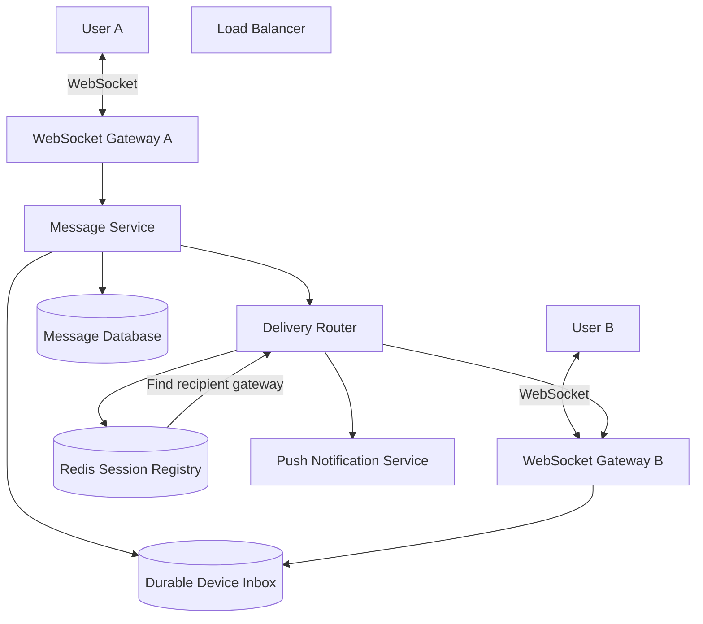
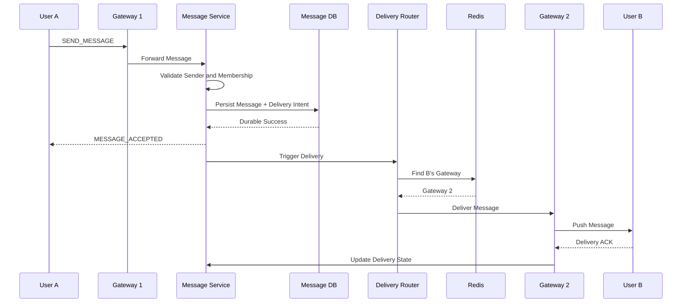
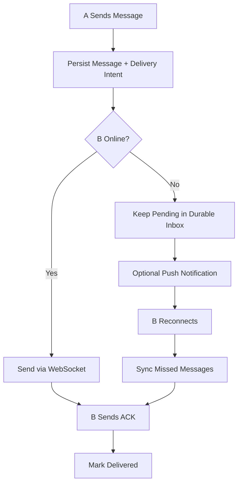
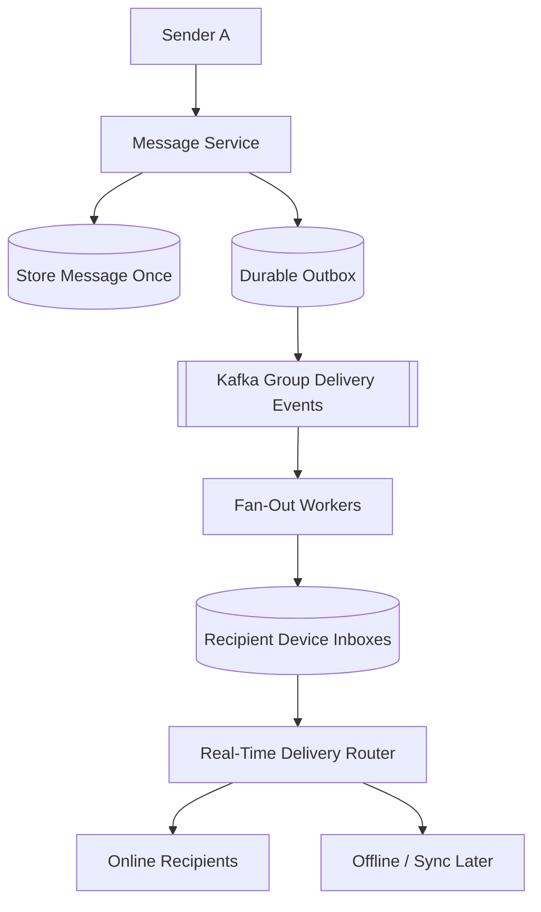
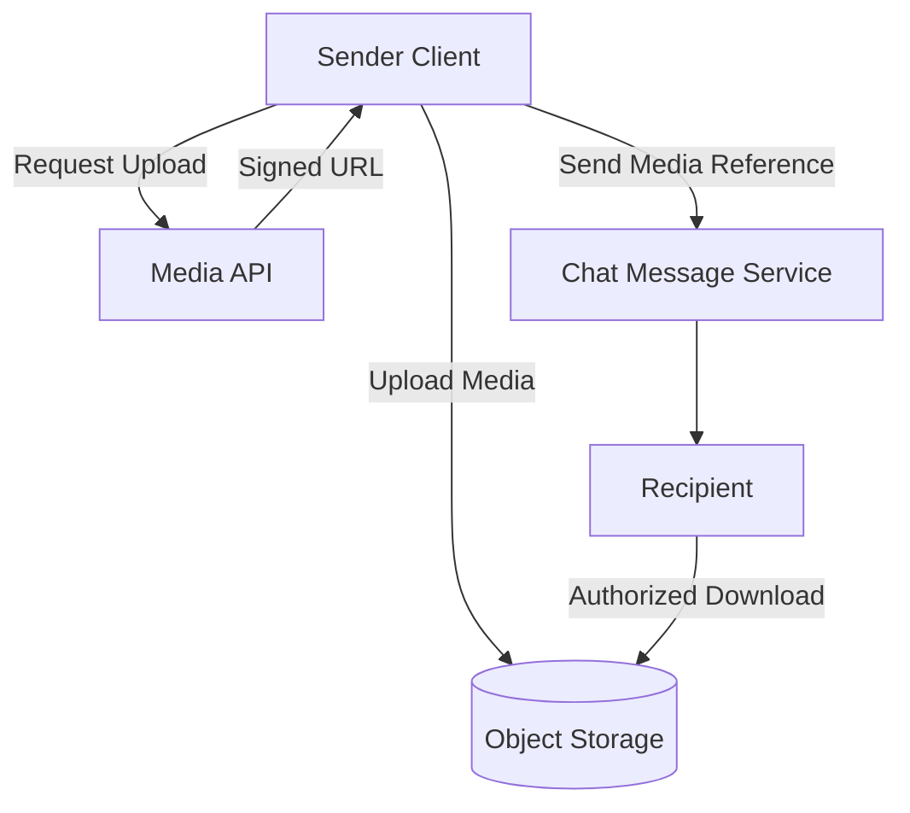
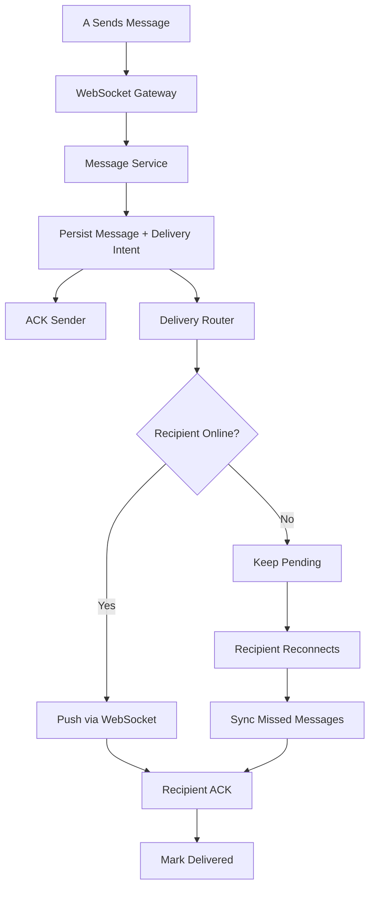

# Design a Chat System (WhatsApp / Messenger)
> **Goal:** Design a scalable, real-time messaging system supporting 1-on-1 chat, group chat, offline delivery, message ordering, and multiple devices.

**Practical Example:** WhatsApp / Facebook Messenger

Imagine:
```text
User A → Sends "Hello" to User B
User B → Receives "Hello" immediately
```
This seems simple, but what if:
- User A and User B connect to different servers?
- User B is offline?
- User A sends the same message twice because of a network timeout?
- User B connects using both an iPhone and a laptop?
- A group contains 100 users?
- A WebSocket or server crashes during delivery?

**The main challenge is not sending messages. It is delivering them reliably, in a consistent order, even when users or servers are unavailable.**

---
# Step 1 — Requirement Gathering

## 1.1 Functional Requirements
| Priority | Requirement |
|---|---|
| Core | Send and receive 1-on-1 text messages |
| Core | Support group chats of up to 100 members |
| Core | Deliver messages when recipients return online |
| Core | Synchronize messages across multiple devices |
| Secondary | Sent, delivered, and read receipts |
| Secondary | Online/offline presence |
| Secondary | Images and file attachments |
| Secondary | Push notifications |
| Out of Scope | Audio/video calls, stories, search |
| Out of Scope | Detailed end-to-end encryption implementation |

### Questions to Ask Interviewer
**Q: Should messages be delivered in real time?**
- Yes, when both users are online.

**Q: What if the recipient is offline?**
- Messages must be stored durably and retrieved after reconnection.

**Q: Do we need message ordering?**
- Yes, messages should have a consistent order within a conversation.

**Q: Should multiple devices receive the same messages?**
- Yes, each device should independently synchronize its history.

**Q: Do we need exactly-once delivery?**
- Aim for at-least-once transport delivery with idempotency and deduplication.

### Four Important Scenarios
```text
1. Both Online
   → Real-time delivery via WebSocket

2. Recipient Offline
   → Store message and deliver after reconnect

3. Group Chat
   → Fan out one message to multiple recipients

4. Multiple Devices
   → Synchronize each device independently
```

---
# Step 2 — Non-Functional Requirements

| Requirement | Goal |
|---|---|
| Low Latency | Online delivery within 500ms under normal conditions |
| High Availability | 99.99% target |
| Durability | Do not acknowledge success before durable acceptance |
| Reliability | At-least-once delivery + deduplication |
| Ordering | Consistent ordering within each chat |
| Scalability | Tens of millions of active users |
| Offline Support | Recover messages missed while disconnected |

## 2.1 Sent vs Delivered vs Read
These three statuses are different.

```text
SENT
→ Server has durably accepted the message.

DELIVERED
→ Recipient device acknowledged receiving the message.

READ
→ Recipient application reported the message as read.
```
### Example
```text
User A sends "Hello"
   ↓
Server saves message
   ↓
Status = SENT
   ↓
User B receives message
   ↓
Status = DELIVERED
   ↓
User B opens the conversation
   ↓
Status = READ
```
**Why separate these states?**
Because saving a message doesn't mean the recipient has received it.

Likewise, receiving a message doesn't mean the user has read it.

## 2.2 Why At-Least-Once Delivery?
Imagine:
```text
1. Server sends message to User B.
2. User B receives the message.
3. User B sends delivery ACK.
4. Network drops the ACK.
5. Server retries the message.
```
User B might receive the same message twice.

**Solution:** Retry delivery using the same `message_id`, and deduplicate messages on the receiving device.

This allows reliable retries without displaying duplicate logical messages.

---
# Step 3 — Estimate Scale

## 3.1 Traffic Estimation
Assumptions:
```text
Daily Active Users = 50M
Messages per user per day = 40
Peak Multiplier = 5x
Average message record = 500 bytes
```
### Messages Per Day
```text
50M × 40
= 2B messages/day
```
### Average Message QPS
```text
2,000,000,000 / 86,400
≈ 23,148 messages/sec
```
### Peak Message QPS
```text
23,148 × 5
≈ 116,000 messages/sec
```
**Important:** This is the incoming logical-message rate.

Group fan-out, multiple devices, delivery acknowledgments, and read receipts generate additional operations.

## 3.2 Storage Estimation
```text
2B messages/day × 500 bytes
≈ 1TB/day

1TB × 365
≈ 365TB/year
```
This excludes:
- Database replication.
- Indexes.
- Device inbox records.
- Images and videos.

## 3.3 WebSocket Connection Estimation
Assume:
```text
50M DAU
10% concurrently connected

50M × 10%
= 5M WebSocket connections
```
Suppose each gateway supports 50K concurrent connections:
```text
5M / 50K
= 100 gateway servers
```
We need additional capacity for server failures, uneven load, and growth.

**Important:** 50K connections/server is an illustrative capacity assumption that must be load-tested.

### What Do These Numbers Tell Us?
We have two different scaling problems:
1. **WebSocket connections:** Millions of persistent connections.
2. **Message processing:** More than 100K incoming messages/sec at peak.

**Design Decision:** Separate WebSocket Gateway servers from the Message Service so they can scale independently.

---
# Step 4 — High-Level Architecture

## 4.1 Why WebSocket Instead of HTTP Polling?

### Option A — Short Polling
```text
Client → Server: Any new message?
Server → Client: No

After 3 seconds:
Client → Server: Any new message?
Server → Client: No
```
**Problem:** Many unnecessary requests.

### Option B — Long Polling
The server keeps an HTTP request open until a message arrives or the request times out.

**Advantage:** Reduces unnecessary polling.

**Disadvantage:** Repeated request setup and timeout management.

### Option C — WebSocket
```text
Client ←→ WebSocket Server
```
Once connected, the client and server can continuously exchange messages over one persistent connection.

**Advantages:**
- Low-latency real-time delivery.
- Bidirectional communication.
- No new HTTP request required for every message.

**Disadvantages:**
- Persistent connection management.
- Heartbeats and reconnection.
- Gateway servers maintain connection state.

**Our Choice:** WebSocket for real-time chat.

REST APIs can still handle login, profiles, chat management, and media uploads.

## 4.2 Complete High-Level Architecture

**Diagram Note:** The Load Balancer accepts new WebSocket connections and assigns them to gateways. It is shown separately because established connections remain attached to their selected gateway.

### Component Responsibilities
| Component | Responsibility |
|---|---|
| Load Balancer | Distribute new WebSocket connections |
| WebSocket Gateway | Maintain active user/device connections |
| Message Service | Validate, authorize, and persist messages |
| Redis | Track which gateway owns each active device session |
| Message Database | Store durable chat history |
| Durable Inbox | Track pending deliveries |
| Delivery Router | Send messages to the correct gateway |
| Push Service | Wake offline mobile devices |
| Sync/Retry Workers | Recover missed or failed deliveries |

### Why Separate Gateway and Message Service?
**Gateway is stateful:**
- Holds active WebSocket connections.
- Maintains session state.

**Message Service is logically stateless:**
- Processes send requests.
- Validates chat membership.
- Persists messages.
- Can scale independently.

**Database is durable:**
- Retains messages when gateways or clients disconnect.

**Key Decision:** Separate connection handling from durable message processing.

---

## 4.3 How Does Server A Find User B?

### Problem
```text
User A → Connected to Gateway 1
User B → Connected to Gateway 2
```
Gateway 1 doesn't own User B's WebSocket connection.

How do we deliver A's message to B?

### Solution — Redis Session Registry
Store the active session location.

```text
Redis:
session:userA:phone → gateway1
session:userB:phone → gateway2
session:userB:laptop → gateway3
```
### Delivery Flow
1. User A sends a message through Gateway 1.
2. Message Service validates and saves it.
3. Delivery Router looks up B's active sessions in Redis.
4. Redis returns Gateway 2 and Gateway 3.
5. Router forwards delivery to the relevant gateways.
6. Gateways push the message to B's devices.

### Why Redis?
- Fast in-memory lookups.
- Shared access across gateways.
- Session TTL helps clean up stale mappings.
- Suitable for frequently changing connection information.

### Important Improvement
Use unique session IDs and expiry/heartbeat tracking.

Example:
```text
userB:phone
gateway = gateway2
session_id = session789
expires_at = ...
```
**Why?** If B reconnects, an old session record must not overwrite or invalidate the new connection.

### Alternative — Consistent Hashing
Assign users to gateways based on `hash(user_id)`.

**Trade-off:**
- Consistent Hashing provides deterministic placement.
- Redis Session Registry tracks actual live connections.

**Our Choice:** Redis Session Registry because users may reconnect to different gateways or connect from multiple devices.

---

## 4.4 Redis Pub/Sub as an Alternative
Instead of querying a session registry, gateways can subscribe to routing channels.

Example:
```text
Gateway 2 subscribes to userB
```
When A sends a message:
```text
Message Service
   ↓
Redis PUBLISH userB
   ↓
Gateway 2
   ↓
User B
```
### Advantage
Simple, low-latency real-time message routing.

### Important Disadvantage
**Redis Pub/Sub is not durable.**

If Gateway 2 disconnects before the publish event arrives, it misses the event.

### Fallback
Store the message and durable delivery intent before publishing.

```text
Persist Message
   ↓
Record Pending Delivery
   ↓
Publish Real-Time Event
   ↓
If Event Is Lost → Recover from Durable Inbox
```
**Key Point:** Redis improves real-time routing, but it must not be the only place responsible for message delivery.

---
# Step 5 — API + Database Design

## 5.1 WebSocket API

### Send Message
```json
{
  "type": "SEND_MESSAGE",
  "chat_id": "chat_123",
  "client_message_id": "uuid_abc",
  "content": "Hello!"
}
```
### Why client_message_id?
It allows the server to recognize a retry of the same logical message.

### Server ACK
```json
{
  "type": "MESSAGE_ACCEPTED",
  "client_message_id": "uuid_abc",
  "message_id": "msg_789",
  "sequence": 42
}
```
Return this only after the message is durably accepted.

### Recipient Delivery ACK
```json
{
  "type": "MESSAGE_ACK",
  "message_id": "msg_789",
  "status": "DELIVERED"
}
```
Other useful WebSocket commands:
```text
READ_RECEIPT
SYNC_MESSAGES
JOIN_CHAT
HEARTBEAT
```

## 5.2 Database Selection
At large scale, DynamoDB or Cassandra are reasonable choices for message storage.

**Why?**
- High write throughput.
- Horizontal scalability.
- Partition-key-based reads.
- Durable message history.

For this design, we'll use a DynamoDB-style database.

For a smaller application, PostgreSQL can also be a good starting point.

## 5.3 Message Table
| Field | Purpose |
|---|---|
| chat_id | Conversation identifier |
| sequence | Order within conversation |
| message_id | Unique server-generated ID |
| client_message_id | Deduplicate sender retries |
| sender_id | Message sender |
| content | Message payload |
| created_at | Server timestamp |

Example:
```text
PK = CHAT#123#2026-10
SK = SEQ#000042
```
### Why Partition by chat_id?
Our main query is:
```text
Get latest 50 messages for chat_123
```
We want messages from the same conversation grouped logically for efficient retrieval.

### Why Month Bucket?
A long-running conversation may accumulate millions of messages.

```text
CHAT#123#2026-09
CHAT#123#2026-10
CHAT#123#2026-11
```
This prevents a single partition from growing indefinitely.

**Trade-off:** Reading older history may require querying multiple time buckets.

**Important:** A very active group may still create a hot logical partition, so partition size and throughput must be monitored separately.

## 5.4 Chat Membership Table
```text
PK = CHAT#123
SK = USER#456

joined_at
role
```
Used to answer:
- Is User 456 allowed to send messages here?
- Which users belong to this group?
- Who is an administrator?

Add an access pattern/index for finding all chats belonging to a user.

## 5.5 Device Inbox Table
```text
PK = DEVICE#iphone_123
SK = MESSAGE#msg_789

status = PENDING
```
### Why Per-Device Inbox?
User B may have:
```text
iPhone
Laptop
Tablet
```
Receiving a message on the iPhone doesn't guarantee that the laptop has received it.

Each device should have independent delivery/synchronization progress.

### Alternative
Use per-chat durable message history with per-device sync cursors instead of storing an individual pending record for every message/device.

**Trade-off:**
- Per-device inbox simplifies explicit delivery tracking.
- Per-device cursors reduce duplicated inbox records but require reliable history synchronization.

**Our Choice:** Durable history + per-device synchronization state, with pending-delivery tracking where needed.

---

## 5.6 Message Ordering

### Problem
User A sends:
```text
Message 1: Hello
Message 2: How are you?
Message 3: Are you there?
```
Because of concurrency and network delays, User B might receive:
```text
Message 2
Message 1
Message 3
```
### Solution — Per-Chat Sequence Number
Assign an authoritative sequence when each message is accepted.

```text
chat_123:

SEQ 41 → Hello
SEQ 42 → How are you?
SEQ 43 → Are you there?
```
Clients display messages in sequence order.

### Why Not Global Sequence?
We don't need a single order across unrelated chats.

```text
Chat A → Sequence 1, 2, 3
Chat B → Sequence 1, 2, 3
```
Each conversation maintains its own logical order.

### How to Generate Sequences?
For a simple design, use a transactional or conditional counter per chat.

The sequence assignment must be coordinated with durable message acceptance so retries and crashes cannot create conflicting records.

### Trade-off
| Approach | Advantage | Disadvantage |
|---|---|---|
| Server Timestamp | Simple | Clock/network ordering uncertainty |
| Per-Chat Sequence | Consistent chat order | Additional coordination |
| Global Sequence | One total order | Unnecessary bottleneck |

**Our Choice:** Per-chat sequence numbers.

Gaps may be acceptable, but duplicate/conflicting sequence assignments are not.

---
# Step 6 — Deep Dive + Failure Handling

## 6.1 Deep Dive A — One-to-One Messaging (Both Online)

### Scenario
```text
User A → Connected to Gateway 1
User B → Connected to Gateway 2
```
### Complete Message Flow

### Why Persist Before Delivering?
Suppose we send to B first and then attempt to save the message.

If the database write fails:
```text
B received message.
Database has no message.
```
The message could disappear from history.

**Better:**
```text
1. Validate message.
2. Durably save message + delivery intent.
3. ACK sender.
4. Attempt real-time delivery.
```
**Key Decision:** Durability before acknowledging successful message acceptance.

---

## 6.2 Deep Dive B — Recipient Offline

### Problem
User A sends a message, but User B's phone is switched off.

### Solution — Store and Forward

### How It Works
1. Store message durably.
2. Record that delivery is pending.
3. Check whether B has an active session.
4. If online, attempt WebSocket delivery.
5. If offline, retain the message.
6. Optionally send a push notification.
7. When B reconnects, synchronize missed messages.
8. Mark delivered when B acknowledges.

### Why Not Depend on FCM/APNs?
Push notifications may be delayed, suppressed, or not delivered.

They also don't prove the chat message was received by the app.

**Important:** Push notification is a wake-up mechanism, not the durable message store.

### Fallback
If WebSocket delivery fails, B can still retrieve missed messages from durable storage.

**Key Principle:** Store and Forward.

---

## 6.3 Deep Dive C — Sender Retries After Timeout

### Problem
```text
1. User A sends message "Hello".
2. Server stores message successfully.
3. Server sends ACK.
4. ACK is lost.
5. User A retries.
```
Without deduplication:
```text
Hello
Hello
```
The server might create two separate messages.

### Solution — Idempotency
Client generates:
```text
client_message_id = uuid_abc
```
First request:
```text
client_message_id = uuid_abc
→ Create msg_789
```
Retry:
```text
client_message_id = uuid_abc
→ Return existing msg_789
```
### Database Requirement
Enforce uniqueness for:
```text
(sender_id, client_message_id)
```
Use a conditional write or equivalent atomic uniqueness mechanism.

### Receiver Deduplication
The recipient also deduplicates using `message_id`.

### Why Both?
- Sender idempotency prevents duplicate stored messages.
- Receiver deduplication prevents repeated transport attempts from appearing twice.

**Trade-off:** Additional identifier/state management, but much safer retries.

---

## 6.4 Deep Dive D — Group Chat Fan-Out

### Problem
A group contains 100 members.

User A sends one message.

We may need to deliver it to 99 other members, possibly across multiple devices.

### Naive Approach
```text
1. Save message.
2. Loop through 99 recipients.
3. Deliver each message synchronously.
4. ACK sender after all deliveries.
```
**Problem:** One offline or slow recipient could delay the sender.

### Solution — Asynchronous Fan-Out

### How It Works
1. Validate group membership.
2. Save one authoritative message in group history.
3. Durably record the fan-out event.
4. ACK sender after durable acceptance.
5. Publish fan-out work to Kafka.
6. Fan-out workers identify eligible recipients.
7. Create pending delivery records as needed.
8. Route to online devices.
9. Offline devices synchronize later.

### Why Kafka?
- Handles asynchronous fan-out.
- Absorbs traffic spikes.
- Supports retries and replay within retention.
- Allows multiple worker instances.
- Can preserve processing order within a chat partition.

### Kafka Partition Key
Use:
```text
partition_key = chat_id
```
Messages belonging to the same chat can be routed to the same Kafka partition.

**Important:** Kafka preserves append order within a partition, but it doesn't automatically guarantee users receive messages in that order after retries and multi-device routing.

### Why Not One Kafka Topic Per User?
Millions of users would create excessive topics and operational overhead.

Instead, use shared topics partitioned by a stable key.

### Kafka Failure Handling
Workers must be idempotent.

If Kafka redelivers an event:
```text
Existing delivery record → Skip duplicate creation
```
### Very Large Group Alternative
For groups much larger than our 100-member requirement, fan-out-on-write may become expensive.

A possible alternative is **fan-out-on-read**:
- Store the group message once.
- Notify users that new content exists.
- Let clients retrieve messages from shared group history.

**Trade-off:** Less write amplification but more read work and potentially slower delivery.

---

## 6.5 Deep Dive E — WebSocket Disconnects

### Problem
User B enters a tunnel.

Their mobile network disconnects, but the server may not immediately detect that the TCP connection is broken.

### Solution — Heartbeats
```text
Server → PING
Client → PONG

Server → PING
Client → PONG

Server → PING
Client → No response

Timeout → Mark session stale
```
Heartbeat intervals depend on mobile battery, network behavior, and infrastructure timeouts.

An illustrative interval is 20–30 seconds.

### Reconnection Flow
1. Client reconnects and authenticates.
2. New gateway registers the active session.
3. Client sends the last applied synchronization cursor.
4. Server returns missed messages.
5. Client deduplicates and applies them.
6. Resume real-time delivery.

### Why Sync After Reconnect?
Because the client may have missed messages while disconnected.

Don't assume that reconnecting means all previous deliveries succeeded.

### Fallback — Backoff with Jitter
If a data center experiences an outage, millions of clients may reconnect simultaneously.

Use:
```text
Retry 1 → 1 second
Retry 2 → 2 seconds
Retry 3 → 4 seconds
Retry 4 → 8 seconds
```
Add random jitter to avoid synchronized retries.

**Why?** Prevents a reconnection storm from overloading recovering gateway servers.

---

## 6.6 Deep Dive F — Multi-Device Synchronization

### Problem
User B has:
```text
iPhone
Laptop
Tablet
```
Their iPhone receives:
```text
SEQ 101
SEQ 102
SEQ 103
```
But the laptop only has messages through sequence 100.

### Solution — Per-Device Sync Cursor
Laptop sends:
```json
{
  "type": "SYNC_MESSAGES",
  "chat_id": "chat_123",
  "after_sequence": 100
}
```
Server returns:
```text
SEQ 101
SEQ 102
SEQ 103
```
Laptop applies them and advances its cursor.

### Why Not One Cursor Per User?
Because devices reconnect independently.

Receiving message 103 on the phone doesn't prove the laptop received messages 101–103.

### Important Rules
- Track each device independently.
- Keep message IDs stable across devices.
- Deduplicate repeated messages.
- Advance the sync cursor only after safe local application.
- Recover missed messages from durable history.

### Device Delivery vs User Delivery
A product may define "Delivered" as received by at least one recipient device or by every registered device.

**This should be clarified with the interviewer.**

Our storage model can track per-device progress regardless of the UI definition.

---

## 6.7 Deep Dive G — Redis or Gateway Failure

### Scenario A: Redis Routing Entry Is Stale
Redis says:
```text
userB → gateway2
```
But B has already reconnected to gateway3.

**Fallback:**
1. Attempt routing.
2. Detect missing/stale session.
3. Refresh session mapping when B reconnects.
4. Recover the message through durable inbox synchronization.

Use session IDs/fencing to prevent stale session updates.

### Scenario B: Redis Pub/Sub Loses an Event
**Fallback:** The message remains in durable storage.

The recipient retrieves it during synchronization.

### Scenario C: Gateway Crashes
**Fallback:**
1. Client detects disconnect.
2. Reconnect to another gateway.
3. Register new session.
4. Fetch missed messages.

### Scenario D: Redis Completely Unavailable
**Fallback:**
- Continue durable message acceptance if storage is healthy.
- Degrade real-time routing.
- Rely on reconnect synchronization and pending deliveries.
- Recover fast routing when Redis becomes available again.

**Why?** Redis is a fast routing layer, not the source of truth for message history.

---

## 6.8 Deep Dive H — Message Database Failure

### Problem
The Message Service receives a message but cannot write it durably.

### Correct Behavior
Do not return `MESSAGE_ACCEPTED`.

Instead:
- Return a retryable error or keep the request pending within a bounded timeout.
- Let the client retry with the same `client_message_id`.
- Recover database availability using replicas and failover.

### Why?
If we acknowledge before storing:
```text
Server says SENT.
Message disappears after crash.
```
This violates our durability requirement.

### Database Replication
Replicate messages across nodes or availability zones according to the durability requirement.

**Trade-off:** Stronger acknowledgment/durability policies can increase write latency.

---

## 6.9 Complete Failure Handling Table

| Failure | Fallback Solution | Why |
|---|---|---|
| Recipient offline | Durable inbox + reconnect sync | Prevent message loss |
| Sender ACK lost | Client idempotency key | Prevent duplicate messages |
| Recipient ACK lost | Retry same message ID | Safe repeated delivery |
| Gateway crashes | Reconnect to healthy gateway | Restore live session |
| Redis mapping stale | Session refresh + sync | Recover routing |
| Redis Pub/Sub event lost | Durable inbox | Recover missed delivery |
| Redis unavailable | Durable storage + delayed sync | Preserve correctness |
| Kafka worker crashes | Replay + idempotent processing | Resume fan-out |
| Partial group fan-out | Retry missing recipient work | Complete delivery |
| DB write fails | Do not ACK; retry | Protect durability |
| Messages arrive out of order | Per-chat sequence + client ordering | Consistent display |
| Multiple devices differ | Per-device cursor | Independent recovery |
| Reconnection storm | Exponential backoff + jitter | Protect infrastructure |
| DB node fails | Replication and failover | Maintain availability |

---
# Step 7 — Trade-offs + Improvements

## 7.1 Redis Pub/Sub vs Kafka vs Database

| Technology | Main Role | Durable? | Main Limitation |
|---|---|---|---|
| Redis Pub/Sub | Fast real-time routing | No | Offline subscriber misses events |
| Kafka | Async processing and group fan-out | Yes, within configured retention | More operational complexity |
| DynamoDB / Cassandra | Persist messages and inbox state | Yes, with suitable configuration | Storage and consistency costs |

### Why Use Multiple Technologies?
Each solves a different problem:
```text
Redis → Where is the recipient connected?
Kafka → How do we process delivery work asynchronously?
Database → Where is the message durably stored?
```
**Important:** We don't necessarily need Kafka for a small 1-on-1 chat MVP.

Introduce Kafka when group fan-out, replay, worker scaling, or failure isolation justify the complexity.

---

## 7.2 Consistent Hashing vs Redis Session Registry
| Decision | Consistent Hashing | Redis Session Registry |
|---|---|---|
| Gateway selection | Based on hash ring | Based on active session |
| Lookup | Deterministic | Redis lookup |
| Adding servers | Ring/membership changes | New session registration |
| Main challenge | Connection migration | Stale entries and Redis availability |

**Our Choice:** Redis Session Registry.

**Why?** It directly represents live connection ownership, including users with multiple devices.

Consistent Hashing can still be useful elsewhere, such as distributing database partitions or assigning backend processing ownership.

---

## 7.3 Strong vs Eventual Consistency
Not every part of chat requires the same consistency level.

| Data | Recommended Behavior |
|---|---|
| Message acceptance | Durable and idempotent |
| Per-chat sequence | Consistently assigned |
| Group membership | Authoritative permission checks |
| Read receipts | Eventual consistency |
| Online presence | Eventual consistency |
| Typing indicators | Best effort |

### Example
User B opens a message, but User A sees the read receipt after two seconds.

That's usually acceptable.

But allowing a removed group member to continue sending messages is not acceptable.

**Key Decision:** Use stronger coordination where correctness is required, and eventual consistency for noncritical presence/read-status data.

---

## 7.4 Media Attachments

### Problem
Users send photos and videos.

Storing large media inside the Message Database increases storage and transfer costs.

### Solution — Object Storage

### Why Object Storage?
- Scales well for large binary objects.
- Supports direct client uploads/downloads.
- Avoids routing large media through chat gateways.

### Security Note
If end-to-end encryption is required, clients encrypt messages and media before upload.

The server should not be assumed to have access to plaintext.

Detailed E2EE key management is outside our current scope.

---

## 7.5 Additional Improvements
| Improvement | Benefit |
|---|---|
| Message Compression | Reduce network bandwidth |
| Media Object Storage | Scale large attachments |
| Redis Session TTL | Remove stale connections |
| Heartbeats | Detect disconnected clients |
| Per-Device Sync Cursors | Recover missed messages |
| Transactional Outbox | Avoid message/event dual-write loss |
| Backoff + Jitter | Prevent reconnect storms |
| Message Retention | Control storage growth |
| Multi-Region Deployment | Reduce regional latency and improve resilience |
| Monitoring | Detect delays and delivery failures |

### Monitoring Metrics
- Active WebSocket connections.
- Message acceptance latency.
- Online delivery p95 latency.
- Pending delivery count.
- Kafka consumer lag.
- Reconnection rate.
- Redis routing errors.
- Message database write failures.
- Duplicate/retry rates.
- Group fan-out delay.

---
# Complete End-to-End Example

Imagine User A sends "Hello" to User B, but B is temporarily offline.

## Phase 1 — Sending
```text
1. A sends message with client_message_id.
2. Gateway forwards message to Message Service.
3. Message Service validates sender and chat membership.
4. Server assigns a chat sequence number.
5. Server saves message + durable delivery intent.
6. Server ACKs A with message_id and sequence.
```

## Phase 2 — Offline Delivery
```text
7. Delivery Router checks B's active sessions.
8. B is offline.
9. Message remains pending in durable storage.
10. Optional push notification is sent.
```

## Phase 3 — Reconnection
```text
11. B reconnects to a WebSocket Gateway.
12. B registers a new session.
13. B sends the last applied sync cursor.
14. Server returns missed messages.
15. B stores and displays "Hello".
16. B sends delivery ACK.
17. Server updates delivery state.
18. A sees "Delivered".
```

## Phase 4 — Duplicate Protection
Suppose the delivery ACK is lost.

```text
Server retries msg_789.
B already has msg_789.
B ignores duplicate display.
B sends ACK again.
```
The logical message appears only once.

### Final End-to-End Flow


---
# Interview Summary

When asked **"Design a Chat System like WhatsApp"**, I would explain:

> First, I would clarify requirements including real-time 1-on-1 messages, group chat, offline delivery, ordering, and multi-device synchronization.
>
> I would use WebSockets because they provide low-latency bidirectional communication over persistent connections.
>
> WebSocket Gateways maintain active client sessions, while Message Services validate and durably persist messages.
>
> To route messages between gateways, I would use a Redis Session Registry that maps user/device sessions to their current gateway.
>
> For reliability, messages and their delivery intent are persisted before acknowledging the sender. If the recipient is offline, messages remain available for later synchronization.
>
> To prevent duplicates caused by retries, I would use client-generated message IDs, server-generated message IDs, and idempotent processing.
>
> For group chats, I would introduce Kafka and asynchronous fan-out workers so one sender doesn't need to wait for every recipient.
>
> For ordering, each conversation would have an authoritative message sequence, and clients would display messages according to that order.
>
> Finally, I would support heartbeats, reconnection with sync cursors, database replication, and durable fallback paths to recover from gateway, Redis, or worker failures.

---
# Quick Revision Table

| Problem | Solution | Why |
|---|---|---|
| Real-time messaging | WebSocket | Low-latency bidirectional connection |
| Millions of connections | WebSocket Gateway Layer | Scale connection handling |
| Users on different gateways | Redis Session Registry | Locate active device sessions |
| Redis event lost | Durable Inbox | Recover missed messages |
| Recipient offline | Store and Forward | Deliver after reconnect |
| Sender retries | Idempotency Key | Prevent duplicate storage |
| Recipient receives duplicate | Message ID Deduplication | Prevent duplicate display |
| Group message fan-out | Kafka + Workers | Async scalable delivery |
| Chat message ordering | Per-Chat Sequence | Consistent conversation order |
| Multiple devices | Per-Device Cursor | Independent synchronization |
| WebSocket disconnect | Heartbeat + Reconnect | Recover active session |
| Gateway crashes | Reconnect to another Gateway | High availability |
| Redis unavailable | Durable Sync Fallback | Preserve messages |
| Message database unavailable | Reject/defer ACK + Retry | Protect durability |
| Large media | Object Storage | Avoid large DB records |
| Read receipts | Eventual Consistency | Lower coordination cost |
| Partial fan-out | Retry + Idempotency | Complete pending deliveries |

## Final Mental Model
```text
REAL-TIME COMMUNICATION
├── WebSocket
├── Gateway Servers
├── Heartbeats
└── Reconnection

MESSAGE STORAGE
├── Message Service
├── Durable Database
├── Chat-Based Partitioning
├── Message Sequence
└── Idempotency

MESSAGE ROUTING
├── Redis Session Registry
├── Delivery Router
├── Real-Time WebSocket Delivery
└── Push Notification Wake-Up

RELIABLE DELIVERY
├── Store and Forward
├── Durable Device Inbox
├── Delivery ACK
├── Retry
└── Deduplication

GROUP CHAT
├── Store Message Once
├── Transactional Outbox
├── Kafka
├── Fan-Out Workers
└── Recipient Delivery Tracking

MULTI-DEVICE SYNC
├── Per-Device Cursor
├── Durable Message History
├── Missed Message Recovery
└── Stable Message IDs

FAILURE HANDLING
├── Gateway Crash → Reconnect
├── Redis Down → Durable Sync
├── Lost ACK → Retry Same ID
├── Worker Crash → Replay
├── Database Failure → No Success ACK
└── Connection Storm → Backoff + Jitter
```

## Most Important Takeaway
A chat system has five major engineering challenges:

**1. Real-Time Communication**
- WebSocket maintains persistent connections.
- Gateways scale independently.

**2. Message Routing**
- Redis tracks where users are connected.
- Delivery Router forwards messages between gateways.

**3. Reliable Delivery**
- Persist messages before acknowledging success.
- Store and forward messages for offline users.
- Retry and deduplicate failed deliveries.

**4. Ordering and Synchronization**
- Per-chat sequence numbers establish conversation order.
- Per-device cursors allow independent recovery.

**5. Group Chat Scaling**
- Kafka and fan-out workers distribute messages asynchronously.
- Durable recipient state prevents permanent delivery loss.

> **Interview Tip:** Prioritize four deep dives: offline message delivery, routing across WebSocket gateways, idempotency, and group chat fan-out. These demonstrate the most important distributed systems concepts in chat application design.