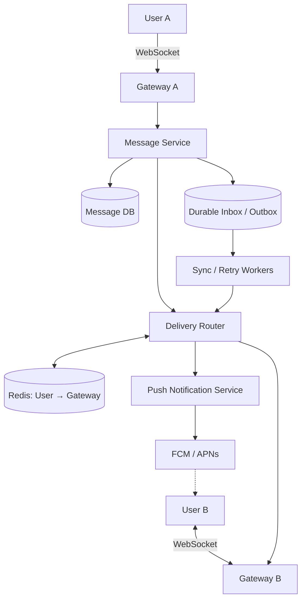

1. Requirement
	1. Functional :
		1. can send 1-1 txt msg
		2. send msg in group chat up to 100 members
		3. can receive msg sent while offline
		4. can access msg across multiple devices
	2. Non Functional
		1. Low latency (<500ms)
		2. High availability 99.99%
		3. Durability(msg)
		4. Delivery reliability (at least once delivery with deduplication)
		5. consistent msg order
		6. scalability
		7. offline support
2. Estimate Scale
	1. Assumption:
		1. 50M DAU -> 40 msg/user/day -> 23k avg msgs/sec
		2. 2B msgs / day 
		3. QPS = 2B/86400 = 23k msg/sec
		4. Peak x5 = 116000 msg /sec
		5. Storage 2B x 500Bytes = 1TB/day 
		6. 1year = 365TB
		7. 50M DAY x10% = 5M simualtenous connected
		8. if a chat server supports 50k websocket connections 
			1. 5M/50000 = 100 servers are needed
			2. Horizontal scale is important
3. High Level Design
	1. Websocket > HTTP polling
		1. Normal HTTP is request response based, not a bidirectional connection
		2. Short Polling :
			1. Client ask server every few seconds
			2. Unnecessary requests
		3. Long Polling :
			1. Server holds request until new data arrives or timeout
			2. Repeated connections and req management
		4. Websocket :
			1. Persistent 2 way connection
			2. Requires connection management
			3. Once connected, client n server change msgs over same connection

2. ![[Pasted image 20261019164600.png]]
	1. Important seperation
		1. Gateway is stateful : need hold connection in memory
		2. Msg Service is stateless : process msg without owning socket
		3. Database is durable : retrains data needed after server failure
	2. How does Server A find User B?
		1. Imagine Server A -> User A, Server B -> User B, server A dont have User B websocker
		2. we can have a redis to do routing mechanism
		3. redis can map gateway to user like user:A → gateway:1, then delivery router query redis for mapped gateway
	3. Alternative : Redis Pub/Sub
		1. this is also routing logic same like 3, but redis Pub/Sub is not durable

3. API + DB Design
	1. Send Message {
		  "type": "SEND_MESSAGE",
		  "chat_id": "chat_123",
		  "client_message_id": "uuid_abc",
		  "content": "Hello!"
		}
	2. Server Acknowledgement{
		  "type": "MESSAGE_ACCEPTED",
		  "client_message_id": "uuid_abc",
		  "message_id": "msg_789",
		  "sequence": 42
		}
	3. Recipient Delivery Acceptance {
		  "type": "MESSAGE_ACK",
		  "message_id": "msg_789",
		  "status": "DELIVERED"
		}
	4. DB Schema
		1. Msg Table ![[Pasted image 20261019165144.png]]
		2. DB sharding can partition by chat ID, bcoz msg in same conversation are grouped logically
			1. 2 Concerns
				1. Large partitions, might need time buckets
				2. Hot partitions, a very active chat can overload one partition, which small group limit, this is managable, but very large group chats would require additional strategies
		3. How to maintain msg ordering?
			1.  we can assign per chat sequence number -> SEQ ->41, 42
			2. can use an atomic counter to generate
			3. ALTENATIVE : order by server received timetstamps, simpler and avoids per chat coordination but provides weaker guarentees
4. Deep Dive
	1. Both online 1-1 msg flow
		1. %22%20viewBox%3D%220%200%20350%20348%22%20width%3D%22100%25%22%20xmlns%3D%22http%3A%2F%2Fwww.w3.org%2F2000%2Fsvg%22%3E%3Ctext%20x%3D%2233%22%20y%3D%2216%22%20font-size%3D%2210%22%20font-weight%3D%22600%22%20fill%3D%22currentColor%22%20text-anchor%3D%22middle%22%3EUser%20A%3C%2Ftext%3E%3Cline%20x1%3D%2233%22%20x2%3D%2233%22%20y1%3D%2225%22%20y2%3D%22338%22%20stroke%3D%22currentColor%22%20stroke-opacity%3D%22.2%22%20stroke-dasharray%3D%224%204%22%2F%3E%3Ctext%20x%3D%22128%22%20y%3D%2216%22%20font-size%3D%2210%22%20font-weight%3D%22600%22%20fill%3D%22currentColor%22%20text-anchor%3D%22middle%22%3EGateway%3C%2Ftext%3E%3Cline%20x1%3D%22128%22%20x2%3D%22128%22%20y1%3D%2225%22%20y2%3D%22338%22%20stroke%3D%22currentColor%22%20stroke-opacity%3D%22.2%22%20stroke-dasharray%3D%224%204%22%2F%3E%3Ctext%20x%3D%22224%22%20y%3D%2216%22%20font-size%3D%2210%22%20font-weight%3D%22600%22%20fill%3D%22currentColor%22%20text-anchor%3D%22middle%22%3EService%3C%2Ftext%3E%3Cline%20x1%3D%22224%22%20x2%3D%22224%22%20y1%3D%2225%22%20y2%3D%22338%22%20stroke%3D%22currentColor%22%20stroke-opacity%3D%22.2%22%20stroke-dasharray%3D%224%204%22%2F%3E%3Ctext%20x%3D%22318%22%20y%3D%2216%22%20font-size%3D%2210%22%20font-weight%3D%22600%22%20fill%3D%22currentColor%22%20text-anchor%3D%22middle%22%3EUser%20B%3C%2Ftext%3E%3Cline%20x1%3D%22318%22%20x2%3D%22318%22%20y1%3D%2225%22%20y2%3D%22338%22%20stroke%3D%22currentColor%22%20stroke-opacity%3D%22.2%22%20stroke-dasharray%3D%224%204%22%2F%3E%3Cline%20x1%3D%2233%22%20x2%3D%22128%22%20y1%3D%2253%22%20y2%3D%2253%22%20stroke%3D%22%2364748b%22%20stroke-width%3D%221.7%22%2F%3E%3Cpath%20d%3D%22M122%2049%20L128%2053%20L122%2057%22%20stroke%3D%22%2364748b%22%20stroke-width%3D%221.7%22%20fill%3D%22none%22%2F%3E%3Ctext%20x%3D%2280.5%22%20y%3D%2245%22%20text-anchor%3D%22middle%22%20font-size%3D%2210%22%20fill%3D%22currentColor%22%3E1.%20SEND%3C%2Ftext%3E%3Cline%20x1%3D%22128%22%20x2%3D%22224%22%20y1%3D%2298%22%20y2%3D%2298%22%20stroke%3D%22%230d9488%22%20stroke-width%3D%221.7%22%2F%3E%3Cpath%20d%3D%22M218%2094%20L224%2098%20L218%20102%22%20stroke%3D%22%230d9488%22%20stroke-width%3D%221.7%22%20fill%3D%22none%22%2F%3E%3Ctext%20x%3D%22176%22%20y%3D%2290%22%20text-anchor%3D%22middle%22%20font-size%3D%2210%22%20fill%3D%22currentColor%22%3E2.%20Persist%3C%2Ftext%3E%3Cline%20x1%3D%22224%22%20x2%3D%22128%22%20y1%3D%22143%22%20y2%3D%22143%22%20stroke%3D%22%2364748b%22%20stroke-width%3D%221.7%22%2F%3E%3Cpath%20d%3D%22M134%20139%20L128%20143%20L134%20147%22%20stroke%3D%22%2364748b%22%20stroke-width%3D%221.7%22%20fill%3D%22none%22%2F%3E%3Ctext%20x%3D%22176%22%20y%3D%22135%22%20text-anchor%3D%22middle%22%20font-size%3D%2210%22%20fill%3D%22currentColor%22%3E3.%20ACK%3C%2Ftext%3E%3Cline%20x1%3D%22128%22%20x2%3D%2233%22%20y1%3D%22185%22%20y2%3D%22185%22%20stroke%3D%22%2364748b%22%20stroke-width%3D%221.7%22%2F%3E%3Cpath%20d%3D%22M39%20181%20L33%20185%20L39%20189%22%20stroke%3D%22%2364748b%22%20stroke-width%3D%221.7%22%20fill%3D%22none%22%2F%3E%3Ctext%20x%3D%2280.5%22%20y%3D%22177%22%20text-anchor%3D%22middle%22%20font-size%3D%2210%22%20fill%3D%22currentColor%22%3E4.%20Sent%20%E2%9C%93%3C%2Ftext%3E%3Cline%20x1%3D%22224%22%20x2%3D%22318%22%20y1%3D%22230%22%20y2%3D%22230%22%20stroke%3D%22%2364748b%22%20stroke-width%3D%221.7%22%2F%3E%3Cpath%20d%3D%22M312%20226%20L318%20230%20L312%20234%22%20stroke%3D%22%2364748b%22%20stroke-width%3D%221.7%22%20fill%3D%22none%22%2F%3E%3Ctext%20x%3D%22271%22%20y%3D%22222%22%20text-anchor%3D%22middle%22%20font-size%3D%2210%22%20fill%3D%22currentColor%22%3E5.%20Deliver%3C%2Ftext%3E%3Cline%20x1%3D%22318%22%20x2%3D%22224%22%20y1%3D%22275%22%20y2%3D%22275%22%20stroke%3D%22%2364748b%22%20stroke-width%3D%221.7%22%2F%3E%3Cpath%20d%3D%22M230%20271%20L224%20275%20L230%20279%22%20stroke%3D%22%2364748b%22%20stroke-width%3D%221.7%22%20fill%3D%22none%22%2F%3E%3Ctext%20x%3D%22271%22%20y%3D%22267%22%20text-anchor%3D%22middle%22%20font-size%3D%2210%22%20fill%3D%22currentColor%22%3E6.%20Device%20ACK%3C%2Ftext%3E%3Cline%20x1%3D%22128%22%20x2%3D%2233%22%20y1%3D%22319%22%20y2%3D%22319%22%20stroke%3D%22%2364748b%22%20stroke-width%3D%221.7%22%2F%3E%3Cpath%20d%3D%22M39%20315%20L33%20319%20L39%20323%22%20stroke%3D%22%2364748b%22%20stroke-width%3D%221.7%22%20fill%3D%22none%22%2F%3E%3Ctext%20x%3D%2280.5%22%20y%3D%22311%22%20text-anchor%3D%22middle%22%20font-size%3D%2210%22%20fill%3D%22currentColor%22%3E7.%20Delivered%20%E2%9C%93%E2%9C%93%3C%2Ftext%3E%3Crect%20x%3D%22185%22%20y%3D%22106%22%20width%3D%2278%22%20height%3D%2220%22%20rx%3D%225%22%20fill%3D%22%230d9488%22%20fill-opacity%3D%22.12%22%2F%3E%3Ctext%20x%3D%22224%22%20y%3D%22120%22%20font-size%3D%229%22%20text-anchor%3D%22middle%22%20fill%3D%22%230d9488%22%3EDB%20committed%3C%2Ftext%3E%3Ctext%20x%3D%22275%22%20y%3D%22168%22%20text-anchor%3D%22middle%22%20font-size%3D%229%22%20fill%3D%22currentColor%22%20opacity%3D%22.7%22%3ERouting%20lookup%3C%2Ftext%3E%3C%2Fsvg%3E)
		2.  Sequence
			1. A sends a message over WebSocket.
			2. Gateway forwards the request to Message Service.
			3. Message Service validates and durably stores the message.
			4. Server acknowledges acceptance to A.
			5. Delivery Router finds B's gateway and pushes the message.
			6. B acknowledges receipt.
			7. Delivery state updates and A sees `Delivered`.
	2. What if user B is offline?
		1. Store and Forward
		2. Keep message pending in durable inbox(like queue), send push notification, when B reconnects, we only sync missed msg
	3. What if sender retries after  a timeout?
		1. when timeout, and A assume request failed and do retries
		2. we may create 2 copies of same msg
		3. Solution : Idempotency Key
			1. can carry same client_msg_id
			2. enforces uniqueness for sender and this id
	4. Group chat?
		1. Fan out
			1. Naive implementation would scynhrnousely loop through 99 recipients before return success
			2. work at small scale but increases latency and creates failure handling complexity
			3. More scalable Solution:
				1. Kafka
				2. it is useful for distributing group delivery work asynchronously
				3. use Kafka to send msg queue and workers consume it to send request asynchonously
				4. kafka partition by chat_id
	5. What if websocket disconnects unexpectedly?
		1. can use heartbeat PING PONG every 20-30 seconds
		2. when clinet reconnects, we only auth and establish a new websocket, register new gateway session, and else
	6. How does multi device sync work?
	7. What if redis or gateway crash?
		1. |Failure|Recovery|
|---|---|
|Redis routing entry stale|Reconnect, refresh session, retry or sync|
|Redis Pub/Sub loses event|Read durable inbox during synchronization|
|Gateway crashes|Client reconnects to another gateway|
|Client never sends ACK|Retry using the same message ID|
|Worker crashes mid-fan-out|Replay event and use idempotent writes|
|Database node fails|Replication and failover|
|Massive reconnection surge|Backoff, jitter, and admission control|
		
	8.Trade Offs + Improvements

![[Pasted image 20261019172937.png]]
![[Pasted image 20261019172952.png]]
![[Pasted image 20261019173001.png]]
		

