# System Design Cheat Set — Interview-Ready Edition (v2)

> [!abstract] The goal
> Understand **what each building block does, why it belongs in a design, how it works, and what remains safe when it fails**. Learn decisions—not a shopping list of technologies.

## How to study this note

- **Quick revision:** read each component's mental model, trade-off table, and failure table.
- **Deep study:** answer the six 5W1H questions aloud, trace the case-study diagram, then explain the fallback without looking.
- **Interview practice:** start with requirements and a correctness rule. Add a component only when it solves an identified problem.
- **Revisit a studied system:** use the topic map below, then the [[#Ten system recipes]] near the end.

**5W1H means:** **What, Why, Who, Where, When, How**.

**Scope:** 10 original system recipes (with Visa debit-card as a focused payment case), 30 original component cards, plus **10 new interview-pattern cards and 8 new practice recipes** added in this edition. Supporting topics such as DNS, load balancing, service discovery, resilience, and observability fill gaps between the designs.

**All case studies and capacity numbers are illustrative.** They explain design choices; they are not claims about the actual internals of WhatsApp, Dropbox, Visa, or other companies. A logical component does not automatically need its own microservice.

> [!important] ❗ The most useful question
> **What is the source of truth, and what must never happen?**
>
> Examples: never sell one seat twice; never count a payment retry as a new charge; never acknowledge a chat message before its required durable write; never silently overwrite a conflicting file version.

## Interview quick start — revise this before every mock

> [!success] Your 60-second mission
> **1. Clarify the workload → 2. State the invariant → 3. Design the smallest correct solution → 4. Scale the measured bottleneck → 5. Explain failure recovery.**
>
> Don't begin with Kafka, Redis, or microservices. Begin with a user's action, the required response, and the data that must be correct.

**If you have only five minutes:** review [[#Seven-step interview playbook — 45 minutes]], [[#Decision matrix — choose a tool only for a reason]], [[#Critical-path and failure checklist]], and [[#Mock interview scoring rubric]].

**If you have 20 minutes:** follow the above, then revisit one weak component card and rehearse a system recipe *without looking*.

**If you have one hour:** do a 45-minute mock and spend 15 minutes diagnosing mistakes; don't spend the whole hour reading.

### Five phrases that demonstrate engineering judgment

- “Before choosing the database, I want to clarify the **access patterns and correctness guarantees**.”
- “The **source of truth** for this decision is ..., so a cache or replica cannot silently override it.”
- “I will keep ... **synchronous**, because the client cannot receive a correct response without it. ... can run asynchronously.”
- “The first bottleneck is likely ..., because ... . I would **measure** before adding shards.”
- “If that dependency times out, the result is **UNKNOWN**, not automatically failed; here's how we reconcile it.”

---

## Topic map — everything you have studied

| Studied topic                   | Your source notes                                                                                                                                            | Main cards to revisit                                                                                |
| ------------------------------- | ------------------------------------------------------------------------------------------------------------------------------------------------------------ | ---------------------------------------------------------------------------------------------------- |
| Chat System                     | [[System Design Practice/Chat System/Manual Note.md\|Manual]] · [[System Design Practice/Chat System/AI Note.md\|Expanded]]                                 | 10, 14–18: conversation partitions, durable delivery, deduplication, WebSockets, device cursors     |
| File Storage — Drive / Dropbox | [[System Design Practice/File Storage(Drive,Dropbox)/Manual Note.md\|Manual]] · [[System Design Practice/File Storage(Drive,Dropbox)/AI Note.md\|Expanded]] | 01, 03, 16, 19–21: private bytes, direct transfer, resumability, version conflicts, synchronization |
| Key-Value Store                 | [[System Design Practice/Key Store Value System/Manual Notes.md\|Manual]] · [[System Design Practice/Key Store Value System/AI Notes.md\|Expanded]]         | 08–11: WAL, LSM, Bloom filters, sharding, quorums, conflict detection, repair                       |
| News Feed                       | [[System Design Practice/News Feed/Manual Note.md\|Manual]]                                                                                                  | 06, 10, 14–16, 22: fan-out, hot keys, timeline IDs, cursor pagination, deletion filtering           |
| Notification System             | [[System Design Practice/Notification System/Manual Note.md\|Manual]] · [[System Design Practice/Notification System/AI Note.md\|Expanded]]                 | 04, 14–17, 23: channel queues, preferences, retries, delivery status, provider outages              |
| Payment System                  | [[System Design Practice/Payment System/Manual Note.md\|Manual]] · [[System Design Practice/Payment System/AI Note.md\|Expanded]]                           | 03, 07, 16–17, 26–29: tokenization, idempotency, UNKNOWN states, ledger, capture, payout           |
| Visa Debit-Card Case            | [[System Design Practice/Payment System/Visa Card Case.md\|Visa case]]                                                                                       | 07, 09, 17, 26–29: synchronous authorization, atomic holds, reversals, HSM, controlled stand-in     |
| Rate Limiter                    | [[System Design Practice/Rate Limiter/Manual Note.md\|Manual]] · [[System Design Practice/Rate Limiter/AI Note.md\|Expanded]]                               | 04, 06, 10, 29: token bucket, atomic Redis operations, local fallback, hot keys                      |
| Ticket Purchasing               | [[System Design Practice/Ticket Purchasing System/Manual Note.md\|Manual]] · [[System Design Practice/Ticket Purchasing System/AI Note.md\|Expanded]]       | 04, 07, 11, 13, 18, 25–26: waiting room, authoritative holds, seat contention, late payments        |
| Unique ID Generator             | [[System Design Practice/Unique ID Generator/Manual Notes.md\|Manual]] · [[System Design Practice/Unique ID Generator/AI Notes.md\|Expanded]]               | 11–12: worker ownership, Snowflake, clock rollback, sequence exhaustion, UUID alternatives          |
| URL Shortener                   | [[System Design Practice/URL Shortener (Bitly)/Manual Note.md\|Manual]] · [[System Design Practice/URL Shortener (Bitly)/AI Note.md\|Expanded]]             | 01, 06, 12, 14, 24: Base62, uniqueness, redirects, caching, asynchronous analytics                   |

The News Feed expanded note was empty when reviewed; its manual note supplies that topic's coverage.

## Seven-step interview playbook — 45 minutes

Use this **every** time, including unfamiliar problems. The minute splits are a guide, not a rigid script; adapt to the interviewer.

| Step                                  |       Time | What to say/do                                                                                                                        | Output                                                |
| ------------------------------------- | ---------: | ------------------------------------------------------------------------------------------------------------------------------------- | ----------------------------------------------------- |
| 1. Clarify requirements and invariant |   0–5 min | Ask who uses it, top 2–3 user actions, exclusions, and *what must never happen*.                                                   | Functional requirements, exclusions, correctness rule |
| 2. Establish NFRs and scale           |  5–10 min | Ask about DAU, peak RPS, data size, read/write ratio, latency, availability, retention, and acceptable loss/staleness.                | 2–3 meaningful estimates and dominant bottleneck     |
| 3. Design APIs and data               | 10–15 min | Propose core endpoints/events, ownership, primary keys, indexes, and a state machine where needed.                                    | Concrete contracts and authoritative entities         |
| 4. Draw the simplest architecture     | 15–25 min | Trace one write and one read. Distinguish sync vs async, authority vs derived views, and each dependency.                             | End-to-end diagram and happy-path walkthrough         |
| 5. Deep-dive the hardest path         | 25–35 min | Analyze concurrency, ordering, timeouts, retries, idempotency, and durability at commit/ACK boundaries.                               | Detailed critical-path design                         |
| 6. Handle scale and failures          | 35–42 min | Identify bottleneck, add one justified scaling mechanism, simulate a dependency crash or network partition, state degradation policy. | Trade-off and failure story                           |
| 7. Conclude                           | 42–45 min | Summarize guarantees, bottlenecks, unresolved assumptions, and what monitoring validates your choice.                                 | Defensible architecture, not buzzwords                |

### Step 1 — requirements: questions worth asking

- **User journey:** Who initiates the action? What should the client see when it succeeds, fails, or remains pending?
- **Must-have scope:** Which 2–3 features should we design now? What is explicitly out of scope?
- **Correctness:** Must data be strongly consistent? Do we need per-user/per-entity ordering? Could duplicate work be harmful?
- **External boundaries:** Are there payment networks, delivery providers, maps, or regulatory systems? Who owns the authoritative outcome?
- **Failure policy:** Can an operation wait, return PENDING, serve stale data, or must it reject?

**Example — ride hailing:** request ride, match driver, update ride state. Do not build payments, pricing optimization, chat, and full dispatch ML until the interviewer asks.

### Step 2 — estimates: compute *only* numbers that change decisions

```text
average_rps = daily_requests / 86_400
peak_rps ≈ average_rps × stated_peak_factor  # assumption; not a benchmark
retained_raw_bytes = writes_per_day × bytes_per_write × retention_days
concurrent_in_flight ≈ arrival_rate_per_second × time_in_system_seconds
minimum_instances = ceil(peak_rps / benchmarked_safe_rps_per_instance)
```

**Always separate** logical data size from physical storage (replicas, indexes, WAL, versions, backups); average requests from peak; API RPS from downstream fan-out; and socket count from message throughput. Quote assumed numbers as assumptions.

### Step 3 — API contract and database model: a concrete example

For a ticket hold, favor business-language endpoints over exposing database internals:

```http
POST /v1/events/{eventId}/holds
Authorization: Bearer <token>
Idempotency-Key: <stable-client-operation-id>
Content-Type: application/json

{"seatIds": ["A12", "A13"]}
```

```http
201 Created
{"holdId":"h_123","status":"HELD","expiresAt":"..."}
```

- **Entities:** `event_seats(event_id, seat_id, status, hold_id, hold_expires_at, version)` with `PRIMARY KEY(event_id, seat_id)`; `holds(hold_id, user_id, event_id, state, expires_at)`; `operations(actor_id, idempotency_key, request_hash, result, status)` with a unique constraint on the scope of that operation key.
- **Access paths:** fetch seats by event, claim an explicit seat set atomically, retrieve a hold by ID/owner, find expired holds in bounded batches. Add indexes based on these queries, not “indexes everywhere.”
- **Concurrency:** claim all selected seats in a short transaction using guarded writes/appropriate row locking; check exactly the expected number of rows, and write the hold + operation record before acknowledging. Expiry needs a race-safe authoritative transition. Never hold a DB lock for the user's entire checkout window.
- **Versioning:** an optimistic `version` predicate or a locked row can prevent stale updates; don't confuse this with an external PSP's completion.
- **Status contract:** use explicit `HELD`, `SOLD`, `EXPIRED`, `CANCELLED` semantics. If payment outcome is uncertain, prevent automatic resale until the business rules safely resolve the original operation.

> [!warning] ⚠️ Avoid a common mistake
> **An ID is not an idempotency key.** An order ID identifies a resource; an operation key identifies a *logical attempt* for a scoped caller and stable payload. Store the original response/decision when appropriate. Reusing a key for a different payload should be rejected.

### Step 4 — basic architecture and ownership diagram

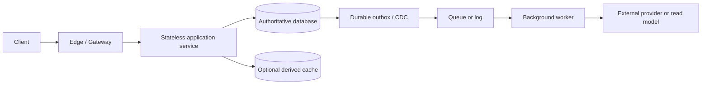

**Narrate each arrow**: What request or event is this? Which writes must commit before ACK? Which calls have timeouts? What retries are safe? What is the fallback? Add a component only for a concrete requirement. Some designs need neither a cache nor a queue.

### Step 5 — critical path and latency budget

Ask: **what must complete for the result to be truthful?** Example: a hypothetical issuer authorization contract with a **6-second total deadline**.

```text
network + security checks + bounded risk checks
    + authoritative funds reservation + durable decision
    + response serialization/network <= 6 seconds

Not on the mandatory response path by default:
    analytics, email, reporting, long-running reconciliation,
    optional dashboards, noncritical fan-out
```

Reserve time for network jitter and failures; assign *measured* per-dependency budgets and propagate a deadline. Don't let a downstream timeout consume the entire overall deadline. If a required balance/risk dependency is unavailable, return the contract's safe response; do not “speed up” an authoritative decision by moving it onto Kafka and waiting for a webhook. The actual response semantics depend on the issuer/network contract.

### Step 6 — bottleneck and failure interrogation

Ask **which operation is actually hot** (reads, writes, connection count, provider quota, lock contention, a single key, or per-request fan-out). Then test:

1. Instance crashes *after a durable write but before response*: can the client retry safely?
2. Database primary dies *during commit*: how do we discover the true result?
3. Cache/queue/provider is unavailable: what continues, what pauses, and what can be lost?
4. Two requests race: which enforced constraint prevents a double-spend/oversell/conflicting version?
5. Traffic rises 10×: which resource saturates first and how does the proposed change relieve *that* limit?
6. A region partitions: who may still write, and what does a stale reader see?

### Step 7 — finish with a 30-second recap

> “The authoritative record is **X** and the non-negotiable invariant is **Y**. We synchronously do **A → B** before acknowledging, and publish **C** after commit. The likely scale limit is **Z**, handled with **...**. If **dependency D** fails, we **degrade/reject/reconcile** without violating Y. I'd monitor **SLI 1**, **SLI 2**, and **business invariant 3**.”

---

## Decision matrix — choose a tool only for a reason

| Need                                           | First plausible choice                     | Why / when                                    | Don't claim                                                |
| ---------------------------------------------- | ------------------------------------------ | --------------------------------------------- | ---------------------------------------------------------- |
| Unique records, multi-row rules, money/seats   | Relational DB + constraints + transactions | Correctness and query flexibility             | “SQL is always strongly consistent regardless of config” |
| Key lookup at enormous scale                   | Managed/distributed KV store               | Access pattern matches a stable partition key | “NoSQL means automatic infinite scale”                   |
| Reduce repeated hot reads                      | Cache-aside Redis/local cache              | Derived data and acceptable staleness         | “Cache is source of truth”                               |
| Slow, independent work after an accepted write | Outbox + queue/workers                     | Durable async consequences                    | “Kafka makes external effects exactly once”              |
| Popular immutable media delivery               | Object storage + CDN                       | Direct bytes and edge distribution            | “Any signed URL is irrevocable”                          |
| Full-text query and ranking                    | Search engine or SQL full-text first       | Search is a read-optimized projection         | “Index freshness means booking authority”                |
| Horizontal API scale                           | Stateless service + load balancer          | Handler capacity is the bottleneck            | “More app nodes fix DB contention”                       |
| More write capacity than one data owner        | Shard using dominant access key            | Measured DB size/throughput limit             | “Sharding is free or always necessary”                   |
| Recover after one instance/zone fails          | Replication + leader/failover rules        | Explicit durability/availability contract     | “Replication replaces backup”                            |
| Multi-step, cross-service business operation   | Saga/process manager                       | No shared ACID transaction                    | “Compensation undoes an external effect instantly”       |
| High concurrency on one critical record        | Atomic conditional update or row lock      | Enforces invariant at source of truth         | “Distributed Redis lock alone prevents races”            |

### Protocol and communication choice

| Mechanism          | Best fit                                                  | Important limitation                                                  |
| ------------------ | --------------------------------------------------------- | --------------------------------------------------------------------- |
| HTTP REST          | Public CRUD/resource APIs, easy compatibility             | Not intrinsically event-driven; retry semantics belong to application |
| gRPC               | Typed internal RPC, streaming, efficient binary protocols | Tight internal contracts, deadline propagation, tooling complexity    |
| WebSocket          | Bidirectional, long-lived chat/live interactions          | Reconnection + cursor recovery still needed                           |
| Server-Sent Events | Server-to-client live updates over HTTP                   | One-way; clients need separate write API and resume policy            |
| Short/long polling | Simple status/updates or compatibility fallback           | Polling load; long polling still requires retry/continuation          |
| Queue / broker     | Decoupled durable tasks/events                            | Async outcome, redelivery, ordering scope, backlog management         |

**Rule:** choose synchronous RPC when the caller needs the result *now* and the dependency can meet the latency/availability contract. Choose async when the client can accept a durable job/PENDING status and eventual completion. “Kafka is fast” is not a sufficient reason.

---

## Critical-path and failure checklist

| Question                              | Correctness-first response                                                              |
| ------------------------------------- | --------------------------------------------------------------------------------------- |
| What is the source of truth?          | Name the DB/service/protocol, **not** merely “Redis.”                           |
| When can API return success?          | Only after the contract's required durable/authoritative effects.                       |
| What happens after timeout?           | Distinguish **FAILED** from **UNKNOWN**; verify by the stable operation ID. |
| Can work be delivered twice?          | Usually yes; enforce idempotency at the *side-effect owner*.                          |
| Does ordering matter?                 | Name the key/scope, e.g. `chat_id`, not “Kafka guarantees ordering everywhere.”     |
| Could stale data cause harm?          | Use authoritative reads for money, ownership, security and inventory.                   |
| Can two workers process the same job? | Assume yes; conditional claim, lease/fence if needed, unique side-effect identity.      |
| How is a stuck process recovered?     | Durable state machine, timeout policy, reconciliation and metrics.                      |
| How is a bad deploy rolled back?      | Expand/migrate/contract, compatibility, feature flags, rollback plan.                   |

**Failure is part of the design**, not a final footnote. For every external call, specify a timeout, retry policy, idempotency scope, and reconciliation story.

---

## Mock interview scoring rubric

Score each category from **0 (missing) to 4 (strong)**, then use the weights to compute a 100-point score. These are practice criteria, not an official company rubric.

| Category                      | Weight | A strong answer does this                                   |
| ----------------------------- | -----: | ----------------------------------------------------------- |
| Requirements and invariants   |     20 | Focuses the scope and states one testable correctness rule  |
| API/data model                |     15 | Defines useful contracts, indexes, owner, state transitions |
| Architecture/read-write paths |     20 | Draws and explains a cohesive end-to-end flow               |
| Deep dive and concurrency     |     20 | Handles races, ACK, ordering, idempotency, external calls   |
| Scaling and NFRs              |     15 | Sizes intelligently and fixes a real bottleneck             |
| Failures and communication    |     10 | Explains safe fallback, monitoring, and trade-offs clearly  |

```text
score = Σ(category_rating / 4 × category_weight)
>= 80: good practice readiness across that scenario
60–79: workable architecture; target weak categories
< 60: rehearse the 7-step structure before adding more patterns
```

**Mock rule:** draw a system in 45 minutes without notes. Re-open the cheat set only afterward. Treat the score as feedback, not a prediction of hiring outcome.

---

## Component index

### Traffic and application entry

- [[#01 DNS and CDN edge]]
- [[#02 Load balancer]]
- [[#03 API gateway and identity boundary]]
- [[#04 Rate limiter and admission control]]
- [[#05 Application service and service discovery]]

### Data, correctness, and scale

- [[#06 Cache]]
- [[#07 Relational database and transactions]]
- [[#08 Key-value store and LSM storage engine]]
- [[#09 Replication consistency and failover]]
- [[#10 Sharding and partition routing]]
- [[#11 Coordination locks leases and fencing]]
- [[#12 Unique ID generator]]
- [[#13 Search index]]

### Asynchronous work and communication

- [[#14 Durable message broker]]
- [[#15 Workers scheduling retries and DLQ]]
- [[#16 Transactional outbox CDC and durable inbox]]
- [[#17 Idempotency and state machines]]
- [[#18 Real-time gateway WebSocket and SSE]]

### Product-specific building blocks

- [[#19 Object storage and signed access]]
- [[#20 Multipart upload and delta transfer]]
- [[#21 Metadata versioning and synchronization]]
- [[#22 Feed builder fan-out and pagination]]
- [[#23 Notification delivery pipeline]]
- [[#24 Short-link creation and redirect service]]
- [[#25 Seat inventory and reservation service]]
- [[#26 Payment orchestrator and provider adapter]]
- [[#27 Ledger and balance service]]
- [[#28 Capture settlement payout and reconciliation]]

### Operational safety

- [[#29 Resilience boundary]]
- [[#30 Observability backup and disaster recovery]]

### Interview toolkit and new patterns

- [[#Interview quick start — revise this before every mock]]
- [[#Seven-step interview playbook — 45 minutes]]
- [[#Decision matrix — choose a tool only for a reason]]
- [[#Critical-path and failure checklist]]
- [[#Mock interview scoring rubric]]
- [[#Additional interview pattern cards — 31–40]]
- [[#Eight additional system recipes — broaden your interview patterns]]
- [[#Worked case — six-second debit authorization under pressure]]
- [[#Two-week practice plan — turn knowledge into performance]]

### Revision tools

- [[#Ten system recipes]]
- [[#Capacity estimation cheat sheet]]
- [[#Common traps and corrections]]
- [[#Failure-policy quick reference]]
- [[#Active-recall exercises]]
- [[#Glossary]]
- [[#Additional active-recall exercises — new gaps]]

---

## 01 DNS and CDN edge

> **Mental model:** DNS tells the client **where to connect**. A CDN serves reusable content **near the client**.

**Used in:** file downloads, news-feed media, ticket-event pages, and carefully chosen short-link redirects.

### 5W1H

- **What — what are these components?** DNS resolves a name such as `files.example.com` to a destination. A content delivery network is a geographically distributed proxy/cache between users and an origin.
- **Why — why not send everything to the origin?** Distance adds network delay, and repeatedly serving identical bytes wastes origin bandwidth. Edge caching reduces repeat traffic, but cannot make an inherently slow first-origin request disappear.
- **Who — who uses and controls them?** Clients and recursive DNS resolvers use DNS; the platform team manages records and routing. Application owners decide which responses may be cached, for whom, and for how long.
- **Where — where do they sit?** DNS discovery happens before a connection is established, often using cached answers. The CDN then sits on the HTTP delivery path, ahead of object storage or an application origin.
- **When — when do they help?** Use a CDN for popular images, static assets, public downloads, or authorized private content with correct edge-access controls. Do not publicly cache personalized responses simply because their URL looks stable.
- **How — how does a request work?** The edge computes a cache key and checks a stored response. On a miss, it fetches the origin, applies cache policy, and returns the result. A TTL limits freshness; versioned object names avoid many invalidation races.

### Case study — a popular photo in the news feed

1. A post references immutable object `photos/p123/v1.jpg`.
2. The first nearby reader causes an origin fetch.
3. Later readers use that edge's cached image rather than repeat the origin transfer.
4. The feed JSON and permissions still come from authorized application APIs.
5. If the image changes, publish `v2.jpg` instead of silently replacing a permanently cached `v1.jpg`.

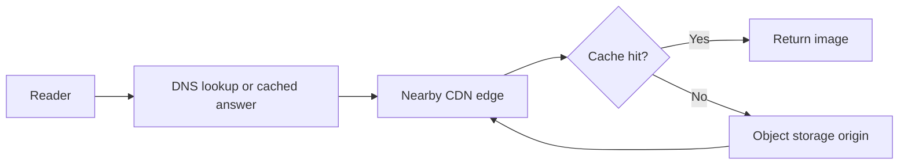

### Trade-offs

| Choice                      | Gain                                    | Cost / limitation                                                  |
| --------------------------- | --------------------------------------- | ------------------------------------------------------------------ |
| Longer TTL                  | More cache hits and less origin traffic | Changes and revocations take longer to propagate                   |
| Versioned immutable objects | Simple, predictable cache behavior      | Old versions need a retention and cleanup policy                   |
| Private CDN delivery        | Edge speed with restricted access       | Signed access, cache isolation, and protected origin configuration |

A private CDN can require signed URLs/cookies and restrict direct origin access. **A private origin must not become public merely to improve cache hits.** [CloudFront private-content documentation](https://docs.aws.amazon.com/AmazonCloudFront/latest/DeveloperGuide/PrivateContent.html).

### If it fails — safe fallback

| Failure                           | Effect                                                  | Recovery / fallback                                                                                             |
| --------------------------------- | ------------------------------------------------------- | --------------------------------------------------------------------------------------------------------------- |
| DNS provider unavailable          | New resolutions may fail; cached answers may still work | Redundant authoritative service, monitoring, and tested DNS changes; failover is not instant                    |
| CDN unavailable                   | Edge requests fail                                      | Use a prepared alternative delivery endpoint only if it preserves authorization and origin capacity             |
| Origin unavailable                | Cache misses fail                                       | Serve eligible cached content within policy; report missing content rather than invent success                  |
| Sensitive cached response exposed | Privacy incident                                        | Disable the unsafe cache path, revoke access where possible, investigate; availability does not justify leakage |

**Use when / why:** CDN for shared, frequently fetched bytes; DNS routing for stable service names. **Skip:** a complex multi-CDN strategy for a small application without a demonstrated requirement.

**Watch:** edge hit ratio, origin-request rate, DNS errors, cache-key correctness, and private-content leakage.

---

## 02 Load balancer

> **Mental model:** A traffic distributor, not extra application capacity and not a database correctness mechanism.

**Used in:** every multi-instance API; especially chat gateways, ticket-search services, and redirect services.

### 5W1H

- **What — what does it do?** A load balancer chooses a backend from a pool. Layer 4 routing works at the transport level; Layer 7 routing understands application information such as HTTP hosts and paths.
- **Why — why is it needed?** One server has finite capacity and can fail. A stable entry point lets clients use a changing fleet without tracking each instance themselves.
- **Who — who owns the decision?** The balancer selects a target; application instances report readiness. Platform operators configure routing, health checks, certificates, draining, and capacity.
- **Where — where is it placed?** At the public entry point, between gateway and application pools, or inside service-to-service traffic. A gateway and balancer can be combined in one product; they remain different responsibilities.
- **When — when should it be added?** When multiple instances, rolling deployment, or fault isolation justify it. More API servers do not solve one highly contended seat row or an overloaded database.
- **How — how is traffic assigned?** Round-robin suits similar short requests; weighted routing supports different capacities; least-connections can help uneven long-lived connections. Health checks stop routing to failed instances after detection; connection draining lets existing work finish.

### Case study — a chat gateway crashes

1. Three gateways hold different users' WebSocket connections.
2. The balancer distributes **new connections**; it does not move an existing socket to a different gateway.
3. Gateway B crashes. Its sockets break; health checks eventually exclude it.
4. Clients reconnect with jitter, authenticate again, and register new gateway sessions.
5. Durable message history supplies missed messages after reconnection.

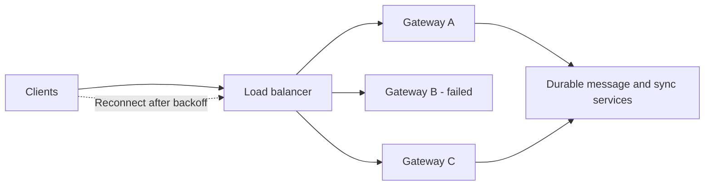

### Trade-offs

| Choice          | Gain                                              | Cost / limitation                                          |
| --------------- | ------------------------------------------------- | ---------------------------------------------------------- |
| Layer 4         | Protocol flexibility and limited inspection       | Less application-aware routing                             |
| Layer 7         | Host/path routing, TLS termination, richer policy | More processing and configuration                          |
| Sticky sessions | Simpler access to local session state             | Uneven load and harder failover; not a durability strategy |

### If it fails — safe fallback

| Failure                        | Effect                                  | Recovery / fallback                                                     |
| ------------------------------ | --------------------------------------- | ----------------------------------------------------------------------- |
| One backend fails              | Some in-flight requests or sockets fail | Remove target, reconnect/retry only with safe semantics                 |
| Balancer endpoint fails        | Healthy backends become unreachable     | Redundant balancer deployment or managed multi-zone entry point         |
| All targets look unhealthy     | Product-specific behavior               | Test this condition; do not assume every balancer always blocks traffic |
| Deployment closes many sockets | Reconnect surge                         | Drain connections, stagger rollout, enforce admission control           |

For example, AWS ALB documents **fail-open routing when every registered target in the group is unhealthy**. Health-check configuration alone is not a complete overload defense. [ALB health checks](https://docs.aws.amazon.com/elasticloadbalancing/latest/application/target-group-health-checks.html).

**Use when / why:** multiple redirect-service instances for read traffic; multiple gateways for connection capacity. **Skip:** sticky sessions for a stateless API when any healthy instance can handle the request.

**Watch:** target health, connection counts, imbalance, rejected connections, and backend p99 latency.

---

## 03 API gateway and identity boundary

> **Mental model:** The front door checks identity and broad policy; the owning service still checks permission for the specific resource.

**Used in:** file sharing, private chat, merchant payment APIs, and authenticated booking.

### 5W1H

- **What — what belongs here?** Routing, request-size limits, authentication, coarse authorization, quotas, and request identifiers. Business rules such as “this user can read this file” remain enforceable in the relevant service.
- **Why — why centralize some checks?** Shared entry checks reduce repeated implementation and reject obvious abuse early. Centralization does not remove the need to validate data or permissions deeper in the system.
- **Who — who is authenticated?** A user, device, merchant, or internal service. Authentication answers **who you are**; authorization answers **what this identity may do to this resource**.
- **Where — where are trust boundaries?** Public client → gateway, gateway → service, service → storage/provider. TLS protects transport; mutual TLS authenticates both connection peers but does not automatically grant business permission.
- **When — when is resource authorization mandatory?** Every private-object operation, including before issuing a download capability. Knowing a `file_id`, `chat_id`, or `payment_id` is not authorization.
- **How — how should checks work?** Validate token signature, issuer, audience, expiry, and relevant claims. Then enforce tenant/ownership/ACL rules; use short-lived service credentials and minimize privileges.

### Case study — Bob downloads Alice's shared file

1. Bob presents a valid identity token.
2. The file service loads the file and sharing relationship.
3. It verifies that Bob may download the current version.
4. Only then does it issue a short-lived, object-specific signed URL.
5. Bob downloads directly from storage. The signed URL is a capability; anyone holding it may have the permitted access until it stops being valid.

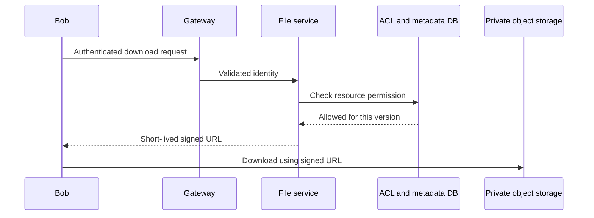

### Trade-offs

| Choice                             | Gain                                         | Cost / limitation                                     |
| ---------------------------------- | -------------------------------------------- | ----------------------------------------------------- |
| Locally validated signed tokens    | Avoid identity-service call on every request | Revocation and key rotation require explicit handling |
| Central policy / permission lookup | Fresher, centralized decisions               | Adds a dependency and latency                         |
| Cached permissions                 | Faster reads                                 | Revocation can lag; define acceptable staleness       |

Use least privilege and deny-by-default authorization; validate permissions for each request rather than trusting a guessed identifier. [OWASP authorization guidance](https://cheatsheetseries.owasp.org/cheatsheets/Authorization_Cheat_Sheet.html).

### If it fails — safe fallback

| Failure                      | Effect                           | Recovery / fallback                                                                                             |
| ---------------------------- | -------------------------------- | --------------------------------------------------------------------------------------------------------------- |
| Identity provider down       | New login/token refresh may fail | Existing unexpired tokens may remain usable under valid local verification policy; never accept unsigned tokens |
| Permission store down        | Cannot prove access              | Deny sensitive operations; serve only explicitly public resources                                               |
| Signing key rotation issue   | Tokens/URLs may stop validating  | Overlapping key rotation and monitored expiry; no blanket verification bypass                                   |
| Internal service compromised | Lateral access risk              | Enforce service authorization, least privilege, isolation, credential rotation                                  |

**Use when / why:** protect file shares and payment APIs without routing large file bytes through the gateway. **Skip:** custom cryptography and one shared all-powerful internal credential.

**Watch:** authorization failures, cross-tenant requests, key expiry, and accidental secrets in logs.

---

## 04 Rate limiter and admission control

> **Mental model:** Rate limiting controls **how fast a client asks**. Admission control controls **how much work the system accepts**.

**Used in:** the Rate Limiter design, ticket waiting rooms, provider quotas, login protection, and reconnection storms.

### 5W1H

- **What — what is limited?** Requests per identity, endpoint, tenant, or operation cost. A waiting room is an additional fairness/admission mechanism: it holds demand outside a scarce checkout path.
- **Why — why not simply autoscale?** Downstream providers, database connections, and one popular seat have hard limits. Adding frontends can increase pressure on the bottleneck.
- **Who — whose budget is consumed?** Usually an authenticated user/API key, sometimes an IP. IP-only limits can punish users behind a shared network and are easy to evade with many addresses.
- **Where — where should enforcement happen?** Reject coarse abuse at the edge; enforce account quotas at the gateway; apply separate concurrency limits at the scarce backend. Provider-channel limits belong near sender workers too.
- **When — when do we allow bursts?** Token buckets permit short bursts while enforcing an average refill rate. A strict financial quota needs a stronger authoritative reservation model than an approximate overload limiter.
- **How — how does token bucket work?** Store remaining tokens and last refill time. Atomically refill up to capacity, check request cost, and deduct if allowed. Use consistent time handling, expiry for idle state, and short bounded scripts.

```text
new_tokens = min(capacity, old_tokens + elapsed_seconds × refill_rate)
allow only if new_tokens >= request_cost
if allowed: tokens = new_tokens - request_cost
```

Redis Lua executes atomically relative to other commands on that server; long scripts block other work. Atomic execution is not a promise of disk durability or general rollback on errors. [Redis Lua scripting](https://redis.io/docs/latest/develop/programmability/eval-intro/).

### Case study — a concert launch

1. One million visitors browse cacheable event information.
2. Per-user limits slow abusive refresh loops.
3. A waiting room admits checkout users at a rate the booking system can sustain.
4. Signed, expiring admission tokens are bound to the intended user/event and verified by booking APIs.
5. The database still decides whether a seat can be held. Admission does not reserve inventory.

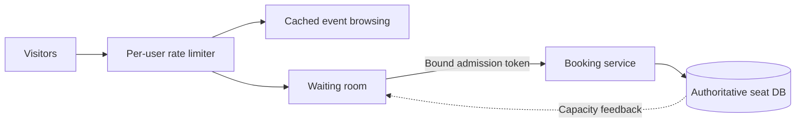

### Trade-offs

| Algorithm / policy         | Gain                                | Cost / limitation                                    |
| -------------------------- | ----------------------------------- | ---------------------------------------------------- |
| Fixed window               | Simple counter                      | Boundary bursts can exceed the intended rolling rate |
| Sliding log                | Precise rolling window              | Stores many timestamps                               |
| Sliding counter            | Lower memory than a log             | Approximation                                        |
| Token bucket               | Controlled average rate with bursts | Atomic refill/deduct and clock handling              |
| Leaky bucket / paced queue | Smoother output                     | Queue delay and bounded-buffer decisions             |

### If it fails — safe fallback

| Failure                         | Effect                              | Recovery / fallback                                                                    |
| ------------------------------- | ----------------------------------- | -------------------------------------------------------------------------------------- |
| Shared limiter unavailable      | Global budget cannot be coordinated | Small local limits for low-risk reads; stricter rejection for abuse-sensitive actions  |
| Local fallback on many gateways | Aggregate allowance grows           | Budget conservatively; `N` gateways each allowing `L` can allow roughly `N × L` |
| Waiting room unavailable        | Checkout could be flooded           | Pause new checkout admission; keep safe browsing and existing-operation status checks  |
| One identity becomes a hot key  | One shard saturates                 | Hierarchical/local prechecks or leased budgets, accepting explicit approximation       |
| Allowed budget exhausted        | Normal policy rejection             | Return `429` and useful retry guidance; do not retry immediately                     |

**Use when / why:** token bucket for API fairness; waiting room for scarce inventory; concurrency limits for overloaded databases. **Skip:** claiming a limiter alone prevents double booking or guarantees fraud protection.

**Watch:** allowed/rejected rates, limiter latency, waiting time, active checkouts, overshoot, and downstream saturation.

---

## 05 Application service and service discovery

> **Mental model:** Application instances execute business rules; discovery tells callers which instances currently exist.

**Used in:** message services, file metadata APIs, feed reads, booking, redirect, and payment orchestration.

### 5W1H

- **What — what is an application service?** Code implementing an API or business capability. “Stateless” means no irreplaceable business/session state exists only in one process; it does not mean the service uses no state.
- **Why — why keep request handlers stateless?** Requests can go to any healthy instance, simplifying horizontal scaling, restart, and rolling deployment. Durable state belongs in an appropriate shared store.
- **Who — who calls and owns it?** Clients through a gateway, other services, or workers call it. A service owner defines its API, data ownership, correctness rules, and dependency failure policies.
- **Where — where does discovery live?** A platform registry, internal DNS, proxy, or client-side directory maps a logical service name to current endpoints. A small deployment can use stable managed endpoints instead of building a registry.
- **When — when should services be split?** When independent scale, ownership, isolation, or deployment demands it. A modular monolith is often enough initially; one component card is not an instruction to create one more network hop.
- **How — how does scaling work safely?** Start instances, warm required resources, mark readiness, then route traffic. Bound connection pools and in-flight requests; more instances must not create unlimited database connections.

### Case study — scaling the redirect service

Suppose one redirect process safely handles an **assumed, benchmarked** 2,000 requests/s at the target latency. A 10,000 requests/s peak needs at least five processes mathematically, but more capacity is needed for failure and headroom.

1. The load balancer reaches several stateless redirect instances.
2. Instances use shared mapping storage and optional local caches.
3. New instances become ready before receiving full traffic.
4. A dead instance is replaceable because it does not own the only URL mapping.
5. Analytics remains asynchronous, rather than slowing every redirect.

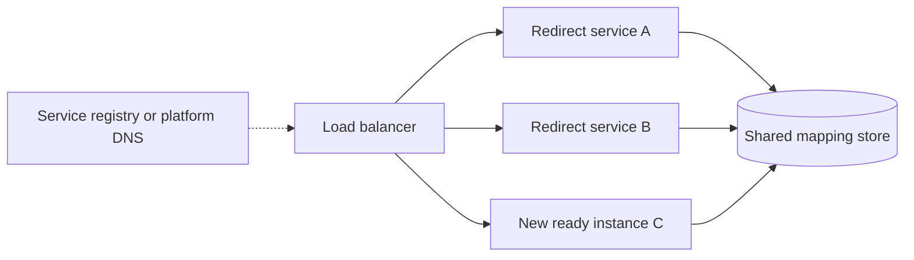

### Trade-offs

| Choice              | Gain                                        | Cost / limitation                                                   |
| ------------------- | ------------------------------------------- | ------------------------------------------------------------------- |
| Modular monolith    | Fewer deployments and network failure modes | Coarser independent scaling                                         |
| Separate services   | Independent scaling and isolation           | Network calls, observability, versioning, distributed workflows     |
| Local process state | Fast access                                 | Lost on restart and inconsistent across instances unless disposable |

### If it fails — safe fallback

| Failure                         | Effect                                     | Recovery / fallback                                                              |
| ------------------------------- | ------------------------------------------ | -------------------------------------------------------------------------------- |
| One process crashes             | In-flight work may have an unknown outcome | Replace instance; retry with stable operation identity                           |
| Discovery unavailable           | New endpoint lookups fail                  | Bounded use of last-known endpoints with health checks; avoid expired identities |
| Autoscaling lags behind a spike | Latency and errors rise                    | Admission control and pre-provisioning; autoscaling is not instantaneous         |
| Too many DB connections         | Database becomes the bottleneck            | Bound pools globally, queue briefly, shed excess work                            |

**Use when / why:** stateless message-processing APIs while socket-owning gateways remain stateful. **Skip:** splitting an issuer authorization path into many services if those hops consume its latency budget without a clear benefit.

**Watch:** request latency/error rate, in-flight requests, readiness, thread/connection pools, and dependency load.

---

## 06 Cache

> **Mental model:** A fast, disposable copy—not automatically the authoritative record.

**Used in:** hot short links, feed timelines, post objects, folder listings, routing/presence, and rate-limit counters. The last two have different loss tolerances from ordinary content caches.

### 5W1H

- **What — what is cached?** A previously computed value or fetched record. An L1 cache is local to an application process; an L2 cache such as Redis is shared across processes.
- **Why — why cache?** Reduce repeated database work and network latency. Caching improves repeated reads, not the correctness of a financial decision or the capacity of an uncached hot write.
- **Who — who maintains freshness?** The application defines keys, TTLs, invalidation, and source-of-truth reads. A cache server cannot infer that a user revoked a file share or deleted a post.
- **Where — where does it sit?** Between the requesting service and durable storage, sometimes with an additional edge cache. Cache IDs separately from large objects when many users reference the same content.
- **When — when is stale data acceptable?** Often for a public event description or feed candidate list. Usually not for deciding available money, final seat ownership, or a newly revoked private permission.
- **How — how does cache-aside work?** Read cache first; on a miss, read the database and populate the cache. On writes, commit authoritative changes and invalidate/update caches with a defined race-handling strategy; a TTL alone does not provide immediate consistency.

### Case study — a viral post becomes a hot key

1. Feed caches store post IDs rather than copying the entire body into every follower's timeline.
2. Feed service fetches post bodies from an object cache, ideally in batches.
3. One viral post overloads its single Redis shard despite a high overall hit ratio.
4. Short-lived L1 copies distribute those reads across application instances.
5. Deleted/private posts still pass current visibility checks before presentation.

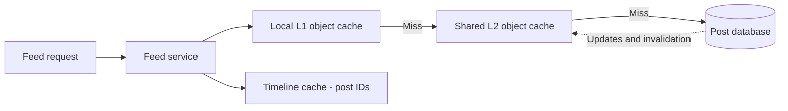

### Trade-offs

| Pattern       | Gain                                 | Cost / limitation                                             |
| ------------- | ------------------------------------ | ------------------------------------------------------------- |
| Cache-aside   | Simple, selective population         | Miss latency, stale entries, stampedes                        |
| Write-through | Cache updated on write path          | Extra write dependency; still needs correct failure semantics |
| Write-behind  | Fast apparent writes                 | Data-loss risk unless pending writes are durably protected    |
| L1 + L2       | Protects shared cache from hot reads | More copies and harder invalidation                           |

**Stampede protection:** coalesce concurrent misses for the same key, randomize TTLs, warm carefully, and bound database fallback. Cache penetration from nonexistent IDs can use short negative caching—but do not let a stale negative hide a newly created short link indefinitely.

### If it fails — safe fallback

| Failure                                 | Effect                       | Recovery / fallback                                                                           |
| --------------------------------------- | ---------------------------- | --------------------------------------------------------------------------------------------- |
| Redis down                              | Cache misses surge           | Bounded DB access, smaller responses, eligible stale L1 content; shed load before DB collapse |
| One hot key                             | One cache node saturates     | L1 caching or deliberate hot-key replication; adding unrelated shards may not help            |
| Stale content after delete              | Old object remains visible   | Read-time tombstone/visibility filtering plus invalidation                                    |
| Cache refill races with update          | Old value can be reinserted  | Version-aware entries, carefully designed invalidation, and a bounded staleness policy        |
| Cache contains the only business record | Cache loss becomes data loss | Redesign: durable authoritative record first                                                  |

Redis replication is asynchronous by default; even `WAIT` does not turn it into a universally strongly consistent, loss-free store. Do not quietly promote a cached balance into payment authority during an outage. [Redis replication guarantees](https://redis.io/docs/latest/operate/oss_and_stack/management/replication/).

**Use when / why:** cache popular short-link mappings to reduce repeated DB reads. **Skip:** treating Redis, a TTL, or a distributed lock as sufficient proof that a ticket is yours.

**Watch:** hit ratio **and** miss volume, cache latency, evictions, hot keys, database fallback load, and stale-read incidents.

---

## 07 Relational database and transactions

> **Mental model:** A place to enforce invariants atomically—not merely somewhere to save JSON.

**Used in:** bookings, payment operations, ledger postings, file metadata/version checks, custom aliases, and idempotency records.

### 5W1H

- **What — what does a transaction provide?** A bounded group of database changes commits together or rolls back. Constraints and concurrency controls protect rules even when several application instances race.
- **Why — why not “read, check, then update” in application code?** Two workers can read the same old state and both proceed. The decisive condition must be checked as part of an atomic operation or properly isolated transaction.
- **Who — who owns correctness?** Application code defines the rule; database constraints, conditional updates, locks, and chosen isolation enforce it. Every writer—including background jobs—must respect the same rule.
- **Where — where is the transaction boundary?** Inside the database that owns the relevant data. An ordinary local DB transaction does not atomically include an external PSP call, an S3 upload, or a Kafka publish.
- **When — when does SQL fit?** Related records, conditional state transitions, uniqueness, and multi-row all-or-nothing changes. NoSQL can also support transactions; choose based on required operations and guarantees, not the label.
- **How — how do we keep transactions safe?** Keep them short, use suitable indexes, check affected-row counts, and handle deadlocks/serialization retries. Use uniqueness for operation identity and consistent lock order for multi-row updates.

### Case study — two debit purchases race

Assume an issuer account has RM150 available. Two requests each try to reserve RM100.

1. Each request has its own stable network/operation identity.
2. In one short transaction, establish idempotency, conditionally reserve funds, and store the authorization decision.
3. The balance condition is re-evaluated under database concurrency control, so both cannot consume the same RM100.
4. The accepted request commits its hold and decision together.
5. A retransmission reads the recorded decision rather than creating another hold.

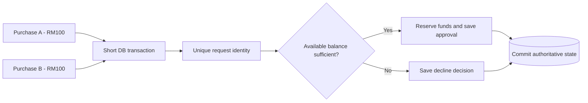

**Isolation matters:** PostgreSQL's default Read Committed is not a blanket serializability guarantee. Conditional updates can safely protect a single-row condition; more complex cross-row invariants may need explicit locks, constraints, or serializable transactions with retries. [PostgreSQL isolation documentation](https://www.postgresql.org/docs/current/transaction-iso.html).

### Trade-offs

| Choice                     | Gain                                        | Cost / limitation                                            |
| -------------------------- | ------------------------------------------- | ------------------------------------------------------------ |
| Optimistic version check   | Low coordination when conflicts are rare    | Conflicts require retry or user resolution                   |
| Short pessimistic row lock | Serializes competing decisions              | Waiting, contention, deadlocks if poorly ordered             |
| Serializable transaction   | Stronger protection for complex concurrency | Transactions may abort and require safe retry                |
| Read replica for display   | Offloads primary reads                      | Lag; not necessarily safe for a new booking/payment decision |

### If it fails — safe fallback

| Failure                                 | Effect                                  | Recovery / fallback                                                           |
| --------------------------------------- | --------------------------------------- | ----------------------------------------------------------------------------- |
| Connection lost during commit           | Client cannot tell whether it committed | Query by durable operation ID; do not assume rollback                         |
| Primary fails                           | Writes pause and some reads fail        | Controlled failover with old-primary fencing and known durability guarantees  |
| Deadlock / serialization failure        | Transaction aborted                     | Retry whole transaction within a bounded budget and stable operation identity |
| DB unavailable for a financial decision | Cannot prove invariant                  | Reject/defer the decision; never approve using an arbitrary stale cache       |

**Use when / why:** reserve several seats atomically and save booking + outbox together. **Skip:** holding a physical row lock open throughout a ten-minute user checkout.

**Watch:** lock wait time, deadlocks, transaction age, connection saturation, query p99, and constraint violations.

---

## 08 Key-value store and LSM storage engine

> **Mental model:** The distributed store decides **which node owns a key**; the storage engine decides **how that node stores it**.

**Used in:** your Key-Value Store design; potentially message history or large access-pattern-driven datasets. An in-memory cache and a durable KV database are not interchangeable.

### 5W1H

- **What — what is a KV store?** An interface such as `Get(key)`, `Put(key, value, version)`, and `Delete(key)`. A log-structured merge-tree, or LSM, is one possible local storage-engine design behind that interface.
- **Why — why use an LSM?** Buffer writes in memory and organize persistent data into immutable sorted files, favoring sequential writes. Background compaction trades later work for efficient ingestion.
- **Who — who performs the work?** The coordinator routes operations; each replica's engine handles local persistence, lookup, flush, and compaction. Application-level conflicts may require application-defined resolution.
- **Where — where are the bytes?** A WAL on persistent storage, recent entries in a memtable, and older entries in SSTables. A memtable is in memory; it does **not** by itself make a write survive a crash.
- **When — when does it fit?** Large workloads dominated by known keys and write throughput, with suitable range-scan support where needed. Ad-hoc joins and multi-object invariants may fit another database model better.
- **How — how do reads/writes work?** Append to the write-ahead log under the required durability policy, update the memtable, and later flush immutable sorted files. Reads search recent state and relevant files; compaction merges versions and eventually reclaims obsolete data.

### Case study — recover a node after a crash

1. `Put("cart:7", value)` reaches a replica.
2. The engine records the write in its WAL and updates memory.
3. An acknowledgment must match the configured durability boundary: merely writing to an OS buffer is different from a durable disk flush.
4. The process crashes before the memtable is flushed.
5. On restart, it replays the required WAL records and rebuilds recent state.

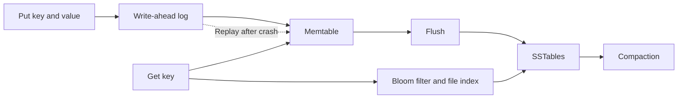

RocksDB documents memtables and WAL separately: memory accelerates writes, while recovery relies on the selected persistent-log behavior. A memtable implementation is not necessarily a red-black tree; skip-list-based implementations are common. [RocksDB memtables](https://github.com/meta/rocksdb/wiki/MemTable), [RocksDB WAL](https://github.com/meta/rocksdb/wiki/Write-Ahead-Log-(WAL)).

### Trade-offs

| Mechanism             | Gain                                                         | Cost / limitation                                                          |
| --------------------- | ------------------------------------------------------------ | -------------------------------------------------------------------------- |
| WAL                   | Recover recent acknowledged data under configured guarantees | Extra writes and flush latency                                             |
| SSTables + compaction | Efficient sorted storage and reclamation                     | Read/write/space amplification; background IO                              |
| Bloom filter          | Skip files that definitely do not contain a key              | False positives; memory cost; not a replacement for lookup                 |
| Tombstone             | Represents deletion without rewriting every file immediately | Reclamation must respect replication/repair so old data is not resurrected |

**Bloom filter rule:** a correctly built filter can say **definitely not in this represented set** or **possibly present**. It cannot prove uniqueness, resolve a hash collision, or safely describe data newer than its coverage.

### If it fails — safe fallback

| Failure                           | Effect                             | Recovery / fallback                                                                       |
| --------------------------------- | ---------------------------------- | ----------------------------------------------------------------------------------------- |
| Process crashes                   | Memtable lost                      | WAL replay, then replica recovery as needed                                               |
| Disk/node lost                    | Local data unavailable             | Read another valid replica; rebuild from surviving durable data                           |
| Compaction falls behind           | Files, space use, and latency rise | Reserve IO/capacity, throttle ingestion, tune workload; do not delete live files manually |
| Corrupted file or lagging replica | Missing / inconsistent data        | Checksums, replica repair, and tested backup restore                                      |
| Deletion marker removed too early | Old values may reappear            | Retain tombstones until safe under the store's replication/repair rules                   |

**Use when / why:** build a write-heavy distributed KV store with explicit durability and consistency choices. **Skip:** hand-building an LSM for an ordinary application that can use an existing database.

**Watch:** WAL sync latency, compaction backlog, read amplification, tombstone volume, disk headroom, and repair lag.

---

## 09 Replication consistency and failover

> **Mental model:** Replication makes copies. A consistency protocol defines what clients may observe. Failover chooses which surviving copy is allowed to lead.

**Used in:** every durable database; central to KV, payments, bookings, and message durability.

### 5W1H

- **What — what is replicated?** Database/log state across independent failure domains. Leader-based replication and Dynamo-style leaderless replication are different models; do not casually mix their guarantees.
- **Why — why replicate?** Survive component loss and sometimes distribute reads. Replication is not a backup: deletion or corruption can spread to all replicas.
- **Who — who decides acknowledgment and leadership?** The storage protocol and its configuration. Applications must understand what “write succeeded” guarantees and which reads may be stale.
- **Where — where should replicas live?** Across separate hosts and usually availability zones. Cross-region copies add disaster protection but incur network latency and more difficult ownership/failover decisions.
- **When — when is staleness acceptable?** Often for feed candidates or analytics. Not for authoritatively deciding whether already-spent money is available again.
- **How — how is consistency maintained?** Options include a leader's ordered log, synchronous acknowledgments, consensus, quorum reads/writes, and repair. Strong reads must follow the database's actual protocol, not simply “read from any replica.”

### Case study — three replicas, one partitioned node

For a **fixed replica set** `A, B, C`:

- `N = 3`: three replicas.
- `W = 2`: two acknowledgments required for a write.
- `R = 2`: read two replicas.
- `R + W > N` means every such read set overlaps every such write set.

If A and B store `v2` while C has `v1`, a read of B and C encounters the newer version **if the version scheme can establish that v2 supersedes v1**.

**Important:** intersection alone does not prove linearizability. Concurrent writes, version ordering, incomplete writes, membership changes, and sloppy quorums require additional protocol rules.

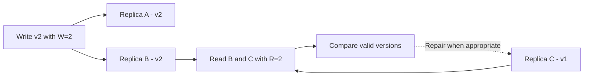

### Trade-offs — replication families

| Family                        | How it behaves                                                                | Main trade-off                                                                 |
| ----------------------------- | ----------------------------------------------------------------------------- | ------------------------------------------------------------------------------ |
| Leader / consensus-backed log | A permitted leader orders writes; a commit protocol protects agreed state     | A minority partition cannot continue normal authoritative writes               |
| Dynamo-style available KV     | May accept writes through different coordinators and later reconcile versions | Concurrent versions and application conflict resolution                        |
| Asynchronous read replicas    | Copy primary changes after acknowledgment                                     | Reads can lag; promotion can lose acknowledged data depending on configuration |

The original Dynamo design combines versioning and repair to preserve availability in some failures. It is not a description of every DynamoDB consistency mode. [Original Dynamo paper](https://www.amazon.science/publications/dynamo-amazons-highly-available-key-value-store).

### Conflict and repair toolkit

- **Last-write-wins:** choose a value by an ordering rule, often timestamp-based. Simple, but clock skew and concurrent edits can lose meaningful changes.
- **Vector clocks:** detect causal order. `[2,0]` and `[1,1]` are concurrent; neither dominates. A cart may merge additions, but conflicting addresses need a business rule. Detection is not automatic resolution.
- **Read repair:** use a read to repair stale replicas under the store's version rules.
- **Hinted handoff:** temporarily hold data intended for a failed replica, then forward it when that replica returns.
- **Sloppy quorum:** substitute reachable nodes; this improves availability but may break the fixed-set intersection assumption above.
- **Merkle trees:** narrow down differing key ranges; they identify differences, not which business value is correct.
- **Gossip:** spreads membership/failure suspicions. A suspected failure is not mathematical proof a node is dead, and gossip is not consensus.

### If it fails — safe fallback

| Failure                          | Effect                                       | Recovery / fallback                                                                        |
| -------------------------------- | -------------------------------------------- | ------------------------------------------------------------------------------------------ |
| One follower fails               | Reduced redundancy                           | Continue only if required acknowledgment rules remain satisfied; replace and resynchronize |
| Leader fails                     | Writes pause                                 | Elect/promote a valid replacement and fence the old writer                                 |
| Majority unavailable             | Cannot safely commit under majority protocol | Stop authoritative writes rather than create two independent histories                     |
| Async replica promoted too early | Recent acknowledged writes may be missing    | Choose explicit loss policy, synchronous durability where required, and reconcile          |
| Region partition                 | Sites cannot coordinate reliably             | Route writes to a valid owner or reject/defer; do not blindly enable both writers          |

PostgreSQL explains the durability/latency distinction between asynchronous and synchronous replication. Synchronous replication reduces certain loss risks, but its acknowledgment level, surviving copies, and failover procedure still matter. [PostgreSQL standby replication](https://www.postgresql.org/docs/current/warm-standby.html).

> [!warning] ⚠️ CAP is not “pick two products”
> During a network partition, a system cannot guarantee both linearizable behavior and a successful response to every request at every non-failing node. CAP's formal availability is not the same metric as “99.99% uptime.” Different operations in one product may choose different behavior. [Gilbert and Lynch&#39;s CAP result](https://www.comp.nus.edu.sg/~gilbert/pubs/BrewersConjecture-SigAct.pdf).

**Use when / why:** stronger authoritative reads/writes for seats and balances; weaker, repairable reads for feed views. DynamoDB itself offers eventually and strongly consistent reads for supported resources; secondary-index and global-table behavior must be checked separately. [DynamoDB read consistency](https://docs.aws.amazon.com/amazondynamodb/latest/developerguide/HowItWorks.ReadConsistency.html).

**Watch:** replication lag, acknowledgment failures, leadership changes, split-brain risk, repair age, and unreconciled conflicts.

---

## 10 Sharding and partition routing

> **Mental model:** Replication copies the same data. Sharding divides different data across owners.

**Used in:** chat history, KV storage, rate-limit keys, notification inboxes, feed timelines, and eventually large booking datasets.

### 5W1H

- **What — what is a shard?** A subset of the dataset assigned to a storage group. A partition key maps a record or query to that subset.
- **Why — why shard?** Spread data volume, write throughput, and working-set size beyond one machine/group. Sharding is more operationally expensive than adding an index or removing unnecessary queries.
- **Who — who routes requests?** A client library, coordinator, proxy, or managed database. Routing depends on current partition ownership; clients must handle movement and retry safely.
- **Where — where is the partition boundary?** Choose a key matching common operations: `chat_id` for conversation history, `user_id` for inbox/feed reads, `event_id` for event-local bookings.
- **When — when is it justified?** After measurement shows that simpler scaling no longer meets requirements. A trillion-row future estimate does not justify unnecessary distributed transactions today.
- **How — how are records distributed?** Hash, range, directory-based routing, or consistent hashing. With a ring, virtual nodes distribute ownership more evenly, but do not guarantee equal request load.

### Case study — conversation history grows too large

1. Route messages by `chat_id` so a conversation's common reads stay local.
2. Add time buckets, such as `(chat_id, month)`, to bound partition size.
3. A read for recent messages touches recent buckets, not every historical shard.
4. One extremely active conversation can still be a hot write partition.
5. Splitting that conversation further requires an explicit ordering/merge strategy; more shards alone do not preserve a total message order.

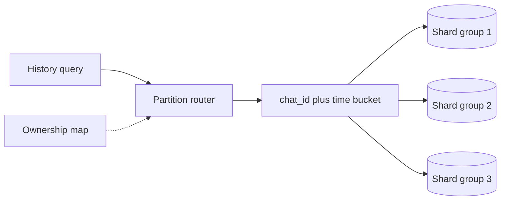

### Trade-offs

| Routing strategy                   | Gain                                              | Cost / limitation                                             |
| ---------------------------------- | ------------------------------------------------- | ------------------------------------------------------------- |
| Hash partitioning                  | Usually spreads keys                              | Range queries and hot individual keys remain difficult        |
| Range partitioning                 | Efficient locality/range scans                    | Sequential inserts or popular ranges may become hot           |
| Consistent hashing + virtual nodes | Ownership changes affect a limited subset of keys | Rebalancing, membership, replica placement, uneven popularity |
| Co-locating related records        | Easier local transactions                         | One very large tenant/event may overload its group            |

Redis Cluster specifically uses **16,384 hash slots**, not a generic clockwise consistent-hash ring. Hash tags can place related keys in the same slot for multi-key operations, but concentrating an entire popular event also concentrates its load. [Redis Cluster specification](https://redis.io/docs/latest/operate/oss_and_stack/reference/cluster-spec/).

### If it fails — safe fallback

| Failure                           | Effect                           | Recovery / fallback                                                                             |
| --------------------------------- | -------------------------------- | ----------------------------------------------------------------------------------------------- |
| One shard owner fails             | Part of the keyspace unavailable | Promote a valid replica using the store's failure protocol                                      |
| Routing map stale                 | Request reaches wrong owner      | Follow validated redirects/refresh ownership and retry with bounded budget                      |
| Rebalance loses ownership clarity | Missing or duplicate writes      | Controlled transfer with explicit cutover/ownership versions and reconciliation                 |
| Hot key / hot event               | One partition overloaded         | Cache hot reads, admit fewer writes, isolate workload, or redesign key distribution             |
| Cross-shard operation required    | Local transaction insufficient   | Redesign locality or use a deliberate distributed transaction/saga; do not pretend it is atomic |

**Use when / why:** `user_id` sharding for inbox reads; `event_id` co-location for seat transactions. **Skip:** claiming virtual nodes make every workload perfectly balanced.

**Watch:** per-shard bytes, request rates, p99, skew, rebalance progress, and cross-shard query frequency.

---

## 11 Coordination locks leases and fencing

> **Mental model:** Coordination decides **who may act**. Fencing stops an **old owner** from continuing to act after ownership changes.

**Used in:** ID-worker assignment, scheduled-job ownership, partition leadership, and some background work. A lock is not a substitute for a database invariant.

### 5W1H

- **What — what is coordination?** Shared agreement about ownership, membership, or ordered configuration. A lease grants temporary ownership; a distributed lock usually grants temporary exclusive access.
- **Why — why is “one worker” hard?** Networks can partition and processes can pause. An old worker may still run after another worker decides it has failed.
- **Who — who grants and enforces ownership?** A coordination service such as etcd/ZooKeeper or an authoritative database grants it. The protected resource must enforce ownership/fencing where stale actions would be dangerous.
- **Where — where should coordination be used?** At rare ownership changes, not necessarily on every business request. A leader can process many operations after safe assignment.
- **When — when do we need a lease?** To recover from abandoned ownership without waiting forever. A lease expiry is a liveness mechanism; it does not physically stop the old process.
- **How — how does fencing help?** Give each ownership generation an increasing token. The downstream resource rejects actions from older generations, so a delayed former owner cannot overwrite a newer owner's result.

Consensus protocols such as Raft coordinate a replicated log through elections and commit rules; they are more than heartbeat counting. etcd exposes leases and revisions that can support coordination designs. [Raft paper](https://raft.github.io/raft.pdf), [etcd API concepts](https://etcd.io/docs/v3.6/learning/api/).

### Case study — a paused export worker resumes

1. Worker A owns an export task with fencing epoch `12`.
2. It pauses long enough for its lease to expire.
3. Worker B takes ownership with epoch `13`.
4. B commits progress under epoch 13.
5. A resumes and sends an old write. Storage checks the epoch and rejects it.

```mermaid
sequenceDiagram
    participant A as Worker A
    participant C as Coordinator
    participant B as Worker B
    participant S as Protected storage
    A->>C: Acquire lease
    C-->>A: Epoch 12
    Note over A: Long pause; lease expires
    B->>C: Acquire ownership
    C-->>B: Epoch 13
    B->>S: Write with epoch 13
    A->>S: Delayed write with epoch 12
    S-->>A: Reject stale owner
```

### Trade-offs

| Choice                                 | Gain                             | Cost / limitation                            |
| -------------------------------------- | -------------------------------- | -------------------------------------------- |
| DB conditional update / short row lock | Enforces rule where data lives   | Contention on that record                    |
| Distributed lease                      | Ownership recovery after failure | Lease timing, partitions, and stale owners   |
| Fencing token enforced by resource     | Protects against stale actions   | Resource must support and check the token    |
| Redis lock as prefilter                | Fast rejection of competing work | Not sufficient financial/inventory authority |

**Lock-release rule:** release only if the lock still contains your unique ownership token. Blindly deleting a key can delete someone else's replacement lock.

### If it fails — safe fallback

| Failure                                 | Effect                             | Recovery / fallback                                                                  |
| --------------------------------------- | ---------------------------------- | ------------------------------------------------------------------------------------ |
| Coordination quorum lost                | Cannot safely assign new ownership | Pause new assignments; existing work follows strict lease-validity rules             |
| Old owner resumes                       | Duplicate/stale work               | Fencing and idempotent business operations                                           |
| Lease expires during slow external call | New worker may start same task     | Stable operation identity; reconcile the original call before repeating              |
| Protected storage ignores fence         | Old owner can still corrupt state  | Enforce the check at storage or redesign; a token in a log message is not protection |

**Use when / why:** assign unique generator-worker identities or claim a durable job. **Skip:** adding Redis locks around every operation when a unique constraint and conditional DB update solve the actual problem.

**Watch:** lease renewal failures, ownership changes, stale-write rejections, and coordination latency.

---

## 12 Unique ID generator

> **Mental model:** Uniqueness, approximate time order, compact size, and unpredictability are different requirements.

**Used in:** Unique ID Generator, URL Shortener, chat message IDs, posts, payments, and notifications.

### 5W1H

- **What — what must be generated?** A unique identifier with explicit requirements: 64-bit numeric or 128-bit, globally unique or scoped, sortable or opaque, generated locally or centrally.
- **Why — why not one database counter?** A central counter is simple but adds shared coordination and availability dependence. At moderate scale it may still be the smallest correct solution.
- **Who — who owns an ID namespace?** A database allocator, a range owner, or a safely assigned Snowflake worker. Random UUID generators rely on sufficient entropy and correct implementation instead of central worker assignment.
- **Where — where should generation occur?** Locally for low-latency independent creation; centrally for a simple sequence or allocated ranges. IDs do not replace request idempotency or authorization.
- **When — when use each option?** Snowflake-style IDs when compact 64-bit approximately time-ordered IDs are required. UUIDv7 when 128 bits are acceptable and time locality helps. UUIDv4 when time order is unnecessary.
- **How — how does Snowflake work?** Combine elapsed milliseconds since a custom epoch, a unique worker namespace, and a per-millisecond sequence. Synchronize local generation and handle clock rollback, restart, and sequence exhaustion.

### Case study — order IDs across many servers

One **illustrative** 64-bit layout:

```text
1 unused/sign bit | 41 timestamp bits | 10 worker bits | 12 sequence bits

id = (timestamp_delta << 22) | (worker_id << 12) | sequence

Timestamp span: 2^41 milliseconds ≈ 69.7 years
Worker namespaces: 2^10 = 1,024
Sequence slots: 2^12 = 4,096 per millisecond per worker
```

Those are **bit-space limits, not measured throughput promises**.

1. Worker 17 receives safe ownership of its namespace.
2. For the same millisecond, it increments its sequence.
3. If the sequence fills, it waits/rejects until a later permitted time rather than wrapping into duplicates.
4. It refuses unsafe timestamp reuse after rollback or restart.
5. The API returns the 64-bit ID as a decimal string when clients cannot represent it exactly.

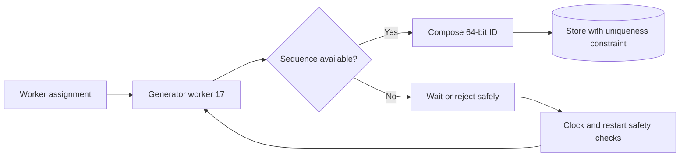

### Trade-offs

| Strategy          | Gain                                 | Cost / limitation                                                                |
| ----------------- | ------------------------------------ | -------------------------------------------------------------------------------- |
| Database sequence | Simple allocation order              | Shared dependency; gaps are normal                                               |
| Allocated ranges  | Fewer allocator calls                | Unused gaps; global creation order not guaranteed                                |
| UUIDv4            | Independent generation               | 128 bits, random index locality, extremely low but nonzero collision probability |
| UUIDv7            | Timestamp-oriented locality          | 128 bits; not a global causal-order guarantee                                    |
| Snowflake-style   | Compact, local, roughly time-ordered | Clock, worker ownership, and restart safety                                      |

UUIDv7 includes a Unix-millisecond timestamp; UUIDs remain 128-bit identifiers. UUIDv4 is not expected to collide merely because an application creates millions or billions of well-generated IDs. [RFC 9562](https://www.rfc-editor.org/rfc/rfc9562.html).

### If it fails — safe fallback

| Failure                                      | Effect                                            | Recovery / fallback                                                                                  |
| -------------------------------------------- | ------------------------------------------------- | ---------------------------------------------------------------------------------------------------- |
| Clock moves backwards                        | Timestamp/sequence namespace may be reused        | Detect rollback; wait, reject, or use a deliberately designed logical-time scheme                    |
| Worker ID reused while old generator can act | Duplicates possible                               | Prevent overlapping ownership and unsafe time reuse; pause on lease uncertainty                      |
| Process restarts in an old timestamp range   | Sequence reset can collide                        | Durable time floor or a proven safe reuse/epoch protocol                                             |
| Registry down                                | New assignments unsafe                            | Do not issue conflicting worker IDs; existing workers continue only under their ownership guarantees |
| Allocator down                               | Range allocation stops                            | Existing safely allocated ranges may continue until exhausted                                        |
| Client uses JavaScript Number                | Large integers lose precision beyond `2^53 - 1` | Serialize IDs as strings or use appropriate big-integer support                                      |

**Fencing caveat:** a normal fencing token cannot magically retract a duplicate ID already emitted. If the token is not part of the ID namespace or enforced before IDs become externally visible, worker reassignment still needs a safe non-overlap/reuse protocol.

**Use when / why:** Snowflake for a strict 64-bit requirement; UUIDv7 for simpler distributed creation if 128 bits fit. **Skip:** using timestamps or generated IDs alone as strict chat sequence numbers, secrets, or access-control checks.

**Watch:** clock rollback, duplicate constraint failures, sequence exhaustion, worker overlap, and remaining epoch life.

---

## 13 Search index

> **Mental model:** A searchable projection of authoritative data—not the authority for seat ownership or private access.

**Used in:** searching ticket events by artist/date/location; optionally searching posts or filenames.

### 5W1H

- **What — what does it store?** A query-optimized representation, often with inverted indexes, tokenization, filters, and ranking. The original business records remain in the owning database.
- **Why — why use it instead of normal queries?** Full-text relevance, flexible filtering, and high search volume may exceed what a simple database index offers. Basic search may still be adequately served by SQL and its full-text features.
- **Who — who updates and queries it?** An indexing worker consumes committed changes; a search service queries the index. Source owners define document IDs, visibility, and versioning rules.
- **Where — where is it placed?** On the discovery/read path. It should not decide whether a seat is still available at checkout or whether a revoked file share remains valid.
- **When — when is delay acceptable?** New/edited events may appear after a short indexing delay. If freshness or permission revocation is critical, verify against the authority before revealing restricted details.
- **How — how is it maintained?** Database change → outbox/CDC → indexer → document upsert/delete. Use stable document IDs and source versions so an old retried event cannot overwrite newer indexed state.

### Case study — search says “seats available”

1. Event DB changes an event description and aggregate seat count.
2. The indexer updates the search document asynchronously.
3. A user searches and sees a potentially slightly stale result.
4. The booking service rechecks actual seat state in the authoritative database.
5. If unavailable, return a clear conflict rather than honoring the stale search count.

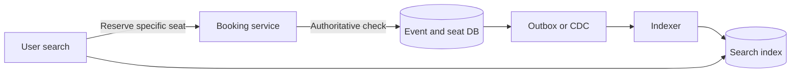

### Trade-offs

| Choice                         | Gain                                        | Cost / limitation                                  |
| ------------------------------ | ------------------------------------------- | -------------------------------------------------- |
| SQL indexes / full-text search | Fewer systems, simpler consistency          | May not meet advanced relevance/scale requirements |
| Dedicated search engine        | Rich discovery and independent read scaling | Index lag, extra storage, operational cost         |
| Frequent index refresh         | Faster search visibility                    | Additional indexing/search overhead                |

Elasticsearch is near-real-time: a refresh makes recently indexed operations searchable. Accepting an index write and being immediately visible to search are distinct moments. [Elastic near-real-time search](https://www.elastic.co/docs/manage-data/data-store/near-real-time-search).

### If it fails — safe fallback

| Failure                            | Effect                | Recovery / fallback                                                               |
| ---------------------------------- | --------------------- | --------------------------------------------------------------------------------- |
| Search cluster down                | Discovery unavailable | Cached popular events or bounded indexed DB queries; avoid an unbounded full scan |
| Indexer lags                       | Search becomes stale  | Show controlled degradation; alert on change-to-search age                        |
| Document deleted but event delayed | Old result remains    | Enforce current visibility at read/detail boundary and retry delete               |
| Index corrupted                    | Projection unreliable | Rebuild from authoritative data with a snapshot plus change replay/cutover        |

**Use when / why:** ticket discovery with rich filters. **Skip:** a dedicated cluster for a small exact-ID lookup service.

**Watch:** search p95/p99, indexing lag, rejected writes, stale-document errors, and rebuild duration.

---

## 14 Durable message broker

> **Mental model:** A durable buffer and distribution mechanism—not proof that every downstream side effect happened exactly once.

**Used in:** notification pipelines, chat group delivery, news-feed fan-out, search indexing, and URL click analytics.

### 5W1H

- **What — what is a broker?** A system that accepts events/jobs and lets consumers process them independently. A work queue distributes tasks; an append-only log supports retention and replay with independent consumer positions.
- **Why — why use asynchronous messaging?** Decouple request latency from slow fan-out, absorb temporary spikes, and let independent consumers recover. A buffer delays overload; it does not create unlimited processing capacity.
- **Who — who publishes and consumes?** Producers emit durable business events; consumer groups perform tasks such as feed insertion or email sending. Independent groups can each process the same log.
- **Where — where should it sit?** After the operation's durability boundary, usually connected through an outbox/CDC. Do not add a general asynchronous hop to a strict synchronous debit-authorization decision without meeting its response contract.
- **When — when is it appropriate?** Work can complete after the initial API response and has defined delay/retention bounds. Some analytics can tolerate loss; accepted financial operations usually cannot.
- **How — how are replay and order handled?** Partition by the required ordering key; track consumer position; commit progress after durable effects. Replay can repeat work, so consumers still need idempotency.

### Case study — group chat fan-out

1. Persist one accepted group message and its delivery intent.
2. Publish a delivery event keyed by `chat_id`.
3. A worker determines the eligible recipient/device set and creates delivery work.
4. It crashes after inserting some inbox rows but before committing its broker position.
5. Replay repeats the event; uniqueness on message-recipient/device work prevents duplicate logical insertion.

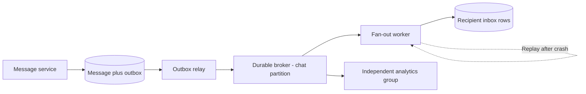

### Trade-offs

| Choice                    | Gain                                   | Cost / limitation                                         |
| ------------------------- | -------------------------------------- | --------------------------------------------------------- |
| Durable log such as Kafka | Replay and independent consumer groups | Partition management and retention limits                 |
| Managed work queue        | Simple task delivery and scaling       | Ordering/replay features depend on service and queue type |
| Redis Pub/Sub             | Lightweight live routing               | No offline replay guarantee                               |
| Direct synchronous call   | Immediate result, fewer moving parts   | Caller inherits downstream latency/failure                |

Kafka ordering is scoped to a partition; its transactions can coordinate Kafka input offsets and Kafka output. External DB writes, emails, or PSP charges still require cooperation/idempotency beyond the log. Configure replication, acknowledgments, minimum in-sync replicas, and retention deliberately. [Kafka design and delivery semantics](https://kafka.apache.org/44/design/design/).

Redis Pub/Sub is explicitly at-most-once; a disconnected subscriber can miss a notification permanently. Use it for an expendable wake-up hint, not as the only durable chat history. [Redis Pub/Sub semantics](https://redis.io/docs/latest/develop/pubsub/).

### If it fails — safe fallback

| Failure                           | Effect                                    | Recovery / fallback                                                                     |
| --------------------------------- | ----------------------------------------- | --------------------------------------------------------------------------------------- |
| Broker temporarily unavailable    | Events cannot be published                | Keep committed outbox backlog; accept only while durable backlog/storage policy permits |
| Consumer crashes                  | Some work incomplete or outcome uncertain | Replay from safe progress and deduplicate effects                                       |
| Backlog exceeds retention         | Unconsumed data may expire                | Alert well before expiry; extend capacity/retention or rebuild from source              |
| Poison message blocks a partition | Other work waits                          | Bounded retries, isolate with DLQ under explicit ordering policy                        |
| Hot partition                     | One ordered stream bottlenecks            | Split only if order requirements permit; adding consumers alone may not help            |

**Use when / why:** asynchronous feed fan-out and click analytics. **Skip:** declaring “Kafka means no data loss” without discussing acknowledgments, retention, consumer behavior, and source recovery.

**Watch:** publish failures, consumer lag, **oldest unprocessed event age**, retained bytes, and per-partition skew.

---

## 15 Workers scheduling retries and DLQ

> **Mental model:** A worker turns durable intent into completed work. A scheduler says when to try; retries must preserve the same logical operation.

**Used in:** email/SMS/push senders, fan-out, file cleanup, scheduled notifications, capture batches, and reconciliation.

### 5W1H

- **What — what is a worker?** A background executor that claims pending work, performs a bounded attempt, and records progress. A dead-letter queue holds work that repeatedly fails or needs investigation.
- **Why — why not do all work in the API request?** Slow providers and large recipient sets would make request latency unpredictable. Independent pools let expensive or failing tasks be isolated.
- **Who — who owns execution state?** The durable job/attempt record and the worker's claim mechanism. The scheduler should tolerate duplicate dispatch; “only one cron process” is not sufficient correctness.
- **Where — where is scheduling stored?** Durable due-time records, queue features, or a scheduler system. Do not rely on process memory or assume Kafka automatically provides arbitrary per-message delayed delivery.
- **When — when should a retry happen?** Only when the error is retryable, the deadline has not passed, and repeating the operation is safe. Invalid input and a permanently revoked token need correction, not endless retries.
- **How — how are attempts controlled?** Claim work atomically, use bounded execution/visibility leases, preserve operation IDs, apply backoff with jitter, and record status. Another worker can recover an abandoned claim.

### Case study — SMS provider slows down

1. High-priority login messages and bulk marketing run in separate pools/queues.
2. A provider returns throttling errors. Sender workers respect its retry guidance and lower concurrency.
3. Retries use the same delivery-operation identity.
4. A message expires before a retry succeeds; the worker marks it expired rather than sending a useless old login code.
5. Permanent failures move to a visible failed/DLQ path; no silent discard.

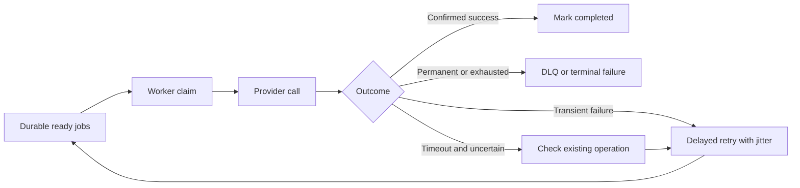

### Trade-offs

| Choice              | Gain                                 | Cost / limitation                                                  |
| ------------------- | ------------------------------------ | ------------------------------------------------------------------ |
| More workers        | Higher parallel throughput           | More pressure on DB/provider; ordered partitions limit concurrency |
| Longer claim lease  | Fewer duplicate claims for slow work | Slower recovery after a worker crash                               |
| Shorter claim lease | Faster recovery                      | More overlapping attempts unless renewal/fencing is correct        |
| Retry queue / DLQ   | Isolation and visibility             | Operational ownership and replay procedures required               |

An exponential delay can be capped and randomized, for example `random(0, min(cap, base × 2^attempt))`. Set an overall retry budget; synchronized retries and retrying at every layer can amplify outages. [AWS guidance on retries and jitter](https://aws.amazon.com/builders-library/timeouts-retries-and-backoff-with-jitter/).

### If it fails — safe fallback

| Failure                           | Effect                       | Recovery / fallback                                                                    |
| --------------------------------- | ---------------------------- | -------------------------------------------------------------------------------------- |
| Worker dies before effect         | Work remains incomplete      | Claim expires; another worker retries                                                  |
| Worker dies after external effect | Outcome uncertain            | Query/deduplicate using the original operation; do not invent a new payment key        |
| Scheduler dispatches twice        | Duplicate execution attempts | Unique business operation and atomic claim                                             |
| DLQ fills                         | Tasks need attention         | Alert, inspect, fix cause, replay with original IDs and authorization                  |
| Retry backlog grows               | New work loses capacity      | Separate priorities, admission limits, bounded retries, scale within provider capacity |

**Use when / why:** channel-specific notification workers so an email outage does not stop in-app inbox writes. **Skip:** infinite retries, unbounded queues, and automatic DLQ replay without understanding side effects.

**Watch:** oldest job age, attempts per operation, completion rate, lease expirations, expired jobs, and DLQ growth.

---

## 16 Transactional outbox CDC and durable inbox

> **Mental model:** Outbox means **“I committed this change and must publish its consequence.”** Inbox means **“I durably accepted this incoming event and must process it safely.”**

**Used in:** payments, file changes, posts, chat delivery, search indexing, and notifications.

### 5W1H

- **What — what problem is solved?** The unsafe dual write: updating a database and publishing an event as two unrelated operations. One may succeed while the other fails.
- **Why — why not just publish after commit?** The process can crash between the database commit and publication. Publishing before commit creates the opposite risk: consumers observe an event for a rolled-back change.
- **Who — who performs each step?** The business service saves data and outbox intent in one transaction; a relay publishes committed events; consumers deduplicate. A webhook receiver can durably save verified incoming events to an inbox.
- **Where — where is the atomic boundary?** Business row + outbox row share one database transaction. On the consumer side, processed-event identity + local business effect should also commit together when they share a database.
- **When — when use CDC?** Change data capture reads committed database/log changes. It can publish an explicit outbox or maintain projections; raw row changes are not automatically well-designed business events.
- **How — how does recovery work?** A relay retries unpublished rows; it marks delivery progress only after broker acknowledgment. If it crashes between publish and marking, it republishes the same event ID.

The outbox solves a local DB/event publication gap; it does **not** create a single transaction across every consumer or PSP. Duplicate publication remains possible. [AWS transactional outbox pattern](https://docs.aws.amazon.com/prescriptive-guidance/latest/cloud-design-patterns/transactional-outbox.html).

### Case study — a post saves but fan-out publication fails

1. One transaction inserts `post:P9` and `event:E9, type=PostCreated`.
2. The API acknowledges after the required durable commit.
3. Kafka is unavailable; E9 remains pending.
4. The relay publishes E9 after recovery.
5. A fan-out consumer atomically inserts its deduplication record and local feed work.
6. If E9 arrives twice, the second attempt does not create a second logical insertion.

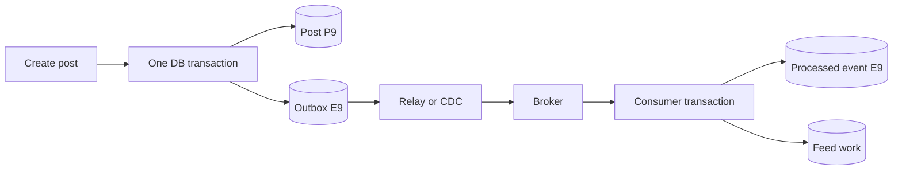

**Ordering rule:** when per-chat/per-entity order matters, persist its sequence/version and design relay and consumer ordering around it. Routing to one broker partition preserves publication order; it cannot fix business events that were already published out of order.

### Durable webhook inbox — related but different

For a payment-provider callback:

1. Verify the signature against the original request body and apply the provider's replay/timestamp rules.
2. Insert the provider/account/event identity into a durable inbox with uniqueness.
3. Acknowledge durable acceptance promptly; process expensive business work asynchronously.
4. Duplicates become harmless; out-of-order events must still obey business-state rules.
5. Missing events require reconciliation, not just deduplication.

Stripe explicitly documents duplicate delivery and lack of guaranteed event ordering; integrations must verify signatures and handle both. [Stripe webhook behavior](https://docs.stripe.com/webhooks).

### Trade-offs

| Choice              | Gain                                        | Cost / limitation                                                 |
| ------------------- | ------------------------------------------- | ----------------------------------------------------------------- |
| Poll outbox table   | Straightforward and explicit                | Polling load, cleanup, publication delay                          |
| CDC relay           | Efficient streaming of committed changes    | Connector/log retention, schema evolution, operational complexity |
| Durable inbox       | Survives receiver crash and supports replay | Extra storage, deduplication, processing backlog                  |
| Direct publish only | Fewer moving parts                          | Can silently lose consequences after a DB commit                  |

### If it fails — safe fallback

| Failure                                    | Effect                                           | Recovery / fallback                                                    |
| ------------------------------------------ | ------------------------------------------------ | ---------------------------------------------------------------------- |
| Relay down                                 | Business writes may succeed but consequences lag | Restart and drain committed backlog; alert on oldest pending event     |
| Publish succeeds, mark fails               | Event republished                                | Stable event ID and idempotent consumer                                |
| Dedup marker saved without business effect | Event may be skipped forever                     | Commit both atomically, or use a recoverable processing-state protocol |
| CDC log position lost/expired              | Gap in projection                                | Controlled snapshot + replay; reconcile expected state                 |
| Backlog storage fills                      | Acceptance cannot remain durable                 | Throttle/reject new work before disk exhaustion                        |

**Use when / why:** save file version + change event together, then let disconnected devices catch up later. **Skip:** claiming the outbox alone guarantees exactly-once emails or charges.

**Watch:** oldest unpublished age, inbox backlog, duplicate rate, connector health, and publication gaps.

---

## 17 Idempotency and state machines

> **Mental model:** Idempotency answers **“is this the same operation?”** A state machine answers **“is this transition allowed now?”**

**Used in:** payment creation/capture/refund/payout, seat checkout, file commits, chat sends, and notification delivery.

### 5W1H

- **What — what is idempotency?** Repeating the same logical operation does not repeat its business effect. An idempotency key identifies that operation; it is not just a random unique request ID generated on every attempt.
- **Why — why is it essential?** Timeouts do not tell the caller whether an operation happened. Network retries, broker replay, duplicate webhooks, and worker crashes are normal.
- **Who — who generates and validates identity?** The client or initiating service creates a stable key. The receiving service scopes it to the tenant/operation, validates parameters, and durably records its ownership and outcome.
- **Where — where must it be enforced?** At every effect boundary: API acceptance, DB changes, provider calls, and consumer effects. A Redis “seen” flag alone is not a durable financial guarantee.
- **When — when is a new key correct?** For a genuinely new business operation, not a retry of an uncertain old one. A refund is different from a capture; separate partial refunds also require distinct operation identities and aggregate limits.
- **How — how does a safe handler work?** Atomically establish unique ownership of the key, save a normalized request hash, enforce state transitions, perform/reconcile the operation, and replay the recorded outcome. A concurrent retry finds the same in-progress operation instead of creating another.

Provider semantics and retention differ. For example, Stripe supports idempotency keys for safe request retries, but exact response behavior and retention depend on the API contract. Keep your internal financial-operation history beyond a short-lived cache. [Stripe idempotent requests](https://docs.stripe.com/api/idempotent_requests).

### Case study — payment succeeded but the response was lost

1. Client submits operation `pay:order-42`.
2. The payment service saves the payment operation and a stable PSP-operation key.
3. PSP performs the effect, but the response times out.
4. Mark the outcome `UNKNOWN` / pending verification—not definitively failed.
5. Query/retry according to the provider's original-operation contract.
6. Return the same verified operation result when the client retries.

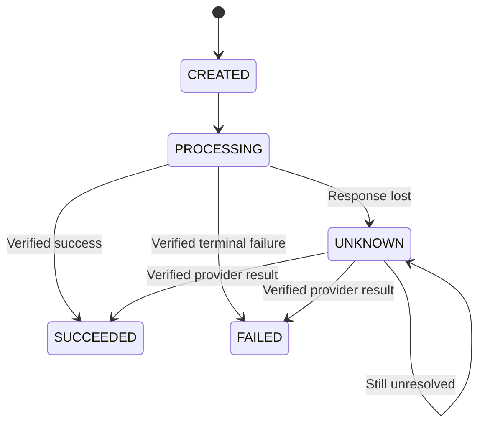

**Request-hash rule:** same key + different amount/currency/resource must be rejected as conflicting reuse, not silently replayed as if equivalent.

**Transition rule:** an old `AUTHORIZED` event must not move a captured payment backwards. Compare allowed source state and operation identity; when ambiguous, query authoritative provider state rather than sort events solely by timestamp.

### Trade-offs

| Choice                     | Gain                               | Cost / limitation                                                    |
| -------------------------- | ---------------------------------- | -------------------------------------------------------------------- |
| Durable uniqueness + state | Survives process/cache loss        | Database storage and careful concurrency                             |
| Cache-only deduplication   | Fast                               | Eviction, failover, and TTL can re-enable duplicates                 |
| Long dedup retention       | Protects long replay/retry windows | Storage/privacy lifecycle management                                 |
| One generic payment status | Simple display                     | Hides distinct authorization, capture, refund, and payout operations |

### If it fails — safe fallback

| Failure                                          | Effect                                          | Recovery / fallback                                                    |
| ------------------------------------------------ | ----------------------------------------------- | ---------------------------------------------------------------------- |
| Two identical requests race                      | Both could create effects                       | Unique scoped key and atomic claim; replay/wait for the winner         |
| Same key, different payload                      | Conflicting operation identity                  | Reject and require a genuinely new operation                           |
| Provider outcome unknown                         | Risk of double effect                           | Preserve original identity and reconcile; do not switch to a fresh key |
| Dedup store unavailable                          | Cannot prove operation novelty                  | Defer/reject sensitive writes; do not bypass uniqueness                |
| Provider has no usable idempotency/query support | External effect cannot be proven safe to repeat | Bound/manual recovery and an explicit weaker guarantee                 |

**Use when / why:** `client_message_id` scoped to sender for chat, `commit_id` for file version publication, financial operation IDs for captures. **Skip:** “exactly once” as an unexplained end-to-end promise.

**Watch:** conflicting key reuse, duplicate attempts, stuck in-progress age, invalid transitions, and UNKNOWN operation age.

---

## 18 Real-time gateway WebSocket and SSE

> **Mental model:** The connection carries updates quickly. Durable history and cursors make updates recoverable.

**Used in:** chat, file-change hints, ticket seat maps, presence, delivery receipts, and live status.

### 5W1H

- **What — what are the choices?** WebSocket provides a persistent bidirectional channel. Server-sent events provide a server-to-client HTTP event stream. Polling asks periodically; long polling waits for a response or timeout.
- **Why — why not only poll?** Frequent polling wastes requests; infrequent polling delays updates. Persistent connections reduce repeated request overhead but add connection management.
- **Who — who owns state?** The gateway owns sockets in memory. The message/metadata service owns durable records. A registry maps users/devices/sessions to current gateways, not just one gateway per user.
- **Where — where does routing happen?** A delivery router finds the receiving session's gateway. Store a session generation so an old disconnect does not remove a newer session's mapping.
- **When — when choose WebSocket vs SSE?** Bidirectional chat suits WebSocket. One-way seat-map or status updates can use SSE while writes remain ordinary authenticated HTTP requests.
- **How — how does recovery work?** Heartbeats detect dead sessions; reconnect with backoff/jitter; authenticate again; fetch changes after a durable cursor. Push can be duplicated or missed across reconnection, so the cursor—not socket continuity—is the recovery contract.

SSE includes event IDs and `Last-Event-ID` reconnection support, but the application must retain/replay the corresponding events. The transport does not create a durable event store. [WHATWG server-sent events](https://html.spec.whatwg.org/multipage/server-sent-events.html).

### Case study — send a message to an offline recipient

1. Alice sends a message with a stable client-message ID.
2. The service checks membership and persists the message plus delivery intent.
3. Alice receives **accepted/sent** only after the required durable write.
4. Bob is offline, so the message remains retrievable; a push notification is a wake-up hint.
5. Bob reconnects on another gateway/device and requests messages after his cursor.
6. A device acknowledgment supports **delivered**; an explicit read action supports **read**.

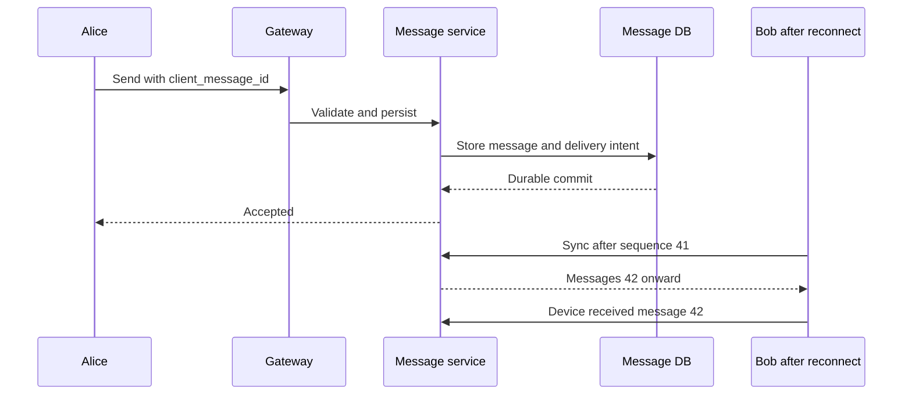

### Trade-offs

| Transport     | Gain                             | Cost / limitation                                         |
| ------------- | -------------------------------- | --------------------------------------------------------- |
| WebSocket     | Fast bidirectional communication | Connection memory, heartbeat, routing, reconnect handling |
| SSE           | Simple one-way live stream       | Client writes need a separate request path                |
| Short polling | Simple and widely compatible     | Extra requests and update delay                           |
| Long polling  | Less idle polling traffic        | Held requests and repeated reconnect/request management   |

**Ordering:** TCP/WebSocket ordering on one connection is not a total order across devices/producers. If strict conversation order is required, assign an authoritative per-chat sequence under a safe serialization mechanism; timestamps/Snowflake IDs provide weaker ordering.

### If it fails — safe fallback

| Failure                     | Effect                       | Recovery / fallback                                                             |
| --------------------------- | ---------------------------- | ------------------------------------------------------------------------------- |
| Gateway dies                | Sockets close                | Reconnect elsewhere, renew session mapping, sync durable history                |
| Presence entry stale        | Router targets dead session  | TTL/heartbeat cleanup and durable catch-up; “online” is approximate           |
| Redis routing unavailable   | Live delivery may be delayed | Preserve messages, use bounded polling/sync; do not acknowledge undurable sends |
| Client falls behind         | Socket buffer grows          | Bound buffers; disconnect slow client with a resumable cursor                   |
| Millions reconnect together | New overload                 | Jitter, staged admission, and capacity for reconnect work                       |

**Use when / why:** WebSocket for chat; SSE for advisory seat-map changes. **Skip:** treating a green seat map or a live socket as proof that a later reservation will succeed.

**Watch:** active connections, per-gateway skew, heartbeat failures, reconnect rate, sync lag, and message accept-to-deliver latency.

---

## 19 Object storage and signed access

> **Mental model:** The database manages file meaning and permission; object storage manages the large bytes.

**Used in:** file storage, chat attachments, feed images, and backup/report artifacts.

### 5W1H

- **What — what is object storage?** A service that stores byte objects identified by keys, with durability/access features supplied by the chosen product. It is not the same abstraction as a transactional filesystem or a relational database.
- **Why — why avoid application-server disks?** Large bytes would consume server bandwidth/storage, complicate horizontal scaling, and disappear or become inaccessible with instance replacement.
- **Who — who uploads/downloads?** Authorized clients can transfer directly using narrowly scoped signed access. The backend owns metadata, permission checks, upload-session authorization, and publication.
- **Where — where are control and data planes?** Control plane: authenticate, allocate version/key, manage metadata. Data plane: client ↔ object storage/CDN for bytes.
- **When — when use direct transfer?** Especially for large files and media. Private objects still require authorization before a signed capability is issued; signing a guessed key is not a permission check.
- **How — how is a file published safely?** Allocate a version-specific object key, upload, verify completion/integrity, then atomically publish its metadata/version. Metadata and object storage do not share an ordinary DB transaction.

An S3 presigned URL grants time-limited capability for an object operation, can be reused while valid, and may expire sooner if its signing credentials expire. Uploading to the same object key can replace existing data; use deliberate immutable/version-specific key design. [S3 presigned URLs](https://docs.aws.amazon.com/AmazonS3/latest/userguide/using-presigned-url.html).

### Case study — upload a private 50 GiB file

1. Alice requests an authorized upload session.
2. The backend creates a pending version and scoped upload instructions.
3. Alice sends bytes directly to object storage.
4. The backend verifies the finalized object's identity, expected size/checksum policy, and any required processing.
5. A DB transaction marks the version active and records a change event.
6. Other devices receive only a hint, then request authorized metadata/download access.

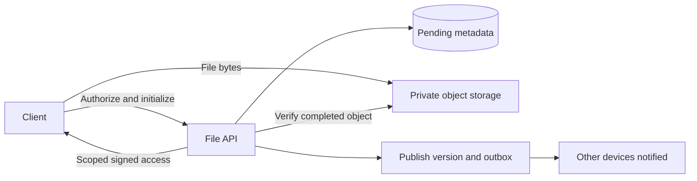

### Trade-offs

| Choice                      | Gain                                           | Cost / limitation                                                |
| --------------------------- | ---------------------------------------------- | ---------------------------------------------------------------- |
| Upload through backend      | Central processing point                       | Backend bandwidth, timeouts, double transfer path                |
| Direct signed upload        | Lower application bandwidth and better scale   | Session control, verification, expiry, untrusted-client handling |
| Immutable version keys      | Avoid overwrite races and simplify caching     | Retention, garbage collection, storage costs                     |
| Object versioning / backups | Recovery from some deletion/overwrite failures | Not a substitute for permission controls or tested restore       |

### If it fails — safe fallback

| Failure                                | Effect                                 | Recovery / fallback                                                                             |
| -------------------------------------- | -------------------------------------- | ----------------------------------------------------------------------------------------------- |
| Upload succeeds; metadata commit fails | Orphaned bytes / pending version       | Retry the same commit; reconcile; clean only safely unreferenced objects after a grace period   |
| Metadata points to incomplete data     | User sees a broken file                | Prevent publication until verified; repair/revert visible pointer under a controlled policy     |
| Storage region unavailable             | Reads/uploads may fail                 | Retry or use a preplanned consistent recovery copy; do not claim an incomplete upload succeeded |
| Signed link leaks                      | Unauthorized holder may use capability | Short lifetimes, minimal scope, protected logs, supported revocation controls                   |
| Object checksum mismatch               | Possible corruption                    | Reject/retry/recover from verified copy; never silently serve corrupt bytes                     |

**Use when / why:** store large media outside the metadata database. **Skip:** making a bucket public or proxying every download through an API merely to check access.

**Watch:** upload completion rate, orphan/pending age, checksum errors, permission failures, egress, and restore success.

---

## 20 Multipart upload and delta transfer

> **Mental model:** Multipart makes one upload resumable. Delta transfer reuses unchanged content across versions. They are related, not the same feature.

**Used in:** large file upload, unreliable networks, and efficient cross-device synchronization.

### 5W1H

- **What — what is a chunk/part?** A bounded piece of a file. Storage-provider multipart parts build one final object; independently stored content-addressed chunks are a different application-level representation.
- **Why — why split a file?** Retry a failed piece rather than all 50 GiB, bound memory, show progress, and use controlled parallelism. Delta transfer can additionally reduce repeated bytes when only part of a file changes.
- **Who — who tracks progress?** The client tracks attempted/completed transfers; the server verifies authoritative storage state before publishing. Client claims alone cannot prove bytes exist.
- **Where — where is the manifest?** A durable upload session records ownership and expected parts; an independent-chunk design needs a durable ordered manifest linking a version to reusable chunks.
- **When — when use delta transfer?** Repeated large-file edits justify chunk indexing, hashing, retention, and conflict complexity. Ordinary multipart is often enough for large initial uploads.
- **How — how does resumption work?** Preserve upload ID/session, part numbers, and verified completion information. On reconnect, reconcile stored parts and send missing pieces; finalize and publish idempotently.

S3 multipart supports independent part uploads and retry, followed by completion. Its ETag is not a universal whole-file MD5 checksum; use the documented checksum mechanism for integrity. [S3 multipart and checksum behavior](https://docs.aws.amazon.com/AmazonS3/latest/userguide/mpuoverview.html).

### Case study — a network drops near the end

Assume **50 GiB**, not decimal GB, and **8 MiB** parts:

```text
50 × 1,024 MiB ÷ 8 MiB = 6,400 parts
4 concurrent parts × 8 MiB = 32 MiB of payload buffers, plus overhead
```

1. The backend creates an upload session and checks current provider limits.
2. Most parts upload successfully.
3. The network drops; the client retains the upload identity.
4. On reconnect, backend/storage verification establishes which parts actually exist.
5. Only missing/failed parts are resent.
6. Finalization and metadata publication use the same stable commit identity on retry.

```mermaid
flowchart LR
    F["Large file"] --> C["Bounded chunker"]
    C --> P1["Part 1 - verified"]
    C --> P2["Part 2 - missing"]
    C --> P3["Part 3 - verified"]
    P1 --> S["Upload session in storage"]
    P2 -.->|Retry only missing part| S
    P3 --> S
    S --> V["Verify and complete"]
    V --> M["Publish version metadata"]
```

### Trade-offs

| Choice                   | Gain                                   | Cost / limitation                                            |
| ------------------------ | -------------------------------------- | ------------------------------------------------------------ |
| Small chunks             | Smaller retries, fine-grained progress | More requests, metadata, hashes, and provider-limit pressure |
| Large chunks             | Fewer requests                         | More bytes resent per failed part                            |
| Fixed-size delta chunks  | Simple boundaries                      | Inserting a byte near the start can shift many later chunks  |
| Content-defined chunking | Better reuse after inserts/deletes     | More CPU and implementation complexity                       |
| Cross-user deduplication | Saves duplicate storage                | Existence/privacy leakage and authorization complexity       |

**Important distinction:** after multipart completion, changing one part does not automatically modify that part in the finalized object. Reusing old content requires an explicit copy/reassembly or independent-chunk/manifest strategy.

### If it fails — safe fallback

| Failure                                    | Effect                                | Recovery / fallback                                                                    |
| ------------------------------------------ | ------------------------------------- | -------------------------------------------------------------------------------------- |
| Browser loses session                      | Cannot easily identify uploaded parts | Recover durable session where supported; otherwise restart and expire abandoned upload |
| Client lies about progress                 | Metadata could become inconsistent    | Verify storage session/parts/final object server-side                                  |
| Same part number resent                    | Previous part may be replaced         | Track the actual final part identity/checksum under provider rules                     |
| Upload abandoned                           | Unfinished parts consume storage      | Lifecycle abort/cleanup with a retention window                                        |
| Chunk garbage collection races with commit | A referenced chunk may be deleted     | Transactional references/manifests or a safe delayed mark-and-sweep protocol           |

**Use when / why:** multipart for a large first upload; delta chunks for frequent large-file edits. **Skip:** adding cross-user deduplication before defining privacy and chunk-lifecycle rules.

**Watch:** resumed bytes saved, retry ratio, part count, abandoned sessions, completion errors, and chunk-reference consistency.

---

## 21 Metadata versioning and synchronization

> **Mental model:** Push says **“something changed.”** A durable version history/change feed says **“here is exactly what you missed.”**

**Used in:** multi-device file storage; the same recovery idea also appears in chat synchronization.

### 5W1H

- **What — what is metadata?** File identity, current version, size/type, parent folder, ownership/shares, and references to bytes. The change log describes committed metadata changes a device needs to discover.
- **Why — why separate versions from the current pointer?** An immutable version preserves content history, while a small current-version pointer can be updated with a concurrency check. This prevents silently losing a competing edit.
- **Who — who creates and resolves versions?** Devices propose changes based on a version they read; the server verifies permissions and expected version. Users/application rules resolve conflicts that cannot safely merge.
- **Where — where is synchronization state?** Server-side durable metadata/change feed plus each device's local journal and cursor. A WebSocket session or a wall-clock timestamp alone is not sufficient state.
- **When — when is optimistic concurrency useful?** Two devices edit the same file while offline or concurrently. Rejecting a conflicting commit is safer than silently applying last-write-wins to an important binary document.
- **How — how is sync performed?** Upload verified bytes first, then conditionally publish a version only if the old pointer matches. Commit metadata and change intent together; devices fetch changes after an opaque/commit-safe cursor and advance only after local application.

### Case study — laptop and phone edit version 7

1. Both devices start from `v7`.
2. Laptop uploads and commits `v8` with expected version `v7`.
3. Phone uploads its changes but also expects `v7`.
4. The server's conditional update fails; it returns a conflict instead of overwriting v8.
5. Phone keeps a conflicted copy or applies a deliberate merge, then commits against the new state.
6. Other devices catch up through a durable change cursor; missed push messages do not lose changes.

```mermaid
flowchart LR
    L["Laptop from v7"] --> C["Conditional commit"]
    P["Phone from v7"] --> C
    C --> D{"Current version still v7?"}
    D -->|First writer yes| V["Publish v8 plus change event"]
    D -->|Later writer no| X["Conflict - preserve local copy"]
    V --> Q["Durable change feed"]
    Q --> O["Other devices resume by cursor"]
```

### Metadata and cursor rules worth remembering

- Index sharing relationships by recipient/user as well as file where needed; avoid scanning every file's share list.
- A change cursor needs stable ordering and tie handling. **`updated_at > last_timestamp` can miss equal timestamps and late commits.**
- An ordinary sequence allocated before commit is not automatically commit order. Use a database/provider change-feed cursor or an explicitly serialized/commit-safe publication protocol.
- If the cursor is older than retained history, perform a snapshot-plus-catch-up protocol with a well-defined boundary.
- Moves, renames, deletions, and permission changes are sync events too; tombstones prevent accidental resurrection.

### Trade-offs

| Choice                          | Gain                                      | Cost / limitation                               |
| ------------------------------- | ----------------------------------------- | ----------------------------------------------- |
| Last-write-wins                 | Simple automated result                   | Can silently discard edits                      |
| Version check + conflicted copy | Preserves competing work                  | User-visible conflicts and extra versions       |
| Automatic document merge        | Better collaboration for suitable content | Format-specific correctness and complexity      |
| Push + periodic pull            | Low perceived delay and robust catch-up   | Connections plus polling/change-feed management |

### If it fails — safe fallback

| Failure                               | Effect                              | Recovery / fallback                                                        |
| ------------------------------------- | ----------------------------------- | -------------------------------------------------------------------------- |
| WebSocket notification lost           | Device does not immediately refresh | Periodic/resume pull from durable cursor                                   |
| Metadata saved, event not published   | Other devices lag                   | Transactional outbox and replay                                            |
| Device crashes while applying changes | Cursor/content may disagree         | Apply through a recoverable local journal; do not advance cursor too early |
| Permission lookup fails               | Cannot prove visibility             | Withhold private data; do not use stale access as a universal fallback     |
| Byte upload orphaned after conflict   | Unreferenced data remains           | Retain for retry/conflict resolution, then safe delayed cleanup            |

**Use when / why:** version-checked file commits for offline editing. **Skip:** last-write-wins just to avoid implementing conflict handling for valuable user data.

**Watch:** conflicts, sync lag, cursor-expiry resyncs, stuck versions, orphan age, and unauthorized sync results.

---

## 22 Feed builder fan-out and pagination

> **Mental model:** Decide whether to pay for assembling a feed **when someone publishes** or **when someone reads**.

**Used in:** News Feed and analogous large-recipient distribution problems.

### 5W1H

- **What — what is a feed builder?** A pipeline that selects candidate post IDs, merges sources, enforces visibility, ranks/orders results, and returns a page. A feed cache is a derived view, not the sole post archive.
- **Why — why not query every followed account every time?** Read-time merging can be expensive for users following many accounts. Precomputed timelines make reads cheaper but amplify writes.
- **Who — who gets fan-out?** Followers, often prioritizing recently active recipients. Celebrity/high-follower publishers may use pull-on-read instead of writing millions of timeline entries at publication.
- **Where — where is data stored?** Canonical post DB; follower graph; per-user timeline IDs; shared post-object cache; object storage for media. Keeping full post bodies in every feed wastes space and complicates updates.
- **When — when use push, pull, or hybrid?** Push for ordinary publishers with manageable active audiences; pull for huge audiences or low-read populations. Hybrid thresholds depend on measured follower activity, posting rate, and latency goals.
- **How — how does a hybrid read work?** Load precomputed IDs, retrieve recent pull-source candidates, merge/deduplicate, filter current visibility, hydrate objects, rank, and paginate under a defined cursor contract.

### Case study — ordinary account vs celebrity

1. Alice posts to 500 followers; async workers insert post IDs into relevant timelines.
2. A celebrity posts to millions of followers; the system keeps that source available for read-time merge.
3. Bob opens his feed: merge his timeline with recent posts from followed pull sources.
4. Deduplicate by post ID, then check deleted/private/unfollowed content before display.
5. Return a cursor with the required ordering/source positions.

```mermaid
flowchart LR
    A["Ordinary post"] --> O["Post DB plus outbox"]
    O --> W["Fan-out workers"]
    W --> T["Per-user timeline IDs"]
    C["Celebrity recent posts"] --> R["Feed merge"]
    T --> R
    R --> V["Deduplicate and verify visibility"]
    V --> H["Hydrate and rank"]
    H --> U["Page plus cursor"]
```

### Trade-offs

| Strategy             | Gain                                         | Cost / limitation                                  |
| -------------------- | -------------------------------------------- | -------------------------------------------------- |
| Fan-out on write     | Fast predictable feed reads                  | Many timeline writes; waste for inactive followers |
| Fan-out on read      | Cheap publish; no huge audience push         | Expensive read-time merge                          |
| Hybrid               | Avoids extreme celebrity write amplification | More sources, merge logic, and cursor state        |
| IDs + shared objects | Less duplication; easier body refresh        | Extra object lookup and cache dependency           |

**Why the amplification matters:** your assumptions of 200 million posts/day × 500 followers imply **100 billion timeline insertions/day** before activity filtering—far more than the post-write rate.

**Pagination:** a chronological cursor can use `(created_at, post_id)` with a stable tie-breaker and snapshot boundary. A changing ranked/hybrid feed may need a ranking session/version and per-source positions; a simple timestamp is not enough to guarantee a frozen feed.

### If it fails — safe fallback

| Failure                        | Effect                            | Recovery / fallback                                                                          |
| ------------------------------ | --------------------------------- | -------------------------------------------------------------------------------------------- |
| Timeline cache lost            | Precomputed feed missing          | Bounded rebuild/read-time recent feed; avoid all-user rebuild stampede                       |
| Fan-out lag grows              | New posts appear late             | Scale within partition/storage limits; prioritize active users; expose freshness degradation |
| Ranking service down           | Personalized ranking unavailable  | Chronological/recent safe candidates under a defined fallback                                |
| Post deleted or user unfollows | Old timeline IDs remain           | Filter at read time; invalidate body cache; clean derived entries asynchronously             |
| Canonical post DB down         | New posts cannot be durably saved | Fail writes; serve only safe cached reads whose visibility policy can still be enforced      |

**Use when / why:** hybrid fan-out for a read-heavy social feed with highly skewed follower counts. **Skip:** copying every full post into every user's cache or selecting a celebrity threshold without measurements.

**Watch:** post-to-feed delay, fan-out amplification, oldest backlog age, hot post keys, feed p99, duplicate/filtered results, and cache rebuild load.

---

## 23 Notification delivery pipeline

> **Mental model:** One business event can create several delivery operations. “Provider accepted” is not “a human read it.”

**Used in:** Notification System; chat wake-up pushes; ticket confirmations; payment and file-share notifications.

### 5W1H

- **What — what does the pipeline do?** Accept durable notification intent, expand recipients, apply preferences/templates, create channel deliveries, call providers, and track results/in-app history.
- **Why — why separate channels?** SMS, email, push, and in-app writes have different costs, rate limits, latency, and failure modes. An email outage should not block an in-app inbox.
- **Who — who decides delivery policy?** The business event selects purpose/priority; user preferences and product rules determine permitted channels. Sender workers enforce provider quotas and record attempts.
- **Where — where is truth stored?** Durable notification/delivery records and in-app inbox; queues distribute work. Device tokens and templates need versioned management, not ad-hoc strings scattered across producers.
- **When — when should delivery happen?** Immediately for eligible transactional events; scheduled/batched for other work. Respect expiry, opt-outs, quiet hours, and recipient timezone where applicable.
- **How — how is duplication controlled?** Derive stable delivery identity from notification, recipient, channel, and relevant policy/version. Deduplicate internal work; use provider idempotency where available, and acknowledge that uncertain non-idempotent external sends may duplicate.

### Case study — “your order shipped”

1. Order service commits its change and an outbox event.
2. Notification intake durably records intent and returns queued status.
3. A processor reads current preferences/device tokens and selects allowed channels.
4. Channel jobs render the intended template/locale and send independently.
5. In-app notification remains fetchable even if push is missed.
6. Provider receipts update delivery state, while user read status remains a separate signal.

```mermaid
flowchart LR
    E["OrderShipped event"] --> N["Durable notification intake"]
    N --> P["Preferences template and recipient expansion"]
    P --> Q1["Push queue"]
    P --> Q2["Email queue"]
    P --> Q3["In-app queue"]
    Q1 --> A["Push provider"]
    Q2 --> B["Email provider"]
    Q3 --> I[("Inbox DB")]
    A --> S["Delivery status tracker"]
    B --> S
```

### Trade-offs

| Choice                           | Gain                                      | Cost / limitation                                             |
| -------------------------------- | ----------------------------------------- | ------------------------------------------------------------- |
| Separate channel/priority queues | Failure isolation and controlled capacity | More queues and routing policy                                |
| At-least-once attempts           | Recover from transient failure            | Duplicate risk at uncertain external boundaries               |
| Multi-provider fallback          | Helps provider-specific outages           | Cost, consent, duplicate sends, routing and status complexity |
| Store inbox + delivery logs      | Retrieval and debugging                   | Retention, privacy, and storage volume                        |

**Status vocabulary:** accepted → queued → sending → provider-accepted → delivered/failed where the channel supports receipts. **Read** is separate and often unavailable or unreliable for external channels.

### If it fails — safe fallback

| Failure                        | Effect                                      | Recovery / fallback                                                                          |
| ------------------------------ | ------------------------------------------- | -------------------------------------------------------------------------------------------- |
| Push provider unavailable      | Device may not receive alert                | Retry within expiry; in-app inbox and other explicitly permitted channels                    |
| Email/SMS times out after send | Uncertain delivery                          | Check provider identity/status if supported; do not promise duplicate-free external delivery |
| Device token invalid           | Future pushes fail                          | Disable invalid token; let device register a new one                                         |
| Preferences unavailable        | Cannot determine allowed marketing delivery | Defer rather than bypass opt-out; transactional policy must be explicitly defined            |
| Bulk campaign floods pipeline  | Urgent notifications delayed                | Separate pools, priority budgets, per-tenant/channel limits                                  |
| Quiet-hour job restarts        | Scheduled event may run twice               | Durable due state and stable delivery identity                                               |

**Use when / why:** purchase confirmation through an independently recoverable pipeline. **Skip:** substituting email for SMS automatically without checking purpose, consent, expiry, and duplicate risk.

**Watch:** event-to-channel latency, oldest queued age, provider acceptance vs delivery, duplicate complaints, invalid-token rate, and cost per channel.

---

## 24 Short-link creation and redirect service

> **Mental model:** Creating a mapping is a correctness problem; redirecting it is a fast read problem; click analytics is a separate asynchronous problem.

**Used in:** URL Shortener and Unique ID Generator.

### 5W1H

- **What — what is stored?** A unique short code mapped to a validated destination, ownership, expiry/status, and creation metadata. Click events belong in an analytics path rather than a hot mutable counter on every mapping.
- **Why — why separate create/read paths?** Redirect traffic may vastly exceed creation traffic. Redirect must remain fast even when analytics workers fail.
- **Who — who chooses the code?** The allocator/generator or a user requesting a custom alias. The database enforces uniqueness regardless of optimistic checks or Bloom filters.
- **Where — where is mapping truth?** In durable storage; caches and optionally edge responses accelerate reads. New-link reads must account for replica lag or stale negative caches.
- **When — when is Base62 appropriate?** When encoding a numeric namespace compactly into letters/digits. Base62 is encoding, not encryption, hashing, or collision resolution.
- **How — how is a link created?** Allocate a unique ID within the chosen namespace, encode it, insert mapping with uniqueness, and return after durable commit. Random/truncated-hash alternatives must handle conflicts through a real unique insert and retry strategy.

### Case study — a new link immediately becomes popular

1. Create mapping `abc123 → destination` and durably commit it.
2. The first redirect misses cache and reads from a source that can see the new mapping.
3. Populate a TTL-bounded cache entry including expiry/status.
4. Return a redirect with deliberate cache policy.
5. Publish click analytics asynchronously; failure to count one click must not become an accidental redirect outage.
6. Hot links can use local/edge caching, but cached redirects change where clicks can be observed.

```mermaid
flowchart LR
    C["Create request"] --> G["Allocate ID and Base62"]
    G --> D[("Unique durable mapping")]
    U["Click short link"] --> R["Redirect service"]
    R --> K["Cache"]
    K -->|Miss| D
    R --> H["HTTP redirect"]
    R -.-> A["Async click analytics"]
```

### Trade-offs

| Choice                       | Gain                                                   | Cost / limitation                                                           |
| ---------------------------- | ------------------------------------------------------ | --------------------------------------------------------------------------- |
| Sequential/range ID + Base62 | Deterministic collision-free encoding of unique inputs | Predictability/enumeration and allocation dependence                        |
| Random code                  | Less predictable namespace                             | Collision handling and sufficient length required                           |
| Permanent redirect           | Strong caching opportunities                           | Destination changes/revocation and origin-side click tracking become harder |
| Temporary redirect           | More flexible routing                                  | Cache behavior still depends on explicit HTTP policy                        |

HTTP defines `301` as permanent and `302` as temporary; “302 means never cached” is not a safe simplification. Set cache headers intentionally. Cached redirects can bypass your origin analytics. [HTTP redirect semantics](https://httpwg.org/specs/rfc9110.html#status.3xx).

**Length rule:** `62^7 ≈ 3.52 trillion` possible seven-character codes. A full 64-bit ID does **not** always fit seven Base62 characters; up to eleven may be needed. If seven is a hard requirement, design a bounded namespace or use a collision-managed code strategy.

### If it fails — safe fallback

| Failure                            | Effect                                      | Recovery / fallback                                                                 |
| ---------------------------------- | ------------------------------------------- | ----------------------------------------------------------------------------------- |
| Cache unavailable                  | Read pressure moves to DB                   | Bounded fallback, local hot mappings, admission control                             |
| Replica lag after creation         | New link looks missing                      | Read from suitable authority/stickiness or retry on authoritative source            |
| Alias collision                    | Two creators request same code              | Unique constraint; one succeeds, other receives conflict                            |
| Link deleted/expired but cached    | Old redirect may continue                   | Check cached expiry, bounded TTL, invalidation; avoid premature code reuse          |
| Analytics unavailable              | Counts lag or some events lost under policy | Buffer durable analytics where required; keep redirects working                     |
| Preview fetch targets internal URL | SSRF risk                                   | If fetching destinations, restrict schemes/destinations and follow redirects safely |

**Use when / why:** a read-heavy alias mapping with independent analytics. **Skip:** using a Bloom filter as proof of uniqueness, hashing an URL without collision handling, or promising exact click counts with browser-cached redirects.

**Watch:** redirect p99, mapping misses, cache hit/miss rates, invalid destinations, collision rate, and analytics lag.

---

## 25 Seat inventory and reservation service

> **Mental model:** A temporary hold is durable business state with an owner and expiry—not a database transaction kept open for ten minutes.

**Used in:** Ticket Purchasing; analogous to stock reservations and issuer balance holds.

### 5W1H

- **What — what does the component own?** Seat state, hold identity/owner, expiry, booking, and allowed transitions such as AVAILABLE → HELD → PAYMENT_PENDING → SOLD.
- **Why — why is this special?** Many users can race for the same scarce seat. Read caching and more application instances do not remove contention or prevent two sales.
- **Who — who is allowed to confirm?** The current valid booking/hold owner with an eligible verified payment outcome. Possessing an old hold ID is insufficient after ownership changes.
- **Where — where is authority?** In the transactional inventory database. Redis may reject obvious competitors quickly, but cannot be the sole final paid-ticket authority.
- **When — when does a hold expire?** According to authoritative time and state. Normal HELD expiry differs from a controlled PAYMENT_PENDING/UNKNOWN recovery policy; a cleanup job must not blindly release every old timestamp.
- **How — how are holds safe?** Atomically claim only eligible seats, persist hold token/expiry, and verify affected rows. For several seats, lock/check in consistent order and commit all or none in one suitable transaction.

### Case study — two users request A-12

1. Both users saw an advisory green seat map.
2. The booking service attempts a conditional authoritative claim.
3. Only one transaction creates the current hold.
4. The winner pays through a separate idempotent payment operation; no seat row lock stays open throughout checkout.
5. Confirmation checks current hold identity, state, ownership, and payment.
6. A late result after seat reassignment cannot take the new owner's seat.

```mermaid
stateDiagram-v2
    [*] --> AVAILABLE
    AVAILABLE --> HELD: Atomic claim with hold ID
    HELD --> AVAILABLE: Eligible expiry or cancel
    HELD --> PAYMENT_PENDING: Start checkout
    PAYMENT_PENDING --> SOLD: Verified payment and valid ownership
    PAYMENT_PENDING --> AVAILABLE: Verified failure and safe release
    PAYMENT_PENDING --> REVIEW: Unknown or late outcome
    REVIEW --> SOLD: Still eligible and verified
    REVIEW --> AVAILABLE: Compensate and release safely
```

### Trade-offs

| Choice                       | Gain                                | Cost / limitation                                        |
| ---------------------------- | ----------------------------------- | -------------------------------------------------------- |
| DB conditional claim         | Correct single-seat competition     | Hot-row serialization and rejected contenders            |
| Short multi-seat transaction | All-or-nothing seat group           | Lock ordering, contention, transaction-size limits       |
| Redis prefilter/lock         | Reduces obvious duplicate pressure  | Stale/lost locks cannot authorize a sale                 |
| Waiting room                 | Keeps admitted load within capacity | Waiting/fairness UX and token enforcement                |
| Payment protection window    | Reduces late-payment conflicts      | Temporarily ties up scarce seats; needs bounded recovery |

**Saga-style checkout:** reservation and PSP payment cannot share a normal local DB transaction. Persist steps and compensate a verified partial failure. A compensation is a new controlled action, not a magical rollback of an external system.

### If it fails — safe fallback

| Failure                                     | Effect                                    | Recovery / fallback                                                                |
| ------------------------------------------- | ----------------------------------------- | ---------------------------------------------------------------------------------- |
| Redis unavailable                           | Fast competing-request filter lost        | Throttle harder, use authoritative DB within safe capacity, or pause admission     |
| Booking DB unavailable                      | Cannot prove ownership                    | Stop new holds/confirmations; keep safe cached browsing                            |
| Expiration worker delayed                   | Old rows still look held                  | Check expiry in claim logic under state rules; cleanup is not the only enforcement |
| Payment succeeds after hold becomes invalid | Cannot fulfill original booking safely    | Void if only authorized or refund a verified capture under policy; never oversell  |
| Payment outcome unknown                     | Unsafe to charge again or release blindly | Preserve operation, enter bounded recovery, query/reconcile                        |
| Confirmation retried                        | Duplicate ticket/notification risk        | Idempotent booking transition and outbox-driven fulfillment                        |

**Use when / why:** assigned seats with no double sale. **Skip:** one Redis TTL key as the entire booking system or blindly releasing all “older than ten minutes” bookings.

**Watch:** hold conflicts, lock waits, expired/stuck holds, waiting-room throughput, late-payment rate, and sale-without-valid-ownership violations.

---

## 26 Payment orchestrator and provider adapter

> **Mental model:** Persist financial intent, use stable operation identities, and distinguish a verified result from an unknown one.

**Used in:** merchant Payment System, ticket checkout, and the separate issuer-side Visa debit-card case.

### 5W1H

- **What — what does the orchestrator own?** Payment intent, separate authorize/capture/refund operations, allowed state transitions, provider references, and recovery. A provider adapter translates these operations into a PSP's actual contract.
- **Why — why not call a PSP and return its response?** Responses can disappear after the provider succeeds. Without durable intent and recovery state, a restart can create a second charge or permanently lose track of the first.
- **Who — who are the actors?** Merchant/customer, payment service, PSP/acquirer, card network, and issuer. The merchant payment platform normally requests payment through a provider; the issuer decides whether to authorize against its card/account state.
- **Where — where does sensitive data go?** Prefer provider-hosted checkout/tokenization so raw card data does not traverse ordinary application infrastructure. Tokens, API keys, webhook secrets, and customer data still need protection.
- **When — when should calls be synchronous?** When the caller needs an immediate decision under a defined latency contract, such as issuer authorization. Reports, notifications, and reconciliation belong off that critical path.
- **How — how is the workflow safe?** Save intent first, claim the operation, call the provider with a stable operation identity, then record verified success/failure or UNKNOWN. Verified callbacks and reconciliation converge the state.

Hosted/provider-controlled collection can reduce card-data exposure and compliance scope, but does not erase the business's security/compliance responsibilities. Never log raw card data, authentication secrets, or reusable payment capabilities. [Stripe integration security guidance](https://docs.stripe.com/security/guide).

### Case study — merchant checkout times out

1. Save payment `P42` and authorize operation `A42`.
2. The customer completes hosted payment collection/authentication.
3. The orchestrator calls the PSP using A42's stable provider identity.
4. The connection times out: A42 becomes UNKNOWN, not a verified decline.
5. A verified webhook or provider query resolves the original operation.
6. The payment-state transaction and outbox trigger downstream accounting/fulfillment safely.

```mermaid
sequenceDiagram
    participant C as Customer or merchant
    participant P as Payment service
    participant D as Payment DB
    participant X as PSP
    participant R as Recovery worker
    C->>P: Start payment with stable key
    P->>D: Save payment and operation
    P->>X: Authorize original operation
    Note over P,X: Response times out
    P->>D: Record UNKNOWN
    R->>X: Query original operation
    X-->>R: Verified outcome
    R->>D: Apply allowed transition and outbox
```

### Visa debit-card case — a different responsibility boundary

```mermaid
flowchart LR
    P["POS terminal"] --> A["Acquirer"]
    A --> V["Visa network"]
    V --> I["Issuer authorization service"]
    I --> H["Required cryptographic and risk checks"]
    H --> D[("Atomic balance hold and decision")]
    D --> R["Approval or decline"]
    R --> V
```

The issuer performs required validation and atomically reserves available funds with a durable request decision. Repeated network requests replay that decision. Later clearing/posting is a different stage from immediate authorization; reversal also needs its own idempotent correlation.

**Do not turn an exercise's “six-second target” into a universal Visa rule.** Network/provider timing and authorization arrangements must be checked for the actual integration.

### Trade-offs

| Choice                            | Gain                                           | Cost / limitation                                                          |
| --------------------------------- | ---------------------------------------------- | -------------------------------------------------------------------------- |
| One PSP initially                 | Simpler state/recovery model                   | Provider concentration                                                     |
| Several PSPs                      | Routing flexibility and some outage resilience | Different contracts, token portability, reconciliation, double-charge risk |
| Synchronous authorize             | Immediate decision                             | Strict dependency/latency budget                                           |
| Async processing after acceptance | Decoupled work                                 | Explicit pending state and recovery needed                                 |

### If it fails — safe fallback

| Failure                                           | Effect                                     | Recovery / fallback                                                                               |
| ------------------------------------------------- | ------------------------------------------ | ------------------------------------------------------------------------------------------------- |
| PSP times out after request                       | Outcome unknown                            | Query/retry original operation under provider contract; never blindly charge through a second PSP |
| PSP known unavailable before an operation is sent | New payment cannot start there             | Route a genuinely unsent eligible attempt elsewhere under explicit policy                         |
| Issuer DB unavailable                             | Cannot verify/reserve funds                | Decline/defer under approved network policy; no stale-cache balance approval                      |
| Required HSM unavailable                          | Mandatory cryptographic checks unavailable | Redundant HSM capacity or approved failure policy; never silently skip required verification      |
| Optional risk dependency slow                     | Latency budget threatened                  | Documented risk-approved degraded rules, not unconditional approval                               |
| Issuer unreachable                                | Network may use configured stand-in        | Only eligible contracted stand-in behavior, bounded risk, later reconciliation                    |

Visa's published rules describe stand-in authorization on an issuer's behalf under defined circumstances. **STIP is not a generic application-level “fail open and approve everything” switch.** [Visa published rules — stand-in processing](https://usa.visa.com/dam/VCOM/download/about-visa/visa-rules-public.pdf).

**Use when / why:** an explicit operation ledger/state machine around external money effects. **Skip:** calling an UNKNOWN result failed merely to make the UI look finished.

**Watch:** authorization p99, provider error rates, UNKNOWN age, duplicate-operation attempts, webhook delay, and reversal/reconciliation backlog.

---

## 27 Ledger and balance service

> **Mental model:** Payment status says **what stage an operation reached**. A ledger explains **where each amount belongs**.

**Used in:** merchant Payment System, payouts, refunds, fees, and issuer balances/holds.

### 5W1H

- **What — what is a ledger?** An auditable set of financial entries tied to business operations. A double-entry model balances debits and credits under its accounting model; corrections are new linked entries rather than silent history edits.
- **Why — why not keep only `merchant_balance += amount`?** A mutable number cannot explain provenance, duplicates, fees, reversals, or why available funds differ from captured funds.
- **Who — who can post?** Trusted financial-operation handlers with authorization, immutable references, and unique posting identity. Accounting/funds-flow policy defines the accounts and meanings; application engineers must not invent real financial policy casually.
- **Where — where is the authoritative record?** Durable ledger/journal and authoritative reservation/balance state, updated under a defined transaction model. Read-optimized wallet views are projections that must reconcile.
- **When — when do entries occur?** At defined financial events such as capture, settlement, fee recognition, refund, or payout. Authorization holds and final booked movements are not the same thing.
- **How — how is correctness maintained?** Store exact currency amounts, enforce posting uniqueness, balance entries, transact related changes, and reconcile projections. Balanced entries alone do not prevent posting the same balanced transaction twice.

### Case study — RM100 capture with RM3 platform fee

**Illustrative platform accounting model only:** exclude tax, FX, provider fees, and actual regulatory/funds-flow arrangements.

| Account              |        Debit MYR |       Credit MYR |
| -------------------- | ---------------: | ---------------: |
| PSP receivable       |           100.00 |             0.00 |
| Merchant payable     |             0.00 |            97.00 |
| Platform fee revenue |             0.00 |             3.00 |
| **Total**      | **100.00** | **100.00** |

1. A verified capture event identifies the financial operation.
2. A transaction inserts its unique posting identity and all balanced entries.
3. A duplicate event finds the original posting, not a new RM100 movement.
4. A balance projection shows pending/available amounts according to settlement/risk policy.
5. A refund posts linked correcting movements; the original history remains explainable.

```mermaid
flowchart LR
    P["Verified capture operation"] --> U["Unique financial posting identity"]
    U --> T["Atomic balanced journal entries"]
    T --> L[("Append-only ledger")]
    L --> B["Balance or wallet projection"]
    L --> R["Financial reconciliation"]
    X["Refund or correction"] --> C["Linked correcting posting"]
    C --> L
```

### Money and holds

- Use integer minor units or suitable exact decimal types, with explicit currency precision and rounding policy. **Not every currency uses two decimal places.**
- Do not use binary floating-point arithmetic as the authoritative representation of money.
- In a simplified debit model, `available = posted_balance - active_holds`. Real overdrafts, fees, pending credits, and limits add rules.
- Clearing/posting must convert/release the matching hold correctly; otherwise money can be reserved twice or released incorrectly.
- Multi-currency accounting needs explicit conversion/clearing rules; do not “balance” unrelated currencies by adding their numeric values.

### Trade-offs

| Choice                                 | Gain                                | Cost / limitation                                                        |
| -------------------------------------- | ----------------------------------- | ------------------------------------------------------------------------ |
| Append-only financial history          | Auditability and reconstructability | Storage, correction workflows, retention/security                        |
| Materialized balance view              | Fast reads                          | Must be transactionally maintained or safely reconciled                  |
| Strongly coordinated available balance | Prevents concurrent overspend       | Per-account contention and reduced write availability in unsafe failures |
| Async reporting projection             | Scalable dashboards                 | Lag; unsuitable as approval authority                                    |

### If it fails — safe fallback

| Failure                     | Effect                            | Recovery / fallback                                                                |
| --------------------------- | --------------------------------- | ---------------------------------------------------------------------------------- |
| Ledger commit uncertain     | Posting may already exist         | Query by financial operation/posting ID before retry                               |
| Wallet projection stale     | Display may lag                   | Rebuild/reconcile from ledger; do not use stale display for payout approval        |
| Ledger unavailable          | Cannot safely record new movement | Pause/defer financial effects under a durable recovery protocol                    |
| Duplicate capture event     | Duplicate accounting risk         | Unique business posting identity in same transaction as entries                    |
| Entries/projection disagree | Financial discrepancy             | Quarantine/investigate and correct with traceable postings; no silent balance edit |

**Use when / why:** explain merchant pending vs available money and prevent duplicate payouts. **Skip:** making every account's balance a cache key with no durable provenance.

**Watch:** unbalanced postings, duplicate posting attempts, negative/invalid availability, projection lag, and unreconciled amounts.

---

## 28 Capture settlement payout and reconciliation

> **Mental model:** Authorization, capture, settlement, and payout are separate stages. Reconciliation checks that independent records agree.

**Used in:** the daily payment batch in your Payment System; settlement/clearing recovery in the Visa case.

### 5W1H

- **What — what do the stages mean?** Authorization reserves/permits an amount; capture requests completion of that payment; settlement concerns movement/accounting between participating parties; payout transfers eligible merchant funds. Terminology/details vary by rail/provider.
- **Why — why keep them separate?** A captured payment is not necessarily settled cash, and settled cash is not automatically eligible for merchant withdrawal. Mixing stages creates incorrect balances and duplicate actions.
- **Who — who starts each process?** A scheduler/capture worker handles eligible authorizations; provider/network processes report outcomes; payout workers use eligible reserved funds; reconciliation compares independent evidence.
- **Where — where is progress tracked?** Durable batch, operation, provider-reference, ledger, and discrepancy records. A batch ID groups work; it must not be the only deduplication identity.
- **When — when should the daily job run?** According to business timezone, cutoff, and **actual authorization deadline**. A daily schedule does not override provider expiry or method eligibility.
- **How — how does a safe batch work?** Create/reuse the intended batch, select eligible operations, claim atomically, call the provider using a stable financial-operation key, persist verified result/UNKNOWN, and resume from durable progress.

Card authorization validity and separate-capture support depend on the payment method, network, and transaction details. Track the actual provider expiry/eligibility rather than hard-code one universal number of days. [Stripe authorization and capture documentation](https://docs.stripe.com/payments/place-a-hold-on-a-payment-method).

### Case study — capture succeeds, worker crashes

1. Payment P42 is authorized; full-capture operation C42 is durably identified.
2. Worker A claims C42 and the PSP captures successfully.
3. A crashes before saving the success.
4. Worker B recovers **C42**, not a new capture in “tomorrow's batch.”
5. B queries/retries according to the original operation contract and records the verified result.
6. Reconciliation compares amount, currency, provider references, fees, and later settlement/payout records.

```mermaid
flowchart LR
    S["Daily scheduler"] --> B["Create or reuse batch"]
    B --> O["Claim existing capture operation"]
    O --> P["PSP capture or original-operation query"]
    P --> R{"Verified outcome?"}
    R -->|Success| L["Record capture and ledger intent"]
    R -->|Failure| F["Record terminal or recoverable failure"]
    R -->|Unknown| U["Reconcile original operation"]
    U -->|Original operation only| P
    L --> C["Compare PSP and settlement reports"]
```

### Payout safety

Before sending RM97 to a merchant:

1. Verify **authoritative available** funds and eligibility.
2. Atomically reserve the amount and create the payout operation.
3. Call the provider with that stable payout identity.
4. Complete the accounting on verified success; release/correct reservation on verified failure.
5. If outcome is unknown, investigate the original payout—not a second transfer.

### Reconciliation — two forms

| Form        | Question                                                                                 | Typical action                                                                                    |
| ----------- | ---------------------------------------------------------------------------------------- | ------------------------------------------------------------------------------------------------- |
| Operational | Is this stuck/UNKNOWN operation actually completed at the provider?                      | Query, apply verified allowed transition, release stuck workflow                                  |
| Financial   | Do internal ledger, PSP reports, fees, settlement totals, and bank/payout records agree? | Match references/currency/amounts/cutoffs, investigate discrepancies, post controlled corrections |

Timing differences are not automatically errors. Compare the correct business date/cutoff and gross/net/fee meanings before “fixing” anything.

### Trade-offs

| Choice                      | Gain                                   | Cost / limitation                                        |
| --------------------------- | -------------------------------------- | -------------------------------------------------------- |
| Batch processing            | Efficient scheduling/report grouping   | Delay, cutoff handling, backlog and restart complexity   |
| Near-real-time capture      | Faster completion                      | More calls and tighter coupling to provider availability |
| Automated reconciliation    | Faster recovery and detection          | Matching rules and false positives need careful design   |
| Manual review for ambiguity | Avoids unsafe automatic money movement | Operational work and resolution delay                    |

### If it fails — safe fallback

| Failure                | Effect                                 | Recovery / fallback                                                                                         |
| ---------------------- | -------------------------------------- | ----------------------------------------------------------------------------------------------------------- |
| Scheduler runs twice   | Same payment selected twice            | Unique financial operation and atomic claim, not only unique batch                                          |
| Authorization expires  | Capture may no longer be allowed       | Mark ineligible and follow provider/customer-approved recovery; no blind charge                             |
| Settlement report late | Balance/financial verification delayed | Keep pending, retry retrieval, alert on age                                                                 |
| Payout response lost   | Transfer may already exist             | Query/reconcile original payout while preserving reservation                                                |
| Reports disagree       | Possible timing/error/duplicate/fraud  | Investigate and correct with an audit trail; never initiate a charge/refund merely to force matching totals |

**Use when / why:** restartable daily capture with independent financial verification. **Skip:** calling a daily capture loop “settlement” without confirming what the requirement actually means.

**Watch:** uncaptured authorizations near expiry, UNKNOWN age, missing batches, unreconciled amount, payout reservation age, and report completeness.

---

## 29 Resilience boundary

> **Mental model:** Timeouts bound waiting; retries recover transient failures; circuit breakers and bulkheads stop one failure from consuming everything.

**Used in:** every remote call, particularly PSPs, notification providers, cache fallback, ticket launch traffic, and reconnect storms.

### 5W1H

- **What — what is the boundary?** A combination of end-to-end deadlines, connection/request timeouts, bounded attempts, concurrency limits, circuit breakers, and fallback rules around a dependency.
- **Why — why can one slow service take down others?** Waiting requests hold threads, memory, sockets, and DB connections. Retries can multiply load precisely when the dependency has the least spare capacity.
- **Who — who chooses the policy?** The owning service/product defines which outcomes are safe; callers enforce their remaining deadline. Security/risk owners approve any degraded policy for sensitive checks.
- **Where — where is it enforced?** At each dependency call and at resource pools, with a deliberate owner for retries. Avoid stacking independent retry loops at every layer.
- **When — when should a breaker open?** When observed failures/slow calls cross a tested threshold and continuing calls would likely waste capacity. Half-open probes test recovery; a circuit breaker is not a distributed lock.
- **How — how should recovery behave?** Stop or reduce calls, use an approved cheap fallback if one exists, probe gradually, and retain unknown-operation identities. A timed-out caller does not prove that remote work was cancelled.

### Case study — email provider stalls during checkout

1. Booking commits its valid state and a notification outbox event.
2. The customer does not wait for email transmission to learn the booking outcome.
3. Email workers have bounded concurrency/timeouts and a dedicated pool.
4. Their breaker opens when the provider stalls.
5. In-app booking history still shows the purchase; email retries resume gradually later.
6. Payment/booking correctness is not bypassed to make checkout look available.

```mermaid
flowchart LR
    C["Checkout"] --> B["Authoritative booking transaction"]
    B --> R["Return booking result"]
    B --> O["Notification outbox"]
    O --> W["Isolated email workers"]
    W --> X{"Circuit breaker"}
    X -->|Closed or probe| P["Email provider"]
    X -->|Open| Q["Durable delayed retry"]
    Q --> W
```

### Trade-offs

| Mechanism                | Gain                                  | Cost / limitation                                  |
| ------------------------ | ------------------------------------- | -------------------------------------------------- |
| Shorter timeout          | Frees caller resources sooner         | More false timeouts and uncertain outcomes         |
| Retry                    | Recovers transient failure            | Extra load, delay, and duplicate-effect risk       |
| Circuit breaker          | Reduces calls to unhealthy dependency | Can reject work during recovery; thresholds matter |
| Bulkhead / separate pool | Contains resource exhaustion          | Reserved capacity can be underused                 |
| Load shedding            | Protects useful successful work       | Some requests are intentionally rejected           |

**Retry multiplication:** if five layers each make three total attempts, one outer request can cause up to `3^5 = 243` downstream attempts in the worst case. Use one deliberate retry layer where practical and a shared deadline/budget. [AWS timeout/retry guidance](https://aws.amazon.com/builders-library/timeouts-retries-and-backoff-with-jitter/).

**Backpressure:** slow intake or reject excess work before unbounded queues/memory turn a partial outage into a full collapse. A simpler degraded feed is reasonable; an unverified payment approval is not. [Google SRE overload guidance](https://sre.google/sre-book/handling-overload/).

### If it fails — safe fallback

| Failure                             | Effect                                | Recovery / fallback                                                 |
| ----------------------------------- | ------------------------------------- | ------------------------------------------------------------------- |
| Dependency slow                     | Resource pools saturate               | Deadline, bounded concurrency, breaker, explicit degradation        |
| Breaker too aggressive              | Healthy capacity unused               | Tune from measurements; gradual half-open probes                    |
| Retry storm                         | Recovery delayed                      | Jitter, attempt/deadline budgets, server retry guidance             |
| DB outage causes cache bypass storm | Cascading overload                    | Bound fallback traffic; shed work rather than unlimited DB attempts |
| Fallback changes correctness        | Duplicate charge, oversell, data leak | Reject/defer instead; some components have no safe substitute       |

**Use when / why:** isolate email from checkout and bound cache fallback. **Skip:** a universal “fail open” policy, infinite retries, and fallbacks that silently weaken essential invariants.

**Watch:** in-flight calls, pool saturation, timeout rate, retries per original request, breaker state, and useful completion rate.

---

## 30 Observability backup and disaster recovery

> **Mental model:** Observability tells you what is happening. Backups and recovery procedures let you restore state when redundant live copies are not enough.

**Used in:** all ten systems; especially money, inventory, durable messages, and user files.

### 5W1H

- **What — what is required?** Metrics for behavior, structured logs for events, traces for cross-service paths, durable business/audit records, backups, restore tools, and tested recovery procedures.
- **Why — why is replication insufficient?** A bad deletion, software bug, or compromised credential can damage every live replica. Availability mechanisms do not automatically provide historical recovery.
- **Who — who owns recovery?** Explicit service/platform owners, incident responders, and data owners. A backup with no tested restore owner is not a complete recovery plan.
- **Where — where should evidence/copies live?** Outside the failed process and, for required disaster scenarios, outside the same failure/security domain. Protect encryption keys and recovery access separately.
- **When — when should you alert/test?** Alert on user impact and invariants, not only CPU. Test restore, region recovery, and failover before relying on them; define acceptable recovery time and data loss.
- **How — how do you verify service health?** Track latency, traffic, errors, and saturation, then add domain signals such as UNKNOWN payment age and message lag. Use correlation IDs without leaking credentials/card data or creating unbounded metric cardinality.

Google SRE's monitoring guidance emphasizes latency, traffic, errors, and saturation. Domain-level failure signals complement those infrastructure metrics. [Google SRE monitoring guidance](https://sre.google/sre-book/monitoring-distributed-systems/).

### Case study — a faulty job deletes file metadata

1. Replicas correctly replicate the unintended deletion; live redundancy does not undo it.
2. An alert detects abnormal deletion volume and sync failures.
3. Stop the faulty writer and protect remaining data/restore evidence.
4. Restore to an isolated environment using a valid backup plus recovery logs.
5. Validate permissions, object references, and change-feed boundaries before controlled cutover.
6. Reconcile later legitimate changes and device sync state rather than blindly replacing production.

```mermaid
flowchart LR
    A["Faulty deletion"] --> D[("Primary")]
    D --> R[("Replica also receives deletion")]
    D -.-> B["Independent backup and recovery logs"]
    M["Business and integrity alerts"] --> I["Stop fault and assess"]
    B --> S["Isolated restore"]
    I --> S
    S --> V["Validate and reconcile"]
    V --> C["Controlled cutover"]
```

### Recovery terms

| Term                            | Meaning                                   | Example                                          |
| ------------------------------- | ----------------------------------------- | ------------------------------------------------ |
| RPO — recovery point objective | Maximum acceptable lost-data interval     | How much recent data may be unrecoverable        |
| RTO — recovery time objective  | Target time to restore service            | How long recovery may take                       |
| Point-in-time recovery          | Restore backup and logs to a chosen point | Before an accidental deletion                    |
| Failover                        | Change active serving owner/copy          | Promote valid standby after fencing failed owner |

RPO/RTO are objectives, not facts established by enabling a feature. Measure actual backup age, restore completion, retained logs, dependencies, and encryption-key availability.

### Trade-offs

| Choice                                     | Gain                                                         | Cost / limitation                                               |
| ------------------------------------------ | ------------------------------------------------------------ | --------------------------------------------------------------- |
| More telemetry                             | Better diagnosis                                             | Cost, noise, privacy, cardinality                               |
| Frequent independent backups/log retention | Smaller recovery gaps                                        | Storage, access control, operational validation                 |
| Synchronous cross-site durability          | Lower risk of losing acknowledged writes in covered failures | Latency and availability trade-offs                             |
| Multi-region active-active                 | Potential local availability                                 | Much harder write ownership, conflict, and recovery correctness |

### If it fails — safe fallback

| Failure                                    | Effect                                  | Recovery / fallback                                                                                            |
| ------------------------------------------ | --------------------------------------- | -------------------------------------------------------------------------------------------------------------- |
| Metrics/log backend down                   | Reduced visibility                      | Bounded local buffering and independent health signals; optional telemetry must not exhaust business resources |
| Required financial audit persistence fails | Cannot prove critical operation history | Do not silently drop mandatory records; preserve durable intent or stop affected operations                    |
| Backup exists but is corrupt/undecryptable | Recovery fails                          | Regular isolated restore tests and protected accessible keys                                                   |
| Entire zone/region unavailable             | Service/state unreachable               | Preplanned serving ownership, dependency recovery, capacity, and controlled routing                            |
| Bad deployment affects all instances       | Correlated failure                      | Roll back/disable fault; maintain safe schema compatibility and recovery evidence                              |

**Use when / why:** measure correctness and recovery for accepted messages, bookings, payments, and file versions. **Skip:** claiming disaster recovery is solved because there are three replicas.

**Watch:** user-facing SLOs, invariant violations, backup/recovery-log age, restore-test success, real recovery duration, and alert actionability.

---

## Additional interview pattern cards — 31–40

> [!info] Why these are separate
> The first 30 cards are your **existing component knowledge**. The next 10 fill gaps in **API design, domain-specific data structures, asynchronous workflows, and operational evolution**. Each card is intentionally shorter: know the use case, invariant, trade-off, and failure before deep study.

### 31 API contracts, data modeling and indexes

> **Mental model:** APIs define *observable promises*; schemas and indexes determine whether you can fulfill them correctly and efficiently.

- **When:** every system design, before selecting the database brand.
- **Start with:** top user operations → endpoints/events → entities → primary keys → top queries → constraints and indexes.
- **Example:** `POST /holds` with idempotency key; `GET /holds/{id}` for uncertain outcomes; `PRIMARY KEY(event_id, seat_id)` on seat authority; unique `(actor_id, operation_key)` on accepted operations.
- **Trade-offs:** normalized rows simplify integrity but may require joins; denormalized views accelerate reads but create update/freshness work. Indexes speed relevant reads at write/storage cost.
- **Failure:** “read then insert” races unless a constraint or atomic claim protects uniqueness. API retries must use the same logical operation identity.
- **Watch:** slow query plans, index hit/miss, lock waits, constraint failures, stale derived views, API errors.
- **Question:** “Which three queries dominate, what do their access paths look like, and what must be unique?”

### 32 Communication contracts and deadline propagation

> **Mental model:** sync vs async is a **business response requirement**, not a technology popularity contest.

- **When:** deciding between REST/gRPC/WebSocket/SSE, queues, or scheduled work.
- **Flow:** client request → fixed deadline → required authoritative decision → response; durable intent → async consequences only where permitted.
- **Trade-offs:** sync gives a timely result but couples latency/availability; async absorbs variable processing but adds PENDING states, job tracking, and delivery semantics.
- **Failure:** a response timeout doesn't tell you whether downstream work succeeded. Propagate deadlines and cancel useless work only where cancellation is safe; record irreversible effects.
- **Watch:** p95/p99 end-to-end, dependency timeout budgets, queue delay, operations stuck PENDING/UNKNOWN.
- **Question:** “Why can email be async but available-funds authorization usually cannot?”

### 33 Geospatial indexing and live matching

> **Mental model:** nearby search shrinks candidates; matching decides *which eligible actor can actually accept a job*.

- **When:** rides, food delivery, nearby stores/vehicles.
- **Flow:** driver location updates → partitioned/TTL location index (geohash, H3, spatial index) → nearby candidates → availability/quality filter → atomic offer/accept or assignment → ride state machine.
- **Trade-offs:** larger cells are cheap but inaccurate; small cells mean more keys/queries. Location freshness and write rate often dominate. Geospatial cache is not the final authority on whether a driver is already assigned.
- **Failure:** candidate disappears, stale GPS, duplicate assignment, or driver times out → bounded retry with a new candidate and an authoritative assignment transition.
- **Watch:** location age, match p99, failed/duplicate assignments, candidate count, update QPS.
- **Question:** “Two riders choose the same driver from a location cache. Who wins and why?”

### 34 Stream processing, counters, top-K and time-series

> **Mental model:** fast live aggregates are **derived views** of ordered/identified events, with an explicit accuracy/freshness contract.

- **When:** leaderboards, metrics dashboards, event analytics, fraud features.
- **Flow:** keyed events → partitioned log/stream job → windowed aggregation with event-time/watermark policy → materialized counters/top-K → read API.
- **Trade-offs:** Redis sorted sets can serve a moderate leaderboard efficiently, but global/high-cardinality rankings, late events, backfills, and very hot scores require partitioning/merge and reconciliation.
- **Failure:** replay causes double-counting unless event IDs and update semantics deduplicate; late events need an explicitly defined window correction policy.
- **Watch:** consumer lag, watermark age, aggregate-vs-source discrepancy, hot keys, ranking freshness.
- **Question:** “How would your top-100 change if one million scores arrive at once?”

### 35 Distributed scheduling and leased workers

> **Mental model:** the scheduler decides **when work is eligible**; a worker owns a **temporary attempt**, not the eternal right to modify state.

- **When:** email campaigns, reminders, cron, batch exports, video transcode tasks.
- **Flow:** durable jobs table with `run_at` and state → leader/claimers acquire due work → conditional lease + attempt ID → workers execute → durable result/retry state.
- **Trade-offs:** DB-based scheduling is simple at moderate scale; partitioned timing wheels/queues help many timers but add ownership and recovery complexity.
- **Failure:** worker pauses after lease expiry; replacement starts the same job. Use idempotent effects, fence stale writes where necessary, jittered retries and DLQ/dead-letter review.
- **Watch:** time-to-start vs scheduled time, stuck leases, attempts, duplicates, DLQ age.
- **Question:** “Can you guarantee a job starts exactly once after a machine crash?” (Usually guarantee *logical effect* via coordination + idempotency, not exactly-once execution.)

### 36 Saga and durable process managers

> **Mental model:** a saga coordinates multiple **local commits** with explicit transitions and compensating actions; it is not one global ACID transaction.

- **When:** multi-service order/booking + payment + inventory workflows where no common DB transaction spans participants.
- **Flow:** persist saga instance → issue command with operation ID → consume verified result → transition → next step or compensating step → reconcile uncertain external effects.
- **Trade-offs:** orchestration centralizes state and diagnostics; choreography decouples ownership but can obscure the overall process. Compensations may not perfectly reverse real-world effects.
- **Failure:** payment times out after success → don't blindly cancel/recharge; query/reconcile the original payment operation, then decide next transition.
- **Watch:** stuck sagas, compensations failed, age of UNKNOWN outcomes, duplicate commands, business reconciliation gap.
- **Question:** “What if inventory reservation succeeds but payment result is unknown?”

### 37 Safe schema evolution, deployment and data lifecycle

> **Mental model:** a valid architecture must survive rolling deploys, schema upgrades, deletion requirements, and replays.

- **When:** every long-lived service; especially systems with old clients or retained event logs.
- **Flow:** expand schema compatibly → deploy readers tolerant of old/new format → backfill in bounded batches → change writers → verify → remove old fields after consumers migrate.
- **Trade-offs:** online migrations and dual-read/write transitions reduce downtime but complicate correctness and rollback. Soft delete aids recovery yet increases privacy/retention obligations.
- **Failure:** new producer breaks old consumer, backfill overloads DB, replay resurrects deleted data. Use versioned contracts, tombstones, throughput limits and checkpoints.
- **Watch:** lagging clients/consumers, schema violations, backfill rate, deletion SLA, failed rollbacks.
- **Question:** “How would you rename a heavily used column with zero downtime?”

### 38 Video/media pipeline

> **Mental model:** upload once, process asynchronously into multiple renditions, then serve content close to viewers.

- **When:** video-sharing platform, streaming education, on-demand entertainment.
- **Flow:** authenticated upload session → multipart object store → committed metadata + job → transcode/packaging → manifest + segments → CDN → adaptive bitrate player.
- **Trade-offs:** higher renditions improve quality but increase compute and storage; regional CDN caches reduce origin load, not user device bandwidth limits.
- **Failure:** worker crash/duplicate transcode → re-executable job keyed to asset version; partial renditions remain hidden until validated. DRM/rights and expiry need explicit contracts.
- **Watch:** upload failure, transcode queue age, processing throughput, playback start time, rebuffering ratio, CDN hit rate.
- **Question:** “What happens if an upload succeeds but the transcode job is lost?”

### 39 Low-latency fraud/risk features

> **Mental model:** risk decisions combine policy, recent signals and model output under a strict decision budget; stale data may change the error cost.

- **When:** card authorization, account abuse, login risk, transaction screening.
- **Flow:** request → deterministic rules and policy constraints → low-latency feature lookup → optional model score → allow/reject/review → durable decision + async feedback labels.
- **Trade-offs:** richer features can improve detection but cost latency and create fresh-data dependencies. Fallback must follow the product's risk policy, not an automatic fail-open.
- **Failure:** feature store unavailable, delayed event, model timeout → use approved fallback rules/decision policy, record which policy version made the call.
- **Watch:** decision latency, feature age, false-positive rate, fraud loss, drift, manual review backlog.
- **Question:** “How would you decide in two seconds if your streaming features are 20 seconds stale?”

### 40 Collaborative documents and concurrent edits

> **Mental model:** distributed edits need a clear **merge semantics**, not merely ‘last write wins’.

- **When:** Google Docs-like collaboration, shared whiteboards, offline-first notes.
- **Flow:** authenticated editor session → operation with document/version/causal context → server sequencing or compatible CRDT merging → durable operation history/snapshot → broadcast → reconnect sync.
- **Trade-offs:** OT uses transformation rules against concurrent operations; CRDTs encode convergence in their data types, often with metadata and semantic complexity. Neither automatically resolves business-level permissions or intent conflicts.
- **Failure:** lost connection, duplicated edit, offline concurrent updates → replay from durable cursor, dedupe op IDs, validate permission at the write boundary.
- **Watch:** convergence failures, snapshot lag, op log growth, reconnect recovery, permission changes.
- **Question:** “Two users insert at the same position while one goes offline. How do replicas converge?”

---

## Ten system recipes

These are **minimal reasoning paths**, not instructions to deploy every component in the library.

### 1. Chat System

**Flow:** client WebSocket → gateway → message service → durable message + delivery intent → recipient routing/inbox → device acknowledgment.

- **Must never happen:** acknowledge durable acceptance and then lose the only message copy.
- **Key decisions:** per-chat ordering, per-device cursors, sender-scoped message deduplication, bounded group fan-out, approximate presence.
- **Failure story:** a gateway crash loses a connection, not committed history. Reconnect and sync; a push notification is not the message database.
- **Study:** [[#14 Durable message broker]], [[#17 Idempotency and state machines]], [[#18 Real-time gateway WebSocket and SSE]].

### 2. File Storage — Drive / Dropbox

**Flow:** authorize upload → pending version/session → direct multipart bytes → verify → conditional metadata commit + outbox → device change-feed sync.

- **Must never happen:** expose unauthorized bytes or silently overwrite a valuable conflicting edit.
- **Key decisions:** bytes vs metadata, immutable versions, explicit shares/indexes, resumability vs delta reuse, safe change cursors.
- **Failure story:** bytes can upload before metadata commits. Retry publication, reconcile pending state, and safely clean real orphans later.
- **Study:** [[#19 Object storage and signed access]], [[#20 Multipart upload and delta transfer]], [[#21 Metadata versioning and synchronization]].

### 3. Distributed Key-Value Store

**Flow:** Get/Put → coordinator → partition routing → replica-local WAL/memtable/SSTables → chosen acknowledgment/read protocol → repair.

- **Must never happen:** claim a durability/consistency level the actual protocol does not provide.
- **Key decisions:** leader vs leaderless, partition key, replica placement, conflict semantics, compaction/repair, strict vs sloppy quorum.
- **Failure story:** a temporary substitute can preserve availability, but its acknowledgment is not automatically a strict quorum of the intended replicas.
- **Study:** [[#08 Key-value store and LSM storage engine]] through [[#11 Coordination locks leases and fencing]].

### 4. News Feed

**Flow:** post DB + outbox → ordinary-publisher fan-out → per-user ID timeline; read → merge celebrity sources → visibility filter → hydrate/rank → cursor page.

- **Must never happen:** show a deleted/private post solely because an old timeline ID remains cached.
- **Key decisions:** write amplification, active-user targeting, hybrid thresholds, hot object caching, stable chronological or ranked pagination contract.
- **Failure story:** lost feed cache is a derived-view outage. Rebuild within limits or serve a smaller safe recent feed.
- **Study:** [[#06 Cache]], [[#22 Feed builder fan-out and pagination]].

### 5. Notification System

**Flow:** durable notification intent → preferences/template/recipient processing → channel queues → provider sender → delivery records + in-app inbox.

- **Must never happen:** silently discard accepted critical intent or bypass a user's delivery restrictions.
- **Key decisions:** channel/priority isolation, provider quotas, quiet hours, expiry, retries, duplicate risk at external send boundaries.
- **Failure story:** provider outage delays that channel; inbox and other explicitly allowed paths can continue.
- **Study:** [[#15 Workers scheduling retries and DLQ]], [[#23 Notification delivery pipeline]].

### 6. Payment System, plus Visa debit-card case

**Merchant flow:** durable payment/operation → hosted payment collection → provider operation → verified transition/outbox → ledger → capture/settlement/payout/reconciliation.

**Issuer flow:** network authorization → required validation/risk checks → atomic available-funds hold + durable decision → immediate response → later clearing/reversal/reconciliation.

- **Must never happen:** treat a retry as new money movement or approve against an arbitrary stale balance.
- **Key decisions:** distinct operation identities, UNKNOWN outcomes, authorization vs capture, balanced unique ledger postings, provider/network contracts.
- **Failure story:** a timeout preserves the original operation for verification. Configured network stand-in is not the application's permission to bypass its authority.
- **Study:** [[#26 Payment orchestrator and provider adapter]] through [[#29 Resilience boundary]].

### 7. Distributed Rate Limiter

**Flow:** identify client/rule → local coarse protection → atomic shared token-bucket decision → allow or return retry guidance → backend concurrency limit.

- **Must never happen:** have several gateways spend the same token through separate read/check/write operations.
- **Key decisions:** allowed burst, precision, endpoint cost, hot keys, hash slots, route-specific fail-open/closed policy.
- **Failure story:** local fallback improves availability but does not preserve an exact global budget. Protect high-risk routes separately.
- **Study:** [[#04 Rate limiter and admission control]], [[#10 Sharding and partition routing]].

### 8. Ticket Purchasing

**Flow:** cached search/index → waiting room → authoritative multi-seat hold → idempotent checkout → verified payment → conditional sold transition → ticket/notification outbox.

- **Must never happen:** sell one seat to two bookings.
- **Key decisions:** strict inventory authority, logical hold vs row lock, multi-seat transactions, advisory seat-map updates, late/unknown payment recovery.
- **Failure story:** when inventory authority is unavailable, stop reservations; cached browsing can remain available.
- **Study:** [[#13 Search index]], [[#18 Real-time gateway WebSocket and SSE]], [[#25 Seat inventory and reservation service]].

### 9. Unique ID Generator

**Flow:** define ID contract → choose sequence/range/UUID/Snowflake → enforce namespace/time/concurrency safety → return/store ID.

- **Must never happen:** reuse a worker/time/sequence namespace unsafely.
- **Key decisions:** 64 vs 128 bits, clock rollback, worker restart, approximate vs strict order, API integer precision.
- **Failure story:** when safe uniqueness cannot be proven, wait/reject instead of generating an attractive duplicate.
- **Study:** [[#11 Coordination locks leases and fencing]], [[#12 Unique ID generator]].

### 10. URL Shortener

**Flow:** validate → allocate/encode or collision-managed code → unique durable insert; click → cached mapping/authority → redirect; analytics → asynchronous pipeline.

- **Must never happen:** return two different authoritative mappings for one live code or reuse an old code while stale redirects remain active.
- **Key decisions:** code length/entropy, custom aliases, expiration, fresh read after create, 301/302 cache policy, best-effort vs durable analytics.
- **Failure story:** keep redirect independent from analytics; limit cache-outage DB traffic.
- **Study:** [[#12 Unique ID generator]], [[#24 Short-link creation and redirect service]].

---

## Eight additional system recipes — broaden your interview patterns

> [!tip] 💡 How to use them
> Don't memorize eight fixed diagrams. For each recipe, answer **requirements → estimates → API/data → architecture → critical path → failure → trade-off**. These are *new practice scenarios*, not assertions about actual proprietary internals.

### 11. Ride Hailing (Uber / Grab)

- **Requirements:** rider requests a ride; nearby available drivers receive eligible offers; one driver accepts; trip state is visible. Scope out pricing ML unless requested.
- **Sizing question:** drivers × location updates per second; active rides; search radius; matching latency and location freshness.
- **Entities/API:** `drivers`, `driver_locations` (derived/TTL), `ride_requests`, `assignments`; `POST /rides`, `POST /rides/{id}/accept`, `GET /rides/{id}`.
- **Flow:** location ingress → geospatial index → candidate ranking → offer(s) → **conditional authoritative assignment** → status notification.
- **Invariant:** one driver cannot be assigned to incompatible active rides; a ride has at most one accepted driver under the product rule.
- **Failure/deep dive:** stale coordinates, driver leaves area, duplicate acceptance, overloaded location writes; recompute candidates and use an atomic winning transition. See [[#33 Geospatial indexing and live matching]].

### 12. Fraud Detection

- **Requirements:** score a risky action before the owning service approves; permit manual review; collect feedback for later rule/model tuning.
- **Sizing question:** decision QPS, deadline, feature freshness, tolerated false positives, audited decision retention.
- **Entities/API:** `risk_decisions(operation_id, rule_version, outcome, timestamp)`, feature snapshot keys; `POST /risk/evaluate` with stable operation identity.
- **Flow:** validated request → rules/feature lookup → score → policy decision → durable audit; streaming events update features **outside** the original decision.
- **Invariant:** mandatory checks cannot be silently skipped. Choose a safe, explicit fallback on dependency loss.
- **Failure/deep dive:** missing feature, late events, duplicate decision request, model latency and concept drift. See [[#39 Low-latency fraud/risk features]].

### 13. Distributed Job Scheduler

- **Requirements:** schedule one-off/repeating tasks, run due tasks, retry eligible failures, inspect status and cancel safely.
- **Sizing question:** scheduled jobs/day, burst at the top of each minute, duration distribution, maximum delay tolerance.
- **Entities/API:** `jobs(job_id, run_at, schedule, state, lease_until, attempt)`, `job_attempts`; `POST /jobs`, `GET /jobs/{id}`.
- **Flow:** durable schedule → due-time claim → partitioned work queue or leasing → idempotent worker → completion, retry or DLQ.
- **Invariant:** one *logical effect* per job/run identity where needed; worker execution may repeat.
- **Failure/deep dive:** leader crashes, worker lease expires, daylight-saving time, duplicate recurrence creation. See [[#35 Distributed scheduling and leased workers]].

### 14. Video Streaming (YouTube-like On Demand)

- **Requirements:** upload video, show processing state, watch in adaptive quality, list/search public videos.
- **Sizing question:** video bytes uploaded/day, encoding CPU/GPU budget, peak viewing bandwidth, storage retention.
- **Entities/API:** `videos`, `assets`, `renditions`, `processing_jobs`; upload session endpoints, metadata GET, signed/CDN playback access.
- **Flow:** direct multipart upload → finalize immutable object → durable transcode intent → renditions/manifests → CDN delivery → player ABR.
- **Invariant:** don't expose broken/unauthorized media or mark unprocessed renditions READY.
- **Failure/deep dive:** orphan uploads, duplicated transcode, unavailable rendition, CDN miss storm. See [[#38 Video/media pipeline]].

### 15. Real-time Leaderboard

- **Requirements:** submit an event/score, display top N and own rank, support seasons/expirations.
- **Sizing question:** writes/s, unique players, number of independent boards, exact vs eventually consistent rank.
- **Entities/API:** durable `score_events(event_id, user_id, delta, season_id)` and materialized ranking by season; `POST /scores`, `GET /leaderboards/{season}`.
- **Flow:** validated score event → durable authoritative score update → derived sorted rank/top-K → reader API.
- **Invariant:** retrying the same scoring event must not award points twice; never accept an untrusted client score without business validation.
- **Failure/deep dive:** hot season key, delayed updates, partitioned top-K merge, rebuild after cache loss. See [[#34 Stream processing, counters, top-K and time-series]].

### 16. Search / Typeahead

- **Requirements:** suggest matching queries/entities as text is typed; support ranking and spelling rules.
- **Sizing question:** query QPS, prefix length distribution, update frequency, acceptable staleness.
- **Entities/API:** source catalog/terms, prefix index or search engine, click popularity aggregates; `GET /suggest?q=...`.
- **Flow:** source changes + popularity events → precomputed prefix/ranking projection → in-memory/edge cache → low-latency GET.
- **Invariant:** private/blocked items aren't exposed in suggestions; an index is not permission authority.
- **Failure/deep dive:** stale suggestion, hot prefixes, ranking-update lag, multilingual tokenization. See [[#13 Search index]].

### 17. Collaborative Editing (Google Docs-like)

- **Requirements:** multiple users edit a shared document; edits synchronize; reconnect/offline changes are reconciled.
- **Sizing question:** concurrently editing users per doc, operation rate, snapshot intervals, reconnect bursts.
- **Entities/API:** `documents`, append-only `operations` with unique IDs/causal context, snapshots and ACL; WebSocket edit transport plus history sync.
- **Flow:** authenticate/authorize → accept edit under chosen OT/CRDT/ordering protocol → persist → broadcast → replay and reconcile.
- **Invariant:** replicas converge under the defined algorithm; never accept edits after permission is revoked solely on cached membership.
- **Failure/deep dive:** simultaneous insert, offline edits, duplicate operation, log compaction/snapshot recovery. See [[#40 Collaborative documents and concurrent edits]].

### 18. Web Crawler

- **Requirements:** discover allowed URLs, fetch pages politely, extract links, deduplicate, update search index.
- **Sizing question:** pages/day, fetch bandwidth, robots/politeness constraints, revisit intervals, duplicate rate.
- **Entities/API:** URL frontier keyed by host/domain, canonical URL and crawl state, fetched content hashes, discovered links.
- **Flow:** seeded frontier → host-aware scheduler → policy/robots check → fetch with timeout → parse → canonicalize/dedupe → durable storage/indexing → schedule revisit.
- **Invariant:** respect configured robots/site policies, rate limits, and data-access restrictions; retries must not create infinite loops.
- **Failure/deep dive:** hot domains, spider traps, duplicate paths, worker crash after fetch, stale content. See [[#35 Distributed scheduling and leased workers]] and [[#13 Search index]].

---

## Worked case — six-second debit authorization under pressure

**Interview prompt:** “You are building an issuer's debit authorization path. A valid network request must receive a response within six seconds.” This is an illustrative interview contract, not a statement of Visa's real implementation.

**Weak opening:** “Microservices, Kafka partitions, many workers, and a webhook to return the outcome.” This confuses deferred events with the time-critical network response and doesn't show an atomic funds decision.

**Better answer:**

1. **Clarify:** Authorization only or clearing too? Which mandatory security/risk checks? What is the external contract for unavailable issuer and ambiguous outcome?
2. **Invariant:** don't approve two concurrent requests against the same funds; replay of one logical authorization must not create a second hold.
3. **Data model:** stable network/operation identity, `authorization_decisions`, `account_available_balance/holds`, and unique constraints for replay identity; later clearing/reversal links to original auth.
4. **Sync path:** network adapter → required validation/risk → **short atomic balance hold + durable auth decision** → response within deadline.
5. **Async path:** outbox → reporting, alerts, settlement/clearing/reconciliation, noncritical projections. No dependence on Kafka for the immediate decision unless a purpose-built protocol demonstrably meets the same contract.
6. **Hard failures:** DB cannot prove available funds → policy-safe decline/unavailable, not cached approval; timeout/connection loss around commit → look up operation identity and reconcile without creating another hold.
7. **Scaling:** profile actual transaction and lock p99; partition accounts only when needed, preserve per-account serialization, bound DB pools, use a tested failover protocol.

```mermaid
flowchart LR
    N[Network request] --> A[Issuer authorization endpoint]
    A --> V[Mandatory validation / risk]
    V --> T[Atomic balance hold + decision]
    T --> D[(Authoritative DB)]
    D --> A
    A --> R[Immediate network response]
    D --> O[Outbox / CDC]
    O --> W[Async reconciliation and reporting]
```

**Three interviewer follow-ups to rehearse:** What if the DB commits and the network response is lost? What if two RM100 authorizations race against RM150 available? What happens when a mandatory risk service is slower than the remaining deadline?

---

## Two-week practice plan — turn knowledge into performance

| Day | Focus                       | Deliverable                                                       |
| --- | --------------------------- | ----------------------------------------------------------------- |
| 1   | Seven steps + baseline mock | Record a 45-minute answer; score 0–4 per rubric category         |
| 2   | API/modeling fundamentals   | Draw schema/queries for tickets and payments, enforce constraints |
| 3   | Sync vs async + latency     | Rehearse 6-second auth and safe timeout story                     |
| 4   | Database choice + sharding  | Contrast feed vs transaction store; explain hot keys              |
| 5   | Message delivery            | Outbox, retries, ordering, dedup and DLQ failures                 |
| 6   | Ride hailing                | New 45-minute mock with location/assignment race                  |
| 7   | Review day                  | Fix 3 mistakes from mocks; no new topics                          |
| 8   | Fraud detection             | Low-latency feature freshness and decision audit                  |
| 9   | Job scheduler               | Worker failure, lease expiry, recurrence and idempotency          |
| 10  | Video + search              | Differentiate media pipeline vs read-optimized search index       |
| 11  | Real-time leaderboard       | Hot ranking, replayed events and exactness contract               |
| 12  | Collaboration               | OT/CRDT semantics, offline reconnect and ACL                      |
| 13  | Random unseen mock          | 45 minutes, without notes, ask someone to change assumptions      |
| 14  | Final revision              | Re-score; review only the two weakest categories                  |

**Daily cadence:** 10 minutes quick revision, 30–45 minutes active design, 10–15 minutes review. Prioritize accurate reasoning over completing every optional chapter.

---

## Capacity estimation cheat sheet

> [!note] ✏️ Assumptions, not benchmarks
> Values below reuse your exercise assumptions. They estimate workload shape—not what one Redis node, gateway, database, or provider can safely handle. Measure capacity at the required latency and failure conditions.

### Reusable formulas

```text
Average requests/s = daily operations ÷ 86,400
Peak requests/s = average × an explicitly assumed peak factor

Raw retained bytes = operations/day × bytes/operation × retention days
Physical storage adds replicas, indexes, logs, versions, backups, and headroom

Average work in flight ≈ arrival rate/s × average time in system (seconds)
    [Little's law, for a stable workload under matching boundaries]

Minimum instances ≈ ceil(peak load ÷ measured safe per-instance capacity)
    Then account for failure, skew, deployments, and growth.
```

Persistent WebSocket capacity depends on connected clients and per-connection resources—not just requests/s.

### Worked numbers from your topics

| Topic                           | Assumption and result                                                                               | What the result teaches                                                             |
| ------------------------------- | --------------------------------------------------------------------------------------------------- | ----------------------------------------------------------------------------------- |
| Chat throughput                 | 50M DAU × 40 messages/day = 2B/day ≈ **23,148 messages/s**; 5× peak ≈ **115,741/s** | Message writes, delivery fan-out, and sockets are separate sizing problems          |
| Chat payload                    | 2B × 500 B = **1 TB/day raw**, about 365 TB/year before overhead                             | Retention and replication dominate storage planning                                 |
| Chat connections                | 5M concurrent sockets ÷ assumed 50k/gateway = **100 gateways minimum**                       | No failure/deployment headroom included; per-gateway figure must be benchmarked     |
| Notification intake             | 1B/day ≈ **11,574 notification intents/s**                                                   | Intake rate differs from actual channel attempts                                    |
| Notification channels           | × 1.5 channels ≈ **17,361 deliveries/s**; 5× peak ≈ **86,806/s**                    | Provider quota and channel pool capacity matter                                     |
| In-app notification storage     | 500M records/day × 500 B = **250 GB/day**, **22.5 TB/90 days raw**                     | This excludes delivery attempts and indexes                                         |
| Delivery-log storage            | 1.5B records/day × 200 B = **300 GB/day**, **27 TB/90 days raw**                       | 300 GB/day is not 9 TB over three months                                            |
| News-feed publishing            | 100M DAU × 2 posts/day ≈ **2,315 posts/s**                                                  | The original post rate looks moderate                                               |
| News-feed reads                 | 100M × 20 reads/day ≈ **23,148 reads/s**                                                    | Fast read paths matter                                                              |
| News-feed fan-out               | 200M posts/day × 500 followers = **100B inserts/day ≈ 1.16M/s**                             | Distribution amplification is the hidden cost                                       |
| News-feed images                | 200M posts × 20% × 500 KB = **20 TB/day raw**                                               | Media belongs on an object/CDN data path                                            |
| Rate limiter                    | 1M decisions/s ÷ assumed 80k per primary = **13 primary shards theoretical minimum**         | These are writable primaries, not 13 replicas; scripts and failover change capacity |
| Limiter with utilization margin | 1M ÷ (80k × 60%) → **21 primaries** in this hypothetical calculation                       | Still add measured failure/skew requirements; 80k is not a universal capability     |
| Ticket launch                   | 1M visitors / 600 s ≈ **1,667 arriving visitors/s**                                          | Not equal to API RPS; each visitor may refresh/call many endpoints                  |
| Ticket seat storage             | 100k events × 50k seats × 500 B = **2.5 TB raw**                                            | High contention, not only raw storage, drives booking design                        |
| Large upload                    | 50 GiB / 8 MiB = **6,400 parts**                                                              | Check provider limits; bound client concurrency and unfinished-upload retention     |
| Short-link namespace            | `62^7 = 3,521,614,606,208` codes                                                                  | Seven characters cover a large bounded space, not every 64-bit integer              |
| Short-link records              | 5B records × 1 KB = **5 TB raw**                                                             | Add indexes, replicas, backups, and hot-key traffic                                 |
| Snowflake layout                | 41 time bits ≈ **69.7 years**; 12 sequence bits = **4,096/ms/worker**                  | Bit capacity is not measured service throughput                                     |

**Unit rule:** this table uses decimal KB/GB/TB except where **MiB/GiB** are written explicitly.

### Latency and availability reminders

- **p95 / p99:** tail latency describes slow requests that averages hide. Measure end-to-end paths and important dependency spans.
- **Serial vs parallel:** serial calls add waiting; parallel calls generally wait for the required slowest result. Do not assume adding dependency p99 values computes the end-to-end p99 exactly.
- **99.99% availability:** roughly 4.3 minutes of unavailability in a 30-day month, under a time-based definition. Request-based SLIs and exclusions may be different.
- **Peak and skew:** the same average load can be evenly spread or concentrated on one key, event, merchant, or conversation.
- **Backlog:** if arrival rate stays above completion rate, no finite queue solves the problem indefinitely.
- **Headroom:** plan the surviving capacity after a node/zone failure, not only the healthy steady state.

---

## Common traps and corrections

| Tempting statement                                               | Better explanation                                                                                           |
| ---------------------------------------------------------------- | ------------------------------------------------------------------------------------------------------------ |
| “This whole application is AP.”                                | Choose guarantees per operation: feed reads can be stale while booking confirmation must preserve ownership  |
| “R + W > N guarantees strong consistency.”                     | It gives fixed-set quorum intersection; ordering, concurrency, membership, and protocol details still matter |
| “Quorum, consensus, and replication are the same.”             | They are respectively a threshold concept, an agreement protocol, and making copies                          |
| “A memtable makes the write durable.”                          | Memory is lost on crash; WAL/flush/replication acknowledgment policy defines durability                      |
| “Gossip proves a node is dead.”                                | It propagates failure suspicions; a slow/partitioned node may still be running                               |
| “Vector clocks automatically merge data.”                      | They detect causal/concurrent versions; business rules decide the merge                                      |
| “Merkle trees tell us which value wins.”                       | They locate differences; version/consistency rules decide repair                                             |
| “Virtual nodes perfectly balance everything.”                  | They help distribute ownership, not arbitrary popularity or hot writes                                       |
| “Redis replicas add write shards.”                             | Replicas copy primaries; distinct writable owners distribute write load                                      |
| “A Lua script is a fully durable DB transaction.”              | Execution is atomic relative to other commands, but persistence and error semantics are different            |
| “A Redis lock prevents every double booking.”                  | A stale/lost lock must not defeat authoritative database ownership checks                                    |
| “A TTL expires exactly when our business action becomes safe.” | Expiration/cleanup is not a substitute for authoritative time/state checks                                   |
| “Kafka exactly-once means one email/charge.”                   | External effects need their own idempotency/transaction/reconciliation cooperation                           |
| “A broker can absorb spikes forever.”                          | Retention/storage and processing capacity are finite                                                         |
| “WebSocket means no message loss.”                             | Durability, acknowledgment, replay, deduplication, and cursors make application delivery recoverable         |
| “Provider accepted means delivered/read.”                      | Provider, device-delivery, and user-read signals are separate                                                |
| “S3 multipart is delta sync.”                                  | Multipart assembles a single upload; delta sync explicitly reuses content across versions                    |
| “An ETag is always the file's MD5.”                            | ETag meaning depends on operation/storage behavior; use documented checksum support                          |
| “Knowing the chunk hash means I can download it.”              | Content identity is not authorization; deduplication can leak existence if designed carelessly               |
| “Snowflake gives strict global creation order.”                | It provides approximate time locality under clock assumptions, not global causality                          |
| “UUIDv4 will collide at normal application scale.”             | With correct randomness, collision risk is extremely low; enforce uniqueness and assess the real risk        |
| “Base62 makes IDs secret.”                                     | Encoding does not remove predictability or provide access control                                            |
| “All 64-bit IDs fit in seven Base62 characters.”               | A full 64-bit domain can require eleven characters                                                           |
| “302 cannot be cached.”                                        | Redirect semantics and caching policy are related but distinct; set headers deliberately                     |
| “Timeout means the payment failed.”                            | The provider may have succeeded; preserve UNKNOWN and verify the original operation                          |
| “Batch ID prevents duplicate capture.”                         | Deduplicate the underlying financial operation even if it appears in different batches                       |
| “Capture, settlement, and payout are the same.”                | They are distinct stages with different records, timing, and ownership                                       |
| “Tokenization removes all security responsibilities.”          | It reduces exposure; tokens, access, secrets, and compliance still need controls                             |
| “Three replicas mean we have backups.”                         | Replication can copy mistakes; independent recoverable history and restore tests are still required          |
| “More servers fix a flash sale.”                               | They do not remove contention for one seat or a provider/DB bottleneck; admit demand deliberately            |

---

## Failure-policy quick reference

**Fail open** permits work when a protective dependency fails. **Fail closed** rejects/defer work when required checks cannot be established. Neither is universally correct.

| Component / operation           | Often safe degradation                                   | Unsafe shortcut                                                   |
| ------------------------------- | -------------------------------------------------------- | ----------------------------------------------------------------- |
| Public-content cache            | Bounded origin reads or eligible stale public content    | Unlimited cache bypass that collapses the DB                      |
| Feed ranking                    | Smaller chronological safe feed                          | Exposing private/deleted content because policy cannot be checked |
| Short-link analytics            | Buffer or accept explicitly best-effort counting         | Make redirect depend synchronously on analytics                   |
| Public search                   | Cached popular results or bounded basic search           | Treat stale index inventory as a confirmed seat                   |
| Low-risk API limiter            | Conservative local allowance                             | Claim the original global quota is still exact                    |
| Login/checkout protection       | Stricter local rules or pause admission                  | Let all requests through because Redis is down                    |
| Waiting room                    | Preserve safe browsing/status, pause new checkout        | Open every booking API to the whole queue                         |
| Booking DB                      | No new authoritative holds/sales                         | Sell from cached green seat map                                   |
| Payment outcome                 | Pending/UNKNOWN plus verification                        | New charge key or second PSP while old outcome is unknown         |
| Ledger / available balance      | Defer authoritative movement                             | Approve against a stale display/cache                             |
| Private-file authorization      | Deny/defer when permission cannot be proven              | Sign a URL for anyone who supplies the object ID                  |
| WebSocket gateway               | Reconnect, polling, durable cursor catch-up              | Pretend a broken connection never missed anything                 |
| Notification provider           | Durable retry within expiry/consent; independent inbox   | Infinite retries or a new channel without policy checks           |
| ID-worker registry              | Pause unsafe new assignments                             | Reuse a worker ID while another generator may still emit          |
| Required HSM verification       | Redundant approved capacity or approved failure response | Skip mandatory verification                                       |
| Optional telemetry              | Bounded buffering/degradation                            | Let log queues exhaust application memory                         |
| Mandatory business/audit record | Preserve durable acceptance or reject affected work      | Drop the record and claim a financial effect is safely tracked    |

> [!tip] 💡 Fallback design test
> Ask **“What invariant becomes weaker?”** If the answer is “we might double-charge, oversell, reveal private data, or lose acknowledged data,” it is not a harmless availability fallback.

---

## Active-recall exercises

Try to answer before expanding.

> [!question] - 1. Chat — gateway B crashes after a message was accepted. What is lost, and how does the recipient recover?
> The socket/session is lost; the committed message must not be. Reconnect, authenticate, register the new session, and fetch after the device's durable cursor. Deduplicate repeated messages/ACKs.

> [!question] - 2. File storage — the object uploaded successfully, but the metadata transaction failed. Should we delete the object immediately?
> No. Preserve pending state for idempotent retry/reconciliation. Only clean safely unreferenced data after an appropriate grace period; another valid commit/retry may still need it.

> [!question] - 3. KV store — why is W=2, R=2, N=3 not a complete linearizability proof?
> It proves intersection only for the same fixed replica set. Concurrent versions, incomplete operations, sloppy quorum, membership, and the read/write ordering protocol still need analysis.

> [!question] - 4. Feed — why not push a celebrity's full post body into every follower's timeline?
> Huge write/storage amplification and difficult updates/deletions. Use hybrid pull for the large audience and store IDs with shared objects; enforce current visibility during reads.

> [!question] - 5. Notifications — the email provider timed out after sending. Can an internal deduplication row prove the user will receive only one email?
> No. The remote effect is uncertain unless the provider's idempotency/query contract resolves it. Record the original delivery operation, investigate/retry within policy, and acknowledge external duplicate risk.

> [!question] - 6. Payments — why not route an UNKNOWN charge to another PSP?
> The first PSP may already have charged. Verify the original operation before creating a genuinely new attempt. Provider-specific routing resilience is not permission for duplicate money movement.

> [!question] - 7. Rate limiter — ten gateways each fall back to 100 requests/s locally. What happened to the global 100 requests/s limit?
> It can become roughly 1,000 requests/s across those gateways. Local fallback is a deliberate approximation, so budgets and route risk must be chosen accordingly.

> [!question] - 8. Tickets — why not keep SELECT FOR UPDATE open for the user's ten-minute hold?
> It ties up database resources and locks for user think time. Commit a short atomic claim with durable hold owner/expiry; later confirmation checks that state again.

> [!question] - 9. IDs — what happens when a Snowflake worker restarts with the same worker ID while its clock is behind?
> It may reuse an earlier timestamp/sequence namespace. Use a proven restart/reuse protocol or wait/reject; registry assignment alone does not fix timestamp reuse.

> [!question] - 10. URL shortener — why can seven-character codes and a full-width Snowflake ID conflict as requirements?
> Seven Base62 characters cover about 3.52 trillion values, less than the full 64-bit domain. Use a bounded allocator, allow longer codes, or choose another carefully collision-managed strategy.

### Additional active-recall exercises — new gaps

> [!question] - 11. API design — why isn't a generated order ID sufficient to deduplicate a client retry?
> The resource identifier and logical-operation identity serve different purposes. Use a scoped idempotency key, stable payload/hash and a durable first outcome.

> [!question] - 12. Schema — why does a unique `(event_id, seat_id)` key not automatically prevent two users from *logically* selling the same seat?
> It identifies a row; the state transition/conditional update and booking-payment workflow must still enforce at most one owner and handle expiration/late outcomes.

> [!question] - 13. Protocol — when would SSE be more suitable than WebSocket?
> One-way server-to-client notifications with HTTP-compatible infrastructure; WebSocket fits bidirectional chat, but both need reconnection/resume semantics.

> [!question] - 14. Geospatial — two riders are matched to one driver in a stale location index. What prevents conflicting assignments?
> An authoritative conditional driver-assignment/ride-state transition, not the proximity search cache; losers retry with a new candidate.

> [!question] - 15. Queue — what is the difference between queue delivery, consumer execution and external side-effect semantics?
> Delivery may repeat; execution may repeat; the business effect requires independent idempotency/verification at the actual owner, especially for external calls.

> [!question] - 16. Scheduler — why is a lease not enough to guarantee one job effect?
> Expired worker may resume after replacement starts. Fence stale writes where possible and make side effects idempotent under stable run identity.

> [!question] - 17. Saga — can compensation reliably undo an already-sent email or completed payout?
> Not necessarily. Compensation is another business action, not a general rollback; some real-world effects require reconciliation or manual intervention.

> [!question] - 18. Leaderboard — a Kafka consumer replays one scoring event. How do you avoid double points?
> Deduplicate stable event IDs or use equivalent atomic processed-event/score transition. Kafka offsets alone do not protect a separate database effect.

> [!question] - 19. Video — upload completed but transcoding never started. How does recovery work?
> Finalized upload metadata records durable processing intent (outbox/job); a sweeper reconciles missing jobs; processing is safely repeatable by asset/version.

> [!question] - 20. Migration — how do you change a schema while old and new application versions overlap?
> Expand compatibly, deploy tolerant readers, move writers/backfill with checkpoints, verify, then contract only after old consumers are gone.

> [!question] - 21. Fraud — what should happen when a mandatory policy engine times out?
> Follow an approved risk/availability policy; never silently bypass mandatory checks, and record the fallback decision and policy version.

> [!question] - 22. Collaboration — why isn't ordinary LWW sufficient for multi-user text edits?
> Concurrent inserts/edits can be silently lost or reordered unexpectedly. Define OT/CRDT or server-sequenced merge semantics plus causal/operation metadata.

> [!question] - 23. Capacity — why isn't peak API RPS enough to size a group-chat platform?
> Need fan-out recipient count, active socket memory, bytes/message, per-chat ordering, delivery queues, retention and reconnect spikes.

> [!question] - 24. Performance — why does adding ten API servers not guarantee tenfold throughput?
> Shared DB locks/pools, provider limits, network and hot partitions may already saturate; benchmark end-to-end bottlenecks.

> [!question] - 25. Six-second authorization — why is Kafka not automatically the right first component?
> The network expects an immediate authoritative response. Async messaging is excellent for downstream consequences, but the mandatory decision path must respect the explicit latency/correctness contract.

### One-minute component answer template

1. **Problem:** “The bottleneck/risk is …”
2. **Role:** “This component owns …; the source of truth is …”
3. **Flow:** “A request enters …, commits …, then triggers …”
4. **Guarantee:** “The invariant is …; consistency/order is scoped to …”
5. **Trade-off:** “We gain … by paying …”
6. **Failure:** “If it fails, we …; we never bypass …”
7. **Evidence:** “We monitor … and would test recovery by …”

---

## Glossary

| Term                 | Plain meaning                                                                                                     |
| -------------------- | ----------------------------------------------------------------------------------------------------------------- |
| Source of truth      | The record/protocol that decides the authoritative answer for an operation                                        |
| Invariant            | A rule that must remain true despite concurrency and failure                                                      |
| Durability           | What accepted state survives under specified failures                                                             |
| Linearizability      | Operations behave as though each took effect at one point between its call and return, respecting real-time order |
| Serializability      | Concurrent committed transactions have an outcome equivalent to some serial transaction order                     |
| Eventual consistency | Replicas converge under the system's assumptions when updates stop and communication/repair progresses            |
| Quorum               | A required threshold of participating acknowledgments/votes                                                       |
| Consensus            | Agreement on decisions/ordered state under an explicit fault model                                                |
| Shard / partition    | One subset of data/ownership or ordered log; exact meaning depends on the system                                  |
| Replica              | Another copy of the same state                                                                                    |
| Hot key / partition  | A key/subset receives disproportionate traffic or work                                                            |
| Idempotency          | Repeating the same logical operation does not repeat its business effect                                          |
| Deduplication        | Recognizing and suppressing repeated identities/work under a defined retention scope                              |
| Outbox               | Durable publication intent saved with a business change                                                           |
| Inbox                | Durable acceptance/processing record for incoming events                                                          |
| CDC                  | Change data capture from committed database changes/logs                                                          |
| Backpressure         | Limiting intake or signaling slowdown when processing cannot keep up                                              |
| Circuit breaker      | A policy that temporarily stops calls to an unhealthy dependency                                                  |
| Bulkhead             | Resource isolation so one failing workload cannot consume every pool                                              |
| Fencing              | Rejecting stale owners' actions using an enforced ownership generation                                            |
| Saga                 | Durable multi-step workflow using local transactions and explicit compensations                                   |
| Cursor               | A resumable position under a defined ordering/snapshot contract                                                   |
| Tombstone            | A retained deletion marker used to prevent stale data from reappearing                                            |
| SLI / SLO            | Measured service indicator / target for that indicator                                                            |
| RPO / RTO            | Acceptable recovery data-loss interval / target recovery duration                                                 |

---

## Study boundaries and references

- Based on the manual notes across all ten topic folders, expanded-note outlines/context, and selected deeper sections for KV, payment, and Visa behavior.
- Primary-source links appear beside the specific guarantees they support. Product guarantees are not interchangeable; confirm the exact deployment/provider contract before implementation.
- Added diagrams are original, simplified teaching models. Arrows show logical interactions, not every authentication, timeout, retry, or replication detail.
- **v2 additions:** The 7-step interview toolkit, cards 31–40, eight extra recipe sketches, six-second authorization walkthrough, active recall, and mock rubric are added study material—not claims extracted from the original topic notes.
- Existing source notes were not rewritten. Illustrative accounting, capacities, network timing, and failure policies require validation for a real deployment.

> [!summary] Final mental model
> **Route traffic. Authenticate and authorize. Protect capacity. Commit authoritative state. Publish consequences durably. Process retries idempotently. Recover from cursors and operation records. Measure what matters.**
>
> A good system design explains not only the happy path, but also **what it refuses to do when it cannot remain correct**.