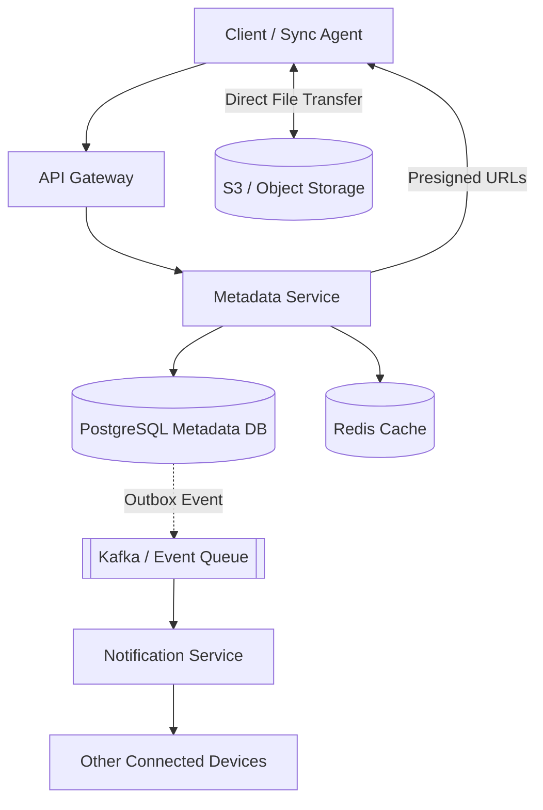
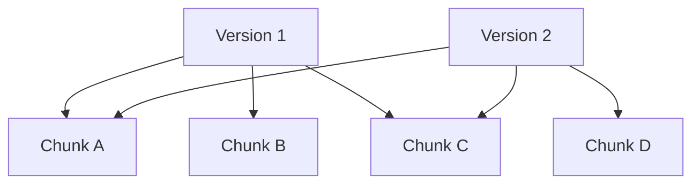
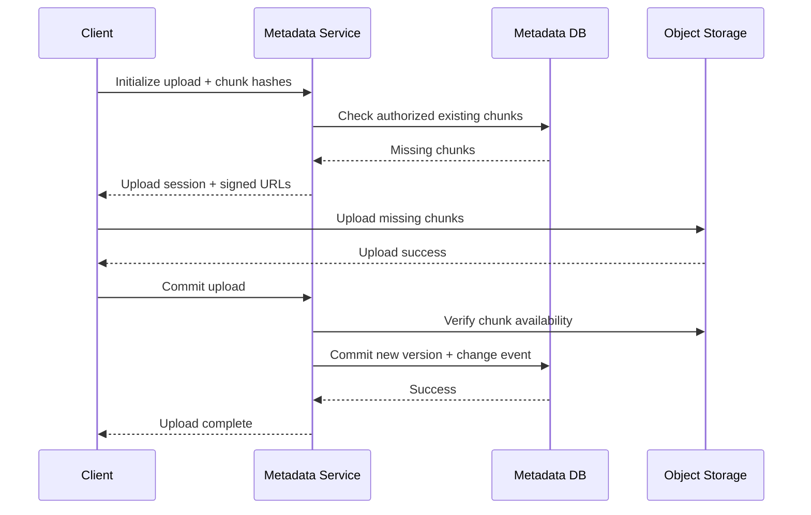
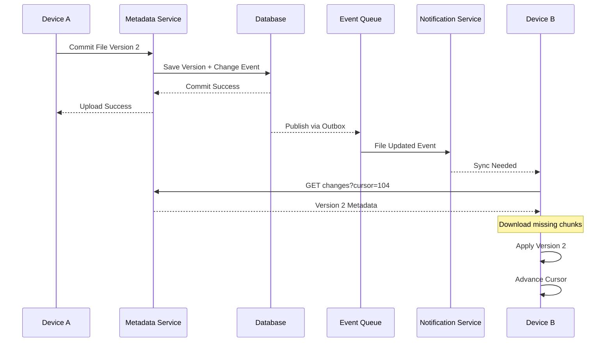
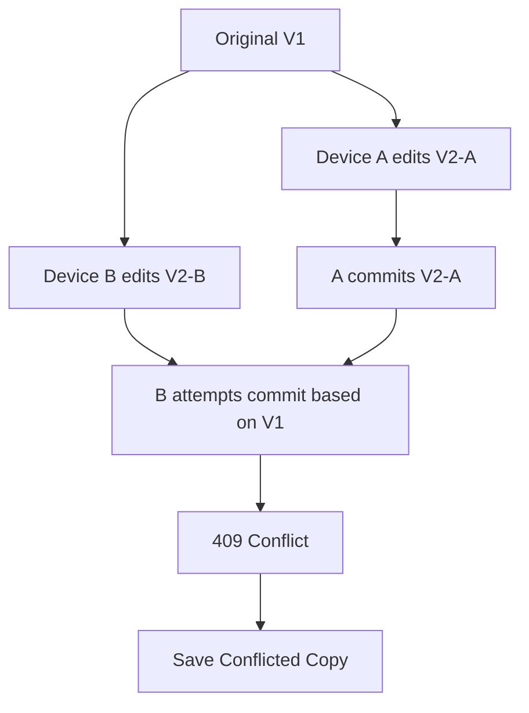
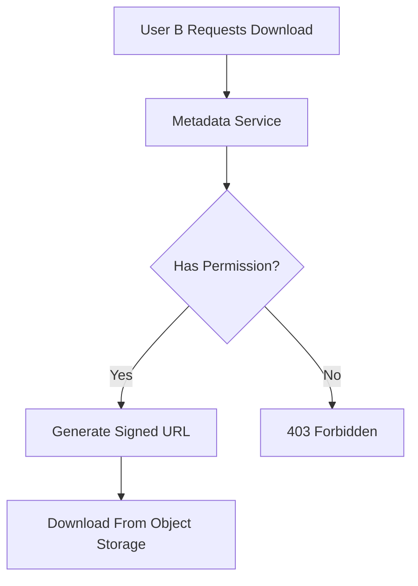
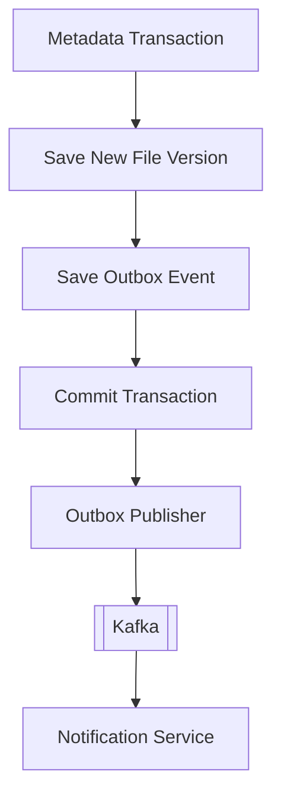
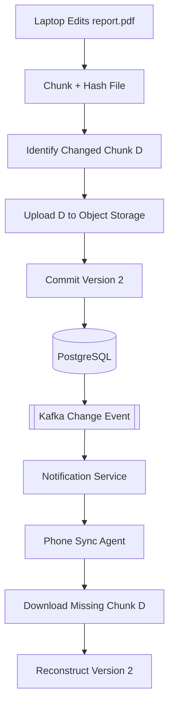

# Design a File Storage System (Dropbox / Google Drive)
> **Goal:** Design a scalable file storage system that supports file uploads, downloads, synchronization across devices, sharing, and reliable recovery.

**Practical Example:** Dropbox / Google Drive

Imagine a user has three devices:
```text
Laptop A → Edits report.pdf
Cloud    → Stores the new version
Phone B  → Automatically receives the update
```
The main challenge is not simply storing files in S3. We also need to:
- Upload large files efficiently.
- Resume interrupted uploads.
- Synchronize changes across devices.
- Prevent concurrent edits from overwriting each other.
- Protect files through authentication and permissions.
- Recover from server or network failures.

---
# Step 1 — Requirement Gathering

## 1.1 Functional Requirements
| Priority | Requirement |
|---|---|
| Core | Upload files |
| Core | Download files |
| Core | Synchronize files across devices |
| Core | Share files with other users |
| Core | Create folders and organize files |
| Optional | File version history |
| Optional | Offline modifications |
| Optional | Search files by name |
| Out of scope | Real-time collaborative editing like Google Docs |

### Questions to Ask Interviewer
**Q: What is the maximum file size?**
- Assume up to 50GB per file.

**Q: Do we support resumable uploads?**
- Yes. Interrupted uploads should continue from where they stopped.

**Q: Should files synchronize automatically?**
- Yes. Changes on one device should eventually appear on other devices.

**Q: What happens if two devices edit the same file?**
- Preserve both changes or detect conflicts instead of silently overwriting data.

**Q: Do we need file sharing?**
- Yes, with basic viewer and editor permissions.

**Scope:** Focus on upload, download, synchronization, sharing, and file versioning.

---
# Step 2 — Non-Functional Requirements

| Requirement | Goal |
|---|---|
| High Availability | 99.99% target |
| Durability | Files survive disk and server failures |
| Low Latency | Fast metadata operations and sync notifications |
| Scalability | Millions of users and petabytes of data |
| Large Files | Support files up to 50GB |
| Bandwidth Efficiency | Transfer changed blocks instead of entire files |
| Security | Authentication, authorization, encryption |
| Consistency | Prevent conflicting file updates |

## 2.1 Strong vs Eventual Consistency
Different components require different consistency guarantees.

### A. Metadata — Strong Consistency for Updates
Metadata includes:
```text
file_id
file_name
folder_id
owner_id
latest_version
permissions
```
Suppose two devices edit the same file:
```text
Device A → Updates report.pdf
Device B → Updates report.pdf
```
We should prevent one update from silently overwriting the other.

**Solution:** PostgreSQL transactions + Optimistic Concurrency Control.

### B. Device Synchronization — Eventual Consistency
Example:
```text
T=0s → Device A uploads version 2
T=2s → Device B receives change notification
T=3s → Device B downloads version 2
```
Small synchronization delays are acceptable.

**Key Point:** Metadata updates should have well-defined concurrency guarantees, while propagation to other devices can be asynchronous.

---
# Step 3 — Estimate Scale

## 3.1 Traffic Estimation
Assumptions:
```text
DAU = 50M
File writes/user/day = 4
Read-to-write ratio = 3:1
Average new data/write = 2MB
```
### Write QPS
```text
50M × 4 = 200M writes/day

200M / 86,400
≈ 2,315 writes/sec
```
### Read QPS
```text
2,315 × 3
≈ 6,945 reads/sec
```
These are average operation rates. Actual traffic requires peak-capacity planning.

## 3.2 Storage Estimation
```text
200M writes/day × 2MB
= 400TB/day

400TB × 365
≈ 146PB/year
```
This is logical new data before deduplication, compression, replication, and retained versions.

### What Do These Numbers Tell Us?
- Storage capacity and network bandwidth are major concerns.
- Large file transfers should not pass through ordinary application servers.
- Metadata and file bytes should scale independently.
- Deduplication and delta synchronization can save substantial bandwidth and storage.

**Design Decision:** Separate the Control Plane and Data Plane.

---
# Step 4 — High-Level Architecture

## 4.1 Control Plane vs Data Plane

### Control Plane
Handles:
- File metadata.
- Folder structure.
- File permissions.
- Version history.
- Upload sessions.
- Synchronization events.

### Data Plane
Handles:
- Actual file bytes.
- Chunk uploads.
- Chunk downloads.
- Object storage.

**Why Separate Them?** Metadata requests are small, while file transfers may involve gigabytes of data.

We don't want a 50GB upload consuming application-server bandwidth unnecessarily.

## 4.2 High-Level Architecture


### Component Responsibilities
| Component | Responsibility |
|---|---|
| Client Sync Agent | Detect changes, split files, calculate hashes |
| API Gateway | Authentication, routing, rate limiting |
| Metadata Service | File versions, permissions, upload sessions |
| PostgreSQL | Store metadata, folders, versions, sharing |
| Redis | Cache frequently accessed metadata |
| Object Storage | Store actual file bytes |
| Kafka | Distribute committed file-change events |
| Notification Service | Notify connected devices of changes |

## 4.3 Why S3 Instead of PostgreSQL?
PostgreSQL is suitable for structured data:
```text
file_id
file_name
parent_folder
owner_id
version_id
permissions
```
S3 is suitable for large binary objects:
```text
report.pdf
video.mp4
photo.jpg
archive.zip
```
**Why?**
- Object storage is designed for massive file capacity.
- Files can be transferred directly using signed URLs.
- Metadata operations remain lightweight.
- Storage and metadata systems scale independently.

**Interview Phrase:** Separate metadata management from file storage.

---
# Step 5 — API + Database Design

## 5.1 API Design
| API | Purpose |
|---|---|
| POST /files/uploads/init | Initialize or resume an upload |
| POST /files/uploads/{id}/commit | Commit a completed upload |
| GET /files/{id} | Retrieve file metadata |
| GET /files/{id}/download | Obtain authorized download URLs |
| GET /files/changes?cursor=x | Retrieve missed changes |
| POST /files/{id}/share | Share file |
| PATCH /files/{id} | Rename or move file |
| GET /sync/events | Subscribe to notifications |

## 5.2 Initialize Upload
```http
POST /files/uploads/init
Authorization: Bearer <token>
```
Request:
```json
{
  "fileName": "report.pdf",
  "parentId": "folder_123",
  "fileSize": 10485760,
  "baseVersion": 3,
  "chunkHashes": ["hash_A", "hash_B", "hash_C"]
}
```
Response:
```json
{
  "uploadId": "upload_abc",
  "missingChunks": ["hash_C"],
  "uploadUrls": {
    "hash_C": "https://storage.example.com/signed-url"
  }
}
```
**Why return missingChunks?** If chunks A and B already exist and are authorized for reuse, the client only uploads C.

### Commit Upload
```http
POST /files/uploads/upload_abc/commit
```
The Metadata Service:
1. Verifies all required chunks exist.
2. Validates checksums and upload ownership.
3. Checks whether the base version is still current.
4. Creates a new file version transactionally.
5. Records a synchronization event.
6. Returns success.

**Important:** Do not make a partially uploaded file visible as the latest version.

## 5.3 Database Schema

### Files Table
```sql
Files (
    file_id UUID PRIMARY KEY,
    owner_id UUID,
    parent_id UUID,
    name VARCHAR,
    latest_version_id UUID,
    is_folder BOOLEAN,
    created_at TIMESTAMP,
    updated_at TIMESTAMP
)
```
Stores file and folder metadata.

### FileVersions Table
```sql
FileVersions (
    version_id UUID PRIMARY KEY,
    file_id UUID,
    version_number INT,
    size BIGINT,
    status VARCHAR,
    created_at TIMESTAMP
)
```
Stores version history.

### Chunks Table
```sql
Chunks (
    chunk_hash VARCHAR PRIMARY KEY,
    storage_key VARCHAR,
    size BIGINT
)
```
Stores information about content-addressed chunks.

### VersionChunks Table
```sql
VersionChunks (
    version_id UUID,
    chunk_hash VARCHAR,
    chunk_order INT,
    PRIMARY KEY (version_id, chunk_order)
)
```
Maps each version to its ordered chunks.

### FileShares Table
```sql
FileShares (
    file_id UUID,
    user_id UUID,
    permission VARCHAR,
    PRIMARY KEY (file_id, user_id)
)
```
Stores sharing permissions.

### ChangeLog Table
```sql
ChangeLog (
    workspace_id UUID,
    sequence_id BIGINT,
    file_id UUID,
    event_type VARCHAR,
    version_id UUID,
    created_at TIMESTAMP,
    PRIMARY KEY (workspace_id, sequence_id)
)
```
The sequence ID should be generated using a mechanism that gives each workspace a durable, well-defined change order.

**Why ChangeLog?** Devices can retrieve changes missed while offline.

## 5.4 Why VersionChunks?
Imagine:
```text
report.pdf V1:
[A, B, C]

report.pdf V2:
[A, D, C]
```
Only chunk B changed to D.

We don't need to store A and C again.


**Benefits:**
- File version history.
- Chunk reuse.
- Reduced storage.
- Delta synchronization.

---
# Step 6 — Deep Dive + Failure Handling

## 6.1 Deep Dive A — Large File Upload

### Problem
A user uploads a 50GB video.

At 90%, their internet connection drops.

If the file is uploaded as one request, restarting from zero is expensive.

### Solution
Use:
1. Chunking.
2. Resumable Upload.
3. Direct Object Storage Upload.
4. Optional Parallel Uploads.

### Chunking Example
```text
video.mp4 = 12MB

Chunk A = 4MB
Chunk B = 4MB
Chunk C = 4MB
```
Upload status:
```text
A → Uploaded
B → Uploaded
C → Failed
```
When the connection recovers:
```text
Retry C only
```
### Complete Upload Flow

**Why Signed URLs?** Clients can upload directly to object storage without proxying large files through the Metadata Service.

### Failure Handling
| Failure | Solution |
|---|---|
| Internet disconnects | Resume missing chunks |
| Individual chunk fails | Retry that chunk |
| Client retries commit | Idempotent commit |
| Upload succeeds, DB fails | Retry/reconcile pending upload |
| Some chunks remain unreferenced | Background garbage collection |

**Important:** Uploading bytes and committing metadata are two separate steps.

---

## 6.2 Deep Dive B — S3 Multipart vs Independent Chunks

These two approaches solve related but different problems.

| Feature | S3 Multipart | Independent Chunks |
|---|---|---|
| Resumable upload | Yes | Yes |
| Parallel upload | Yes | Yes |
| Final storage | One assembled object | Multiple objects |
| Chunk reuse across file versions | Not automatic | Yes |
| Delta synchronization | Additional logic | Natural fit |
| Complexity | Lower | Higher |

### Option A: S3 Multipart Upload
```text
Large File
   ↓
Split into Parts
   ↓
Upload Parts
   ↓
Complete Multipart Upload
   ↓
One S3 Object
```
**Best for:** Simpler large-file uploads.

### Option B: Independent Content-Addressed Chunks
```text
Large File
   ↓
Split into Chunks
   ↓
Hash Each Chunk
   ↓
Store Only Missing Chunks
   ↓
Version References Chunk Hashes
```
**Best for:** Dropbox-style synchronization where unchanged file blocks are reused.

### Design Decision
Choose **Independent Chunks** because efficient delta synchronization is an important requirement.

**Trade-off:** More metadata and lifecycle-management complexity.

For an MVP focused only on large uploads/downloads, S3 Multipart would be simpler.

---

## 6.3 Deep Dive C — Delta Synchronization

### Problem
Suppose a user edits a 100MB file but only changes 4MB.

Do we upload the whole file again?

No. That would waste bandwidth.

### Solution: Delta Sync
Transfer only changed chunks.

Before:
```text
[A, B, C, D, E]
```
After:
```text
[A, B, X, D, E]
```
Only C changed to X.

Upload:
```text
X only
```
### How Does the System Detect Changes?
Each chunk has a hash.

Example:
```text
V1:
[hashA, hashB, hashC, hashD]

V2:
[hashA, hashB, hashX, hashD]
```
Compare hashes:
```text
hashA → Same
hashB → Same
hashC → Changed to hashX
hashD → Same
```
Upload hashX's content only if it is not already available.

### Why Use Hashes?
- Detect changed content.
- Verify chunk integrity.
- Identify identical chunks.
- Support deduplication.

Use a strong content hash such as SHA-256.

### Problem: Fixed-Size Chunk Boundary Shift
Suppose a user inserts one byte near the beginning of a file.

With fixed-size chunking, later chunk boundaries may all shift.

That can cause many chunk hashes to change even though only one byte was added.

### Improvement: Content-Defined Chunking (CDC)
CDC uses rolling hashes to choose chunk boundaries based on file content.

**Why?** A small insertion is less likely to invalidate all subsequent chunks.

**Trade-off:** More CPU and implementation complexity.

### Summary
| Approach | Advantage | Trade-off |
|---|---|---|
| Full File Upload | Simple | High bandwidth |
| Fixed-Size Chunks | Easy resumability | Boundary shifts |
| Content-Defined Chunking | Better delta sync | More complexity |

---

## 6.4 Deep Dive D — File Synchronization Across Devices

### Problem
Device A uploads a new version.

How does Device B know the file has changed?

### Solution
Use:
1. Notification Service.
2. WebSocket or Long Polling.
3. Durable ChangeLog.
4. Synchronization Cursor.

### Synchronization Flow


### Why Not Send Entire Files Through WebSocket?
WebSockets should notify devices that a change is available.

Example:
```json
{
  "type": "sync_needed",
  "workspaceId": "123",
  "latestCursor": 105
}
```
Device B then queries the Metadata Service and downloads missing chunks from object storage.

### Why Do We Need a ChangeLog?
Imagine:
```text
Device B goes offline.
Device A updates 10 files.
Device B reconnects.
```
WebSocket notifications were missed.

If we rely only on notifications, B might never learn about those changes.

### Solution: Cursor-Based Sync
```text
Device B last cursor = 100
Server latest cursor = 110

GET /files/changes?cursor=100
```
Server returns changes 101–110.

Device B applies them and advances its cursor.

**Important:** Advance the cursor only after changes have been safely applied.

### WebSocket vs Long Polling
| Approach | Advantage | Trade-off |
|---|---|---|
| Short Polling | Simple | Repeated requests |
| Long Polling | Efficient for infrequent updates | Reconnect after response |
| WebSocket | Fast push notifications | Persistent connection management |

**Design Decision:** WebSocket or Long Polling for notifications, backed by a durable ChangeLog.

The ChangeLog is the recovery mechanism. Notifications are only a signal to synchronize.

---

## 6.5 Deep Dive E — Concurrent Updates and Conflict Resolution

### Problem
Two devices edit the same file while offline.

```text
Server Latest Version = V1

Device A starts from V1.
Device B starts from V1.
```
Device A changes the file:
```text
V1 → V2-A
```
Device B independently changes it:
```text
V1 → V2-B
```
Both try to upload.

### What If We Use Last Write Wins?
Whichever update arrives last overwrites the previous version.

**Problem:** Valid edits may disappear.

### Better Solution: Optimistic Concurrency Control
When a client commits a new file version, it includes the version it started from.

Example:
```text
Device A:
baseVersion = V1
newVersion  = V2-A

Device B:
baseVersion = V1
newVersion  = V2-B
```
Device A commits first:
```text
Server Latest = V2-A
```
Device B then attempts its commit.

But the server's latest version is no longer V1.

Return:
```http
409 Conflict
```

### Database Version Check
```sql
UPDATE Files
SET latest_version_id = :new_version
WHERE file_id = :file_id
  AND latest_version_id = :expected_version;
```
If zero rows are updated, the expected version no longer matches.

### Conflict Resolution
Instead of discarding Device B's changes, preserve them:
```text
report.pdf
report (conflicted copy).pdf
```
### Diagram


### Trade-offs
| Approach | Advantage | Disadvantage |
|---|---|---|
| Last Write Wins | Simple | Can lose valid edits |
| Optimistic Concurrency | Prevents silent overwrite | Conflict handling needed |
| Automatic Merge | Better collaboration | Difficult for binary files |

**Design Decision:** Optimistic Concurrency + conflicted copies.

---

## 6.6 Deep Dive F — File Sharing and Permissions

### Requirement
User A wants to share `report.pdf` with User B.

Example:
```text
FileShares
-------------------------
file_id | user_id | role
123     | A       | OWNER
123     | B       | VIEWER
```
### Sharing Flow
1. User A authenticates.
2. Metadata Service verifies A has sharing permission.
3. Save B's permission in FileShares.
4. Notify B if needed.

### Download Flow

### Why Signed URLs?
Object storage can serve file bytes directly while the backend controls who receives access.

**Important:** A signed URL is effectively a temporary bearer credential. Anyone possessing it may be able to use it until expiration.

### Security Measures
- Authenticate every request.
- Check file-level or inherited folder permissions.
- Generate short-lived signed URLs.
- Encrypt data in transit and at rest.
- Revalidate permissions for sensitive operations.
- Never grant access solely because someone knows a file ID or chunk hash.

### Permission Revocation
If User A removes B's permission:
```text
User B → No new authorized download URLs
```
Previously issued signed URLs may still work until expiry.

For stronger immediate revocation, use shorter URL lifetimes or a controlled download proxy when necessary.

---

## 6.7 Deep Dive G — Failure Handling

### Failure 1: Internet Disconnect During Upload
**Problem:** File upload stops at 90%.

**Fallback:** Resume only missing chunks.

### Failure 2: Upload Succeeds but DB Commit Fails
**Problem:**
```text
Chunks uploaded to S3
DB commit fails
```
**Fallback:**
- Keep upload session in pending state.
- Retry commit safely.
- Reconcile uploaded chunks.
- Garbage-collect abandoned, unreferenced chunks later.

### Failure 3: Metadata Commits but Notification Fails
**Problem:**
```text
1. Metadata DB commits V2.
2. Service crashes.
3. Kafka event not published.
4. Device B isn't notified.
```
**Solution:** Transactional Outbox.

### Transactional Outbox Flow

**Why?** Metadata updates and the intent to publish a change are saved atomically.

An independent publisher sends the event and retries failures.

Consumers must remain idempotent because events can be delivered more than once.

### Failure 4: WebSocket Disconnects
**Fallback:**
```text
Reconnect
   ↓
GET changes?cursor=lastAppliedCursor
   ↓
Download Missing Updates
```
The client doesn't depend on receiving every notification.

### Failure 5: Two Devices Modify Same File
**Fallback:** Optimistic version check + conflicted copy.

### Failure 6: Database Instance Crashes
**Fallback:**
- Database replicas.
- Automated safe failover.
- Backups and recovery procedures.

**Important:** Asynchronous replicas may lag, so the design must define which acknowledged writes are protected.

### Failure 7: Object Storage Chunk Corrupted
**Fallback:**
- Verify checksums.
- Retrieve a healthy replica or backup.
- Repair or restore corrupted content.

### Summary
| Failure | Solution |
|---|---|
| Upload interrupted | Resumable chunks |
| Commit retried | Idempotency |
| Upload succeeds, DB fails | Pending session + reconciliation |
| Notification lost | Transactional Outbox |
| WebSocket disconnected | ChangeLog + Cursor |
| Duplicate events | Idempotent consumers |
| Concurrent edits | Optimistic Concurrency |
| Metadata DB crashes | Replica failover + backups |
| Chunk corruption | Checksums + recovery |
| Reconnect traffic spike | Backoff + jitter |

---
# Step 7 — Trade-offs + Improvements

## 7.1 PostgreSQL vs DynamoDB
| PostgreSQL | DynamoDB |
|---|---|
| Relational transactions | Managed NoSQL |
| Good for folder hierarchy | Good for predictable key access |
| Strong multi-row updates | Requires careful key/index design |
| Easier relational permissions | Flexible scale patterns |
| May require manual sharding | Managed horizontal scaling |

**Our Choice:** PostgreSQL for the initial metadata system.

**Why?**
- Folder hierarchy.
- Permissions.
- Version history.
- Transactional commits.
- Optimistic concurrency.

### Database Sharding
At very large scale, partition metadata by:
```text
workspace_id
```
This keeps many related file operations within one logical shard.

**Trade-off:** Shared folders and operations spanning multiple workspaces may require cross-shard coordination.

## 7.2 Should We Use Redis?
Yes, but selectively.

Possible cached data:
- File metadata.
- Folder listings.
- Frequently accessed user information.

**Important:** Redis shouldn't become the authoritative source for file permissions or latest versions.

### Cache Invalidation
When a file is renamed:
```text
1. Update PostgreSQL.
2. Invalidate affected Redis entries.
3. Subsequent reads fetch updated metadata.
```
Permission checks and concurrent version commits require an authoritative or consistency-safe approach.

## 7.3 Should We Use a CDN?
It depends on the file access pattern.

### Private Files
Use direct downloads from object storage by default.

### Popular Public/Shared Files
A CDN may reduce download latency and object-storage traffic.

### Trade-off
CDNs can make immediate permission revocation and cache invalidation harder.

Use signed access, short lifetimes, and immutable versioned object keys where appropriate.

## 7.4 Deduplication vs Privacy
### Benefit
Two files may contain identical chunks.

Instead of storing both copies, reuse one stored chunk.

### Risk
Cross-user deduplication can reveal whether another user already possesses a certain file if implemented carelessly.

### Fallback
Start with workspace-level deduplication.

Global deduplication requires stronger authorization and information-leak protections.

**Important:** Knowing a chunk hash must never be enough to retrieve another user's private data.

## 7.5 Additional Improvements
| Improvement | Benefit |
|---|---|
| Content-Defined Chunking | Better delta sync after insertions/deletions |
| Compression | Reduce storage and transfer size |
| Parallel Uploads | Faster large-file transfers |
| Multi-AZ Object Storage | Better durability and availability |
| Multi-Region Recovery | Disaster recovery |
| Background Garbage Collection | Remove unreferenced chunks |
| Client Offline Queue | Resume changes after reconnect |
| Upload Retry with Backoff | Avoid retry storms |
| Monitoring | Detect slow sync and failures |

### Important Monitoring Metrics
- Upload success rate.
- Upload retry rate.
- Metadata commit latency.
- Time to synchronize across devices.
- ChangeLog consumer lag.
- File conflict rate.
- Orphaned chunk count.
- Object storage errors.

---
# Complete End-to-End Example

Imagine Alice edits `report.pdf` on her laptop.

### Original File
```text
Version 1:
[A, B, C]
```
Alice changes B to D:
```text
Version 2:
[A, D, C]
```

### End-to-End Flow
1. Laptop detects the file modification.
2. Client splits the file and calculates chunk hashes.
3. Client compares the new manifest with existing chunks.
4. Only chunk D needs uploading.
5. Metadata Service generates a signed upload URL.
6. Laptop uploads D directly to object storage.
7. Metadata Service verifies D exists.
8. Client commits V2 using its expected base version V1.
9. PostgreSQL atomically stores the new version and a change event.
10. Outbox publisher sends the event to Kafka.
11. Notification Service signals Alice's phone.
12. Phone requests changes since its last cursor.
13. Phone downloads chunk D and reuses existing A and C.
14. Phone reconstructs Version 2.
15. Phone advances its synchronization cursor.


This illustrates the main architecture: efficient chunk uploads, transactional metadata, asynchronous notifications, and reliable synchronization.

---
# Interview Summary

When asked **"Design a File Storage System like Dropbox"**, I would explain:

> First, I would clarify the requirements: file uploads, downloads, synchronization, sharing, and support for large files.
>
> I would separate the Control Plane from the Data Plane. The Metadata Service manages file metadata, permissions, and versions using PostgreSQL, while S3 stores the actual file content.
>
> For large files, I would split content into chunks and upload only missing chunks using short-lived signed URLs. This supports resumable uploads and delta synchronization.
>
> Each file version references its ordered chunks, so unchanged content can be reused.
>
> Once an upload is complete, the Metadata Service verifies the content and atomically commits the new version.
>
> To synchronize devices, I would publish committed file-change events through Kafka and notify connected devices using WebSocket or long polling.
>
> Clients would use a durable ChangeLog and synchronization cursor to recover any changes missed while offline.
>
> For concurrent edits, I would use Optimistic Concurrency Control and preserve conflicting updates instead of silently overwriting files.
>
> Finally, I would handle interrupted uploads, lost notifications, duplicate requests, database failures, and corrupted chunks through retries, idempotency, transactional outbox, replication, and checksum validation.

---
# Quick Revision Table

| Problem | Solution | Why |
|---|---|---|
| Huge files | Object Storage | Scalable binary storage |
| Application bandwidth overload | Direct Signed URL Upload | Avoid proxying file bytes |
| Upload interruption | Chunking + Resume | Retry missing chunks |
| Reuploading unchanged data | Delta Sync | Save bandwidth |
| Duplicate chunks | Content Hashing | Reuse identical content |
| Changed chunk boundaries | Content-Defined Chunking | Better delta detection |
| File metadata | PostgreSQL | Transactions and relationships |
| Concurrent edits | Optimistic Concurrency | Prevent silent overwrite |
| Cross-device sync | Notification Service | Signal changes |
| Missed notifications | ChangeLog + Cursor | Recover offline updates |
| DB commit succeeds, event fails | Transactional Outbox | Reliable event publishing |
| Duplicate commits | Idempotency | Avoid repeated operations |
| Large download traffic | Object Storage / CDN | Scale transfer |
| Sharing | ACL + Signed URL | Controlled access |
| Metadata overload | Redis | Cache noncritical reads |
| Massive metadata scale | Workspace Sharding | Distribute database load |
| Corrupted file blocks | Checksums + Recovery | Protect integrity |
| Unused chunks | Garbage Collection | Recover storage |

## Final Mental Model
```text
CONTROL PLANE
├── Metadata Service
├── PostgreSQL
├── File Versions
├── Permissions
└── ChangeLog

DATA PLANE
├── Object Storage
├── Chunk Upload
├── Chunk Download
└── Presigned URLs

EFFICIENT TRANSFER
├── Chunking
├── Content Hashing
├── Resumable Upload
├── Delta Sync
└── Deduplication

SYNCHRONIZATION
├── File Change Event
├── Transactional Outbox
├── Kafka
├── Notification Service
├── WebSocket / Long Polling
└── Sync Cursor

CORRECTNESS
├── Optimistic Concurrency
├── Version Checking
├── Conflict Preservation
├── Idempotency
└── Authorization

FAILURE HANDLING
├── Retry Missing Chunks
├── Reconcile Pending Uploads
├── Recover Missed Events
├── Database Failover
├── Chunk Integrity Checks
└── Garbage Collection
```

## Most Important Takeaway
A distributed file storage system solves three major problems:

**1. File Transfer Efficiency**
- Chunking.
- Resumable uploads.
- Delta synchronization.
- Direct object storage transfer.

**2. Metadata Correctness**
- PostgreSQL transactions.
- File versioning.
- Optimistic concurrency.
- Access permissions.

**3. Reliable Cross-Device Synchronization**
- Change events.
- Notification service.
- Durable ChangeLog.
- Cursor-based recovery.

> **Interview Tip:** Prioritize three deep dives: large-file resumable uploads, delta synchronization, and concurrent edit handling. These demonstrate the key engineering challenges beyond simply storing files in S3.