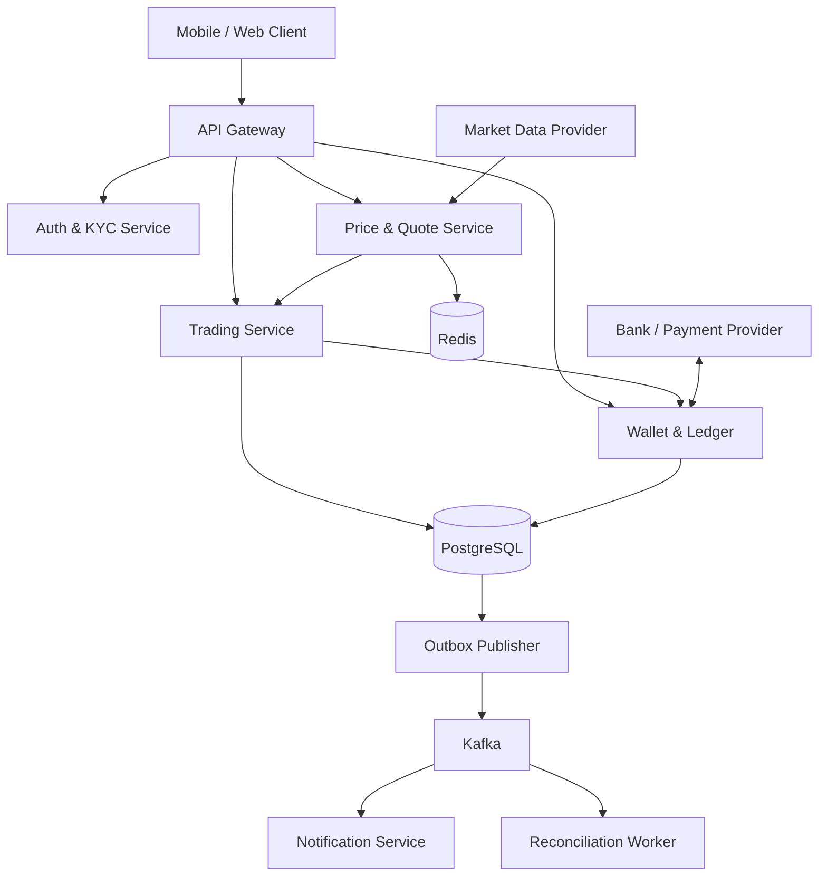
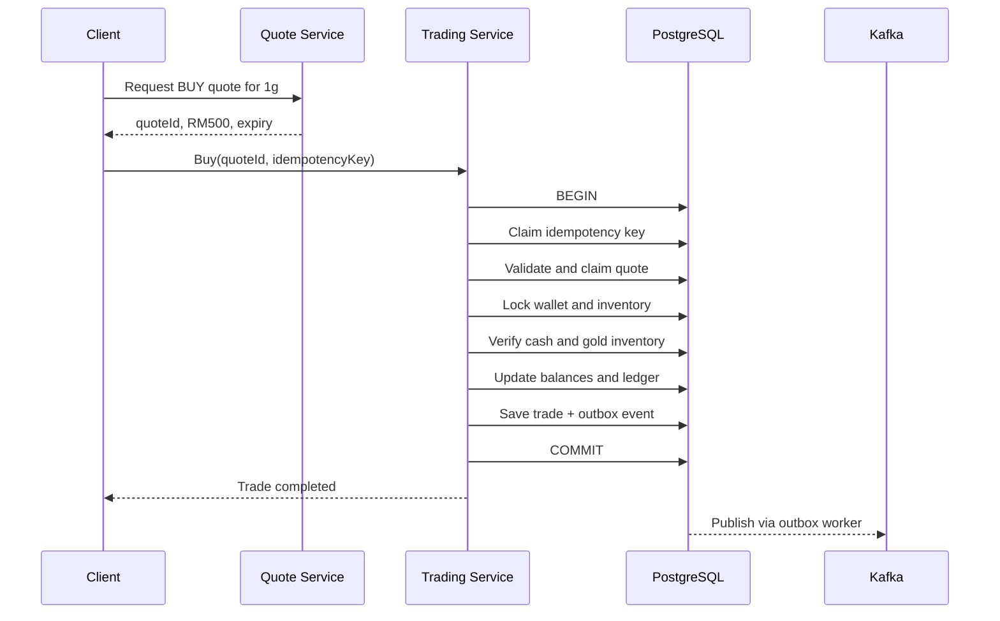
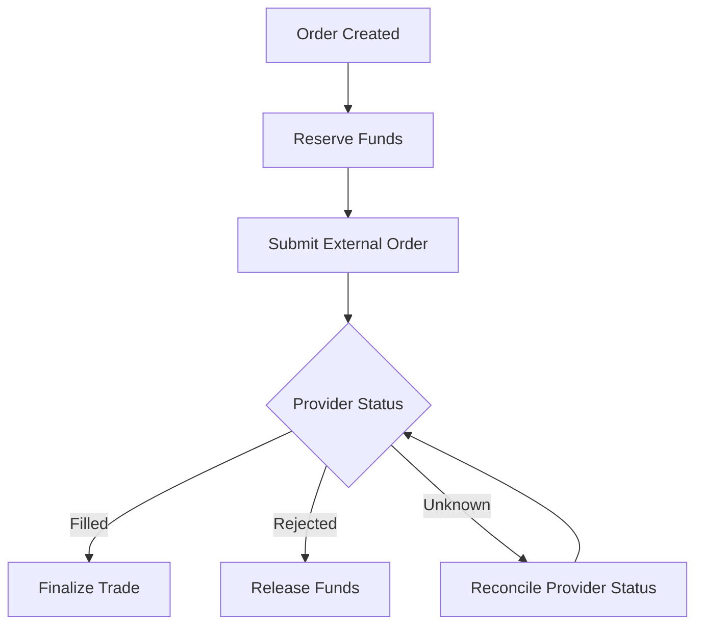

# System Design: Gold Trading Application

**Difficulty:** Medium–Advanced  
**Interview Duration:** 45–60 minutes  
**Tech Stack:** Java, Spring Boot, PostgreSQL, Redis, Kafka

## Step 1: Requirements Clarification

### 1.1 Problem Statement

Design a digital gold trading platform where users can:

- Buy gold using MYR.
- Sell gold and receive MYR.
- View live gold prices.
- Hold fractional gold in a digital wallet.
- View transaction history.
- Deposit and withdraw money.

**Assumption:** The platform owns or sources gold inventory and offers users buy/sell quotes. We are not building an exchange matching engine.

### 1.2 Functional Requirements

**Core (MVP):**

1. User authentication and KYC.
2. Live gold price display.
3. Buy gold.
4. Sell gold.
5. View cash and gold holdings.
6. Transaction history.

**Out of scope (initially):**

- Physical gold delivery.
- Advanced limit orders.
- User-to-user trading.
- Margin trading.
- Multi-currency support.

### 1.3 Non-Functional Requirements

| Requirement | Target |
|---|---|
| Availability | 99.95% target |
| Quote latency | p95 < 100ms |
| Internal trade latency | p95 < 300ms |
| Consistency | Strong for financial writes |
| Durability | No loss of committed trades |
| Idempotency | No duplicate trade execution |
| Auditability | Immutable financial ledger |
| Scalability | 10,000+ concurrent users |

Targets are illustrative interview requirements, not measured performance.

**Key design decision:**

Financial consistency is more important than trading availability. If financial integrity cannot be guaranteed, trading should pause instead of accepting unsafe transactions.

---

## Step 2: Capacity Estimation

### 2.1 Assumptions

- 1 million registered users.
- 100,000 daily active users.
- Average 5 trades per active user per day.
- Peak traffic = 10x average.
- Price refresh every second.

### 2.2 Trading Traffic

Daily trades:

100,000 × 5 = 500,000 trades/day

Average TPS:

500,000 / 86,400 ≈ 6 TPS

Peak TPS:

6 × 10 ≈ 60 TPS

Provision initially for approximately 100–200 TPS, with headroom for growth.

This estimate covers trade requests, not the higher volume of price reads.

### 2.3 Storage

Assume each trade and associated metadata consumes approximately 2 KB, excluding some indexes and replication overhead.

Daily:

500,000 × 2 KB ≈ 1 GB

Yearly:

1 GB × 365 ≈ 365 GB

Actual storage will be higher once ledger entries, indexes, audit events, backups and replication are included.

### 2.4 Key Observation

Price reads will greatly outnumber trade writes.

Therefore:

- Redis handles frequently accessed prices.
- WebSocket handles price broadcasting.
- PostgreSQL handles authoritative financial records.
- Kafka handles asynchronous downstream work.

Do not overengineer the database for extremely high TPS before identifying the actual bottleneck.

---

## Step 3: API Design and Data Model

### 3.1 REST APIs

**Get latest gold price**

```http
GET /api/v1/gold/prices
```

Example response:

```json
{
  "buyPrice": "505.00",
  "sellPrice": "495.00",
  "currency": "MYR",
  "unit": "gram",
  "timestamp": "2026-11-15T10:00:00Z"
}
```

**Request buy quote**

```http
POST /api/v1/quotes

{
  "side": "BUY",
  "quantityGrams": "1.0000"
}
```

Response:

```json
{
  "quoteId": "q123",
  "pricePerGram": "505.00",
  "quantityGrams": "1.0000",
  "totalAmount": "505.00",
  "expiresAt": "2026-11-15T10:00:10Z"
}
```

**Execute buy**

```http
POST /api/v1/trades/buy
Idempotency-Key: unique-request-id

{
  "quoteId": "q123"
}
```

**Execute sell**

```http
POST /api/v1/trades/sell
Idempotency-Key: unique-request-id

{
  "quoteId": "q124"
}
```

**Get wallet**

```http
GET /api/v1/wallet
```

**Get trade history**

```http
GET /api/v1/trades?cursor=abc123&limit=20
```

Use cursor pagination for transaction history rather than large OFFSET queries.

### 3.2 Database Schema

#### Users

```sql
users (
    id UUID PRIMARY KEY,
    email VARCHAR UNIQUE,
    kyc_status VARCHAR,
    created_at TIMESTAMP
)
```

#### Wallet Accounts

```sql
wallet_accounts (
    id UUID PRIMARY KEY,
    user_id UUID,
    asset VARCHAR,
    available NUMERIC(20, 8),
    reserved NUMERIC(20, 8),
    version BIGINT
)
```

Example assets: MYR and GOLD.

#### Trades

```sql
trades (
    id UUID PRIMARY KEY,
    user_id UUID,
    quote_id UUID UNIQUE,
    side VARCHAR,
    quantity NUMERIC(20, 8),
    price NUMERIC(20, 8),
    total_amount NUMERIC(20, 8),
    status VARCHAR,
    idempotency_key VARCHAR,
    created_at TIMESTAMP,
    UNIQUE (user_id, idempotency_key)
)
```

#### Ledger Entries

```sql
ledger_entries (
    id UUID PRIMARY KEY,
    journal_id UUID,
    account_id UUID,
    asset VARCHAR,
    amount NUMERIC(20, 8),
    created_at TIMESTAMP
)
```

Each financial journal must balance independently for each asset.

#### Quotes

```sql
quotes (
    id UUID PRIMARY KEY,
    user_id UUID,
    side VARCHAR,
    price NUMERIC(20, 8),
    quantity NUMERIC(20, 8),
    expires_at TIMESTAMP,
    status VARCHAR
)
```

### 3.3 Important Decisions

**Money and gold precision:**

- Java: BigDecimal
- PostgreSQL: NUMERIC
- JSON: Decimal strings

Never use float or double for financial calculations.

**Source of truth:**

- PostgreSQL stores committed financial state.
- Redis stores cached prices.
- Kafka distributes events.
- Ledger entries provide an immutable accounting record.

Balances can be materialized for fast reads, but their updates must remain consistent with the ledger.

---

## Step 4: High-Level Architecture



Logical service boundaries are shown here. Initially, Trading and Wallet/Ledger can run within one application and share one PostgreSQL transaction.

### 4.1 Price & Quote Service

Responsibilities:

- Receive live gold prices.
- Validate source timestamps.
- Convert to MYR per gram if necessary.
- Apply platform spread.
- Generate short-lived quotes.
- Publish updates through WebSocket.

Example:

Market reference price = RM500/g

Customer buy price = RM505/g  
Customer sell price = RM495/g

The spread helps cover trading costs and risk.

### 4.2 Trading Service

Responsibilities:

- Validate executable quotes.
- Enforce KYC and trading limits.
- Check available funds or gold.
- Execute purchases and sales.
- Ensure idempotency.
- Coordinate ledger updates.

### 4.3 Wallet & Ledger

Responsibilities:

- Maintain cash and gold accounts.
- Reserve and release balances.
- Prevent negative available balances.
- Record double-entry journals.
- Support financial reconciliation.

### 4.4 Redis

Use Redis for:

- Latest market prices.
- Fast quote-related reads.
- Rate limiting.
- Non-authoritative caching.

Never treat Redis as the authoritative financial ledger.

### 4.5 Kafka

Example events:

```text
TradeCompleted
TradeRejected
DepositSettled
WithdrawalRequested
```

Consumers include:

- Notifications
- Analytics
- Reconciliation
- Risk monitoring

Use a transactional outbox to reliably publish committed business events.

---

## Step 5: Core Trading Workflows

### 5.1 Buy Gold Flow

Example:

User has RM1,000 and 0g gold.

User buys 1g at RM500/g.

Expected result:

Cash = RM500  
Gold = 1g



### 5.2 Atomic Transaction

Use a single database transaction for the core financial operations.

```java
@Transactional
public TradeResult buyGold(BuyRequest request) {

    Trade existing = findExistingTrade(
        request.userId(),
        request.idempotencyKey()
    );

    if (existing != null) {
        return existing.toResult();
    }

    Quote quote = validateAndClaimQuote(
        request.quoteId(),
        request.userId()
    );

    Wallet wallet = lockUserWallet(request.userId());

    GoldInventory inventory = lockGoldInventory();

    validateBalance(wallet, quote);
    validateInventory(inventory, quote);

    debitCash(wallet, quote.totalAmount());
    creditGold(wallet, quote.quantity());

    updatePlatformAccounts(quote);

    Trade trade = saveTrade(quote);

    saveDoubleEntryLedger(trade);
    saveOutboxEvent(trade);

    return trade.toResult();
}
```

This is conceptual pseudocode. In production, claiming the idempotency key must be concurrency-safe, and a repeated request must resolve to the existing committed operation.

### 5.3 Double-Entry Ledger

Gold purchase: 1g for RM500.

| Account | Asset | Change |
|---|---|---|
| User cash | MYR | -500 |
| Platform cash | MYR | +500 |
| Platform gold inventory | Gold | -1g |
| User gold | Gold | +1g |

For each asset, total ledger movements balance to zero.

**Why?**

We need to prove:

- Money was not created or destroyed.
- Gold was not created or destroyed.
- Every trade is auditable.
- Wallet balances can be reconciled.

Physical custody or external gold-provider balances must also be reconciled with the platform's gold liabilities.

### 5.4 Sell Gold Flow

The sell flow is the reverse of buying.

1. User requests a sell quote.
2. Backend checks quote validity.
3. Lock user's gold balance.
4. Check sufficient available gold.
5. Debit user's gold balance.
6. Credit user's MYR balance.
7. Update platform inventory/accounts.
8. Record ledger and trade atomically.
9. Publish TradeCompleted asynchronously.

**Important:** Concurrent selling must not allow the same grams to be spent twice.

### 5.5 Handling Expired Quotes

Suppose:

Quoted price = RM500/g  
Current price = RM510/g

The quote expires after 10 seconds.

If the user confirms after expiration:

```text
Request
   ↓
Validate quote
   ↓
Expired?
   ├── Yes → Reject and request new quote
   └── No  → Continue trade
```

Do not silently change the agreed execution price.

---

## Step 6: Consistency, Reliability and Security

### 6.1 Prevent Double Spending

Problem:

User has RM500.

Two concurrent requests each try to buy RM500 of gold.

Without concurrency control, both might pass the balance check.

**Solution: Pessimistic Locking**

```sql
BEGIN;

SELECT available
FROM wallet_accounts
WHERE user_id = :user_id
  AND asset = 'MYR'
FOR UPDATE;

-- Check sufficient balance.
-- Update balances, ledger and trade.

COMMIT;
```

The second transaction waits for the first, then reads the updated balance.

Alternative: atomic conditional updates.

```sql
UPDATE wallet_accounts
SET available = available - 500
WHERE user_id = :user_id
  AND asset = 'MYR'
  AND available >= 500;
```

Check that exactly one row was updated.

This update must be within the same transaction as the other financial changes.

### 6.2 Idempotency

Problem:

The trade succeeds, but the network response is lost.

The user retries.

Without idempotency, a second trade may execute.

**Solution:**

Use:

```http
Idempotency-Key: abc123
```

Store the key with the operation and its outcome.

Enforce uniqueness in PostgreSQL.

For repeated requests:

- Same key + same payload → Return original result.
- Same key + different payload → Reject conflict.
- Concurrent same-key requests → Only one execution wins.

### 6.3 Transactional Outbox

Problem:

1. PostgreSQL transaction commits.
2. Server crashes before publishing to Kafka.

The trade succeeds, but downstream systems receive no event.

**Solution: Transactional Outbox**

```text
BEGIN
  Update balances
  Insert ledger entries
  Insert trade
  Insert outbox event
COMMIT
        ↓
Outbox Publisher
        ↓
Kafka
        ↓
Consumer
```

An outbox publisher retries unpublished events.

Kafka consumers should be idempotent because events may be delivered more than once.

### 6.4 External Liquidity Provider

If the platform sends orders to an external gold provider, the provider's execution cannot be committed atomically with our local database.

Use an order state machine:



Important:

- Use provider-side idempotency keys.
- Never blindly retry an order with unknown outcome.
- Reconcile uncertain execution states.
- Release reservations only when failure is confirmed.

### 6.5 Failure Scenarios

| Failure | Solution |
|---|---|
| Duplicate trade request | Idempotency key |
| Two concurrent buys | Row lock / atomic update |
| Database crash before commit | Transaction rollback |
| Crash after DB commit | Persisted trade + outbox |
| Kafka consumer failure | Retry + idempotent consumer |
| Expired quote | Reject and requote |
| Stale market price | Pause quote generation |
| External order timeout | Reconcile status |
| Payment callback duplicated | Idempotent settlement |
| Ledger mismatch | Alert and investigate |

### 6.6 Security

Financial systems also need:

- TLS for all network communication.
- Authentication and authorization.
- KYC/AML checks.
- Transaction and withdrawal limits.
- Rate limiting.
- Encrypted sensitive information.
- Audit logs.
- Fraud detection.
- Secrets management.
- Administrative access controls.

Never trust price, amount or account ownership supplied by the client without server-side verification.

---

## Step 7: Scaling, Trade-offs and Interview Follow-ups

### 7.1 Scaling Read Traffic

Problem:

Thousands of users request live prices simultaneously.

Solution:

```text
Market Provider
      ↓
Price Ingestion
      ↓
Redis
      ↓
WebSocket Gateway
      ↓
Connected Users
```

Use a shared price stream rather than querying the provider for every client request.

Possible optimizations:

- Redis caching.
- WebSocket fan-out.
- Stateless application instances.
- Horizontal autoscaling.
- Connection management.
- Rate limiting.

### 7.2 Scaling Trading Traffic

Initially:

- Stateless Spring Boot instances.
- PostgreSQL primary for trading writes.
- Read replicas for historical queries.
- Appropriate database indexes.
- Short database transactions.
- Connection pooling.

At higher scale:

- Partition large trade-history tables.
- Archive historical data.
- Separate analytics workloads.
- Monitor lock contention.
- Optimize inventory reservation strategy.

Avoid premature sharding because financial transactions may involve multiple accounts.

### 7.3 Database vs Redis Trade-off

| PostgreSQL | Redis |
|---|---|
| Strong transactions | Very fast reads |
| Durable financial writes | Cache and transient data |
| Relational constraints | Rate limiting |
| Immutable accounting records | Live price distribution |
| Primary financial source of truth | Not financial source of truth |

### 7.4 SQL Transaction vs Distributed Saga

**Use a local SQL transaction when:**

- All affected financial records share one database.
- Atomic commit is possible.
- Strong consistency is required.

**Use a Saga / state machine when:**

- Multiple independent systems participate.
- External payment or trading providers are involved.
- A single atomic transaction is impossible.

A Saga requires explicit recovery and reconciliation, not just rollback logic.

### 7.5 Latency Optimization

Example interview latency targets:

| Operation | Target p95 |
|---|---|
| Get cached gold price | < 100ms |
| Generate quote | < 100ms |
| Internal trade execution | < 300ms |
| Wallet read | < 150ms |

These are design objectives, not guaranteed outcomes.

To verify them:

1. Run load tests.
2. Measure p50, p95 and p99.
3. Monitor database lock waits.
4. Measure connection pool saturation.
5. Test concurrent requests to the same wallet.
6. Simulate dependency failures.
7. Verify ledger invariants under load.

External-provider trades can take longer, so their status may need to remain PENDING.

### 7.6 Monitoring

Monitor:

- Trade success/failure rate.
- Trade latency.
- Quote expiration rate.
- Price feed staleness.
- Database lock contention.
- Kafka consumer lag.
- Outbox publishing delay.
- Ledger reconciliation discrepancies.
- Inventory and liquidity exposure.

Financial discrepancies should trigger high-priority alerts.

### 7.7 Common Interview Questions

**Q1: Why PostgreSQL instead of MongoDB?**

PostgreSQL provides strong transactional guarantees, constraints and relational modeling that fit financial ledgers and multi-account updates well.

**Q2: Why Kafka?**

For asynchronous downstream processing such as notifications, analytics, hedging and reconciliation. It should not replace the primary financial database transaction.

**Q3: How do you avoid double spending?**

Use database locking or conditional atomic updates, combined with transactional ledger entries and nonnegative balance constraints.

**Q4: What happens if a user retries after a timeout?**

The client sends the same idempotency key. The server retrieves the existing operation instead of executing another trade.

**Q5: How do you handle changing gold prices?**

Generate short-lived, executable price quotes. Validate the quote atomically during trade execution and reject expired quotes.

**Q6: Why use a double-entry ledger?**

It provides an auditable accounting record and helps detect inconsistencies. Every asset's postings should balance.

**Q7: What if the external liquidity provider times out?**

Mark the order as having an unknown/pending outcome, query its status, reconcile, and avoid blindly submitting it again.

**Q8: How would you scale to millions of users?**

Scale price distribution and stateless services independently, optimize database writes, partition large history datasets and isolate analytics from critical trading operations.

---

# Final Interview Summary

## Architecture

```text
                 Mobile / Web
                      |
                 API Gateway
                      |
        +-------------+-------------+
        |             |             |
       Auth        Pricing        Trading
                      |             |
                    Redis       Wallet/Ledger
                                    |
                                PostgreSQL
                                    |
                                  Outbox
                                    |
                                  Kafka
                                    |
                         Async Consumers
```

## Top 5 Concepts to Remember

1. **ACID transactions** — Financial updates must commit atomically.
2. **Double-entry ledger** — Record auditable money and gold movements.
3. **Idempotency** — A retry must not create duplicate trades.
4. **Quote expiration** — Prevent execution using invalid market prices.
5. **Transactional outbox** — Reliably publish events after committed transactions.

## How to Explain This in an Interview

"I would design the gold trading platform around a pricing service, trading service and financial ledger.

The pricing service receives market prices and creates short-lived executable quotes.

When the user buys or sells gold, the trading service validates the quote, checks the balance and executes the financial changes within one PostgreSQL transaction.

I would use row-level locking or atomic conditional updates to prevent concurrent double spending, and an immutable double-entry ledger for financial auditability.

Every trade request carries an idempotency key to prevent duplicate execution.

For downstream processing, I would use a transactional outbox with Kafka.

Redis and WebSocket would handle high-frequency market price updates, while PostgreSQL remains the authoritative source of truth.

Finally, I would add reconciliation, monitoring and failure recovery, especially when integrating with external payment or gold liquidity providers."

## Interview Checklist

- [ ] Clarified trading model and requirements
- [ ] Estimated scale and peak traffic
- [ ] Designed APIs and database schema
- [ ] Explained high-level architecture
- [ ] Walked through one complete buy transaction
- [ ] Explained double-entry ledger
- [ ] Handled concurrent trades and idempotency
- [ ] Explained quote expiration and price updates
- [ ] Covered external provider failures
- [ ] Discussed scaling, security and trade-offs

**Key takeaway:** In a financial trading system, correctness and recoverability matter more than raw speed. A fast trading API is useless if it can double-spend money or lose a committed trade.
