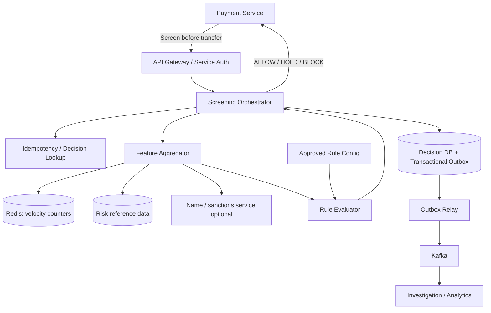
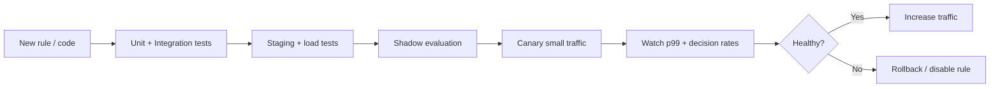

# 01 — Design a Real-Time Transaction Screening System (7 Steps)

**GrabDefence-style system design practice | 55–60 minutes | Medium → Advanced**

> **Interview question:** "Design a service for a digital bank that screens a payment *before* it is executed and returns a risk decision quickly."
>
> **Important:** All traffic numbers, rules, schemas and policies here are **hypothetical interview assumptions**, **not claims about Grab's production environment**. Never memorize a diagram before clarifying the requirements.

## The 7-step roadmap

1. Clarify the problem and scope.
2. Define functional and non-functional requirements.
3. Estimate capacity and set a latency budget.
4. Draw a simple high-level design and explain a request end-to-end.
5. Design APIs, data model and transaction boundaries.
6. Deep-dive into correctness, concurrency, failures and security.
7. Explain testing, monitoring, deployment and trade-offs.

---

## Step 1 — Clarify requirements first (5 minutes)

**What is transaction screening?** The payment system asks a risk service whether a proposed transfer can proceed. It might return **ALLOW**, **HOLD_FOR_REVIEW** or **BLOCK**. The risk service **does not itself move money**.

Ask the interviewer:

| Question | Why it matters | Assumption for this practice |
|---|---|---|
| Pre-payment or after-payment screening? | Determines synchronous vs asynchronous path | Pre-payment: decision before execution |
| What response types? | Affects API and downstream payment states | `ALLOW`, `HOLD`, `BLOCK` |
| What risk signals? | Defines dependencies | Recent transfer velocity, amount, risky destination, device signal |
| How fast? How many requests? | Drives latency and capacity | Peak 10,000 RPS, p99 < 200 ms |
| Which failures are acceptable? | Determines fail-open/fail-closed policy | Policy-dependent: high-risk flows may HOLD |
| Audit / compliance? | Defines durability and historical data | Every final decision is auditable |
| Repeated requests? | Defines idempotency | Same screening ID + same payload gives same logical result |

**Say this aloud:**

> "I'll design pre-payment screening. The payment service synchronously requests a decision; risk evaluation uses recent behavioral features and versioned rules. I will keep payment execution separate from screening, and I'll define what to do when a risk dependency fails."

**Out of scope for the first version:** training ML models, analyst dashboards, customer notifications and the payment ledger itself. They can connect asynchronously later.

## Step 2 — Functional and non-functional requirements (5 minutes)

### Functional (what the product does)

- Accept transaction details with an unambiguous `screening_id` / `transaction_id` and identity of the requesting payment service.
- Retrieve risk features (e.g., recent transfer count and destination risk).
- Evaluate rules against one **consistent rule version per decision**.
- Return a decision with stable reason codes; persist an auditable record.
- Handle duplicate requests safely and emit a committed decision event for downstream workflows.
- Support manual-review handoff for `HOLD` decisions (not synchronous analyst handling).

### Non-functional (quality targets)

- **Latency:** illustrative p99 below 200 ms, end-to-end, including persistence.
- **Availability:** define a product target with the interviewer; don't invent an SLA for Grab.
- **Consistency:** no duplicate logical decisions on retries; risk counters must meet explicitly chosen freshness/accuracy requirements.
- **Durability:** a successful final decision response must correspond to a committed decision record, if audit-before-response is a requirement.
- **Security:** authenticated service callers, least privilege, sensitive data protection.
- **Extensibility:** add/change rules safely without changing the screening API.

**State the most important invariants:**

1. A payment cannot be executed without a decision acceptable to the payment service's policy.
2. A repeated logical screening request cannot silently produce a second conflicting decision.
3. The audit record must identify the rule version and decision reasons.
4. An unavailable risk dependency cannot accidentally become an unconditional ALLOW.

## Step 3 — Capacity estimation & latency budget (5 minutes)

Assume (for practice): **average 1,000 RPS**, peak **10,000 RPS**, 1 KB audit payload per decision.

```text
At 1,000 requests/second average:
Decisions/day = 1,000 × 86,400 = 86.4 million
Raw audit data/day ≈ 86.4 million × 1 KB ≈ 86.4 GB/day (decimal)
Raw audit data/year ≈ 31.5 TB, excluding indexes, replicas, backups, metadata
At peak: 10,000 × 20 evaluated rules ≈ 200,000 rule evaluations/second
```

This is **large**: discuss partitioning/retention, compression and hot-path vs analytical storage. A record with real indexes and replication can cost substantially more than 1 KB.

### Hypothetical p99 budget: 200 ms

| Component | Target budget (illustrative) |
|---|---:|
| Gateway/auth + network | 20 ms |
| Feature orchestration (parallel calls) | 60 ms |
| Rule evaluation | 15 ms |
| Decision DB commit | 45 ms |
| Response + contingency | 60 ms |
| **Total** | **200 ms** |

**Warning:** Budgeting is not proof! p99 end-to-end must be **measured under realistic peak load**. Summing component p99 values is not a statistically exact prediction of end-to-end p99; the table is a planning budget.

## Step 4 — High-level architecture (10 minutes)

Start simple: **don't introduce Kafka into the blocking payment path unless required**.



**Explain the synchronous path:**

1. Payment API creates a stable `screening_id` and sends transaction context to Screening.
2. Gateway authenticates the payment-service caller and enforces authorization.
3. Service checks whether this screening request already has a final committed decision.
4. For a new request, fetch features **in parallel where safe**, using a bounded deadline.
5. Evaluate a fixed, approved rule version; collect decision and reason codes.
6. Persist decision + outbox event in **one SQL transaction**, then return the decision.
7. Payment service acts on the result under its own rules. **ALLOW is not a money transfer**.
8. Outbox relay later publishes the committed decision to Kafka for investigation/analytics.

### Sequence diagram — normal request and retry

```mermaid
sequenceDiagram
    participant P as Payment Service
    participant S as Screening API
    participant C as Counter / Feature Store
    participant R as Rule Engine
    participant D as Decision DB
    P->>S: Screen(screening_id, payload)
    S->>D: Look up existing result
    D-->>S: Not found
    S->>C: Fetch recent features
    C-->>S: Feature snapshot + freshness
    S->>R: Evaluate(rule_version, features)
    R-->>S: HOLD + reason codes
    S->>D: Atomic insert decision + outbox
    D-->>S: Committed
    S-->>P: HOLD + decision ID
    Note over P,S: Network response lost; payment retries same ID
    P->>S: Same screening_id and payload
    S->>D: Fetch committed decision
    D-->>S: Existing HOLD
    S-->>P: Same result
```

**Trade-off:** If every screening needs to synchronously query a slow external provider, that provider can dominate p99. Use cached/reference data when permitted, explicit freshness bounds, timeouts, and a defined failure policy.

## Step 5 — API, database, and transaction boundaries (10 minutes)

### API example

```http
POST /v1/screenings
Authorization: Bearer <service-token>
Idempotency-Key: SCR-abc-123
Content-Type: application/json

{
  "screening_id": "SCR-abc-123",
  "transaction_id": "TX-501",
  "payer_account_ref": "A-11",
  "payee_account_ref": "B-22",
  "amount_minor": 150000,
  "currency": "MYR",
  "occurred_at": "2026-11-19T07:30:00Z"
}
```

```json
{
  "screening_id": "SCR-abc-123",
  "decision_id": "DEC-991",
  "decision": "HOLD",
  "reason_codes": ["HIGH_VELOCITY"],
  "rule_version": "v12",
  "evaluated_at": "2026-11-19T07:30:00.054Z"
}
```

- Use minor currency units (`amount_minor`), not floating-point currency.
- `screening_id` and `Idempotency-Key` identify one logical request; define their scope, expiry, and mismatch behavior.
- Distinguish `HOLD` (a business decision) from `503` or timeout (an infrastructure failure).
- A duplicate idempotency key with a **different payload hash** should be rejected, not treated as a valid retry.

### SQL tables (simplified)

```sql
CREATE TABLE screening_decisions (
  decision_id       UUID PRIMARY KEY,
  screening_id      VARCHAR(80) NOT NULL UNIQUE,
  transaction_id    VARCHAR(80) NOT NULL,
  request_hash      CHAR(64) NOT NULL,
  decision          VARCHAR(16) NOT NULL,
  rule_version      VARCHAR(64) NOT NULL,
  reason_codes      JSONB NOT NULL,
  evaluated_at      TIMESTAMPTZ NOT NULL DEFAULT now()
);

CREATE TABLE screening_outbox (
  event_id          UUID PRIMARY KEY,
  screening_id      VARCHAR(80) NOT NULL,
  event_type        VARCHAR(64) NOT NULL,
  payload           JSONB NOT NULL,
  published_at      TIMESTAMPTZ
);
CREATE INDEX idx_screening_outbox_unpublished
  ON screening_outbox (published_at) WHERE published_at IS NULL;
```

For very high sustained traffic, partition and archive decisions using policy-defined retention, while keeping a globally correct idempotency/uniqueness strategy. A time-partitioned table alone may not enforce global uniqueness for `screening_id`; plan a separate key registry or appropriately scoped uniqueness strategy if necessary.

### What belongs in one database transaction?

```text
BEGIN
  INSERT screening_decisions(...)
  INSERT screening_outbox(...)
COMMIT
```

**Not** inside that DB transaction: external payment execution, waiting for Kafka acknowledgement, network calls to third-party screening providers.

**If two API replicas race:** both might compute. Let the unique key choose the winner on insert; the loser fetches the committed result. A claim/lease mechanism can reduce duplicate expensive work but must handle crashes and expired leases. Do not rely on a Redis lock as the sole correctness guarantee.

### Redis counter example — choose semantics explicitly

```text
Key: velocity:account:A-11:2026-11-19T15:30
Value: count = 9
TTL: 10 minutes
```

One time bucket is only an approximation of a sliding five-minute window. A strict rolling window needs a more exact data structure or several small buckets with defined precision. For one transaction, deduplicate by its stable event ID; if the same transfer retries, **don't count twice**. If an evaluation merely reads counters rather than consumes the transaction event, don't claim the count is already updated.

## Step 6 — Deep dive: correctness, failures, security (10 minutes)

### A. How does the service handle concurrent requests?

- Concurrent transactions from the **same account** can race when they update/read velocity counters.
- Decide whether the rule requires approximate near-real-time detection or an exact threshold.
- For exact account-local admission/count constraints, use an atomic per-account update-and-evaluate step (or another strongly consistent mechanism) and explicitly address hot accounts and cross-shard behavior.
- A Kafka-derived counter is often **eventually consistent**; it may miss transactions not processed yet. Don't describe it as strictly up-to-date.

### B. Failure policy matrix

| Failure | Possible behavior | Why |
|---|---|---|
| Redis unavailable | `HOLD` / manual review for high-risk policy; alternate durable feature path if permitted | Never silently assume count = 0 |
| Slow third-party name match | Deadline + policy-dependent `HOLD` or documented fallback | Bound latency without bypassing sanctions policy |
| Decision DB unavailable | Return retriable error; upstream does not execute without required clearance | Cannot guarantee durable audit |
| DB commits, response times out | Retry same ID; return persisted result | Idempotency handles uncertain client outcome |
| Kafka unavailable | Outbox backlog; keep decision path independent while DB has capacity | Decouples final decision from event delivery |
| Rule version invalid | Reject rollout and continue approved prior version | Prevents broken rules from affecting traffic |

**Fail-open vs fail-closed:** This is a **business/compliance decision**, not an engineering default. Some low-risk features might have approved fallback; sanctions screening may require a block/hold when unavailable. Agree on a policy per rule and risk tier.

### C. Security checklist

- Service-to-service identity (mTLS or approved short-lived service credentials).
- Authorization: only payment services may screen; only authorized risk admins may edit rules.
- Validate payloads, rate limit callers, prevent injection, encrypt in transit/at rest.
- Minimize sensitive account/name data in logs and Kafka events; apply retention and access controls.
- Tamper-evident audit strategy / restricted mutations where required by policy.

### D. How to explain correctness clearly

> "My payment service never treats a network timeout as ALLOW. It retries with the same screening ID. If the previous decision committed, Screening returns it; otherwise the request can be retried safely. I use a DB uniqueness constraint as the final deduplication guarantee, and an outbox to publish committed decisions asynchronously."

## Step 7 — Testing, monitoring, deployment, trade-offs (8 minutes)

### Testing

| Test | What it demonstrates |
|---|---|
| Unit tests for each rule | Deterministic rule behavior, boundary cases |
| Integration with DB and Redis | Uniqueness, counter atomicity, rollback |
| Concurrency tests with duplicate IDs | One logical committed decision; no double-counting |
| Failure injection: DB/Kafka/Redis | Intended fallback and retry behavior |
| Load test at 10k peak RPS | Achieved throughput and **measured** end-to-end p99 |
| Replay approved historical test dataset | New rules don't unexpectedly increase false positives |
| Security tests | Only approved service callers/admins have access |

### Monitoring

**Technical:** incoming RPS, decision p50/p95/p99, dependency timeouts, DB commit duration, Redis command latency, outbox lag, Kafka lag, saturation, error rate.

**Business:** ALLOW/HOLD/BLOCK ratios by rule version, missing-feature frequency, investigator queue age, policy-driven fallback count. A sudden change in HOLD ratio after deployment can indicate a bad rule.

### Deploy safely



### Architectural trade-offs

| Choice | Benefit | Cost / risk |
|---|---|---|
| Synchronous screening | Prevent risky payment before execution | Adds payment latency and a dependency |
| Asynchronous Kafka projection for features | Scales independently; replayable | Can be stale; requires freshness management |
| Redis hot counters | Low-latency reads/writes | Recovery, correctness and hot-key complexity |
| SQL decision + outbox | Audit and atomic event intent | DB throughput/partitioning overhead |
| Separate rule engine | Independent versioning and extensibility | More rule lifecycle complexity |

### 90-second interview recap

> "I would clarify whether screening is pre- or post-transaction and define the decision outcomes, p99 latency and failure policy. For pre-payment screening, Payment Service calls an authenticated Screening API. It fetches recent risk features, evaluates a fixed rule version, persists the decision and outbox event atomically, then returns ALLOW/HOLD/BLOCK. Redis supports low-latency recent counters, but I would define whether those counters are exact or eventually consistent. Idempotency protects retries, and the DB uniqueness constraint prevents duplicate logical decisions. Kafka is outside the synchronous path. I would load-test p99, monitor dependency errors and decision ratios, and roll out rules in shadow/canary mode."

## Interviewer challenge questions (answer without looking)

1. What if a payment is sent twice with two **different** screening IDs? What is upstream payment idempotency responsible for?
2. Why can't you perform the payment transaction and screening in one DB transaction?
3. If Redis increments after evaluating, can two concurrent transactions both get ALLOW? How would you address this if exact admission is required?
4. What happens if a third-party sanctions API takes 700 ms but your p99 target is 200 ms?
5. How will you detect that the risk-feature projection is 10 minutes behind Kafka?
6. A new rule causes HOLD rate to increase 20x. What is your rollback procedure?
7. Which metrics prove your design meets requirements? Which are only estimates?

**Memory hook:** `Payment asks → Features → Rules → Durable decision → Response; Outbox → Kafka later.`
