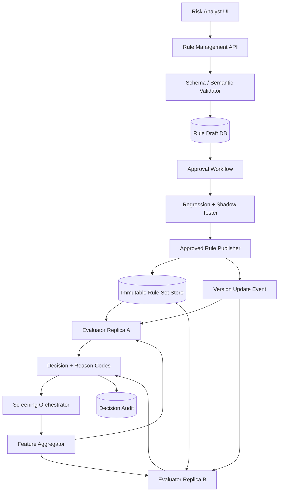
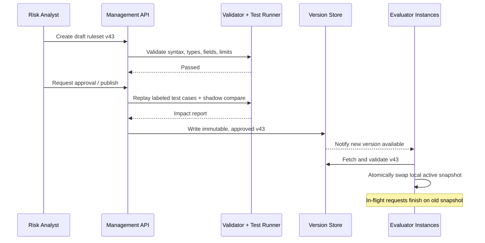
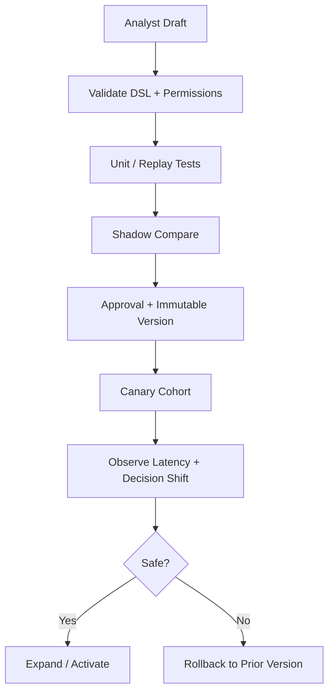

# 03 — Design a Dynamic Fraud Rule Engine (7 Steps)

**GrabDefence-style system design practice | 55–60 minutes | Medium → Advanced (HLD + LLD)**

> **Interview question:** "Design a fraud rule engine where risk analysts can create, test and update rules without redeploying the backend, while decisions remain fast and explainable."
>
> **Disclaimer:** The examples below are illustrative, not Grab's internal implementation, and the rule thresholds are not fraud-policy recommendations.

## The 7-step roadmap

1. Clarify the problem and scope.
2. Define functional and non-functional requirements.
3. Estimate rule volume, QPS and evaluation budgets.
4. Design the high-level control plane and data plane.
5. Design APIs, schema and Java-level components.
6. Deep-dive into versioning, concurrency, failures and security.
7. Explain testing, monitoring, deployment and trade-offs.

---

## Step 1 — Clarify requirements (5 minutes)

**What's a rule engine?** A component that evaluates a configured set of conditions against transaction features and produces a decision/reason. Example: "If the account makes many transfers within five minutes AND the amount is large, send for review."

**What's dynamic?** Authorized users can change the **rule configuration** (under approval and validation) without shipping new Java code every time. This is **not** the same as letting users execute arbitrary Java/Python code inside your backend.

Ask the interviewer:

| Question | Why it matters | Practice assumption |
|---|---|---|
| Are rules edited by engineers or risk analysts? | Configuration UI and permissions | Risk analysts with approval workflow |
| Allowed conditions? | Defines rule DSL and feature catalog | AND/OR, comparisons, membership, thresholds |
| Results and priority? | Handles conflicting rules | ALLOW, REVIEW, BLOCK; BLOCK > REVIEW > ALLOW (illustrative policy) |
| Is evaluation synchronous? | Drives latency limits | Inside transaction-screening request |
| Can rules be stateful? | Defines counter/feature dependencies | Engine consumes precomputed features |
| How are rules released? | Versioning/approval/rollback | Draft → test → approve → shadow → active |
| Need explanation? | Audit and investigations | Save matched rule IDs and version |

**Crucial distinction:** The rule engine **evaluates features**; the feature service (e.g., Redis risk counters) is responsible for obtaining and updating state. Keeping them separate makes testing and scaling easier.

## Step 2 — Requirements and invariants (5 minutes)

### Functional

- Create/edit a rule draft with conditions, action, severity, priority and effective scope.
- Validate rule syntax, allowed fields/operators and types before approval.
- Require suitable permissions and approvals to activate rules.
- Distribute immutable, versioned rule sets to evaluator instances.
- Evaluate all applicable rules against a transaction context with bounded CPU/memory/time.
- Return final decision + matched rule IDs + version + explainable reason codes.
- Support **shadow mode**: evaluate new rules without changing the production decision.
- Support rollback and audit of every rule change.

### Non-functional

- **Low latency:** hypothetical engine budget p99 < 20 ms, excluding feature fetching.
- **High availability:** if config backend is down, instances may use last-known-approved snapshot under agreed policy.
- **Consistency:** each evaluation uses exactly **one immutable rule-set version**.
- **Security:** rule authoring is restricted; untrusted arbitrary code isn't executed.
- **Extensibility:** add a new operator/feature via a controlled platform release, while most individual rules are config-only.
- **Testability:** deterministic evaluation given the same features, rules and clock-dependent inputs.

### Invariants

1. **No partially deployed rule set** is visible to one evaluation.
2. Every decision identifies the **exact rule-set version** used.
3. Rules cannot access unauthorized data sources or cause unbounded computation.
4. A rule cannot become active without required validation/approval.
5. An evaluation with missing required features follows an explicit policy; it cannot invent safe values.

## Step 3 — Quick estimation (5 minutes)

Hypothetical design:

```text
Peak traffic                     = 10,000 screening requests/second
Active rules                     = 100
Naive rule evaluations/second    = 1,000,000 predicate/rule evaluations per second
Engine p99 budget                = 20 ms (excluding feature retrieval)
Approved rule publishes         = tens per day, not tens of thousands per second
```

**Main observation:** The **read/evaluation path is extremely hot** but changes to rule configurations are relatively rare. Optimize rule evaluation for **local in-memory reads** instead of querying a rules database on every transaction.

Note: The 1 million figure is an upper-bound style illustration when every request checks every rule; real work depends on operators, early exits, scoping, aggregation and the number of conditions per rule.

### Latency plan (illustrative)

```text
Features fetched before engine: separate screening API budget
Select immutable ruleset snapshot: ~constant-time reference read
Rule applicability filter:            2 ms budget
Predicate evaluation:                 12 ms budget
Decision aggregation and response:     6 ms budget
-----------------------------------------------
Evaluation budget:                    20 ms
```

Benchmark with realistic contexts and large regex/collection inputs; don't assume rule count predicts CPU perfectly.

## Step 4 — High-level architecture: control plane vs data plane (10 minutes)

**Control plane = author/manage rules.** **Data plane = evaluate real transactions.** This separation is the core design decision.



### The data plane request

1. Screening Orchestrator has a **feature context** (amount, recent count, destination risk, etc.).
2. Evaluator gets one current **immutable** ruleset reference (e.g., `version=42`).
3. It filters rules relevant to the product/country/transaction type.
4. It evaluates allowed predicates (simple comparison, AND, OR, NOT) against known features.
5. It applies a **defined precedence/aggregation policy** (e.g., BLOCK beats REVIEW beats ALLOW).
6. It returns `decision`, `matchedRuleIds`, `reasonCodes`, `ruleSetVersion`.
7. Screening Orchestrator, not the rule engine itself, commits the transaction decision + audit/outbox as required.

### The control plane publish flow



**Important nuance:** With many replicas, activation can be **eventually convergent**: one server may use v42 briefly while another uses v43. Each decision remains internally consistent and records its version. If you require *all* requests to use the same global version at the same instant, introduce a stronger coordinated activation mechanism and accept its cost. For payments requiring deterministic retries, the screening/idempotency layer should return the prior committed decision.

## Step 5 — API, database and LLD (10 minutes)

### Example rule DSL (JSON, not executable code)

```json
{
  "rule_id": "HIGH_VELOCITY_AMOUNT",
  "version": 3,
  "scope": { "product": "TRANSFER", "country": "MY" },
  "priority": 50,
  "when": {
    "all": [
      { "feature": "transfer_count_5m", "op": "GTE", "value": 8 },
      { "feature": "amount_minor", "op": "GTE", "value": 500000 }
    ]
  },
  "action": "REVIEW",
  "reason_code": "HIGH_VELOCITY"
}
```

This rule is purely an example. In production, versions, applicability scopes, feature types, and threshold governance need well-defined semantics.

### Management API examples

```http
POST /v1/rule-sets/drafts
POST /v1/rule-sets/{draftId}/validate
POST /v1/rule-sets/{draftId}/request-approval
POST /v1/rule-sets/{draftId}/shadow-test
POST /v1/rule-sets/{draftId}/activate
POST /v1/rule-sets/{approvedVersion}/rollback-to
GET  /v1/rule-sets/active
```

Authorization depends on each action. Creating a draft must not automatically grant approval/activation rights. Define an approval workflow and its meaning; don't assume a URL's existence is authorization.

### Data schema (simplified)

```sql
CREATE TABLE rule_set_versions (
  version_id       VARCHAR(64) PRIMARY KEY,
  status           VARCHAR(24) NOT NULL,
  rules_json       JSONB NOT NULL,
  content_hash     CHAR(64) NOT NULL,
  created_by       VARCHAR(80) NOT NULL,
  approved_by      VARCHAR(80),
  approved_at      TIMESTAMPTZ,
  activated_at     TIMESTAMPTZ
);

CREATE TABLE rule_change_audit (
  audit_id         UUID PRIMARY KEY,
  version_id       VARCHAR(64) NOT NULL,
  actor_id         VARCHAR(80) NOT NULL,
  action           VARCHAR(40) NOT NULL,
  reason           TEXT,
  happened_at      TIMESTAMPTZ NOT NULL DEFAULT now()
);
```

The active-version pointer belongs in a strongly controlled configuration store/table; publish changes using a transaction/outbox if activation events must be reliable. `rules_json` is immutable after approval. Historic rule sets must remain recoverable according to audit policy.

### Java-level LLD — explain the major responsibilities

```java
// Illustrative code, intentionally simplified for an interview.
record TransactionContext(
    String transactionId,
    long amountMinor,
    Map<String, Object> features
) {}

record RuleResult(
    boolean matched,
    String action,
    String reasonCode,
    String ruleId
) {}

interface Condition {
    boolean test(TransactionContext context);
}

record Rule(
    String id,
    Condition condition,
    String action,
    String reasonCode,
    int priority
) {}

record RuleSet(String version, List<Rule> rules) {}

interface RuleEngine {
    EvaluationResult evaluate(TransactionContext context);
}

record EvaluationResult(
    String decision,
    String ruleSetVersion,
    List<String> matchedRuleIds,
    List<String> reasonCodes
) {}
```

An implementation might keep `AtomicReference<RuleSet> activeRules`:

```java
final class InMemoryRuleEngine implements RuleEngine {
    private final AtomicReference<RuleSet> activeRules;

    InMemoryRuleEngine(RuleSet initial) {
        this.activeRules = new AtomicReference<>(initial);
    }

    @Override
    public EvaluationResult evaluate(TransactionContext ctx) {
        RuleSet snapshot = activeRules.get(); // Pin ONE version
        List<Rule> matched = new ArrayList<>();
        for (Rule rule : snapshot.rules()) {
            if (rule.condition().test(ctx)) matched.add(rule);
        }
        // Aggregate per APPROVED policy, e.g. BLOCK > REVIEW > ALLOW.
        return aggregate(matched, snapshot.version());
    }

    void activateApproved(RuleSet next) {
        // Caller must have already validated/authenticated/approved next.
        activeRules.set(next); // Atomic local swap, not a global transaction.
    }

    private EvaluationResult aggregate(List<Rule> matched, String version) {
        // Implement explicit conflict handling, reason codes and no-match policy.
        throw new UnsupportedOperationException("Interview pseudocode");
    }
}
```

**What this demonstrates:**

- **Strategy-like rule components** / composable conditions allow new combinations without a giant `if-else`.
- **Immutable `RuleSet`** means an in-flight evaluation cannot see half of a new version.
- **AtomicReference** makes a local version swap thread-safe; it **does not guarantee global simultaneous activation**.
- **Separation of concerns:** compiler/validator, configuration publisher, evaluator, auditing and feature retrieval remain separate.

**Don't create one class per user-configured rule.** Most individual rules should be data compiled into safe condition objects. New *operators* (e.g., geo-distance) may require a controlled code release.

## Step 6 — Deep dive: correctness, safe updates, failures (10 minutes)

### A. What if two rules conflict?

Define an explicit aggregation policy rather than relying on accidental iteration order:

```text
Rule 1: Account has suspicious transaction velocity -> REVIEW
Rule 2: Destination is on a mandatory block list -> BLOCK
Final:  BLOCK
Reasons: both triggering rule IDs retained
```

If priority alone can override mandatory blocks, your system may violate policy. Model hard-block requirements separately if necessary. Business ownership must sign off on precedence and exemptions.

### B. What if a feature is missing?

Avoid treating `null` as zero or `false` unless rules explicitly allow it. Choose one:

- `UNKNOWN` / three-valued logic, propagating an uncertain result;
- Rule-specific fallback and reason code;
- `HOLD` or screening error for mandatory features.

**Define missing, stale, malformed and permission-denied distinctly.** Observability should reveal which happened.

### C. What if someone writes an expensive / malicious rule?

- Support only a bounded **declarative DSL**, compiled to a safe AST; no arbitrary scripting or reflection from users.
- Whitelist feature identifiers and type-check values/operators.
- Limit AST depth, number of conditions, `IN` list sizes, regex complexity (or exclude regex), evaluation time and memory.
- Never allow conditions to make unbounded network calls; prefetch allowed features in a separate phase.
- Restrict rule publication by RBAC, multi-person approval and audit.

### D. How do you deploy rules safely?

**Draft → Validate → Review → Test → Shadow → Canary → Activate → Monitor → Roll back.**

- **Shadow:** evaluate v43 in parallel but do not change the production decision; compare results against v42 and report impact.
- **Canary:** apply v43 to a bounded eligible cohort while monitoring decision distribution and p99.
- **Rollback:** switch approved active version back; preserve decisions already made under v43 and their provenance.

### E. What if rule storage or update notification fails?

| Failure | Response |
|---|---|
| Config DB down during request | Evaluate last-known-approved cached snapshot if policy allows |
| Rule publisher event lost | Periodic polling / reconciliation of active version + alerts |
| Rule set invalid or incompatible | Reject activation on affected engine versions; keep prior approved snapshot |
| Evaluator crashes | Multiple stateless replicas behind load balancer; restart safely |
| Rule triggers 30x more BLOCK outcomes | Alert, halt canary, rollback; investigate impact |
| Kafka delayed | Don't depend on Kafka for local rule evaluation; record audit/events via owner service |
| Too many CPU-heavy predicates | Bound cost, measure CPU/p99, narrow rules by applicable scope, optimize hot predicates |

### F. Security boundary

A risk analyst may define **what conditions to evaluate**, but the backend determines **which features they can use, how operators work and who is allowed to publish**. Audit change requests, approvals, releases, and decision versions. Do not allow a "dynamic rule" feature to become remote code execution.

## Step 7 — Testing, monitoring, release and trade-offs (8 minutes)

### Tests

| Test layer | Example |
|---|---|
| Unit tests | `amount_minor == threshold`, null feature, nested AND/OR |
| Property / fuzz tests | AST nesting, malformed input, very large `IN` lists |
| Rule validation | Disallowed operator, unknown feature, type mismatch |
| Concurrency tests | Activate v43 while 10k requests run; each request uses one snapshot |
| Historical replay | Compare v42 vs v43 on approved labeled test transactions |
| Shadow mode | Track decision differences without affecting live decisions |
| Load tests | p99 at peak RPS with worst-case rule sets |
| Failure injection | Config DB down, notification lag, rollback |
| Security tests | Draft author cannot approve/activate their own rule if separation required |

### Monitoring (both technical and business)

**Technical:** evaluation p50/p95/p99, evaluations/sec, CPU and memory, cache version, refresh failures, config age, invalid-rule count, rollout progress by instance.

**Business:** number of matched rules, decision ratios by rule version, top reason codes, shadow disagreement rate, analyst queue volume, unusual increases in REVIEW/BLOCK.

**Important:** Do not confuse a technical success (p99 < 20 ms) with a correct fraud policy (low false positives and false negatives). Both require independent evidence.

### Rule release diagram



### Trade-offs

| Choice | Advantage | Downside |
|---|---|---|
| Configurable DSL | Analysts update rules without deploy | Needs strict validation and governance |
| In-memory compiled snapshots | Very fast evaluation | Per-replica version distribution |
| Fetch features before evaluation | Pure, deterministic rule evaluation | Feature service may dominate latency |
| Rule-per-service microservices | Independent deployment | Too much network overhead on critical path |
| Single shared evaluation service | Central policy and audit | Scaling/availability become critical |
| Shadow and canary rollout | Reduce regression risk | More platform complexity and analysis |

### 90-second interview recap

> "I'd split the rule platform into a control plane and data plane. Analysts write rules in a restricted declarative DSL; management validates types and allowed features, runs regression tests, obtains approval and stores an immutable version. Evaluator instances compile approved rule sets and hold them in memory so every transaction is evaluated quickly without querying a rules DB. Each request pins one rule-set snapshot and returns matched rule IDs, reason codes and the exact version. I'd define deterministic conflict handling and missing-feature policy. New versions are shadow-tested, canary-released and rolled back if error, latency or decision distributions change unexpectedly. I'd measure both engineering performance and fraud-policy impact."

## Interviewer challenge questions

1. Two evaluators use different versions during rollout. Is that acceptable? How would you guarantee deterministic retries?
2. Why not store the rules directly in PostgreSQL and query them on every request?
3. How do you add a rule based on "number of unique beneficiaries in 10 minutes" without introducing stateful code into the evaluator?
4. If analysts can create regex conditions, how can a malicious/accidental rule exhaust CPU?
5. Why is `AtomicReference` enough for local consistency but not global activation?
6. What should happen when a required feature has not updated for ten minutes?
7. How do you test a rule that rarely triggers in production?
8. An approved rule blocks too many genuine customers. How would you find and safely roll back the problem?

**Memory hook:** `Author → Validate → Approve → Immutable version → Local evaluation → Explain → Shadow/Canary/Rollback.`
