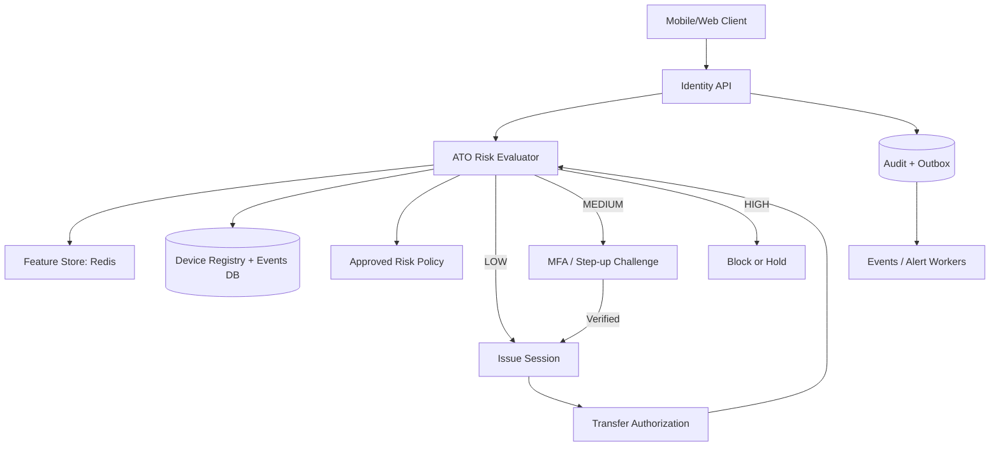

# 01 — Account Takeover (ATO) Prevention (7-Step System Design)

**Area:** Digital Banking · Security  
**Target:** Grab Round 2 system design practice · junior-to-mid backend · 45–60 minutes  
**Assumptions:** All system sizes, policies, APIs, schemas, times and data examples here are **illustrative**, not confirmed Grab or GXBank production details. Verify product/business and regulatory rules with the interviewer.

> **Mock question:** Design a service that detects suspicious logins and requires extra verification before a compromised account can transfer money.

## The 7-step roadmap

1. Clarify the Problem and Scope
2. Functional and Non-Functional Requirements
3. Capacity Estimation and Performance Goals
4. High-Level Architecture and Request Flow
5. APIs, Data Model and Correctness Boundaries
6. Deep Dive: Concurrency, Failure Handling and Security
7. Testing, Monitoring, Deployment and Trade-offs


---

## Step 1 — Clarify the Problem and Scope

Start with questions. **Do not draw Redis or Kafka immediately.** A 60-second clarification can change the entire architecture.

| Interviewer question | Why / practice assumption |
|---|---|
| What constitutes ATO? | Unusual device, location, session behavior; risk is probabilistic, not proof. |
| Protect login, transfer, or both? | Start with login plus step-up before high-risk transfers. |
| Are devices registered? | Use cryptographic device binding when available; fingerprint is only a signal. |
| What happens on uncertain risk? | Challenge or temporary hold; do not silently allow high-risk actions. |
| Who owns credentials? | Identity service owns passwords/sessions; risk service only provides a decision. |


**First-version boundary:** Start with login risk and high-risk transfer authorization. Fraud model training, biometric vendor implementation and full banking ledger are out of scope.

**How to say it:** “I'll confirm the system's scope, correctness guarantees and expected traffic, then start with the simplest viable design and deepen the failure cases.”

## Step 2 — Functional and Non-Functional Requirements

### Functional requirements (what it must do)

- Assess login/session risk from recent attempts, device trust, IP reputation and account history.
- Issue an MFA / step-up challenge for suspicious attempts, then verify completion.
- Bind a trusted device using a cryptographic public key after strong identity verification.
- Invalidate or restrict sessions when an account is locked; record immutable security actions.
- Allow risk policy to evolve independently from the login service.

### Non-functional requirements (how well it must work)

- Illustrative login risk evaluation p99 < 200 ms, excluding user MFA interaction.
- Never issue an authenticated session merely because a challenge was created.
- High-risk authorization fails safely if mandatory checks are unavailable.
- Limit sensitive-data exposure, apply least privilege, and have auditable outcomes.

### Critical invariants (conditions that must never be violated)

- Only a verified challenge can elevate an authentication attempt to an authorized session.
- Device fingerprint similarity alone never establishes device ownership.
- Challenge, session and authorization tokens have bound identities, purpose, expiry and one-time use.

**Interview tip:** Say the invariants aloud before drawing. They determine whether Redis is a cache, whether SQL transactions are required and what happens when data is missing.

## Step 3 — Capacity Estimation and Performance Goals

Assume 2,000 peak login assessments/sec and a 1 KB security event: 2,000 × 86,400 = 172.8M events/day **if peak sustained all day** (~173 GB/day raw). In reality estimate average vs peak separately and apply retention tiers. The largest risk may be external fraud-signal latency, not CPU.

Do not claim an architecture satisfies a p99 target just because components were assigned latency budgets. **Prove it using realistic end-to-end load tests, tail-latency monitoring and failure tests.** Distinguish steady-state from burst and differentiate product traffic from external provider throughput.

## Step 4 — High-Level Architecture and Request Flow

### Architecture (Mermaid)



### Explain one request end-to-end

1. Client submits login to Identity API over TLS; credentials are validated there.
2. Risk evaluator fetches time-bounded device, IP and failed-login features.
3. Policy determines LOW / CHALLENGE / BLOCK; record policy version and reason codes.
4. Identity API creates session only for LOW or after the correct challenge is verified.
5. For sensitive transfers, run a fresh action-specific risk check or step-up.
6. Publish security events asynchronously, excluding secrets and complete tokens.


**Whiteboard narration:** Name the system of record, the synchronous critical path, the async side path, and the place where a durable state change happens. A Kafka event is not a replacement for a required synchronous commit unless the product permits eventual completion.

## Step 5 — APIs, Data Model and Correctness Boundaries

### API contract (illustrative)

```http
POST /v1/auth/login
{"email":"user@example.com","password":"<redacted>","device_id":"d_123"}
→ 200 {"state":"CHALLENGE_REQUIRED","attempt_id":"a_9","challenge_id":"c_4","method":"passkey"}

POST /v1/auth/challenges/c_4/verify
{"attempt_id":"a_9","proof":"<one-time cryptographic proof>"}
→ 200 {"state":"AUTHENTICATED","session_token":"<short-lived-token>"}

POST /v1/security/devices/bind
{"public_key":"<device public key>","attestation":"<vendor proof>"}
→ 201 {"device_binding_id":"b_1","status":"ACTIVE"}

POST /v1/transfers/t_7/step-up
{"challenge_response":"<action-bound proof>"}
→ 200 {"authorization":"APPROVED","expires_at":"<timestamp>"}
```

**API design checklist:** identify caller and authorization, required fields, stable resource/request ID, validation rules, status codes, idempotency behavior, and timeout/retry semantics. Use consistent errors and never trust a client-supplied account ID by itself.

### Data model (illustrative PostgreSQL SQL)

```sql
CREATE TABLE auth_attempt (
  attempt_id UUID PRIMARY KEY, user_id UUID NOT NULL,
  device_id TEXT, risk_level TEXT NOT NULL,
  policy_version BIGINT NOT NULL, state TEXT NOT NULL,
  created_at TIMESTAMPTZ NOT NULL
);
CREATE TABLE device_binding (
  binding_id UUID PRIMARY KEY, user_id UUID NOT NULL,
  public_key_hash TEXT NOT NULL, status TEXT NOT NULL,
  UNIQUE (user_id, public_key_hash)
);
CREATE TABLE step_up_challenge (
  challenge_id UUID PRIMARY KEY, attempt_id UUID NOT NULL,
  purpose TEXT NOT NULL, expires_at TIMESTAMPTZ NOT NULL,
  consumed_at TIMESTAMPTZ, state TEXT NOT NULL
);
```

**Data modeling checklist:** state ownership, constraints and unique indexes, status transitions, retention/partitioning, and transaction boundaries. The SQL is a **teaching sketch**, not a complete production migration.

## Step 6 — Deep Dive: Concurrency, Failure Handling and Security

### The implementation deep dive

- **Step-up is a state machine:** `STARTED → CHALLENGE_REQUIRED → VERIFIED → SESSION_ISSUED` (or `BLOCKED` / `EXPIRED`). Verification must be atomic and bound to the original attempt/purpose.
- **Risk signals vs authentication:** IP, user-agent and device fingerprint are weak signals. For trusted-device proof, require a server-registered device key and signed challenge.
- **Race control:** one-time challenges use conditional DB update (`state=ISSUED AND expires_at>now`) before marking consumed; concurrent verification cannot succeed twice.
- **Session protection:** rotate session identifiers after elevation, revoke on account lock and enforce short-lived tokens with server-side revocation for sensitive operations.

### Failure scenarios to explain

| Failure | Handling strategy |
|---|---|
| Risk features unavailable | Use a policy-based CHALLENGE or HOLD for high-risk actions; record degraded mode. |
| MFA provider down | Do not bypass mandatory step-up; offer an approved alternate factor or fail safely. |
| Repeated login attempts | Apply user/IP/device-aware throttling without making account lockout an easy denial-of-service vector. |
| Challenge replay | Atomic consume + short TTL + bind to attempt, user and action. |

### Security and trust boundaries

Hash passwords with a suitable password KDF (e.g., Argon2id), protect tokens and passkeys, use TLS, do not log credentials/OTP, apply RBAC for policy admins and store minimal device/geo signals.

**Common trap:** “Just retry” is not a complete failure strategy. Explain which requests are idempotent, what outcome is unknown after a timeout, how duplicates are detected, and how the system eventually reconciles.

## Step 7 — Testing, Monitoring, Deployment and Trade-offs

### Testing plan

- Two parallel challenge-verification requests: at most one consumes the proof.
- Simulate stolen session attempting sensitive transfer without step-up.
- Test low/medium/high risk policies, policy outages and clock expiry.
- Load test login risk p99 with realistic feature-store tail latency.

### Monitoring and operational metrics

- Login decision p95/p99, challenge success rate and step-up abandonment.
- False-positive challenge/lock rates, compromised-account incidents and time to revoke.
- Feature-store availability/freshness, policy evaluation errors, suspicious IP/tenant spikes.

### Deployment / rollback

Canary new policies, initially shadow-score without enforcing, compare outcomes by version; require approval and an immediate rollback path for high-risk policy changes.

### Trade-offs you must justify

| Trade-off | Reasoning |
|---|---|
| Hard block vs step-up | Hard blocks prevent immediate loss but raise false-positive friction; step-up provides a controlled fallback. |
| Synchronous features vs async signals | Sync features influence the current decision; async streaming enriches future decisions. |
| Fingerprints vs cryptographic binding | Fingerprints are easy to collect but spoofable; key-based device proof is stronger. |


### Interview follow-up questions — practise answering aloud

1. How do you distinguish a new legitimate phone from a stolen account?
2. What if a fraud score provider returns after your timeout?
3. How do you protect the approval process from an attacker who already stole a session?


---

### Final 30-second recap template

> “The core user flow is **[critical path]**. The source of truth is **[durable store]** and the primary correctness rule is **[invariant]**. I chose **[key technology]** because of **[workload/latency/consistency reason]**, while accepting **[trade-off]**. For reliability I would handle **[most dangerous failure]** with **[specific recovery]**, and I would validate performance with **[tests and production metrics]**.”

**Remember:** The goal is not to recite this specific architecture; it is to explain your assumptions and defend decisions when requirements change.