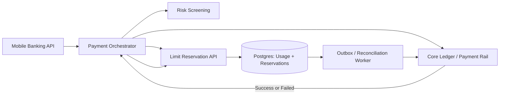

# 02 — Bank Transfer Authorization and Daily Limits (7-Step System Design)

**Area:** Digital Banking · Concurrency  
**Target:** Grab Round 2 system design practice · junior-to-mid backend · 45–60 minutes  
**Assumptions:** All system sizes, policies, APIs, schemas, times and data examples here are **illustrative**, not confirmed Grab or GXBank production details. Verify product/business and regulatory rules with the interviewer.

> **Mock question:** Design a service that enforces a customer’s daily bank-transfer limit correctly, even when several transfers are initiated concurrently.

## The 7-step roadmap

1. Clarify the Problem and Scope
2. Functional and Non-Functional Requirements
3. Capacity Estimation and Performance Goals
4. High-Level Architecture and Request Flow
5. APIs, Data Model and Correctness Boundaries
6. Deep Dive: Concurrency, Failure Handling and Security
7. Testing, Monitoring, Deployment and Trade-offs


---

## Step 1 — Clarify the Problem and Scope

Start with questions. **Do not draw Redis or Kafka immediately.** A 60-second clarification can change the entire architecture.

| Interviewer question | Why / practice assumption |
|---|---|
| What counts toward a limit? | Outgoing completed + reserved transfers; exact status rules are a product decision. |
| Which date and time zone? | Agree on bank-local calendar day vs rolling 24-hour window. |
| Per-user or per-account limits? | Support both via scope_key; define precedence. |
| When is money moved? | Limit service reserves quota; payment processor transfers funds. |
| Can transfers fail or time out? | Yes; design confirmation, release and reconciliation. |


**First-version boundary:** Implement reservation and tracking of customer transfer limits; external settlement, AML and ledger transfers are separate services.

**How to say it:** “I'll confirm the system's scope, correctness guarantees and expected traffic, then start with the simplest viable design and deepen the failure cases.”

## Step 2 — Functional and Non-Functional Requirements

### Functional requirements (what it must do)

- Check available limit and atomically reserve amount before payment execution.
- Commit a reservation after confirmed payment success; release after confirmed failure/cancel.
- Support stable idempotency keys and read remaining quota.
- Handle day rollover, different currencies and admin policy changes with explicit semantics.
- Reconcile stuck reservations against authoritative payment status.

### Non-functional requirements (how well it must work)

- No transfer can exceed the effective limit through concurrent calls.
- Illustrative reservation response p99 < 100 ms under normal DB health.
- State transitions and released limits are auditable and recoverable.
- Use decimal minor units (e.g., cents/sen); never floating-point money.

### Critical invariants (conditions that must never be violated)

- used + reserved <= configured limit for the specified scope/day/currency.
- A logical transfer has at most one active reservation with one amount and scope.
- A reservation is not released solely because a network timeout occurred; confirm payment state first.

**Interview tip:** Say the invariants aloud before drawing. They determine whether Redis is a cache, whether SQL transactions are required and what happens when data is missing.

## Step 3 — Capacity Estimation and Performance Goals

Example peak 3,000 transfer attempts/sec and average 300/sec. At average: 300 × 86,400 = 25.92M attempts/day. With two ~small indexed DB writes per request, plan for write throughput, hot customer rows, retention and connection limits; traffic is not evenly distributed.

Do not claim an architecture satisfies a p99 target just because components were assigned latency budgets. **Prove it using realistic end-to-end load tests, tail-latency monitoring and failure tests.** Distinguish steady-state from burst and differentiate product traffic from external provider throughput.

## Step 4 — High-Level Architecture and Request Flow

### Architecture (Mermaid)



### Explain one request end-to-end

1. Caller supplies a stable `transfer_id` and payment details.
2. Payment service performs authentication, step-up and risk checks as required.
3. Limit API atomically checks and reserves quota for bank day.
4. Payment service executes ledger/payment flow separately; never hold a SQL transaction open across a network payment.
5. On confirmed outcome, commit or release the reservation idempotently.
6. Reconciliation queries unresolved transfers and repairs reservation state after crashes.


**Whiteboard narration:** Name the system of record, the synchronous critical path, the async side path, and the place where a durable state change happens. A Kafka event is not a replacement for a required synchronous commit unless the product permits eventual completion.

## Step 5 — APIs, Data Model and Correctness Boundaries

### API contract (illustrative)

```http
POST /v1/limit-reservations
Idempotency-Key: transfer-123
{"customer_id":"u1","transfer_id":"t123","amount_minor":500000,
 "currency":"MYR","limit_scope":"DAILY_OUTBOUND"}
→ 201 {"reservation_id":"r42","state":"RESERVED","remaining_minor":2500000}
→ 409 {"code":"LIMIT_EXCEEDED"}   // if insufficient

POST /v1/limit-reservations/r42/commit
{"payment_result_id":"p900"}
→ 200 {"state":"COMMITTED"}

POST /v1/limit-reservations/r42/release
{"reason":"PAYMENT_CONFIRMED_FAILED"}
→ 200 {"state":"RELEASED"}

GET /v1/limits/DAILY_OUTBOUND?currency=MYR
→ 200 {"limit_minor":3000000,"used_minor":0,"reserved_minor":500000}
```

**API design checklist:** identify caller and authorization, required fields, stable resource/request ID, validation rules, status codes, idempotency behavior, and timeout/retry semantics. Use consistent errors and never trust a client-supplied account ID by itself.

### Data model (illustrative PostgreSQL SQL)

```sql
CREATE TABLE daily_limit_usage (
  scope_key TEXT NOT NULL, bank_day DATE NOT NULL,
  currency CHAR(3) NOT NULL, limit_minor BIGINT NOT NULL,
  used_minor BIGINT NOT NULL DEFAULT 0,
  reserved_minor BIGINT NOT NULL DEFAULT 0,
  PRIMARY KEY (scope_key, bank_day, currency),
  CHECK (used_minor >= 0 AND reserved_minor >= 0)
);
CREATE TABLE limit_reservation (
  reservation_id UUID PRIMARY KEY, transfer_id TEXT UNIQUE NOT NULL,
  scope_key TEXT NOT NULL, bank_day DATE NOT NULL,
  currency CHAR(3) NOT NULL, amount_minor BIGINT NOT NULL,
  state TEXT NOT NULL, created_at TIMESTAMPTZ NOT NULL
);
```

**Data modeling checklist:** state ownership, constraints and unique indexes, status transitions, retention/partitioning, and transaction boundaries. The SQL is a **teaching sketch**, not a complete production migration.

## Step 6 — Deep Dive: Concurrency, Failure Handling and Security

### The implementation deep dive

- **Atomic reservation:** within one SQL transaction, lock or conditionally update the usage row when `used_minor + reserved_minor + :amount <= limit_minor`; insert unique reservation. Roll back both changes on failure.
- **Idempotency:** unique `transfer_id` plus normalized payload hash. Same transfer+payload returns existing reservation; same key with changed amount returns conflict.
- **Payment boundary:** reserving limit is not transferring funds. Confirm money movement from the authoritative payment system; do not assume a timeout means failure.
- **Date rollover:** make `bank_day` an explicit property at reservation time, preserve the original day even if final payment happens after midnight.
- **Multi-currency:** define whether policies are per-currency or converted at a frozen rate; document precision and rounding.

### Failure scenarios to explain

| Failure | Handling strategy |
|---|---|
| Two transfers race for last RM100 | Atomic conditional update or row lock allows only one qualifying reservation. |
| DB committed but caller timed out | Retry using transfer ID; return existing result, not a second reserve. |
| External payment times out | Leave PENDING/RESERVED, query payment service, then commit or release. |
| Worker crashes during settlement | Outbox + idempotent transitions + reconciliation on stale reservations. |

### Security and trust boundaries

Only trusted payment services can reserve/commit quotas; admin limit changes require approval, audit and versioning. Do not let a client supply arbitrary customer scope or payment result proof.

**Common trap:** “Just retry” is not a complete failure strategy. Explain which requests are idempotent, what outcome is unknown after a timeout, how duplicates are detected, and how the system eventually reconciles.

## Step 7 — Testing, Monitoring, Deployment and Trade-offs

### Testing plan

- Simulate 1,000 concurrent RM10 transfers against a RM100 remaining limit: never exceed quota.
- Retry after response timeout; reserve count must remain one.
- Bank-day rollover and daylight-saving policy test (where relevant).
- Payment success arrives twice, or before an expected worker event: state transition remains consistent.

### Monitoring and operational metrics

- Limit-exceeded rate and reservation success/failure latency.
- Outstanding reservations age, reconciliation mismatch count, commit/release error rate.
- DB lock wait, deadlocks, transaction retries and hot keys.

### Deployment / rollback

Use backward-compatible schema migrations; deploy reservation changes behind a flag, dual-compare old/new calculations in shadow mode without double-reserving, then canary and monitor limit mismatches.

### Trade-offs you must justify

| Trade-off | Reasoning |
|---|---|
| DB row lock vs optimistic CAS | Row locking is simple and correct; CAS may reduce contention but needs retry control. |
| DB truth vs Redis cache | Strong limit enforcement belongs in authoritative atomic store; Redis can cache read-only views. |
| Reserve vs check-then-pay | Reservation prevents concurrent overspend; plain reads race. |


### Interview follow-up questions — practise answering aloud

1. What happens if a payment succeeds but the commit call is lost?
2. How do you enforce several limits: per-transfer, daily, monthly, per-beneficiary?
3. How do you prevent one hot merchant account from causing DB contention?


---

### Final 30-second recap template

> “The core user flow is **[critical path]**. The source of truth is **[durable store]** and the primary correctness rule is **[invariant]**. I chose **[key technology]** because of **[workload/latency/consistency reason]**, while accepting **[trade-off]**. For reliability I would handle **[most dangerous failure]** with **[specific recovery]**, and I would validate performance with **[tests and production metrics]**.”

**Remember:** The goal is not to recite this specific architecture; it is to explain your assumptions and defend decisions when requirements change.