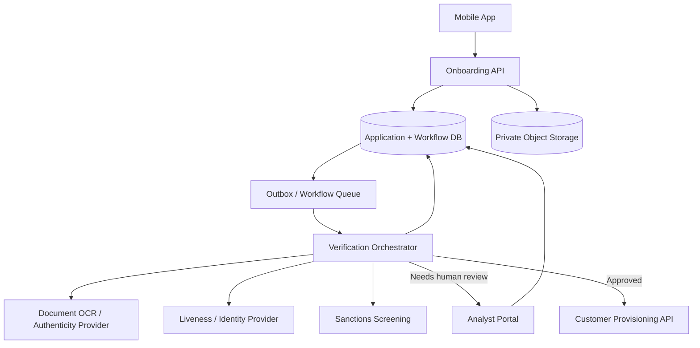

# 03 — Digital Bank Customer Onboarding / eKYC (7-Step System Design)

**Area:** Digital Banking · Asynchronous Workflow  
**Target:** Grab Round 2 system design practice · junior-to-mid backend · 45–60 minutes  
**Assumptions:** All system sizes, policies, APIs, schemas, times and data examples here are **illustrative**, not confirmed Grab or GXBank production details. Verify product/business and regulatory rules with the interviewer.

> **Mock question:** Design an onboarding system that collects identity documents, runs verification checks, handles manual review and safely creates a customer account.

## The 7-step roadmap

1. Clarify the Problem and Scope
2. Functional and Non-Functional Requirements
3. Capacity Estimation and Performance Goals
4. High-Level Architecture and Request Flow
5. APIs, Data Model and Correctness Boundaries
6. Deep Dive: Concurrency, Failure Handling and Security
7. Testing, Monitoring, Deployment and Trade-offs


---

## Step 1 — Clarify the Problem and Scope

Start with questions. **Do not draw Redis or Kafka immediately.** A 60-second clarification can change the entire architecture.

| Interviewer question | Why / practice assumption |
|---|---|
| Who is the user? | New applicant with potentially unstable network/mobile device. |
| What checks? | Document validity, identity match, duplication, sanctions/PEP checks; exact rules are policy-defined. |
| Can verification take minutes/hours? | Yes: use an asynchronous workflow with progress states. |
| What is the success boundary? | Approved identity and bank customer created exactly once logically. |
| Compliance and retention? | Set locality, consent, encryption, retention and deletion from policy/legal requirements. |


**First-version boundary:** Design application workflow and integrations; not the internal ML/OCR models or a full core-banking platform.

**How to say it:** “I'll confirm the system's scope, correctness guarantees and expected traffic, then start with the simplest viable design and deepen the failure cases.”

## Step 2 — Functional and Non-Functional Requirements

### Functional requirements (what it must do)

- Create/resume an onboarding application with stable applicant reference.
- Issue time-limited document upload URLs to protected object storage.
- Run document, liveness and external verification steps asynchronously.
- Handle third-party callbacks safely; route unclear cases to manual review.
- Approve/reject with documented reasons, approvals and audit records.

### Non-functional requirements (how well it must work)

- Never approve solely on a missing third-party response or incomplete mandatory check.
- Status reads respond quickly; costly checks run asynchronously.
- Document data encrypted in transit/at rest with strict permissions and retention.
- Safe retries and no duplicate bank customer creation.

### Critical invariants (conditions that must never be violated)

- An application enters APPROVED only after mandatory checks satisfy policy version.
- Every external callback has verified sender/identity and is idempotently recorded.
- Provisioning a bank customer is idempotent with application_id.

**Interview tip:** Say the invariants aloud before drawing. They determine whether Redis is a cache, whether SQL transactions are required and what happens when data is missing.

## Step 3 — Capacity Estimation and Performance Goals

Assume 20,000 new applications/day, 4 uploads averaging 2 MB each → ~160 GB of new media/day before replicas/retention. Peak upload throughput and external vendor quotas may dominate; object storage is appropriate for binary data.

Do not claim an architecture satisfies a p99 target just because components were assigned latency budgets. **Prove it using realistic end-to-end load tests, tail-latency monitoring and failure tests.** Distinguish steady-state from burst and differentiate product traffic from external provider throughput.

## Step 4 — High-Level Architecture and Request Flow

### Architecture (Mermaid)



### Explain one request end-to-end

1. Create application in `DRAFT` and return its ID.
2. Client requests a pre-signed upload URL, uploads directly to private storage and confirms document metadata.
3. Workflow enters `VERIFYING`, asynchronously calls providers with bounded retries.
4. Normalize signed callbacks into stored verification results; evaluate policy.
5. If uncertain, enter `MANUAL_REVIEW`, assign analyst and require an authorized decision.
6. Once approved, provision customer using application ID as the idempotency reference.


**Whiteboard narration:** Name the system of record, the synchronous critical path, the async side path, and the place where a durable state change happens. A Kafka event is not a replacement for a required synchronous commit unless the product permits eventual completion.

## Step 5 — APIs, Data Model and Correctness Boundaries

### API contract (illustrative)

```http
POST /v1/onboarding/applications
{"country":"MY","product":"SAVINGS"}
→ 201 {"application_id":"app123","status":"DRAFT"}

POST /v1/onboarding/applications/app123/upload-requests
{"document_type":"NATIONAL_ID","content_type":"image/jpeg"}
→ 201 {"upload_url":"<short-lived signed URL>","object_id":"obj9"}

POST /v1/onboarding/applications/app123/submit
{"document_object_ids":["obj9","obj10"]}
→ 202 {"status":"VERIFYING"}

GET /v1/onboarding/applications/app123
→ 200 {"status":"MANUAL_REVIEW","pending_steps":["IDENTITY_MATCH"]}

POST /internal/verification-provider/callback
{"provider_event_id":"evt88","application_id":"app123","result":"PASS"}
→ 200 {"accepted":true}
```

**API design checklist:** identify caller and authorization, required fields, stable resource/request ID, validation rules, status codes, idempotency behavior, and timeout/retry semantics. Use consistent errors and never trust a client-supplied account ID by itself.

### Data model (illustrative PostgreSQL SQL)

```sql
CREATE TABLE onboarding_application (
  application_id UUID PRIMARY KEY, applicant_id UUID NOT NULL,
  state TEXT NOT NULL, policy_version BIGINT NOT NULL,
  created_at TIMESTAMPTZ NOT NULL, updated_at TIMESTAMPTZ NOT NULL
);
CREATE TABLE verification_step (
  application_id UUID NOT NULL, step_name TEXT NOT NULL,
  status TEXT NOT NULL, provider_reference TEXT,
  PRIMARY KEY (application_id, step_name)
);
CREATE TABLE provider_event (
  provider_event_id TEXT PRIMARY KEY,
  application_id UUID NOT NULL, received_at TIMESTAMPTZ NOT NULL
);
```

**Data modeling checklist:** state ownership, constraints and unique indexes, status transitions, retention/partitioning, and transaction boundaries. The SQL is a **teaching sketch**, not a complete production migration.

## Step 6 — Deep Dive: Concurrency, Failure Handling and Security

### The implementation deep dive

- **Workflow states:** `DRAFT → SUBMITTED → VERIFYING → (MANUAL_REVIEW | APPROVED | REJECTED)`. Terminal decisions cannot be overwritten by late callbacks without an explicit reopening workflow.
- **Outbox:** persist application state and next workflow task atomically; queue workers are at-least-once, so steps use idempotency.
- **Callback security:** validate signatures/mTLS, reject unexpected application/provider combinations, deduplicate `provider_event_id` and handle out-of-order results.
- **Document storage:** pre-signed URLs with short expiry and constrained MIME/size; scan files and make the storage bucket private.
- **User experience:** applicant polls status or receives push; retries submission safely after disconnection.

### Failure scenarios to explain

| Failure | Handling strategy |
|---|---|
| Verification vendor unavailable | Retry with backoff and DLQ; keep application VERIFYING, not APPROVED. |
| Callback arrives twice | Unique event ID makes processing idempotent. |
| Customer provisioning response lost | Retry with application ID, query customer service before creating a second identity. |
| File upload interrupted | Resume/retry object upload and mark document ready only after successful finalization. |

### Security and trust boundaries

Strong identity access control, tokenized file URLs, encryption at rest, key management, PII redaction, staff least privilege, approval audit and legally defined retention/erasure.

**Common trap:** “Just retry” is not a complete failure strategy. Explain which requests are idempotent, what outcome is unknown after a timeout, how duplicates are detected, and how the system eventually reconciles.

## Step 7 — Testing, Monitoring, Deployment and Trade-offs

### Testing plan

- State-machine transition tests for invalid jumps and late callbacks.
- Duplicate/missing/out-of-order callback simulation.
- Malicious file upload, unauthorized document download and expired signed URL tests.
- End-to-end test including vendor timeout and manual-review approval.

### Monitoring and operational metrics

- Applications by state, median/p95 onboarding completion time, abandonment.
- Vendor success/timeout rates, manual-review backlog, callback delay.
- Duplicate customer prevention incidents and document access-denied anomalies.

### Deployment / rollback

Version verification policies and schemas; roll out new checks to a small cohort, preserve in-progress applications under explicit policy migration rules and maintain auditability.

### Trade-offs you must justify

| Trade-off | Reasoning |
|---|---|
| Synchronous vs async verification | Async avoids mobile timeouts and isolates third-party latency. |
| Orchestrated workflow vs event choreography | Orchestration makes compliance state transitions easier to reason about. |
| Build vs buy OCR/liveness | Vendors reduce implementation time but add privacy, reliability and cost trade-offs. |


### Interview follow-up questions — practise answering aloud

1. What happens if a sanctions result changes after a customer is approved?
2. How do you recover half-completed onboarding after a worker crash?
3. How do you prove who approved a manual-review case?


---

### Final 30-second recap template

> “The core user flow is **[critical path]**. The source of truth is **[durable store]** and the primary correctness rule is **[invariant]**. I chose **[key technology]** because of **[workload/latency/consistency reason]**, while accepting **[trade-off]**. For reliability I would handle **[most dangerous failure]** with **[specific recovery]**, and I would validate performance with **[tests and production metrics]**.”

**Remember:** The goal is not to recite this specific architecture; it is to explain your assumptions and defend decisions when requirements change.