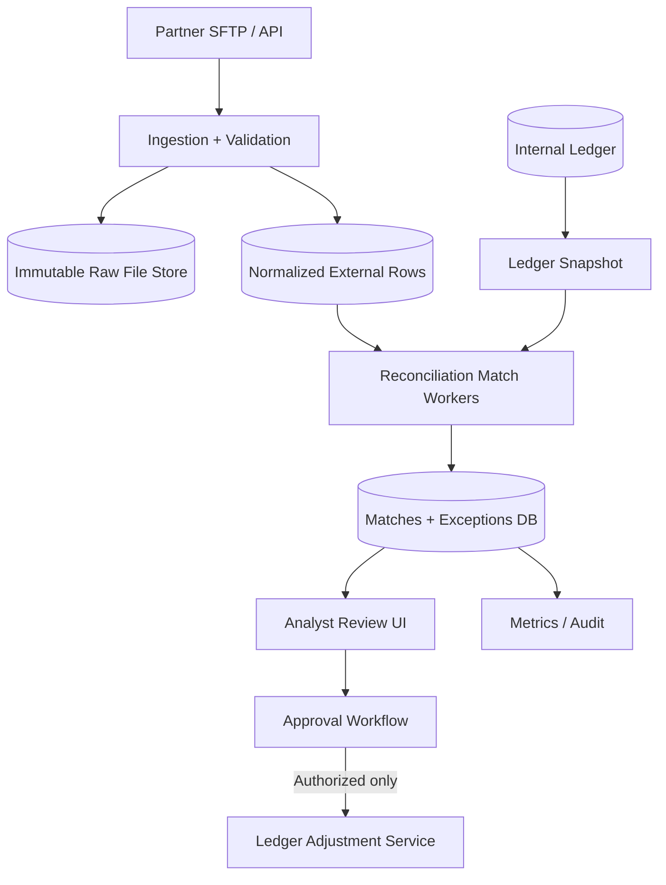

# 04 — Bank Reconciliation and Settlement (7-Step System Design)

**Area:** Fintech · Data Correctness  
**Target:** Grab Round 2 system design practice · junior-to-mid backend · 45–60 minutes  
**Assumptions:** All system sizes, policies, APIs, schemas, times and data examples here are **illustrative**, not confirmed Grab or GXBank production details. Verify product/business and regulatory rules with the interviewer.

> **Mock question:** Design a reconciliation system that detects discrepancies between an internal ledger and transactions reported by external banks or payment partners.

## The 7-step roadmap

1. Clarify the Problem and Scope
2. Functional and Non-Functional Requirements
3. Capacity Estimation and Performance Goals
4. High-Level Architecture and Request Flow
5. APIs, Data Model and Correctness Boundaries
6. Deep Dive: Concurrency, Failure Handling and Security
7. Testing, Monitoring, Deployment and Trade-offs


---

## Step 1 — Clarify the Problem and Scope

Start with questions. **Do not draw Redis or Kafka immediately.** A 60-second clarification can change the entire architecture.

| Interviewer question | Why / practice assumption |
|---|---|
| What sources are reconciled? | Internal posted ledger versus partner transaction/settlement reports. |
| How often? | Daily batch initially; add intraday updates if required. |
| What means a match? | Stable external reference + amount + currency + direction and state. |
| Who fixes mismatches? | Analysts investigate; ledger adjustment requires separate authorization. |
| Do reports arrive late? | Yes: ingestion, corrections and reruns must be repeatable. |


**First-version boundary:** Build ingestion, deterministic matching and exceptions workflow. Do not implement actual money settlement networks or silently modify authoritative ledger entries.

**How to say it:** “I'll confirm the system's scope, correctness guarantees and expected traffic, then start with the simplest viable design and deepen the failure cases.”

## Step 2 — Functional and Non-Functional Requirements

### Functional requirements (what it must do)

- Ingest and validate partner files/API feeds, deduplicate files/rows.
- Snapshot or query authoritative internal ledger postings for the same cutoff.
- Match by stable keys, amounts, currency, direction and settlement date rules.
- Classify unmatched, duplicate and amount-mismatched entries as exceptions.
- Provide reruns, analyst review, approved adjustments and audit history.

### Non-functional requirements (how well it must work)

- Reconciliation is deterministic and repeatable for an input version.
- No silent mutation of financial ledger during matching.
- Handle late reports, large batches and interrupted jobs safely.
- Strong RBAC, immutable audit logs and retained raw source lineage.

### Critical invariants (conditions that must never be violated)

- Each external row is consumed at most once per report version; reruns do not duplicate exceptions.
- Only explicit authorized workflows can initiate ledger correction.
- A balance difference remains visible until evidence-backed resolution.

**Interview tip:** Say the invariants aloud before drawing. They determine whether Redis is a cache, whether SQL transactions are required and what happens when data is missing.

## Step 3 — Capacity Estimation and Performance Goals

Assume 5 million transaction rows/day at ~300 bytes normalized ≈ 1.5 GB/day raw before indexes, originals and replicas. Batch matching may need partitioning by partner/day and efficient keyed joins; do not load the entire dataset into one worker’s memory.

Do not claim an architecture satisfies a p99 target just because components were assigned latency budgets. **Prove it using realistic end-to-end load tests, tail-latency monitoring and failure tests.** Distinguish steady-state from burst and differentiate product traffic from external provider throughput.

## Step 4 — High-Level Architecture and Request Flow

### Architecture (Mermaid)



### Explain one request end-to-end

1. Receive report, verify partner, schema, checksum and report identity; persist immutable original.
2. Normalize every row with partner reference, amount minor units, currency, date and version.
3. Create reconciliation run with a fixed source cutoff/watermark and ledger snapshot reference.
4. Match by deterministic keys and handle duplicate/partial/aggregated partner references explicitly.
5. Store `MATCHED`, `UNMATCHED_INTERNAL`, `UNMATCHED_EXTERNAL` or `AMOUNT_MISMATCH` evidence.
6. Analysts resolve exceptions; approved corrections occur in a separate ledger workflow.


**Whiteboard narration:** Name the system of record, the synchronous critical path, the async side path, and the place where a durable state change happens. A Kafka event is not a replacement for a required synchronous commit unless the product permits eventual completion.

## Step 5 — APIs, Data Model and Correctness Boundaries

### API contract (illustrative)

```http
POST /v1/reconciliation/runs
{"partner_id":"bankA","bank_day":"2026-11-14","report_id":"report77"}
→ 202 {"run_id":"run42","status":"QUEUED"}

GET /v1/reconciliation/runs/run42
→ 200 {"status":"COMPLETED","matched":9980,"exceptions":20}

GET /v1/reconciliation/runs/run42/exceptions?state=OPEN&cursor=...
→ 200 {"items":[{"id":"e1","kind":"AMOUNT_MISMATCH"}],"next_cursor":null}

POST /v1/reconciliation/exceptions/e1/resolve
{"resolution":"INVESTIGATE_PARTNER","evidence_ref":"ticket44"}
→ 200 {"state":"UNDER_INVESTIGATION"}
```

**API design checklist:** identify caller and authorization, required fields, stable resource/request ID, validation rules, status codes, idempotency behavior, and timeout/retry semantics. Use consistent errors and never trust a client-supplied account ID by itself.

### Data model (illustrative PostgreSQL SQL)

```sql
CREATE TABLE partner_report (
  partner_id TEXT NOT NULL, report_id TEXT NOT NULL,
  sha256 TEXT NOT NULL, version INT NOT NULL,
  object_uri TEXT NOT NULL,
  PRIMARY KEY (partner_id, report_id, version)
);
CREATE TABLE reconciliation_run (
  run_id UUID PRIMARY KEY, partner_id TEXT NOT NULL,
  bank_day DATE NOT NULL, report_version INT NOT NULL,
  ledger_watermark TEXT NOT NULL, state TEXT NOT NULL
);
CREATE TABLE reconciliation_exception (
  exception_id UUID PRIMARY KEY, run_id UUID NOT NULL,
  external_reference TEXT, ledger_reference TEXT,
  kind TEXT NOT NULL, state TEXT NOT NULL,
  UNIQUE(run_id, external_reference, ledger_reference, kind)
);
```

**Data modeling checklist:** state ownership, constraints and unique indexes, status transitions, retention/partitioning, and transaction boundaries. The SQL is a **teaching sketch**, not a complete production migration.

## Step 6 — Deep Dive: Concurrency, Failure Handling and Security

### The implementation deep dive

- **Immutable evidence:** raw partner file and normalized version are never overwritten; corrections create a new version linked to prior version.
- **Matching approach:** stable reference first; amount/date-only fuzzy matching may propose candidates but must not auto-resolve ambiguous payments.
- **Cutoff consistency:** snapshot ledger posting IDs or a durable watermark. Without a stable cutoff, rerun results may change unintentionally.
- **Partial settlement / FX / fees:** model principal, fees, net settlement, currency and expected aggregation explicitly; do not assume one row equals one transaction.
- **Exception lifecycle:** investigations may require maker-checker approval before a correction event or journal entry.

### Failure scenarios to explain

| Failure | Handling strategy |
|---|---|
| Partner file received twice | Deduplicate by partner/report/version/hash; safe rerun. |
| Job crashes halfway | Checkpoint partitions and upsert deterministic match results. |
| Partner sends corrected file | Create new report version, rerun with selected cutoff, preserve history. |
| Mismatch investigated as duplicate | Never auto-post offsetting ledger entries to make totals match. |

### Security and trust boundaries

Signed/transmitted reports, encrypted storage, access separated by partner, dual approval for financial adjustments, audit of every exception state change and evidence.

**Common trap:** “Just retry” is not a complete failure strategy. Explain which requests are idempotent, what outcome is unknown after a timeout, how duplicates are detected, and how the system eventually reconciles.

## Step 7 — Testing, Monitoring, Deployment and Trade-offs

### Testing plan

- Golden fixture for exact match, duplicate, wrong amount, missing row and fee aggregation.
- Repeat run with same source versions and compare deterministic outputs.
- Simulate truncated report, corrected report and out-of-order file arrival.
- Reconcile ledger snapshot with post-cutoff transactions present.

### Monitoring and operational metrics

- Match rate and absolute financial discrepancy amount by partner/day/currency.
- Age and count of unresolved exceptions, time-to-reconcile, rerun volume.
- Input lag, partner report availability, source schema rejects and job failures.

### Deployment / rollback

Run old and new matchers side by side against identical immutable inputs; compare mismatch totals before switching. Version matching algorithms and retain lineage.

### Trade-offs you must justify

| Trade-off | Reasoning |
|---|---|
| Batch vs streaming | Batch is auditable and simple for end-of-day reports; streaming improves timeliness but needs watermarks/replay. |
| Exact vs probabilistic matching | Exact is safer for automated financial action; fuzzy candidates aid manual investigation. |
| DB join vs distributed processing | DB is simpler at moderate scale; distributed partitioning helps very large or complex reports. |


### Interview follow-up questions — practise answering aloud

1. How do you match one partner settlement entry to 1,000 internal payments?
2. What if the external bank report contains refunds arriving two days late?
3. How do you prove reconciliation results are repeatable?


---

### Final 30-second recap template

> “The core user flow is **[critical path]**. The source of truth is **[durable store]** and the primary correctness rule is **[invariant]**. I chose **[key technology]** because of **[workload/latency/consistency reason]**, while accepting **[trade-off]**. For reliability I would handle **[most dangerous failure]** with **[specific recovery]**, and I would validate performance with **[tests and production metrics]**.”

**Remember:** The goal is not to recite this specific architecture; it is to explain your assumptions and defend decisions when requirements change.