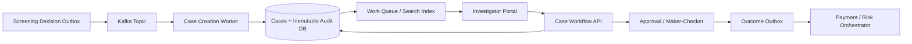

# 05 — Fraud Investigation / Case Management (7-Step System Design)

**Area:** Digital Banking · Workflow and Audit  
**Target:** Grab Round 2 system design practice · junior-to-mid backend · 45–60 minutes  
**Assumptions:** All system sizes, policies, APIs, schemas, times and data examples here are **illustrative**, not confirmed Grab or GXBank production details. Verify product/business and regulatory rules with the interviewer.

> **Mock question:** Design a fraud case management system that routes suspicious transactions to investigators and tracks review decisions without losing evidence.

## The 7-step roadmap

1. Clarify the Problem and Scope
2. Functional and Non-Functional Requirements
3. Capacity Estimation and Performance Goals
4. High-Level Architecture and Request Flow
5. APIs, Data Model and Correctness Boundaries
6. Deep Dive: Concurrency, Failure Handling and Security
7. Testing, Monitoring, Deployment and Trade-offs


---

## Step 1 — Clarify the Problem and Scope

Start with questions. **Do not draw Redis or Kafka immediately.** A 60-second clarification can change the entire architecture.

| Interviewer question | Why / practice assumption |
|---|---|
| How do cases originate? | From risk screening HOLD, suspicious behavior or analyst creation. |
| One case per event or account? | Start one case per source event, with optional grouping/linking. |
| Which roles exist? | Investigators, team leads, auditors, compliance administrators. |
| What decisions matter? | Approve, block, escalate, request evidence; approvals may require two people. |
| SLA and evidence retention? | Agree deadlines and retention with business/compliance policy. |


**First-version boundary:** Handle investigation lifecycle and evidence; actual payment release/hold execution remains in the authorized payment service.

**How to say it:** “I'll confirm the system's scope, correctness guarantees and expected traffic, then start with the simplest viable design and deepen the failure cases.”

## Step 2 — Functional and Non-Functional Requirements

### Functional requirements (what it must do)

- Create cases idempotently from screening decision events.
- Assign/claim cases based on skills, queue and urgency.
- Track evidence, notes, comments, deadlines, decision reasons and audit.
- Enforce state transitions and maker-checker rules for sensitive decisions.
- Emit approved outcome events so downstream payment/risk systems can act.

### Non-functional requirements (how well it must work)

- Strong authorization and audit for sensitive financial decisions.
- Prevent two analysts from silently overwriting one another.
- Support search and queue pagination at investigation scale.
- No lost HOLD cases even if queue consumers restart.

### Critical invariants (conditions that must never be violated)

- Every case transition has actor, timestamp, previous/new state, policy/evidence reference.
- Only authorized transitions can release a held transaction.
- One source event must not create multiple independent active cases accidentally.

**Interview tip:** Say the invariants aloud before drawing. They determine whether Redis is a cache, whether SQL transactions are required and what happens when data is missing.

## Step 3 — Capacity Estimation and Performance Goals

Assume 100,000 risk alerts/day and 10% manual cases → 10,000 cases/day. If each generates ~20 audit events (500 bytes), ~100 MB/day audit payload before indexes/evidence. Human review SLA and queue fairness are the dominant design concerns.

Do not claim an architecture satisfies a p99 target just because components were assigned latency budgets. **Prove it using realistic end-to-end load tests, tail-latency monitoring and failure tests.** Distinguish steady-state from burst and differentiate product traffic from external provider throughput.

## Step 4 — High-Level Architecture and Request Flow

### Architecture (Mermaid)



### Explain one request end-to-end

1. Risk service publishes committed HOLD event using an outbox.
2. Consumer deduplicates `source_event_id` and creates OPEN case plus audit entry.
3. Queue assigns or allows analyst to claim; ownership changes are atomic.
4. Analyst reviews redacted transaction/device evidence and documents findings.
5. Workflow validates RBAC, state version and optional second approver.
6. Approved decision is recorded with outbox; payment system consumes it idempotently.


**Whiteboard narration:** Name the system of record, the synchronous critical path, the async side path, and the place where a durable state change happens. A Kafka event is not a replacement for a required synchronous commit unless the product permits eventual completion.

## Step 5 — APIs, Data Model and Correctness Boundaries

### API contract (illustrative)

```http
POST /internal/v1/cases
{"source_event_id":"screen_evt_77","entity_id":"acct7","reason":"VELOCITY"}
→ 201 {"case_id":"case42","state":"OPEN","version":1}

GET /v1/cases?state=OPEN&priority=HIGH&cursor=...
→ 200 {"items":[{"case_id":"case42","priority":"HIGH"}],"next_cursor":null}

POST /v1/cases/case42/claim
{"assignee_id":"analyst8","expected_version":1}
→ 200 {"state":"IN_REVIEW","version":2}

POST /v1/cases/case42/decision
{"outcome":"BLOCK","reason_code":"CONFIRMED_SUSPICIOUS","expected_version":2}
→ 202 {"state":"PENDING_APPROVAL","version":3}
```

**API design checklist:** identify caller and authorization, required fields, stable resource/request ID, validation rules, status codes, idempotency behavior, and timeout/retry semantics. Use consistent errors and never trust a client-supplied account ID by itself.

### Data model (illustrative PostgreSQL SQL)

```sql
CREATE TABLE fraud_case (
  case_id UUID PRIMARY KEY, source_event_id TEXT UNIQUE NOT NULL,
  entity_id TEXT NOT NULL, state TEXT NOT NULL,
  assignee_id TEXT, priority TEXT NOT NULL,
  version BIGINT NOT NULL DEFAULT 1, created_at TIMESTAMPTZ NOT NULL
);
CREATE TABLE case_audit (
  audit_id UUID PRIMARY KEY, case_id UUID NOT NULL,
  actor_id TEXT NOT NULL, action TEXT NOT NULL,
  from_state TEXT, to_state TEXT,
  created_at TIMESTAMPTZ NOT NULL
);
CREATE INDEX idx_case_queue ON fraud_case(state, priority, created_at);
```

**Data modeling checklist:** state ownership, constraints and unique indexes, status transitions, retention/partitioning, and transaction boundaries. The SQL is a **teaching sketch**, not a complete production migration.

## Step 6 — Deep Dive: Concurrency, Failure Handling and Security

### The implementation deep dive

- **State machine:** `OPEN → IN_REVIEW → (PENDING_APPROVAL | ESCALATED | CLOSED)`; only approved transitions trigger release/block downstream.
- **Optimistic concurrency:** conditional update `WHERE case_id=? AND version=?` prevents stale browser sessions overwriting another analyst.
- **Maker-checker:** certain releases/blocks need a second authorized reviewer who is not the maker. Enforce server-side, not UI-only.
- **Queue discipline:** priority + age, assignment leases, rebalancing and anti-starvation; case SLAs are monitored separately from API latency.
- **Evidence:** store immutable links/hash/version, redact access and log every sensitive read.

### Failure scenarios to explain

| Failure | Handling strategy |
|---|---|
| Case event delivered twice | Unique source_event_id ensures one logical case. |
| Two analysts claim together | Version/conditional update allows one owner; other receives conflict. |
| Downstream payment consumer offline | Decision stays in committed outbox, retried idempotently. |
| Evidence service unavailable | Keep case open; do not approve based on missing mandatory evidence. |

### Security and trust boundaries

Strict per-case RBAC/ABAC, dual control for sensitive outcomes, immutable audit, confidential evidence links, scoped search results and least-privilege analyst access.

**Common trap:** “Just retry” is not a complete failure strategy. Explain which requests are idempotent, what outcome is unknown after a timeout, how duplicates are detected, and how the system eventually reconciles.

## Step 7 — Testing, Monitoring, Deployment and Trade-offs

### Testing plan

- Parallel claim and decision conflict tests.
- Unauthorized analyst attempts to approve their own maker-required decision.
- Duplicate Kafka messages and out-of-order updates.
- Case SLA escalation and old evidence link expiry tests.

### Monitoring and operational metrics

- Open backlog, age distribution, SLA breaches, average review time.
- Duplicate case suppression, outbox lag, failed state transitions.
- Case release rate, reversal rate and analyst workload imbalance.

### Deployment / rollback

Version workflow transitions; rollout to a pilot investigator team, compare old/new queue metrics, preserve in-flight cases and support rollback without erasing audit.

### Trade-offs you must justify

| Trade-off | Reasoning |
|---|---|
| Single case DB vs search index | DB is system of record; search index improves filtering but may be eventually consistent. |
| Automatic vs manual decisions | Automated low-risk handling scales; high-impact ambiguous cases need evidence and review. |
| Push assignment vs pull/claim | Push provides load balancing; claim provides analyst control and can reduce mistakes. |


### Interview follow-up questions — practise answering aloud

1. How can you ensure a fraud hold is not released twice?
2. What if an analyst loses connectivity while submitting a decision?
3. How do you audit every time an employee views customer evidence?


---

### Final 30-second recap template

> “The core user flow is **[critical path]**. The source of truth is **[durable store]** and the primary correctness rule is **[invariant]**. I chose **[key technology]** because of **[workload/latency/consistency reason]**, while accepting **[trade-off]**. For reliability I would handle **[most dangerous failure]** with **[specific recovery]**, and I would validate performance with **[tests and production metrics]**.”

**Remember:** The goal is not to recite this specific architecture; it is to explain your assumptions and defend decisions when requirements change.