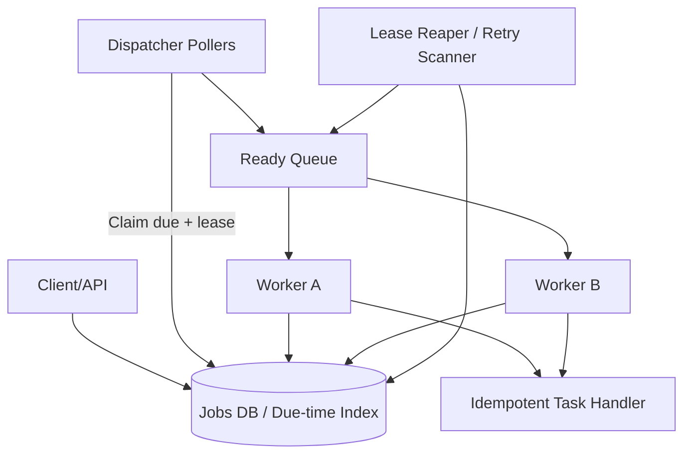

# 06 — Distributed Task Scheduler (7-Step System Design)

**Area:** General Backend · Distributed Coordination  
**Target:** Grab Round 2 system design practice · junior-to-mid backend · 45–60 minutes  
**Assumptions:** All system sizes, policies, APIs, schemas, times and data examples here are **illustrative**, not confirmed Grab or GXBank production details. Verify product/business and regulatory rules with the interviewer.

> **Mock question:** Design a service that executes scheduled tasks at a specified time using multiple workers, while surviving crashes and retries.

## The 7-step roadmap

1. Clarify the Problem and Scope
2. Functional and Non-Functional Requirements
3. Capacity Estimation and Performance Goals
4. High-Level Architecture and Request Flow
5. APIs, Data Model and Correctness Boundaries
6. Deep Dive: Concurrency, Failure Handling and Security
7. Testing, Monitoring, Deployment and Trade-offs


---

## Step 1 — Clarify the Problem and Scope

Start with questions. **Do not draw Redis or Kafka immediately.** A 60-second clarification can change the entire architecture.

| Interviewer question | Why / practice assumption |
|---|---|
| One-time or recurring tasks? | Support one-time and recurring/cron schedules. |
| What execution guarantee? | At-least-once by default; exactly-once effects require task-level idempotency. |
| Delay tolerance? | Illustrative 99% tasks start within 10 seconds of due time. |
| Can jobs run long? | Yes: workers need leases/heartbeats and timeouts. |
| How many tasks? | Assume 1 million due per day, bursty around common clock boundaries. |


**First-version boundary:** Design scheduling, leasing and dispatch. Each task’s business handler remains the responsibility of its service.

**How to say it:** “I'll confirm the system's scope, correctness guarantees and expected traffic, then start with the simplest viable design and deepen the failure cases.”

## Step 2 — Functional and Non-Functional Requirements

### Functional requirements (what it must do)

- Create, list, cancel, pause and retry jobs.
- Find due tasks efficiently and distribute them across workers.
- Guarantee a recoverable state after worker crash or scheduler restart.
- Support attempt history, retry policies, dead-letter queues and recurring schedules.
- Avoid executing a cancelled task where possible; define the race semantics.

### Non-functional requirements (how well it must work)

- At-least-once task dispatch with idempotent side effects.
- Low schedule lag, high recovery and bounded retry load.
- No worker holds an unbounded global lock; avoid a single leader bottleneck.
- Honor time zone and daylight-saving conventions for recurring jobs.

### Critical invariants (conditions that must never be violated)

- A given job version has at most one current valid lease, though expired leases can cause duplicate concurrent attempts.
- A worker must prove lease ownership/fencing token before mutating scheduler state.
- Handlers need idempotency or a downstream fence to prevent duplicate irreversible effects.

**Interview tip:** Say the invariants aloud before drawing. They determine whether Redis is a cache, whether SQL transactions are required and what happens when data is missing.

## Step 3 — Capacity Estimation and Performance Goals

Example 1M jobs/day ≈ 11.6 jobs/sec average, but 100,000 jobs may be due at 00:00. Engineer for burst dispatch, indexed due-time queries, partitions and queue backpressure; average alone is misleading.

Do not claim an architecture satisfies a p99 target just because components were assigned latency budgets. **Prove it using realistic end-to-end load tests, tail-latency monitoring and failure tests.** Distinguish steady-state from burst and differentiate product traffic from external provider throughput.

## Step 4 — High-Level Architecture and Request Flow

### Architecture (Mermaid)



### Explain one request end-to-end

1. API validates schedule and inserts job with `next_run_at`, `PENDING` and idempotency key.
2. Dispatchers use indexed due-time query and atomic claim (`FOR UPDATE SKIP LOCKED` or equivalent).
3. Claim stores lease expiry, attempt count and monotonically increasing fencing token.
4. Dispatcher enqueues task; worker executes with bounded timeouts and heartbeats.
5. Worker reports completion only if current fencing token matches.
6. Expired/error tasks return to retry queue or DLQ; recurring jobs generate next run deterministically.


**Whiteboard narration:** Name the system of record, the synchronous critical path, the async side path, and the place where a durable state change happens. A Kafka event is not a replacement for a required synchronous commit unless the product permits eventual completion.

## Step 5 — APIs, Data Model and Correctness Boundaries

### API contract (illustrative)

```http
POST /v1/scheduled-jobs
Idempotency-Key: user7-email-42
{"task_type":"SEND_REMINDER","payload_ref":"p42",
 "run_at":"2026-11-20T09:00:00+08:00","retry_policy":{"max_attempts":4}}
→ 201 {"job_id":"job123","state":"PENDING"}

GET /v1/scheduled-jobs/job123
→ 200 {"state":"RUNNING","attempt":2,"next_run_at":null}

POST /v1/scheduled-jobs/job123/cancel
→ 200 {"state":"CANCEL_REQUESTED"}

POST /internal/v1/job-runs/job123/complete
{"attempt":2,"fencing_token":17,"outcome":"SUCCEEDED"}
→ 200 {"state":"SUCCEEDED"}
```

**API design checklist:** identify caller and authorization, required fields, stable resource/request ID, validation rules, status codes, idempotency behavior, and timeout/retry semantics. Use consistent errors and never trust a client-supplied account ID by itself.

### Data model (illustrative PostgreSQL SQL)

```sql
CREATE TABLE scheduled_job (
  job_id UUID PRIMARY KEY, task_type TEXT NOT NULL,
  payload_ref TEXT NOT NULL, state TEXT NOT NULL,
  next_run_at TIMESTAMPTZ, attempt INT NOT NULL DEFAULT 0,
  lease_until TIMESTAMPTZ, fencing_token BIGINT NOT NULL DEFAULT 0,
  idempotency_key TEXT UNIQUE
);
CREATE INDEX idx_due_jobs ON scheduled_job(next_run_at)
  WHERE state IN ('PENDING','RETRY');
-- Claim a limited batch inside a short DB transaction:
-- SELECT ... FOR UPDATE SKIP LOCKED; UPDATE lease fields; COMMIT;
```

**Data modeling checklist:** state ownership, constraints and unique indexes, status transitions, retention/partitioning, and transaction boundaries. The SQL is a **teaching sketch**, not a complete production migration.

## Step 6 — Deep Dive: Concurrency, Failure Handling and Security

### The implementation deep dive

- **Leases are not locks forever:** worker may pause beyond expiry while another worker picks up the job; both can run. Prevent duplicate *effects* through handler idempotency or fencing at the target store.
- **Fencing token:** increment on every claim; downstream that supports fencing rejects work from older token. Without it, a stale worker can overwrite a new worker.
- **Crash gap:** if dispatcher claims DB row but crashes before queue send, lease expiry scanner redispatches. For stronger enqueue durability use transactional outbox.
- **Recurring cron:** store time zone, choose DST skip/repeat semantics, calculate next run from schedule not from worker completion time.
- **Retries:** exponential backoff + jitter + cap; permanent validation failures go DLQ, not infinite retry loops.

### Failure scenarios to explain

| Failure | Handling strategy |
|---|---|
| Worker crashes | Lease expires; another worker resumes; idempotency protects effects. |
| Dispatcher dies after claiming | Outbox or expired-lease scanner restores delivery. |
| Queue down | Retain due jobs in DB and apply backpressure; do not mark COMPLETED. |
| Job cancelled while running | Define best-effort cancellation; handler checks status or abort signal; irreversible action needs business-level compensation. |

### Security and trust boundaries

Authenticate job creators, allowlisted task types, authorization on payload references, worker identities, resource quotas and audit of job creation/cancellation. Never execute arbitrary user code by default.

**Common trap:** “Just retry” is not a complete failure strategy. Explain which requests are idempotent, what outcome is unknown after a timeout, how duplicates are detected, and how the system eventually reconciles.

## Step 7 — Testing, Monitoring, Deployment and Trade-offs

### Testing plan

- Kill worker before and after side effect; verify idempotency and eventual completion.
- Two dispatchers claim the same due batch concurrently.
- Simulate lease expiration and stale token completion.
- Cron DST transition and massive midnight burst load tests.

### Monitoring and operational metrics

- Schedule lag (due time to actual start), queue delay, success rate by task type.
- Lease expiration, retry rates, DLQ size, worker saturation.
- Jobs stuck in RUNNING, dispatcher DB query p99 and backlog age.

### Deployment / rollback

Canary new workers per task type, drain on shutdown, retain payload schema compatibility and use versioned handlers for long-lived scheduled tasks.

### Trade-offs you must justify

| Trade-off | Reasoning |
|---|---|
| DB polling vs timing wheel | DB polling is simple/durable; time wheels handle high timer counts but require durable recovery. |
| Single leader vs multiple pollers | A leader simplifies ordering; concurrent `SKIP LOCKED` pollers avoid single leader but complicate leases. |
| At-least-once vs exactly-once | At-least-once is practical; correctness requires idempotent or fenced side effects. |


### Interview follow-up questions — practise answering aloud

1. What happens if a worker is paused for five minutes and then resumes?
2. How do you safely send 100,000 reminders all scheduled at midnight?
3. Can you really guarantee exactly-once email delivery?


---

### Final 30-second recap template

> “The core user flow is **[critical path]**. The source of truth is **[durable store]** and the primary correctness rule is **[invariant]**. I chose **[key technology]** because of **[workload/latency/consistency reason]**, while accepting **[trade-off]**. For reliability I would handle **[most dangerous failure]** with **[specific recovery]**, and I would validate performance with **[tests and production metrics]**.”

**Remember:** The goal is not to recite this specific architecture; it is to explain your assumptions and defend decisions when requirements change.