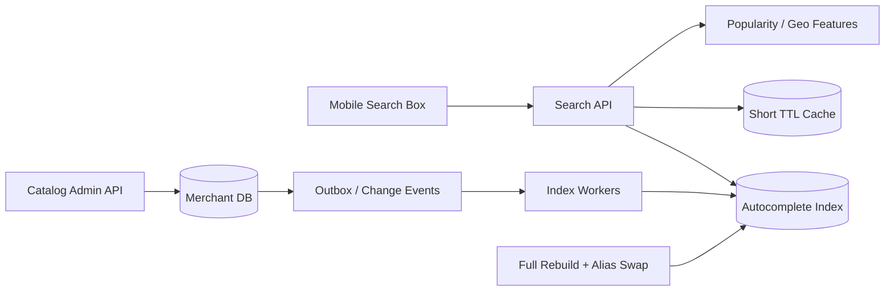

# 07 — Search and Autocomplete Service (7-Step System Design)

**Area:** General Backend · Read-Heavy Indexing  
**Target:** Grab Round 2 system design practice · junior-to-mid backend · 45–60 minutes  
**Assumptions:** All system sizes, policies, APIs, schemas, times and data examples here are **illustrative**, not confirmed Grab or GXBank production details. Verify product/business and regulatory rules with the interviewer.

> **Mock question:** Design product/place autocomplete that returns relevant suggestions as a user types, with low latency and near-real-time catalog updates.

## The 7-step roadmap

1. Clarify the Problem and Scope
2. Functional and Non-Functional Requirements
3. Capacity Estimation and Performance Goals
4. High-Level Architecture and Request Flow
5. APIs, Data Model and Correctness Boundaries
6. Deep Dive: Concurrency, Failure Handling and Security
7. Testing, Monitoring, Deployment and Trade-offs


---

## Step 1 — Clarify the Problem and Scope

Start with questions. **Do not draw Redis or Kafka immediately.** A 60-second clarification can change the entire architecture.

| Interviewer question | Why / practice assumption |
|---|---|
| What is searched? | Merchant names and locations; could be products in another scenario. |
| Prefix only or typo-tolerant? | Prefix first, optional fuzzy matching with a bounded candidate set. |
| How fresh? | Illustrative new/edited catalog entries searchable within 30 seconds. |
| Any user-specific permissions? | Only eligible, published merchants for customer-facing search. |
| Ranking factors? | Text relevance, popularity and proximity; product decides weights. |


**First-version boundary:** Autocomplete suggestions, not a complete web search engine or ML ranking platform.

**How to say it:** “I'll confirm the system's scope, correctness guarantees and expected traffic, then start with the simplest viable design and deepen the failure cases.”

## Step 2 — Functional and Non-Functional Requirements

### Functional requirements (what it must do)

- Serve prefix/typo-tolerant suggestions and return stable IDs for selections.
- Ingest merchant create/update/delete without losing updates.
- Filter unpublished, banned or region-ineligible entries.
- Support language normalization and trending popularity.
- Allow safe full rebuild and atomic swap of a search index version.

### Non-functional requirements (how well it must work)

- Illustrative p99 suggestion latency < 100 ms at 5,000 peak QPS.
- Eventual index consistency with measurable update lag.
- No leakage of hidden merchants or private fields.
- Degrade safely if personalized ranking is unavailable.

### Critical invariants (conditions that must never be violated)

- Authoritative merchant DB owns truth; search index is derived and rebuildable.
- Every returned result satisfies eligibility/visibility filters, not only text similarity.
- An out-of-order update must not resurrect a deleted merchant.

**Interview tip:** Say the invariants aloud before drawing. They determine whether Redis is a cache, whether SQL transactions are required and what happens when data is missing.

## Step 3 — Capacity Estimation and Performance Goals

Suppose 1M merchants, ~2 KB searchable metadata each → 2 GB raw, excluding inverted index, language analyzers, replicas. At 5,000 QPS peak and 10 KB responses, outbound throughput ~50 MB/s before compression/caches. Measure hot prefixes.

Do not claim an architecture satisfies a p99 target just because components were assigned latency budgets. **Prove it using realistic end-to-end load tests, tail-latency monitoring and failure tests.** Distinguish steady-state from burst and differentiate product traffic from external provider throughput.

## Step 4 — High-Level Architecture and Request Flow

### Architecture (Mermaid)



### Explain one request end-to-end

1. A merchant update is committed in the source DB plus outbox event.
2. Index worker consumes event and upserts document by version; deletes become tombstones.
3. Client sends normalized query prefix with locale/location.
4. Search API uses prefix/edge-ngram index to retrieve bounded candidates.
5. Apply visibility filters, geo/popularity features and stable ranking; return 5–10 suggestions.
6. Cache popular queries briefly, keyed by locale/region and permissions context.


**Whiteboard narration:** Name the system of record, the synchronous critical path, the async side path, and the place where a durable state change happens. A Kafka event is not a replacement for a required synchronous commit unless the product permits eventual completion.

## Step 5 — APIs, Data Model and Correctness Boundaries

### API contract (illustrative)

```http
GET /v1/search/suggestions?q=kopi&lat=3.14&lng=101.69&locale=en-MY&limit=8
→ 200 {
  "suggestions":[
    {"id":"merchant42","text":"Kopi Corner","category":"CAFE","score":0.91}
  ],"index_version":"v2026-11"
}

POST /internal/v1/merchants
{"merchant_id":"merchant42","name":"Kopi Corner","visibility":"PUBLISHED","version":12}
→ 202 {"accepted":true}

GET /internal/v1/search/index-health
→ 200 {"index_version":"v2026-11","update_lag_seconds":5}
```

**API design checklist:** identify caller and authorization, required fields, stable resource/request ID, validation rules, status codes, idempotency behavior, and timeout/retry semantics. Use consistent errors and never trust a client-supplied account ID by itself.

### Data model (illustrative PostgreSQL SQL)

```sql
CREATE TABLE merchant (
  merchant_id TEXT PRIMARY KEY, name TEXT NOT NULL,
  visibility TEXT NOT NULL, region TEXT NOT NULL,
  version BIGINT NOT NULL, updated_at TIMESTAMPTZ NOT NULL
);
CREATE TABLE search_outbox (
  event_id UUID PRIMARY KEY, merchant_id TEXT NOT NULL,
  version BIGINT NOT NULL, operation TEXT NOT NULL,
  published_at TIMESTAMPTZ
);
-- Example search document: {id, normalized_name, region, visibility,
--    popularity_score, geo_point, source_version}.
```

**Data modeling checklist:** state ownership, constraints and unique indexes, status transitions, retention/partitioning, and transaction boundaries. The SQL is a **teaching sketch**, not a complete production migration.

## Step 6 — Deep Dive: Concurrency, Failure Handling and Security

### The implementation deep dive

- **Indexing strategy:** prefix trie works in memory; Elasticsearch/OpenSearch completion suggester or edge n-grams support scalable filtering/typo tolerance. Select based on feature set, ops skill and data size.
- **Normalization:** lowercase, Unicode normalization, diacritic handling, language-specific tokenization; retain original display text.
- **Ordered events:** update indexed document only if incoming `source_version > indexed_version`. Deletes carry versioned tombstones.
- **Ranking:** retrieve candidates first, then rank by match quality, proximity and popularity. Keep expensive personalized ranking out of the p99 hot path initially.
- **Index migration:** build v2 alongside v1, replay changes until caught up, test results, atomically swap read alias.

### Failure scenarios to explain

| Failure | Handling strategy |
|---|---|
| Index temporarily unavailable | Serve bounded popular-prefix cache or return unavailable; never invent unauthorized results. |
| Out-of-order catalog events | Compare source version, ignore older updates and keep tombstones. |
| Index update backlog grows | Track index lag; scale workers and apply dead-letter handling. |
| Search floods on one prefix | Rate limit and cache hot prefixes; avoid unbounded fuzzy expansions. |

### Security and trust boundaries

Filter by tenant/region/published status at query and index time, minimize PII, protect admin ingestion endpoints, rate limit queries and avoid unbounded wildcard scanning.

**Common trap:** “Just retry” is not a complete failure strategy. Explain which requests are idempotent, what outcome is unknown after a timeout, how duplicates are detected, and how the system eventually reconciles.

## Step 7 — Testing, Monitoring, Deployment and Trade-offs

### Testing plan

- Prefix and typo cases across languages and Unicode forms.
- Out-of-order update/delete/recreate event sequence.
- Ensure unpublished merchant never appears in public results.
- Load test p99 for common hot prefixes and cache-miss traffic.

### Monitoring and operational metrics

- Suggestion p95/p99 and zero-result rate, search error rate.
- Index update lag and failed docs, cache hit ratio, hot prefixes.
- Suggestion click-through and accepted result quality.

### Deployment / rollback

Shadow compare rankings and visibility filters, build a new versioned index, shift read traffic gradually and retain an alias rollback.

### Trade-offs you must justify

| Trade-off | Reasoning |
|---|---|
| Trie vs search engine | Trie is simple for exact prefix; search engine supports flexible analyzers and filters. |
| Strong vs eventual consistency | User-facing autocomplete typically tolerates measured short lag; published visibility updates may need stricter guardrails. |
| Rich ranking vs latency | More signals improve relevance but increase cost/tail latency. |


### Interview follow-up questions — practise answering aloud

1. How do you support Chinese, Malay and English names?
2. A merchant is banned—how fast must it disappear?
3. How would you prove autocomplete p99 is below 100 ms?


---

### Final 30-second recap template

> “The core user flow is **[critical path]**. The source of truth is **[durable store]** and the primary correctness rule is **[invariant]**. I chose **[key technology]** because of **[workload/latency/consistency reason]**, while accepting **[trade-off]**. For reliability I would handle **[most dangerous failure]** with **[specific recovery]**, and I would validate performance with **[tests and production metrics]**.”

**Remember:** The goal is not to recite this specific architecture; it is to explain your assumptions and defend decisions when requirements change.