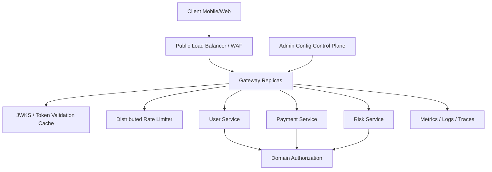

# 08 — API Gateway and Authentication Platform (7-Step System Design)

**Area:** General Backend · Networking and Security  
**Target:** Grab Round 2 system design practice · junior-to-mid backend · 45–60 minutes  
**Assumptions:** All system sizes, policies, APIs, schemas, times and data examples here are **illustrative**, not confirmed Grab or GXBank production details. Verify product/business and regulatory rules with the interviewer.

> **Mock question:** Design a gateway for a fintech backend that authenticates requests, enforces rate limits and routes traffic safely to multiple microservices.

## The 7-step roadmap

1. Clarify the Problem and Scope
2. Functional and Non-Functional Requirements
3. Capacity Estimation and Performance Goals
4. High-Level Architecture and Request Flow
5. APIs, Data Model and Correctness Boundaries
6. Deep Dive: Concurrency, Failure Handling and Security
7. Testing, Monitoring, Deployment and Trade-offs


---

## Step 1 — Clarify the Problem and Scope

Start with questions. **Do not draw Redis or Kafka immediately.** A 60-second clarification can change the entire architecture.

| Interviewer question | Why / practice assumption |
|---|---|
| External, internal or both? | Public API gateway first; internal service-to-service calls have separate trust controls. |
| Authentication type? | OIDC/OAuth 2.0 access tokens for users; workload identity for services. |
| Where is authorization enforced? | Gateway validates coarse scopes; domain services enforce object/action permissions. |
| Traffic? | Illustrative 20,000 peak RPS across multiple endpoints. |
| Failure posture? | Never bypass authentication or mandatory authorization on dependency outage. |


**First-version boundary:** Gateway edge policies and routing; not building a full identity provider or TLS stack from scratch.

**How to say it:** “I'll confirm the system's scope, correctness guarantees and expected traffic, then start with the simplest viable design and deepen the failure cases.”

## Step 2 — Functional and Non-Functional Requirements

### Functional requirements (what it must do)

- TLS terminate or pass through according to security architecture.
- Validate token issuer, signature, audience, expiry and scope.
- Apply per-client/tenant/route rate limiting and routing.
- Support retries/timeouts safely based on HTTP method and idempotency.
- Publish sanitized access logs, traces and security audit events.

### Non-functional requirements (how well it must work)

- Low overhead, horizontal scalability and clear upstream timeouts.
- Strong separation of caller authentication from resource authorization.
- Config updates are versioned, approved and rolled back safely.
- No gateway single point of failure.

### Critical invariants (conditions that must never be violated)

- Every protected route has an explicit authentication policy and the domain owner still authorizes the resource.
- Invalid, expired or mis-scoped tokens are rejected regardless of backend availability.
- A request is never blindly retried if its effect may be non-idempotent.

**Interview tip:** Say the invariants aloud before drawing. They determine whether Redis is a cache, whether SQL transactions are required and what happens when data is missing.

## Step 3 — Capacity Estimation and Performance Goals

At 20,000 RPS peak and 2 KB request+response average, aggregate data through gateway may be ~40 MB/s for this illustrative traffic. Real sizing must include TLS CPU, connection count, egress and P99 upstream tail latency.

Do not claim an architecture satisfies a p99 target just because components were assigned latency budgets. **Prove it using realistic end-to-end load tests, tail-latency monitoring and failure tests.** Distinguish steady-state from burst and differentiate product traffic from external provider throughput.

## Step 4 — High-Level Architecture and Request Flow

### Architecture (Mermaid)



### Explain one request end-to-end

1. Client establishes HTTPS/TLS and sends bearer access token.
2. Gateway validates JWT signature, issuer, audience, expiry and required coarse scopes; fetches signing keys via cached JWKS.
3. Apply request size limits, schema/path constraints, rate limits and appropriate WAF rules.
4. Attach trusted identity context after stripping spoofable user-supplied identity headers.
5. Route to healthy backend with bounded timeout and trace ID.
6. Backend checks domain ownership/object-level permissions and handles idempotency.


**Whiteboard narration:** Name the system of record, the synchronous critical path, the async side path, and the place where a durable state change happens. A Kafka event is not a replacement for a required synchronous commit unless the product permits eventual completion.

## Step 5 — APIs, Data Model and Correctness Boundaries

### API contract (illustrative)

```http
POST /v1/transfers
Authorization: Bearer <access_token>
Idempotency-Key: transfer-u7-20261120-1
{"beneficiary_id":"b9","amount_minor":15000,"currency":"MYR"}
→ 202 {"transfer_id":"t1","state":"PROCESSING"}
→ 401 {"code":"INVALID_TOKEN"}
→ 403 {"code":"INSUFFICIENT_SCOPE"}
→ 429 {"code":"RATE_LIMITED","retry_after_seconds":30}

GET /internal/v1/gateway/routes
→ 200 {"revision":57,"routes":[{"path":"/v1/transfers","upstream":"payments"}]}

PUT /internal/v1/gateway/routes/payments
If-Match: 57
{"timeouts_ms":1000,"required_scope":"transfer:create"}
→ 200 {"revision":58}
```

**API design checklist:** identify caller and authorization, required fields, stable resource/request ID, validation rules, status codes, idempotency behavior, and timeout/retry semantics. Use consistent errors and never trust a client-supplied account ID by itself.

### Data model (illustrative PostgreSQL SQL)

```sql
CREATE TABLE route_config (
  route_id TEXT PRIMARY KEY, path_pattern TEXT NOT NULL,
  upstream TEXT NOT NULL, required_scope TEXT,
  revision BIGINT NOT NULL, updated_at TIMESTAMPTZ NOT NULL
);
CREATE TABLE config_audit (
  change_id UUID PRIMARY KEY, route_id TEXT NOT NULL,
  actor_id TEXT NOT NULL, old_revision BIGINT,
  new_revision BIGINT, changed_at TIMESTAMPTZ NOT NULL
);
-- Hot path uses validated in-memory config snapshots, not SQL per request.
```

**Data modeling checklist:** state ownership, constraints and unique indexes, status transitions, retention/partitioning, and transaction boundaries. The SQL is a **teaching sketch**, not a complete production migration.

## Step 6 — Deep Dive: Concurrency, Failure Handling and Security

### The implementation deep dive

- **AuthN vs AuthZ:** gateway authenticates who called and checks broad scopes; payment service checks that the caller owns the actual account and may require step-up approval.
- **JWT validation:** use asymmetric signature verification with cached JWKS, validate allowed algorithms, issuer (`iss`), audience (`aud`), expiry (`exp`) and clock skew rules. Avoid accepting arbitrary algorithms/keys.
- **JWKS rotation:** cache keys with bounded expiry, refresh on unknown key ID safely; decide behavior during identity provider outage rather than bypass verification.
- **Rate limiting:** use Redis atomic token bucket/sliding window; choose fail-open vs fail-closed per endpoint sensitivity and degraded mode.
- **Retry policy:** GET may be retried selectively; POST payment should not be auto-retried without explicit idempotency guarantee and deadline budget.

### Failure scenarios to explain

| Failure | Handling strategy |
|---|---|
| JWKS provider temporarily unavailable | Use valid cached signing keys within policy; do not accept unverifiable tokens. |
| Redis rate limiter down | Apply endpoint-specific fallback controls; never let a failure silently bypass mandatory protections. |
| Upstream service unavailable | Bound timeout, circuit break, return structured 503; do not retry infinitely. |
| Gateway rollout breaks routing | Canary with health checks and automatic rollback; config audit reveals change. |

### Security and trust boundaries

TLS, workload identity/mTLS internally, strip spoofed identity headers, least-privilege admin roles, secure key management, request body limits, audit and avoidance of secrets in logs.

**Common trap:** “Just retry” is not a complete failure strategy. Explain which requests are idempotent, what outcome is unknown after a timeout, how duplicates are detected, and how the system eventually reconciles.

## Step 7 — Testing, Monitoring, Deployment and Trade-offs

### Testing plan

- Bad signature/wrong audience/expired token/requested scope mismatch.
- JWT key rotation with intermittent IdP failure.
- Per-tenant rate limit atomicity and burst tests.
- Backend object-level authorization still denies cross-account access.

### Monitoring and operational metrics

- Gateway requests/sec, p95/p99 overhead, 401/403/429/5xx rates.
- TLS handshakes, upstream timeout/circuit-open counts, rate-limit backend health.
- Config revision distribution and rollout errors across replicas.

### Deployment / rollback

Version config bundles, automated policy tests, staging shadow traffic, canary replicas, readiness checks and rollback on error/latency regression.

### Trade-offs you must justify

| Trade-off | Reasoning |
|---|---|
| Central vs domain authorization | Central controls simplify coarse policy; domain ownership checks belong in services. |
| JWT self-contained vs introspection | JWT is fast/offline verifiable; introspection supports immediate revocation but adds synchronous dependency. |
| Gateway retry vs client retry | Gateway retries need strict idempotency/deadlines; unsafe retries can duplicate effects. |


### Interview follow-up questions — practise answering aloud

1. If JWT is valid, can a user transfer from another user’s account?
2. What happens when the authentication provider is down?
3. How can the gateway increase latency even when backend latency is stable?


---

### Final 30-second recap template

> “The core user flow is **[critical path]**. The source of truth is **[durable store]** and the primary correctness rule is **[invariant]**. I chose **[key technology]** because of **[workload/latency/consistency reason]**, while accepting **[trade-off]**. For reliability I would handle **[most dangerous failure]** with **[specific recovery]**, and I would validate performance with **[tests and production metrics]**.”

**Remember:** The goal is not to recite this specific architecture; it is to explain your assumptions and defend decisions when requirements change.