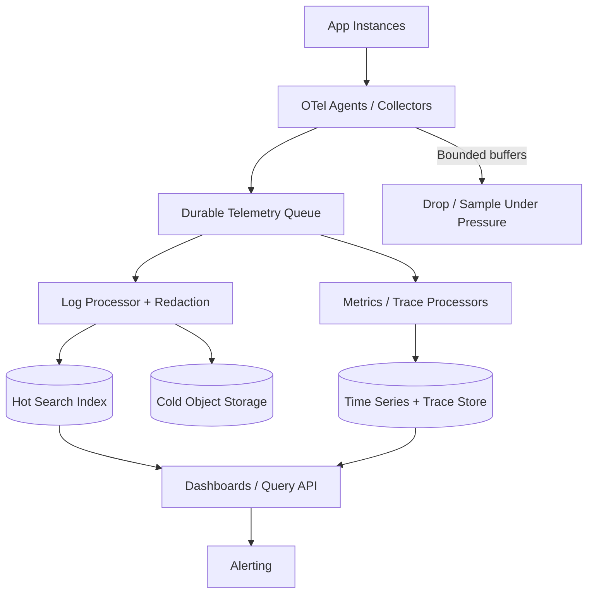

# 09 — Centralized Logging, Metrics and Tracing Platform (7-Step System Design)

**Area:** General Backend · Observability  
**Target:** Grab Round 2 system design practice · junior-to-mid backend · 45–60 minutes  
**Assumptions:** All system sizes, policies, APIs, schemas, times and data examples here are **illustrative**, not confirmed Grab or GXBank production details. Verify product/business and regulatory rules with the interviewer.

> **Mock question:** Design an observability platform that collects logs, metrics and traces from hundreds of services, enables incident investigation and prevents telemetry loss from hurting production traffic.

## The 7-step roadmap

1. Clarify the Problem and Scope
2. Functional and Non-Functional Requirements
3. Capacity Estimation and Performance Goals
4. High-Level Architecture and Request Flow
5. APIs, Data Model and Correctness Boundaries
6. Deep Dive: Concurrency, Failure Handling and Security
7. Testing, Monitoring, Deployment and Trade-offs


---

## Step 1 — Clarify the Problem and Scope

Start with questions. **Do not draw Redis or Kafka immediately.** A 60-second clarification can change the entire architecture.

| Interviewer question | Why / practice assumption |
|---|---|
| Which signals? | Structured logs, time-series metrics and distributed traces. |
| How much traffic? | Illustrative 100k log events/sec peak, plus lower-volume metrics and sampled traces. |
| How long to retain? | Hot search 7 days, cold object store 90 days as hypothetical policy. |
| Who can query? | Engineers with tenant/team-based authorization; sensitive logs restricted. |
| What is the priority? | Protect application availability first, then telemetry delivery/freshness. |


**First-version boundary:** Telemetry collection, storage and query. Alert rules and dashboards are included lightly; not implementing Prometheus/OTel internals from scratch.

**How to say it:** “I'll confirm the system's scope, correctness guarantees and expected traffic, then start with the simplest viable design and deepen the failure cases.”

## Step 2 — Functional and Non-Functional Requirements

### Functional requirements (what it must do)

- Ingest structured logs, metrics and traces with service identity and trace IDs.
- Buffer burst ingestion and control backpressure; route hot/cold retention.
- Enable scoped search, latency/error dashboards and alerts.
- Sample traces intentionally while retaining useful error traces.
- Support deletion/retention policies and high-cardinality safeguards.

### Non-functional requirements (how well it must work)

- Observability pipeline cannot block business requests due to a downstream outage.
- Define acceptable ingestion lag and loss for each signal class.
- Enforce encryption, access control and sensitive-data redaction.
- Query latency targets should be separate from ingestion latency.

### Critical invariants (conditions that must never be violated)

- Never log credentials, payment secrets or full sensitive customer data.
- Telemetry sampling/loss policy must be explicit; logs are not authoritative financial audit records.
- No high-cardinality user/account ID metric label that exhausts the time-series store.

**Interview tip:** Say the invariants aloud before drawing. They determine whether Redis is a cache, whether SQL transactions are required and what happens when data is missing.

## Step 3 — Capacity Estimation and Performance Goals

100k events/sec × 1 KB/event ≈ 100 MB/sec ≈ 8.64 TB/day raw if sustained. Hot indexed search at this volume is expensive: use compression, sampling, service-based log levels and cold object storage. Add index/replica overhead separately.

Do not claim an architecture satisfies a p99 target just because components were assigned latency budgets. **Prove it using realistic end-to-end load tests, tail-latency monitoring and failure tests.** Distinguish steady-state from burst and differentiate product traffic from external provider throughput.

## Step 4 — High-Level Architecture and Request Flow

### Architecture (Mermaid)



### Explain one request end-to-end

1. Applications emit structured logs and OpenTelemetry spans without blocking request completion.
2. Local agent/collector batches and redacts; bounded buffer absorbs short spikes.
3. Collector sends to durable transport when required; consumers transform, route and index.
4. Use metrics store for aggregates; tracing store for request paths; log index for debugging.
5. Move old data to compressed cold storage under retention policy.
6. Dashboard queries are tenant/team-scoped and correlated with trace IDs.


**Whiteboard narration:** Name the system of record, the synchronous critical path, the async side path, and the place where a durable state change happens. A Kafka event is not a replacement for a required synchronous commit unless the product permits eventual completion.

## Step 5 — APIs, Data Model and Correctness Boundaries

### API contract (illustrative)

```http
POST /v1/otlp/v1/logs
Authorization: Bearer <workload-token>
{"resourceLogs":[{"service":"risk-api","events":[{"level":"ERROR","trace_id":"abc","msg":"timeout"}]}]}
→ 202 {"accepted":true}

GET /internal/v1/logs/search?service=risk-api&level=ERROR&limit=50
→ 200 {"items":[{"timestamp":"2026-11-15T09:00:00Z","trace_id":"abc","msg":"timeout"}]}

GET /internal/v1/metrics/query?name=http_request_duration_seconds&service=risk-api
→ 200 {"unit":"seconds","series":[{"p99":0.19}]}

Note: OTLP request above is a simplified illustrative shape, not the full official OTLP protocol schema.
```

**API design checklist:** identify caller and authorization, required fields, stable resource/request ID, validation rules, status codes, idempotency behavior, and timeout/retry semantics. Use consistent errors and never trust a client-supplied account ID by itself.

### Data model (illustrative PostgreSQL SQL)

```sql
-- A relational DB may store dashboards/alerts/access policies;
-- high-volume logs and time series go into specialized stores.
CREATE TABLE alert_rule (
  rule_id UUID PRIMARY KEY, owner_team TEXT NOT NULL,
  expression TEXT NOT NULL, severity TEXT NOT NULL,
  enabled BOOLEAN NOT NULL, revision BIGINT NOT NULL
);
CREATE TABLE telemetry_access_audit (
  audit_id UUID PRIMARY KEY, actor_id TEXT NOT NULL,
  resource_scope TEXT NOT NULL, accessed_at TIMESTAMPTZ NOT NULL
);
-- Example log record (structured):
-- {timestamp, service, environment, level, trace_id, message, attributes}
```

**Data modeling checklist:** state ownership, constraints and unique indexes, status transitions, retention/partitioning, and transaction boundaries. The SQL is a **teaching sketch**, not a complete production migration.

## Step 6 — Deep Dive: Concurrency, Failure Handling and Security

### The implementation deep dive

- **Three signals:** logs tell what happened, metrics tell how often/how severe, traces show where a cross-service request spent time.
- **Cardinality:** metrics tagged by `user_id` produce millions of series; group by safe bounded dimensions like service, status, region.
- **Sampling:** normal requests can be head-sampled; tail sampling retains slower/errors when resources allow. Security/audit events are not interchangeable with sampled application logs.
- **Backpressure:** bounded agent buffers; if central storage fails, prefer controlled sampling/dropping telemetry to consuming all application RAM.
- **SLO math:** error budget for 99.9% availability is ~43 minutes/month assuming a 30-day month; availability and latency objectives are different indicators.

### Failure scenarios to explain

| Failure | Handling strategy |
|---|---|
| Hot search cluster down | Keep buffered/queued data and cold writes where possible; query degrades independently. |
| Traffic spike causes ingestion lag | Apply quotas/sampling and autoscale processors; alert on lag and dropped logs. |
| Bad log exposes PII | Redact at source/collector; restrict access, investigate and follow removal policy. |
| Cardinality explosion | Reject dangerous labels and enforce quotas per team/metric family. |

### Security and trust boundaries

Workload authentication, log redaction, sensitive-data scanning, per-team access, encrypted object/index stores and audit trails for privileged queries.

**Common trap:** “Just retry” is not a complete failure strategy. Explain which requests are idempotent, what outcome is unknown after a timeout, how duplicates are detected, and how the system eventually reconciles.

## Step 7 — Testing, Monitoring, Deployment and Trade-offs

### Testing plan

- Inject 10× traffic burst and stop storage, then verify bounded buffers and app health.
- Trace correlation from API gateway to Kafka consumer with proper context propagation.
- Attempt to query another team’s logs; verify denial.
- P99 latency alert triggers at expected SLO threshold with synthetic load.

### Monitoring and operational metrics

- Ingestion lag, drops/sampling rates, queue depth and index freshness.
- Query p95/p99, cost per GB, storage utilization and alert noise.
- Product-level RED metrics: Rate, Errors, Duration; plus USE: Utilization, Saturation, Errors.

### Deployment / rollback

Canary collector pipelines, compare transformed fields and costs, version parsing rules and run load tests before raising ingestion volume or retention.

### Trade-offs you must justify

| Trade-off | Reasoning |
|---|---|
| All logs indexed vs tiered storage | Indexing all is expensive; hot index plus cold storage balances cost/searchability. |
| At-least-once vs loss tolerance | Critical alerts need durable delivery; debug telemetry may be sampled under overload. |
| Centralized vs per-team stores | Centralized simplifies correlation; multi-tenant isolation and noisy-neighbor control are harder. |


### Interview follow-up questions — practise answering aloud

1. What exactly should you monitor for a fraud screening API?
2. How do you stop logging infrastructure from taking down payments?
3. How would you trace a payment request through Kafka asynchronously?


---

### Final 30-second recap template

> “The core user flow is **[critical path]**. The source of truth is **[durable store]** and the primary correctness rule is **[invariant]**. I chose **[key technology]** because of **[workload/latency/consistency reason]**, while accepting **[trade-off]**. For reliability I would handle **[most dangerous failure]** with **[specific recovery]**, and I would validate performance with **[tests and production metrics]**.”

**Remember:** The goal is not to recite this specific architecture; it is to explain your assumptions and defend decisions when requirements change.