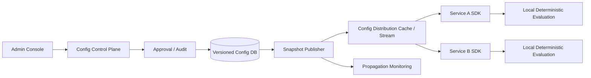

# 10 — Feature Flags and Configuration Service (7-Step System Design)

**Area:** General Backend · Extensibility and Safe Rollouts  
**Target:** Grab Round 2 system design practice · junior-to-mid backend · 45–60 minutes  
**Assumptions:** All system sizes, policies, APIs, schemas, times and data examples here are **illustrative**, not confirmed Grab or GXBank production details. Verify product/business and regulatory rules with the interviewer.

> **Mock question:** Design a configuration service that allows teams to enable features for small percentages of users, roll out gradually, and instantly disable dangerous features.

## The 7-step roadmap

1. Clarify the Problem and Scope
2. Functional and Non-Functional Requirements
3. Capacity Estimation and Performance Goals
4. High-Level Architecture and Request Flow
5. APIs, Data Model and Correctness Boundaries
6. Deep Dive: Concurrency, Failure Handling and Security
7. Testing, Monitoring, Deployment and Trade-offs


---

## Step 1 — Clarify the Problem and Scope

Start with questions. **Do not draw Redis or Kafka immediately.** A 60-second clarification can change the entire architecture.

| Interviewer question | Why / practice assumption |
|---|---|
| What kinds of flags? | Boolean, percentage rollout and small parameter variants. |
| Evaluation location? | SDK/in-service for high-throughput; control plane publishes config snapshots. |
| Propagation target? | Illustrative 99% update within 10 seconds; define emergency path. |
| What if config service is down? | Use cached last-known-good snapshot with per-flag fail-safe fallback. |
| Who can change risky flags? | Authorized staff with approval, audit and versioning. |


**First-version boundary:** Control plane plus SDK evaluation; not a full A/B analytics platform.

**How to say it:** “I'll confirm the system's scope, correctness guarantees and expected traffic, then start with the simplest viable design and deepen the failure cases.”

## Step 2 — Functional and Non-Functional Requirements

### Functional requirements (what it must do)

- Create/update/approve/rollback flag definitions and targeting rules.
- Distribute versioned snapshots to service SDKs via polling or push.
- Evaluate flags deterministically and quickly with stable user bucketing.
- Support percentage rollout, allowlist and emergency kill switches.
- Record edits and expose propagation status/metrics.

### Non-functional requirements (how well it must work)

- Evaluation should be local or cached to avoid a network call on every request.
- Configuration updates are atomic, versioned and eventually propagated.
- Sensitive flags default to safe states on startup/no valid snapshot.
- Only approved changes can affect production.

### Critical invariants (conditions that must never be violated)

- An SDK evaluates one complete immutable config snapshot version for each decision.
- Percentage rollout is stable for the same flag+subject+salt until intentionally changed.
- A missing/invalid config does not silently enable privileged behavior.

**Interview tip:** Say the invariants aloud before drawing. They determine whether Redis is a cache, whether SQL transactions are required and what happens when data is missing.

## Step 3 — Capacity Estimation and Performance Goals

Assume 1,000 service instances × one poll every 10 sec → 100 configuration reads/sec (without long polling/push). Local evaluations may run millions/sec and should not hit a central DB. Payload size and cache TTL determine control-plane bandwidth.

Do not claim an architecture satisfies a p99 target just because components were assigned latency budgets. **Prove it using realistic end-to-end load tests, tail-latency monitoring and failure tests.** Distinguish steady-state from burst and differentiate product traffic from external provider throughput.

## Step 4 — High-Level Architecture and Request Flow

### Architecture (Mermaid)



### Explain one request end-to-end

1. Admin proposes a flag/target change and authorized reviewer approves it.
2. Control plane creates a new immutable version, validates rules and publishes a signed snapshot.
3. SDK fetches version or receives push notification; validates and atomically swaps full snapshot.
4. Request path evaluates flag locally using stable hash of `(flag_id, subject_id, salt)` and targeting.
5. If distribution fails, SDK uses last-known-good snapshot or declared safe fallback.
6. Telemetry reports snapshot version, evaluation errors and rollout impact in aggregate.


**Whiteboard narration:** Name the system of record, the synchronous critical path, the async side path, and the place where a durable state change happens. A Kafka event is not a replacement for a required synchronous commit unless the product permits eventual completion.

## Step 5 — APIs, Data Model and Correctness Boundaries

### API contract (illustrative)

```http
POST /internal/v1/flags
{"key":"new_risk_rules","default":false,"owner_team":"risk"}
→ 201 {"flag_id":"f1","version":1}

PATCH /internal/v1/flags/f1
If-Match: 1
{"rollout_percentage":5,"environment":"production","reason":"canary"}
→ 202 {"change_id":"chg99","state":"PENDING_APPROVAL"}

POST /internal/v1/flag-changes/chg99/approve
{"approver_id":"lead2"}
→ 200 {"state":"PUBLISHED","snapshot_version":102}

GET /internal/v1/config/snapshot?environment=production&since_version=101
→ 200 {"version":102,"flags":[{"key":"new_risk_rules","default":false,"percentage":5}]}
```

**API design checklist:** identify caller and authorization, required fields, stable resource/request ID, validation rules, status codes, idempotency behavior, and timeout/retry semantics. Use consistent errors and never trust a client-supplied account ID by itself.

### Data model (illustrative PostgreSQL SQL)

```sql
CREATE TABLE flag_definition (
  flag_id UUID PRIMARY KEY, flag_key TEXT UNIQUE NOT NULL,
  owner_team TEXT NOT NULL, default_value JSONB NOT NULL
);
CREATE TABLE flag_revision (
  flag_id UUID NOT NULL, version BIGINT NOT NULL,
  config JSONB NOT NULL, created_by TEXT NOT NULL,
  approved_by TEXT, state TEXT NOT NULL,
  PRIMARY KEY (flag_id, version)
);
CREATE TABLE config_snapshot (
  environment TEXT NOT NULL, version BIGINT NOT NULL,
  content_hash TEXT NOT NULL, created_at TIMESTAMPTZ NOT NULL,
  PRIMARY KEY (environment, version)
);
```

**Data modeling checklist:** state ownership, constraints and unique indexes, status transitions, retention/partitioning, and transaction boundaries. The SQL is a **teaching sketch**, not a complete production migration.

## Step 6 — Deep Dive: Concurrency, Failure Handling and Security

### The implementation deep dive

- **Deterministic bucketing:** `bucket = stable_hash(flag_id + subject_id + salt) % 10000`; enable when bucket < percentage×100. Use non-cryptographic stable hashing if not used for security boundaries.
- **Immutable snapshots:** publish new snapshot atomically so a request never sees mixed half-old and half-new settings.
- **Kill switch:** define propagation SLO and safe fallback; truly instantaneous global change is unrealistic across offline/mobile SDKs.
- **Config validation:** reject circular dependencies, invalid types/targeting, environment leaks and nonapproved production changes.
- **Flag lifecycle:** remove stale flags after rollout; excessive permanent flags cause hard-to-maintain branching.

### Failure scenarios to explain

| Failure | Handling strategy |
|---|---|
| Config API down | SDK uses cached last-known-good version with risk-aware fallback. |
| One service remains on old version | Emit snapshot_version metric, alert on propagation lag and retry distribution. |
| Bad rollout causes errors | Rollback by publishing previous known-good config as a new version. |
| Percentage bucketing fluctuates | Stable hash/salt and identity choice; avoid using changing session IDs. |

### Security and trust boundaries

Admin RBAC and maker-checker for sensitive flags, encrypted and signed config transport, no secrets in flag payloads, tenant separation and immutable change audit.

**Common trap:** “Just retry” is not a complete failure strategy. Explain which requests are idempotent, what outcome is unknown after a timeout, how duplicates are detected, and how the system eventually reconciles.

## Step 7 — Testing, Monitoring, Deployment and Trade-offs

### Testing plan

- 10000 synthetic IDs produce roughly requested cohort size and stable membership.
- Old snapshot remains functional during control-plane outage.
- Rejected bad config never reaches production SDK.
- Canary and rollback tests across multiple SDK versions.

### Monitoring and operational metrics

- Distribution lag, percentage of clients on expected snapshot version.
- Evaluation errors, fallbacks, stale snapshot age, config invalidations.
- Guardrail metrics such as payment p99, errors, fraud false positives per cohort.

### Deployment / rollback

Shadow-evaluate critical policies before enforcing, start at 1% then 5%/25%/100% with guardrails and approval, retain rapid rollback and consistent cohorts.

### Trade-offs you must justify

| Trade-off | Reasoning |
|---|---|
| Local vs remote evaluation | Local is fast/resilient; remote simplifies immediate rule updates but adds network dependency. |
| Polling vs push | Polling is simple; push updates faster but needs reconnect, resync and offline recovery. |
| Percentage vs explicit allowlist | Percentage is scalable for canaries; allowlist supports internal testing and controlled cohorts. |


### Interview follow-up questions — practise answering aloud

1. How can you disable a dangerous fraud rule while the config service is down?
2. How do you ensure the same customer stays in the same rollout cohort?
3. What happens when some pods have v101 and others v102?


---

### Final 30-second recap template

> “The core user flow is **[critical path]**. The source of truth is **[durable store]** and the primary correctness rule is **[invariant]**. I chose **[key technology]** because of **[workload/latency/consistency reason]**, while accepting **[trade-off]**. For reliability I would handle **[most dangerous failure]** with **[specific recovery]**, and I would validate performance with **[tests and production metrics]**.”

**Remember:** The goal is not to recite this specific architecture; it is to explain your assumptions and defend decisions when requirements change.