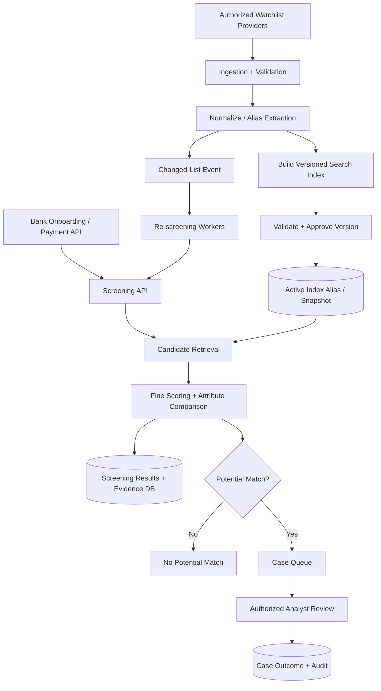
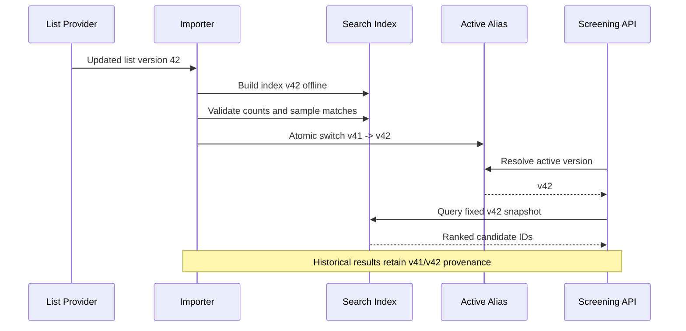
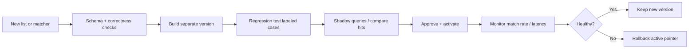

# 02 — Design a Name Screening / Sanctions Matching System (7 Steps)

**GrabDefence-style system design practice | 55–60 minutes | Medium → Advanced**

> **Interview question:** "Design a platform that screens new bank customers and payment beneficiaries against sanctions/watchlists, handles spelling variations, and sends potential matches for review."
>
> **Scope note:** Regulatory obligations vary by jurisdiction, product and list. This guide teaches engineering architecture; **a fuzzy-match score by itself does not establish a legal sanctions match**. All volumes, timings and thresholds are hypothetical.

## The 7-step roadmap

1. Clarify the problem and scope.
2. Define functional and non-functional requirements.
3. Estimate traffic and data size.
4. Draw the high-level architecture and explain the data flows.
5. Design APIs, search indexes and durable records.
6. Deep-dive into matching quality, updates, failure handling and security.
7. Explain testing, observability, deployment and trade-offs.

---

## Step 1 — Clarify what is being screened (5 minutes)

**What is name screening?** Compare a person's or company's identity details with sanctioned persons/entities or other relevant watchlists. It differs from transaction fraud scoring: its main challenge is identifying **possible identity matches reliably** despite aliases, spelling differences, scripts, incomplete data and frequently changing lists.

Ask:

| Question | Why | Assumed answer |
|---|---|---|
| Who is screened? | Customer onboarding vs each payment is a different hot path | Onboarding + payment beneficiaries |
| Which lists? | Determines list licensing, source integrity, rules | A configured set of officially obtained lists |
| What decision? | Name similarity isn't a final identity determination | `NO_POTENTIAL_MATCH`, `POTENTIAL_MATCH`, `NEEDS_REVIEW` |
| What evidence exists? | More fields reduce ambiguity | Name, DOB, nationality, country, entity type; sometimes missing |
| Response deadline? | Determines sync vs async review | Candidate search ~100–300 ms illustrative; review later |
| What happens on a potential hit? | Defines operational workflow | HOLD onboarding/payment pending approved process |
| Updates and audits? | Sanctions lists change frequently | Versioned list import + reproducible decisions |

**Say this aloud:**

> "I'll build a candidate-matching service, not a service that automatically declares everyone with a similar name sanctioned. We'll produce a ranked candidate list with provenance; final actions follow policy and, where required, analyst review."

## Step 2 — Functional and non-functional requirements (5 minutes)

### Functional

- Load/update list entries from authorized sources, preserving source IDs, aliases, countries and timestamps.
- Normalize names and efficiently retrieve candidates across spelling variations.
- Rank candidates using multiple identity attributes and produce explainable match evidence.
- Persist screening records with list/index version and match evidence.
- Create cases for potential matches; analysts can record permitted dispositions with audit history.
- Re-screen affected customers when lists change, according to policy.
- Prevent unauthorized analyst overrides or loss of case history.

### Non-functional

- **Low latency:** bounded online query time; human review is asynchronous.
- **High recall:** don't easily miss meaningful candidates; evaluate false negatives rigorously.
- **Manageable false positives:** avoid overwhelming analysts with weak matches.
- **Update integrity:** no partially imported active lists; know exact effective version.
- **Security and privacy:** PII minimization, need-to-know access, encrypted data.
- **Auditability:** evidence, chosen list version, match algorithm version and final disposition preserved.

**Key invariant:** When a list version is activated, every query must use a coherent index snapshot of that version, not a mixture of old/new records.

## Step 3 — Estimate traffic, index size and storage (5 minutes)

Hypothetical scenario:

```text
10 million customer identities stored for potential re-screening
2 million watchlist entries, with 3 aliases per entry on average
~6 million searchable name aliases (rough approximation)
Online peak: 2,000 screening requests/second
Candidate limit: top 100 per search (before fine ranking)
```

- The **index is not the 10 million customer DB**. The watchlist index contains source entries and alias search terms; a customer table supports re-screening.
- Storage scales with source records + aliases + search index postings + past decisions + case evidence.
- Multi-language n-grams / phonetic keys can significantly multiply search index size; benchmark with representative data.
- A single online search returning hundreds of candidates is a warning: broad queries can cause expensive fine ranking or false-positive floods.
- If every existing customer is rescanned after a list update, **10 million evaluations** requires a separate batch/streaming workflow rather than synchronously processing in the admin upload request.

**Estimation discussion:** Estimate average and peak separately, read vs write demand, how many aliases per person, index rebuild frequency, query mix (exact names vs common names), retention policy and the number of analyst cases generated.

## Step 4 — High-level architecture (10 minutes)

**Important separation:** **list ingestion** and **online matching** are different pipelines.



### Online query — explain every stage

1. Caller submits name and available attributes (name, DOB, nationality, type).
2. Screening API authenticates caller and validates the request.
3. **Normalize** name (case, whitespace, Unicode form; transliteration/diacritic logic where appropriate).
4. Search engine retrieves a **small candidate set** using exact, alias, n-gram, token or phonetic indexes. This favors recall.
5. Fine-ranking compares candidates across name and **non-name attributes**; use explainable evidence.
6. Persist screening summary, matched candidates, source IDs, list/index version and algorithm version.
7. Return `POTENTIAL_MATCH` or `NO_POTENTIAL_MATCH`; possible matches enter review workflow.

### Watchlist update — explain separately

1. Fetch signed/authenticated or otherwise integrity-verified source feed through approved integration.
2. Validate schema, completeness, source IDs, timestamps, duplicates and unexpected large deletions.
3. Build a **new** versioned index; do not write directly into the live index while serving queries.
4. Run validation queries + regression tests and obtain required approval.
5. Atomically change the active index alias/pointer.
6. Keep the previous version available for rollback and historical decision reproduction (as required).
7. Trigger risk-based re-screening of affected existing users.

### Sequence: index swap



## Step 5 — API, data model and search strategy (10 minutes)

### API example

```http
POST /v1/name-screenings
Idempotency-Key: NS-390
Authorization: Bearer <service-token>

{
  "screening_id": "NS-390",
  "subject_type": "PERSON",
  "full_name": "Mohamad Ahmad",
  "date_of_birth": "1982-04-10",
  "nationality": "MY",
  "purpose": "BENEFICIARY_ONBOARDING"
}
```

```json
{
  "screening_id": "NS-390",
  "status": "POTENTIAL_MATCH",
  "list_version": "2026-11-19-v42",
  "matching_version": "name-match-v6",
  "candidate_count": 2,
  "case_id": "CASE-444"
}
```

**Privacy practice:** Don't expose raw complete watchlist details or unnecessary personal identifiers to arbitrary API clients. Authorized reviewers access detailed evidence through a separate API.

### Data entities

```text
watchlist_source(source_id, provider, list_type, imported_at)
watchlist_version(version_id, source_id, checksum, effective_at, status)
watchlist_entity(entity_id, version_id, entity_type, primary_name, metadata)
watchlist_alias(alias_id, entity_id, language, raw_name, normalized_name)

screening(screening_id, subject_ref, request_hash, status,
          list_version, matching_version, screened_at)
candidate_match(screening_id, entity_id, score, matched_fields, evidence_ref)
review_case(case_id, screening_id, state, assignee, created_at)
case_event(event_id, case_id, action, actor_id, timestamp, reason)
```

### Matching is a two-stage process

| Stage | Aim | Example |
|---|---|---|
| **Candidate retrieval** | Find plausible matches quickly with high recall | Exact alias, token match, n-grams, phonetic/transliteration variants |
| **Fine ranking** | Distinguish stronger from weaker matches | Name similarity + DOB + jurisdiction + identifier consistency |

**Why not plain `LIKE '%name%'`?** A leading wildcard often cannot efficiently use an ordinary B-tree index, and spelling differences make naive substring search incomplete. Specialized search indexes and normalization are a better fit for large-scale fuzzy retrieval.

**Why not just edit distance?** Edit distance ignores word order, aliases, language/script changes and crucial identity attributes. Two people with the same common name may be different; a person with a transliterated name may still be the same.

### A deliberately simple scoring illustration

```text
Potential matches:
A: Similar name + same date of birth + compatible nationality -> stronger candidate
B: Similar name + conflicting unique ID -> likely weak candidate
```

Do **not** present arbitrary numeric match thresholds as legal policy. Thresholds must be validated against labeled cases, policy requirements and the cost of false negatives.

## Step 6 — Deep dive: quality, security and failures (10 minutes)

### A. False positives vs false negatives

- **False positive:** harmless person flagged → customer friction + overloaded analysts.
- **False negative:** true relevant name not surfaced → possible serious compliance/financial risk.
- Optimize candidate-retrieval **recall**, then control review volume with richer evidence and calibrated ranking.
- Measure performance across common names, reordered names, aliases, accents, different scripts, missing DOB, organizations and adversarial spelling changes.
- Human review and approved policy determine how to handle uncertain cases.

### B. What if a name has multiple scripts?

Use locale-aware normalization and *documented* transliteration/alias methods. Keep the original form for evidence; never overwrite raw names with lossy normalized text. Phonetic algorithms designed for English may fail badly in other languages: evaluate by language and geography.

### C. What if the search index is down?

| Failure | Response |
|---|---|
| Index unavailable | Time out, surface an explicit screening error / HOLD per policy; don't return "no match" |
| New feed malformed | Reject new version; continue current validated version if permitted and alert |
| Bad new index increases hits 100x | Halt rollout, switch alias back, investigate |
| Review backlog grows | Prioritize by risk and age; scale analysts/workers; do not silently auto-clear |
| Index version changes mid-request | Pin the request to resolved version for consistent retrieval |
| List source delayed | Track list age and freshness SLO; escalate as policy requires |

### D. Audit and access control

- Log authenticated identity, search purpose, source/list version, algorithm version, candidate IDs, relevant match evidence, decision and any human disposition.
- Case analysts need role-based access plus case-level permission; review edits should be append-only audited.
- Sensitive DOB/identifiers should be encrypted, masked and retained only as needed; never log raw subject attributes by default.
- Keep separation of duties for source approval, algorithm/rule changes and analyst dispositions where required.

## Step 7 — Testing, monitoring, deployment and trade-offs (8 minutes)

### Test strategy

- **Unit:** normalization of accents, whitespace, token order and Unicode; DOB comparison; alias rules.
- **Retrieval benchmark:** labeled positive/negative candidate pairs by language; measure recall@K and latency.
- **Ranking validation:** precision/recall and review workload; inspect false negative cases.
- **Integration:** full list import, building a version, alias swap, rollback, evidence persistence.
- **Concurrency:** active version switch while thousands of live requests are running; each request uses one snapshot.
- **Load:** common names and high-fan-out queries at peak traffic.
- **Security:** audit permission changes and attempts to view someone else's case.

### Monitoring

**System:** screening p50/p95/p99 latency, index error rate, query fan-out, candidate count distribution, queue depth, backlog age, resource saturation.

**Data & quality:** source/list freshness, feed completeness, checksum mismatch, index version, sudden change in match rate, recall regressions using approved test cases, review reversal rates.

**Operational:** cases created per hour, time to review, unresolved high-priority case age, list activation/rollback events.

### Deployment approach



### Design trade-offs

| Choice | Advantage | Downside |
|---|---|---|
| Exact matching | Fast and straightforward | Misses aliases/misspellings |
| Fuzzy indexed search | Better candidate recall | More false positives, index complexity |
| Online sync lookup | Fast response for onboarding/payment | Dependence on index availability |
| Async human review | Better quality for uncertain matches | Adds delay and operational costs |
| Full index rebuild | Reproducible and safe version swap | More compute/storage on large sources |
| Incremental index changes | Lower update cost | Harder to guarantee snapshot consistency |

### 90-second interview recap

> "I would first clarify who is screened, against which approved lists, and whether a potential match must hold onboarding or payment. I'd separate ingestion from online querying. The importer validates and normalizes list records, builds a versioned search index, tests it and atomically activates it. The online API normalizes the submitted name, retrieves candidates using indexed alias/fuzzy strategies, then compares non-name attributes to produce explainable potential matches. I persist the list and algorithm versions so cases remain auditable. Possible hits enter a separate analyst queue. I would load-test common names, monitor list freshness and match-rate changes, and fail safely if the index is unavailable."

## Interviewer challenge questions

1. How can you find a name spelled differently in English and Arabic without relying only on edit distance?
2. If two million records become three million after an import, how do you determine whether it is legitimate?
3. How do you avoid returning mixed candidates from old and new list versions?
4. What are recall and precision? Which is more costly to get wrong, and why?
5. Can two people share exactly the same name and DOB? How does your reviewer handle ambiguity?
6. How do you re-screen ten million existing accounts after one list changes?
7. What if a match has to be decided before a payment can leave the bank?

**Memory hook:** `Verified lists → Versioned index → Retrieve candidates → Fine rank → Potential hit → Review + audit.`