# Grab Round 2 — All Seven System Design Notes (Updated)

*Seven topic chapters in one Markdown file, plus a README with whiteboard practice and project deep dives. Diagrams use Mermaid syntax.*

# Grab Round 2 — Seven System Design Notes + Interview Deep Dives

**Plain-English Markdown notes with Mermaid diagrams, real-world failure handling, whiteboard practice, architecture trade-offs and project deep dives.**

These notes complement the **12 system design questions** you have already studied. They're intended for your **Backend / GrabDefence** interview preparation, with examples based on hypothetical financial services. They do **not** describe confidential Grab architectures or guarantee interview questions.

## Study order

| File | Topic | Priority | Study focus |
|---|---|---|---|
| [01](01_Security_API_Protection.md) | Security & API Protection | P0 | AuthN, AuthZ, service identity, data security, threat model |
| [02](02_Observability_Production_Reliability.md) | Observability | P0 | Logs, metrics, tracing, p99, SLOs, incidents |
| [03](03_Networking_Cloud_Deployment.md) | Cloud, Networking, Deployment | P0 | DNS/TLS, OS/JVM, cloud services, safe rollout |
| [04](04_API_Database_Data_Modeling.md) | API & Data Modeling | P0 | Contracts, correctness, extensibility, Ant architecture story |
| [05](05_Advanced_Failure_Handling.md) | Failure Handling | P1 | Retries, outbox, DLQ, decisions during outages |
| [06](06_Testing_Release_Strategies.md) | Testing & Release | P1 | Production readiness, failure tests, canary, migrations |
| [07](07_Fraud_Risk_Screening_Architecture.md) | Fraud Screening | P1 | Full whiteboard mock, risk decisions, Swap N Go deep dive |

## How to study each file (30–45 minutes)

1. **Read** the problem and diagram, and explain the request flow in your own words.
2. **Close the note** and recreate the Mermaid diagram as a whiteboard sketch.
3. **Challenge it:** Pick a dependency and ask, "What if it fails or traffic grows 10×?"
4. **Answer aloud:** Use the compact interview answer and respond to follow-up questions.
5. **Write 2 weak areas** to review the next day.

## Universal seven-step interview framework

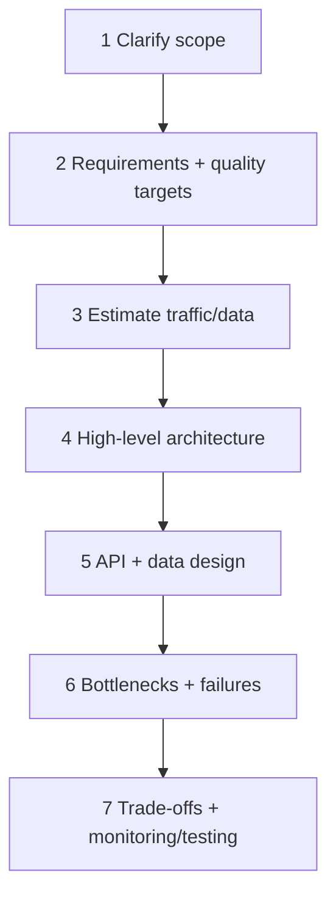

## Three mock prompts to test readiness

1. **Risk screening:** "Design a system that decides ALLOW/HOLD/BLOCK for bank transfers at 10k peak RPS and p99 below 200 ms." (Hypothetical numbers.)
2. **Payments:** "Design a wallet transfer API. Two transfers race against the same account balance. A caller times out after the DB commits."
3. **Deployments:** "Your risk rules service becomes 3× slower after a canary deployment while errors remain low. How do you detect, mitigate, and investigate?"

## Readiness checklist

- [ ] I can explain every major component without reading notes.
- [ ] I can define one correctness invariant and defend it.
- [ ] I can design the API + database schema and choose useful indexes.
- [ ] I can discuss duplicate requests, timeouts, and partial failures.
- [ ] I know the monitoring and deployment plan.
- [ ] I can justify trade-offs without technology-name dumping.
- [ ] I can answer a 45–60-minute mock verbally without looking at solutions.

## Official references

- [Grab engineering interview guide](https://www.grab.careers/en/how-we-hire/engineering/)
- [GrabDefence backend role](https://www.grab.careers/en/jobs/744000145894679/software-engineer-backend-grabdefence/)
- [OWASP API Security](https://owasp.org/projects/api-security-project)
- [OpenTelemetry concepts](https://opentelemetry.io/docs/concepts/)
- [Kubernetes probes](https://kubernetes.io/docs/concepts/workloads/pods/probes/)
- [AWS cloud design patterns](https://docs.aws.amazon.com/prescriptive-guidance/latest/cloud-design-patterns/)
- [Grab Griffin public article](https://engineering.grab.com/griffin)

*Notes prepared 11 November 2026. Generic designs and hypothetical calculations are clearly labeled.*


---

## New additions based on Grab's actual Round 2 invitation

The invitation for **Thursday, 19 November 2026 at 4:00 PM GMT+8** explicitly asks you to **lead the whiteboard session**, justify technical decisions, understand **data models, security, testing, monitoring, deployment, OS, networking and cloud**, and explain previous engineering projects. The notes above now include practice sections for these requirements.

| Invitation requirement | Where to review |
|---|---|
| Lead as a feature/product owner on a whiteboard | [07 — Full walkthrough](07_Fraud_Risk_Screening_Architecture.md); universal framework below |
| Extensibility and maintainability | [04 — Versioned rule engine + stable interfaces](04_API_Database_Data_Modeling.md) |
| OS, networking, cloud and deployment | [03 — OS/JVM, TLS, HTTP, cloud mapping](03_Networking_Cloud_Deployment.md) |
| Security and trust boundaries | [01 — Threat model and authorization](01_Security_API_Protection.md) |
| Monitoring and incident response | [02 — SLO/dashboard/incident drill](02_Observability_Production_Reliability.md) |
| Testing, release and failure injection | [06 — Production-readiness checklist](06_Testing_Release_Strategies.md) |
| Reliability during partial failures | [05 — Failure decision tree](05_Advanced_Failure_Handling.md) |
| Discussion of own projects | [04 — Ant routing](04_API_Database_Data_Modeling.md); [07 — Swap N Go](07_Fraud_Risk_Screening_Architecture.md) |

## Whiteboard leadership: what to do before drawing a big system

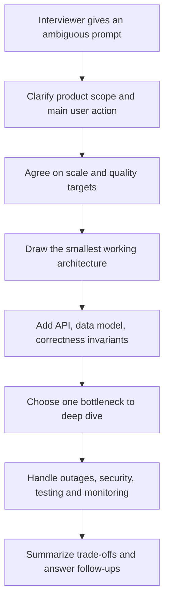

**Suggested opening (40 seconds):**

> "Before I draw the architecture, I'd like to clarify who calls the system, what its core actions are, and whether we're optimizing for correctness, latency or availability. Then I'll estimate scale, sketch a simple request flow, define the API and data model, and deep-dive the most important failure or bottleneck."

**Ask at least one product question before discussing technology.** The seven steps are a *checklist in your head*, not something to force on an interviewer who wants to investigate a particular decision.

### Two-minute practice without notes

1. Draw `Client → API → DB` and describe its business invariant.
2. Add Redis/queue only after explaining the problem it solves.
3. Identify a failure and show how the system detects, contains and recovers from it.
4. Answer: **"Why this, and what does this choice cost?"**

## Your project discussion — prepare both (not just STAR stories)

### Ant International — payment routing optimization

**What you can substantiate:** Java/financial transaction work; approximately **17 → 1 peak DB writes per transaction**; data representation and async persistence decisions; cross-service collaboration. Draw the high-level request path **only from what you personally know**. Explain the trade-off between fewer DB writes and a more complex recovery/read path. Avoid inventing confidential components or validations.

### Swap N Go — Go and Kafka benchmark

**What you can substantiate:** A blockchain e-wallet project with Go + Kafka and a benchmark improving **16.7 → 78.4 TPS with eight partitions**. Explain the test environment, what you measured, key/ordering approach, retries and duplicate handling. "No duplicate settlements observed in the benchmark" is not an exactly-once production guarantee.

## Mini readiness rubric: score yourself after each mock

Give each area **0 (not explained), 1 (mentioned), or 2 (clear and justified)**:

| Area | Score / 2 |
|---|---:|
| Clarified scope, users and non-functional targets | __ |
| Designed coherent request flow and API/data model | __ |
| Explained a real scaling bottleneck and trade-off | __ |
| Covered consistency, concurrency or idempotency | __ |
| Covered security and failure policy | __ |
| Defined tests, observability and deployment | __ |
| Communicated clearly and led the whiteboard | __ |

**Interpretation:** 11–14 = solid rehearsal coverage; 8–10 = find weak spots; below 8 = redo the design. This is a **study rubric**, not Grab's actual scoring system.

## Final rehearsal plan (before 19 Nov)

- [ ] 1 full mock on an unfamiliar design with timed whiteboard drawing.
- [ ] 1 full mock on payment/fraud, including rule updates and Redis/Kafka outages.
- [ ] 1 short architecture presentation of Ant (2 minutes) plus technical follow-ups.
- [ ] 1 short architecture presentation of Swap N Go (90 seconds) plus benchmark questions.
- [ ] 1 production-readiness explanation: CI/CD → tests → canary → metrics → rollback.
- [ ] Confirm attendance via the interview invitation, as requested by Grab.

*Updated 14 November 2026. The invite's evaluation criteria are supplied by the candidate; all system diagrams and scale examples are educational, not descriptions of Grab's internal production systems.*


---

# 01 — Security & API Protection

**Grab Round 2 | Beginner → Intermediate | Priority P0**

> **One-line idea:** Security answers *who is calling, what they may do, and how to protect the data and system*. A valid login does **not** automatically give access to every record.

## 1. The problem and the basic design

**Problem:** A mobile client wants to view a transaction, while an internal payment service wants to request a fraud-screening decision. They are different actors and should have different permissions.

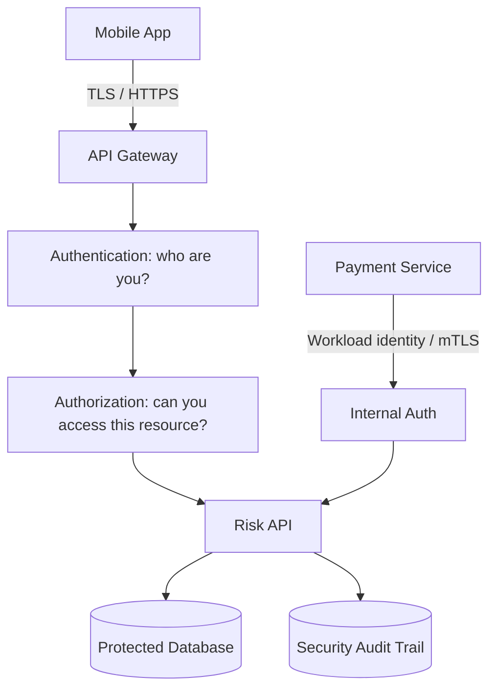

- **Authentication (AuthN):** Verify identity. Example: valid user session or verified service identity.
- **Authorization (AuthZ):** Verify permission. Example: user A may read their own transfer, not user B's.
- **Encryption in transit:** TLS protects traffic while it moves between parties.
- **Encryption at rest:** Protect stored data using managed keys and controlled access.
- **Audit trail:** Record sensitive actions and decisions without exposing secrets or unnecessary personal data.

## 2. How user authentication works

A typical application might use OAuth 2.0 / OpenID Connect (OIDC) for sign-in and access tokens for API access. Keep the concepts distinct: OAuth addresses delegated authorization; OIDC adds an identity layer.

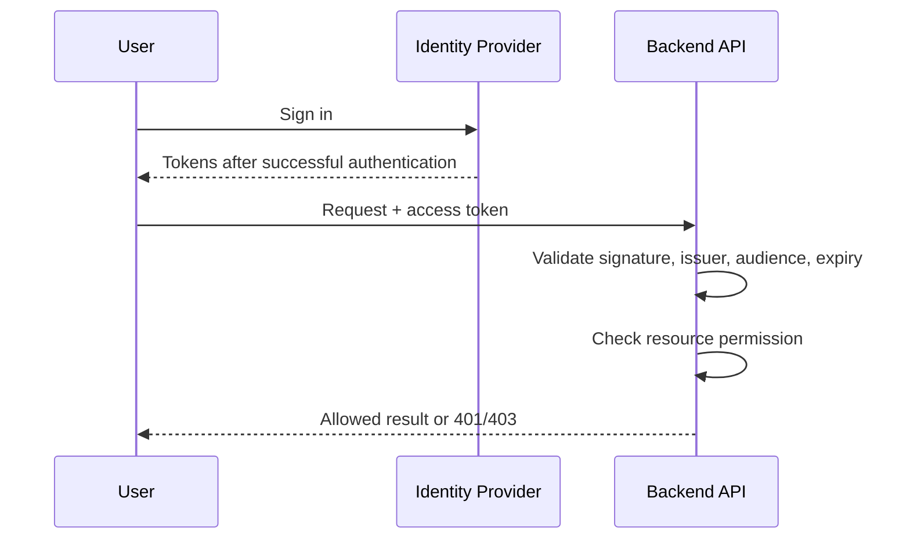

- **JWT:** A token format. It can carry claims, but the API must validate it correctly. A JWT is *not* automatically safe simply because it is signed.
- **401 Unauthorized:** Caller has not successfully authenticated or has an invalid token.
- **403 Forbidden:** Caller is known but lacks permission.
- **Access token vs refresh token:** Access tokens are usually short-lived; refresh credentials need stronger protection and rotation/revocation controls.
- **Session revocation:** A signed token may remain valid until expiry unless you add a revocation strategy or use introspection/short lifetimes.

## 3. How authorization works

**Example:** `GET /v1/transfers/TX-123`.

- **Bad design:** `SELECT * FROM transfers WHERE id = 'TX-123'`, return it to any signed-in user.
- **Better design:** Determine the authenticated caller and check ownership/role/tenant access before returning the transfer.
- **RBAC (role-based access control):** `analyst`, `admin`, `customer` each get allowed actions.
- **ABAC (attribute-based access control):** Permission also depends on resource ownership, department, region, risk sensitivity, or other attributes.
- **BOLA / IDOR:** A caller changes a resource ID and accesses someone else's data. This is a major API risk even when authentication works.

**Interview line:** "I authenticate the caller, then authorize the **specific action on the specific resource**. I don't trust IDs or roles supplied directly by the client."

## 4. Service-to-service security

For an internal `Payment Service → Screening Service` request:

- Use **workload/service identity**, not one shared API key across every service.
- Use **mTLS** when appropriate: each side presents a certificate, authenticates the other, and encrypts traffic.
- Use **short-lived service tokens** with limited scopes, or platform-managed identity.
- Give the screening service only the privileges it needs; do not let it read every customer table.
- Authenticate and authorize **internal traffic too**. Internal networks are not automatically trusted.

## 5. Other security controls you should mention

| Risk | Control | Why it matters |
|---|---|---|
| Stolen token | Short lifetime, secure storage, rotation, detection | Limits misuse window |
| Brute-force requests | Rate limits, account protection, monitoring | Reduces abuse; not a complete fraud solution |
| SQL injection | Parameterized queries | Keeps input from becoming SQL code |
| Overly broad data access | Object-level access checks, least privilege | Prevents cross-customer leaks |
| Leaked financial data | Data minimization, encryption, redacted logs | Avoids sensitive information exposure |
| Request replay | Authentication + idempotency / freshness controls where required | A repeated request must not create a second financial effect |
| Admin changes rules | Admin authorization, approvals, audit, versioning | Controls risk-policy changes |
| Overloaded API | Request size limits, quotas, timeouts | Protects capacity |

## 6. When things fail — safe fallbacks

### Failure A: Identity provider is down

- **Problem:** New users may not be able to sign in; already issued tokens might still validate locally if policy permits.
- **Effect:** Some authentication paths become unavailable.
- **Fallback:** Decide explicitly whether existing valid sessions continue; never bypass authentication for convenience.

### Failure B: Policy/permission service is unavailable

- **Problem:** You cannot verify whether an admin is allowed to change fraud rules.
- **Effect:** Unauthorized changes may slip through if checks are skipped.
- **Fallback:** Reject/defer the privileged operation or use a carefully bounded policy cache; alert operators.

### Failure C: Logs contain full card/bank information

- **Problem:** Observability becomes a data-leak channel.
- **Effect:** Retention and access risks multiply.
- **Fallback:** Redact/tokenize, enforce access and retention controls, review logging schemas.

## 7. GrabDefence example

**Prompt:** "Build an API for analysts to review flagged transactions."

A reasonable first answer:

1. Analyst signs in using the organization's identity provider.
2. Backend validates identity and verifies `risk_case:read` permission.
3. Authorization checks the analyst is allowed to access this case/region.
4. API returns minimum required fields; sensitive data is masked.
5. Every view, decision, and rule change is audited.
6. Admin actions may require stronger authentication and maker-checker approval.

## 8. Interview questions with compact answers

**Q: If we already use an API Gateway, do we still need authorization in the service?**  
Yes. The gateway can enforce general access rules, but the service understands business ownership and object-level permission.

**Q: JWT or session store?**  
JWT supports local verification and fewer lookup calls, but revocation/claim freshness is harder. Server-side sessions give easier central revocation but add state and availability considerations. Choose based on requirements.

**Q: Is rate limiting enough to prevent fraud?**  
No. It limits request volume; fraud decisions need identity, behavior, context, domain rules, and investigation flows.

**Q: How would you protect a risk-rule editor?**  
Strong admin authentication, role/resource-level authorization, audit logs, versioning, approval workflow, and safe rollback.

## 9. Quick memory card

- **AuthN:** Who are you?
- **AuthZ:** Are you allowed to do this action on this resource?
- **TLS/mTLS:** Protect and/or mutually authenticate the connection.
- **Least privilege:** Only the access needed.
- **Financial safety:** Never skip a required control because a dependency failed.

**Further reading:** [OWASP API Security Top 10](https://owasp.org/projects/api-security-project) · [OWASP BOLA](https://api-security.owasp.org/editions/2023/en/0xa1-broken-object-level-authorization/)

---

## Grab interview add-on — Explain security during your whiteboard design

Grab's instructions explicitly mention **security**, so do not leave it until the interviewer prompts you.

### 10-second threat model

**Threat model** means asking: *Who might misuse this system? What can they access? What happens if a control fails?*

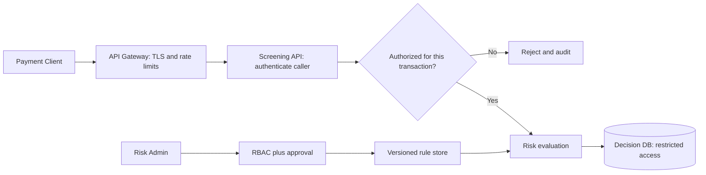

**Trust boundary:** Do not assume that because a request passed the gateway, the requested `customer_id` or `transaction_id` belongs to that caller. The service must enforce resource-level authorization. Service-to-service calls also need authenticated identities.

| Attack or mistake | What you would do | Why |
|---|---|---|
| User tries to screen another user's transaction | Validate tenant/account ownership server-side | Prevent broken object-level authorization |
| Someone changes fraud rules without approval | RBAC, maker-checker approval, versioned audit trail | Rules can affect real financial outcomes |
| Logs expose names, IDs or account details | Minimize/redact fields, restrict access and retention | Protect sensitive financial data |
| Compromised service calls DB directly | Least-privilege DB user and network restrictions | Reduce blast radius |
| Suspicious API traffic floods screening | Authentication, quotas, rate limits, alerts | Preserve capacity for legitimate requests |

### What to say aloud

> "At each trust boundary, I'd authenticate the caller and authorize the exact operation. I'd encrypt traffic, protect secrets, minimize sensitive fields in logs, and make rule changes auditable and approval-controlled. These safeguards should be checked in integration and security tests."

### Interview challenge

**Q: The API Gateway already validates JWTs. Why validate authorization again?**  
**A:** A valid JWT proves something about the caller, not automatically the right to access a particular transaction. The backend enforces business/resource permissions.

**Q: Can we log full transaction payloads to debug failures?**  
**A:** Usually not. Prefer trace IDs, safe reason codes and redacted metadata; use controlled access for any data genuinely required for investigations.


---

# 02 — Observability & Production Reliability

**Grab Round 2 | Beginner → Intermediate | Priority P0**

> **One-line idea:** Observability helps you answer: *Is the service healthy? What failed? Where did time go? Who is affected?*

## 1. Understand logs, metrics, and traces

**Problem:** Customers say screening requests are slow, but your service has three dependencies. How do you find the bottleneck?

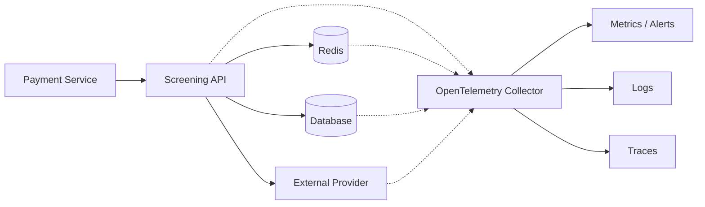

- **Logs:** Individual events. Example: `screening_failed transaction_id=... reason=feature_timeout`.
- **Metrics:** Numeric trends. Example: error rate = 2%, p99 = 230 ms.
- **Traces:** The path/timing of one request across services. Example: 140 ms spent waiting for external screening.
- **Trace ID:** Identifier that links a request's work across services. Propagate it through HTTP/gRPC and, when possible, async messages.

## 2. Latency: average vs p95 vs p99

Suppose 100 requests complete. **p99 = 200 ms** means approximately 99 of those requests complete in **200 ms or less** under the chosen measurement method/window. It does **not** mean every request takes 200 ms.

- **Average latency:** Overall mean. Can hide very slow outliers.
- **p95 latency:** 95% finish at or under this time.
- **p99 latency:** 99% finish at or under this time; useful for slow-tail user experience.
- **Throughput:** Requests processed per second.
- **Error rate:** Failed requests ÷ total requests, with a clear definition of failure.

**Why p99 matters in fintech:** Even if average screening takes 20 ms, a small fraction taking 2 seconds can block payment processing and create timeouts or retries.

## 3. SLI, SLO, SLA — simple meanings

- **SLI (Service Level Indicator):** What you measure. Example: proportion of valid screening requests answered in under 200 ms.
- **SLO (Service Level Objective):** Your target. Example: at least 99% meet that latency requirement during a 30-day window.
- **SLA (Service Level Agreement):** A formal agreement with consequences, often a contractual commitment.
- **Error budget:** The amount of failure allowed by the SLO. For a 99.9% successful-request SLO, around 0.1% may fall outside the target in the window.

> **Interview tip:** Define the metric's denominator. Is a rejected invalid request a system failure? Is `HOLD` a business decision or an error? Without these definitions, charts can mislead.

## 4. What would you monitor?

| Layer | Example metrics | What it tells you |
|---|---|---|
| API | RPS, p50/p95/p99, 5xx, timeouts | User-visible performance |
| App | Goroutines/threads, CPU, memory, GC, pool saturation | Compute pressure |
| Database | Query latency, connections, lock waits, replication lag | Storage bottlenecks |
| Redis | Hit rate, latency, memory, evictions, failures | Feature/caching health |
| Kafka | Consumer lag, retry count, DLQ size | Delayed or stuck events |
| Risk business | ALLOW/HOLD/BLOCK ratios, missing features | Decision changes and potential data issues |
| Deployments | Error/latency difference by version | Regressions after release |

**RED method for requests:** Rate, Errors, Duration. For infrastructure also watch resource use, saturation, and capacity.

## 5. A sample request trace

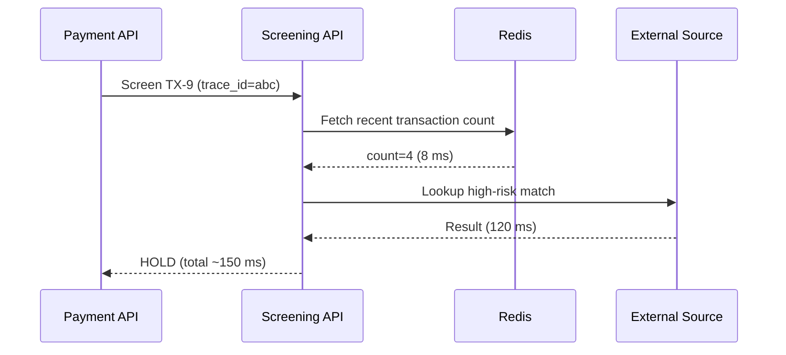

**Observation:** Most time is in the external service. Adding more Screening API instances may not fix latency. Consider caching only safe data, a deadline, bulkhead, and a business-approved fallback.

## 6. Alerting: detect user impact, not just resource usage

**Good alerts:**

- Sustained screening errors above a defined threshold.
- p99 above the SLO over a meaningful window.
- Risk feature freshness beyond an accepted limit.
- Kafka consumer lag growing while throughput falls.
- Sudden unexplained change in BLOCK/HOLD rates after a rule deployment.

**Bad alerts:** Every harmless log line, a momentary CPU spike, or counters without an action/owner.

**Incident workflow:** Detect → assess impact → mitigate (rollback, divert, restrict) → communicate → investigate → write a blameless postmortem → prevent recurrence.

## 7. Failure scenarios

### Problem A: High error rate after deploying version 2

- **Effect:** More payment screening calls fail.
- **Investigate:** Compare error rate and latency by deployment version and dependency; inspect traces/logs.
- **Fallback:** Pause rollout, revert to known-good version when safe, or disable the risky feature with approved controls.

### Problem B: Kafka consumer lag grows

- **Effect:** Historical features or analytics may become stale.
- **Investigate:** Consumer throughput, partition skew, errors, poison messages, broker health.
- **Fallback:** Scale consumers up to partition/concurrency limits, optimize processing, isolate failed messages safely; do not claim fresh features if they are stale.

### Problem C: Logs accidentally print personal data

- **Effect:** Privacy/security risk.
- **Fallback:** Stop logging affected fields, control access, apply retention/redaction and follow incident procedures.

## 8. How to answer in an interview

> "I'd instrument the screening service with request rate, error rate, and p95/p99 latency. I'd propagate a trace ID so we can distinguish slow Redis lookups from slow external providers. I'd monitor Kafka lag and feature freshness because technically successful requests can still produce poor risk decisions if data is stale. Alerts should relate to SLOs and business impact."

**Q: If p99 latency increased but CPU is low, what would you check?**  
Network calls, database locks, thread/connection pools, cache misses, retries, queues, and external dependencies—use traces rather than guessing.

**Q: Is 200 OK for `BLOCK` and `HOLD`?**  
HTTP 200 may indicate the API successfully returned a business decision; a BLOCK is not necessarily a system error.

**Q: What's the difference between health and readiness?**  
A process can be alive but temporarily unable to serve traffic. Readiness prevents new traffic; liveness can trigger restart.

## 9. Quick memory card

**Logs = what happened; Metrics = how often/how bad; Traces = where time went.**

Always mention **p99, error rate, traces, dependency health, business metrics, and action-based alerts**.

**Further reading:** [OpenTelemetry signals](https://opentelemetry.io/docs/concepts/signals/) · [OpenTelemetry concepts](https://opentelemetry.io/docs/concepts/)

---

## Grab interview add-on — Be able to operate the system after launch

The interviewer may ask: **"Your design works. How will you know when it becomes unhealthy?"**

### A simple monitoring dashboard

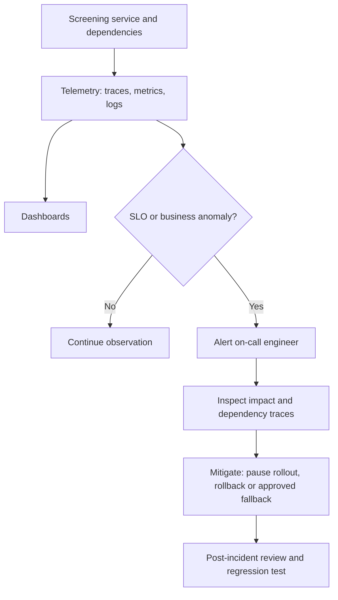

Start with **RED**: Request **Rate**, **Errors**, **Duration**. Then add saturation and business correctness metrics.

| Question | Example signal | Why it matters |
|---|---|---|
| Are users waiting? | p95/p99 screening latency, timeout rate | Tail latency delays payment decisions |
| Are requests failing? | 5xx rate, dependency error count | Technical failures |
| Is the service overloaded? | CPU, JVM heap/GC pauses, thread pool, connection pool | Resource pressure may appear before errors |
| Are risk inputs stale? | Age of most recent feature update, Kafka lag | `HTTP 200` can still hide a wrong risk decision |
| Did a rule deploy change outcomes? | ALLOW/HOLD/BLOCK ratios by rule version | Catch logic regressions without 5xx errors |

### Example: p99 increases after deployment, but the 5xx rate stays flat

1. **Detect:** Compare p99 by application version and recent rule version; check traffic mix.
2. **Localize:** Trace a slow request. Is time going into rule evaluation, Redis, DB locks or an external screening provider?
3. **Mitigate:** Stop the canary and roll back the affected code/rule version if safe; honor the risk policy during degraded operations.
4. **Verify:** Latency and decision mix return to acceptable ranges. Do not rely solely on CPU usage.
5. **Learn:** Add a regression test or performance guard before the next release.

### SLO vs business decision

**Technical success:** The API returns a valid decision within the latency budget.  
**Business correctness:** The decision used appropriate rules and sufficiently fresh features.

A `BLOCK` or `HOLD` can be a technically successful HTTP response. Also monitor false-positive impact; "fewer 500s" is not the same as "good fraud decisions." 

### 45-second interview answer

> "I'd define an SLO for valid screening requests, then monitor request rate, error rate and p99 latency. I'd propagate trace IDs across APIs and queue events, and track DB/Redis latency, connection pools and Kafka lag. For risk systems, I'd additionally monitor feature freshness and sudden changes in HOLD/BLOCK rates. If a canary causes a regression, I'd stop rollout, mitigate and create a regression test."


---

# 03 — Networking, Cloud & Deployment

**Grab Round 2 | Beginner → Intermediate | Priority P0**

> **One-line idea:** Explain how traffic reaches your code, how your code runs in production, and how a new version is released safely.

## 1. Follow one request from phone to database

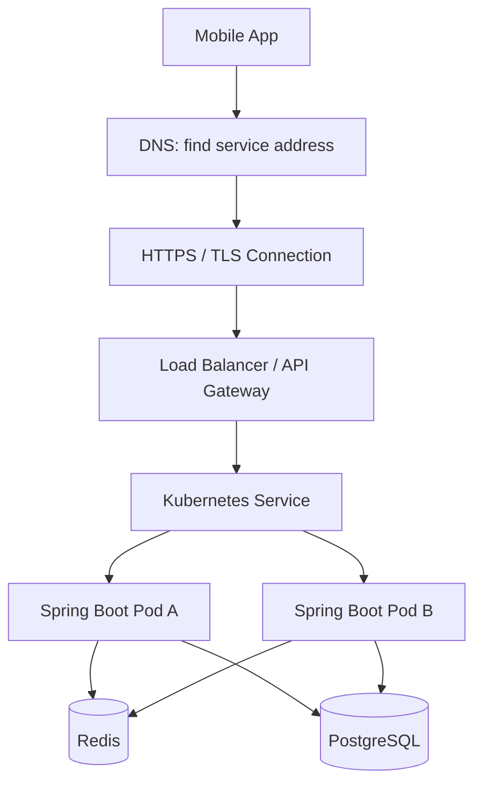

What each component does:

- **DNS:** Turns a service name like `api.example.com` into a network address.
- **TCP:** Reliable ordered byte stream. Typical transport for HTTP/1.1 and HTTP/2.
- **TLS:** Encrypts and authenticates the connection (HTTPS usually = HTTP over TLS).
- **Load Balancer:** Distributes requests to healthy backend endpoints.
- **API Gateway:** Handles shared concerns like routing, authentication policies, and request limits; not a replacement for service-level business authorization.
- **Pod:** A deployable unit in Kubernetes containing one or more containers.
- **Kubernetes Service:** A stable way to find and reach a set of Pods.

### HTTP/REST vs gRPC

| REST over HTTP | gRPC (commonly HTTP/2 + Protobuf) |
|---|---|
| Easy for browser/public APIs | Good for typed internal APIs |
| JSON often convenient to debug | Compact binary messages and generated clients |
| Flexible ecosystem | Schema/version management is important |

Choose based on clients, tooling, performance, and team needs—not because one is automatically faster for every workload.

## 2. Containers, replicas, and autoscaling

**Docker container:** Packages app + its runtime dependencies. **It is not a virtual machine by itself.**

**Replica:** Another running instance of the API. Multiple replicas help capacity and availability, but only if state and dependencies are designed accordingly.

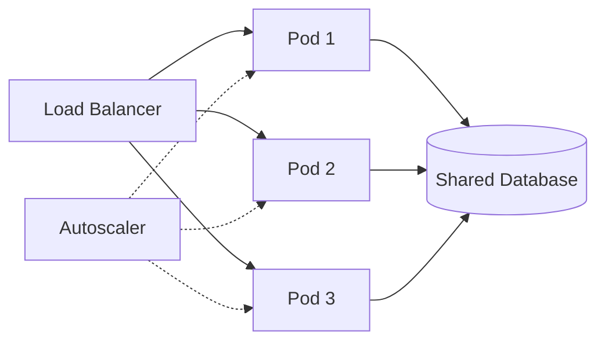

- **Vertical scaling:** Increase CPU/RAM on one machine.
- **Horizontal scaling:** Add more service instances.
- **Stateless service:** Doesn't require a client to return to the same process for essential session state.
- **Autoscaling:** Adds/removes instances based on metrics; not instant, and it won't fix a saturated database.
- **Bottleneck:** 100 API replicas sharing one slow DB can make the DB problem worse.

## 3. Kubernetes health probes — common interview trap

- **Startup probe:** Is this app finished starting? Useful for slow initialization.
- **Readiness probe:** Is this Pod currently ready to receive requests? Failure removes it from regular traffic routing.
- **Liveness probe:** Is this app stuck in a state where restart helps? Failure can restart it.

**Important:** Do not make liveness fail just because an external database is briefly down. Restarting every Pod may amplify an outage. Distinguish application health from dependency readiness and business fallback behavior.

## 4. CI/CD and safe deployment

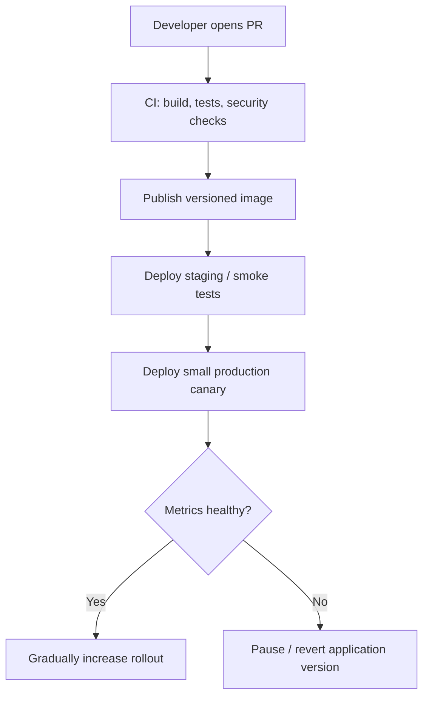

- **CI:** Verify each change automatically (compile, unit tests, static analysis, etc.).
- **CD:** Deliver/deploy verified builds through controlled stages.
- **Rolling deployment:** Replace replicas gradually; keep enough healthy capacity.
- **Canary:** Route a small fraction of traffic to the new version, watch metrics, then expand.
- **Blue/green:** Maintain two environments; switch traffic when new environment is ready.
- **Rollback:** Revert the application version when necessary; DB migrations are not always reversible, so use backward-compatible schema changes.

## 5. Timeouts, latency budgets, and network failures

Suppose an end-to-end request has a hypothetical **200 ms budget**:

- Payment service connection + routing: 20 ms
- Screening API processing: 30 ms
- Risk feature fetch: 60 ms
- Rule evaluation + response: 30 ms
- Safety margin: 60 ms

**This is planning, not a guarantee.** Actual p99 depends on dependencies and tail behavior; parallel calls and retries change the math.

- Give downstream calls timeouts **shorter than the overall request deadline**.
- Avoid unbounded waiting for Redis/DB/external services.
- Be careful with multiple retries: they can consume the entire time budget.
- Use connection pools and monitor pool exhaustion.

## 6. Production failure scenarios

### Problem A: One Pod dies

- **Effect:** Reduced capacity; some in-flight requests may fail.
- **Fallback:** Load balancer routes to healthy replicas; Kubernetes can replace failed Pod; client retries only when safe.

### Problem B: All Pods restart during DB outage

- **Cause:** Incorrect liveness check depends on DB availability.
- **Effect:** Restart storm and loss of service capacity.
- **Fallback:** Separate readiness from liveness; avoid crash loops; use business-approved degraded behavior.

### Problem C: A release causes increased p99

- **Effect:** Payment screening slows down.
- **Fallback:** Stop canary, compare traces/metrics, revert app if safe. Check incompatible data/schema changes before rollback.

### Problem D: An entire availability zone fails

- **Fallback:** Multiple replicas across zones, resilient dependencies and routing. Cross-zone deployment requires validation of capacity and data replication.

## 7. The architecture conversation

**Interviewer:** "How do you deploy the screening service without downtime?"

**Good answer:**

> "I'd package a versioned application image, run CI and integration tests, deploy to staging, then use a rolling or canary production deployment. Readiness probes keep unready instances out of traffic. I would watch p99, error rate and risk decision metrics. Database changes should be backward-compatible so the old and new versions can coexist during rollout."

**Q: Does adding more API servers make the DB faster?**  
Not necessarily; it may increase pressure on the DB. First identify the bottleneck.

**Q: Why not deploy everything into one Pod?**  
Independent services may need different scaling/availability, but too many services add network and operations complexity. Start with the required boundaries.

## 8. Quick memory card

**DNS → TLS → Load Balancer → Gateway/Service → Pods → Dependencies.**  
**Deploy safely:** test → canary → observe → expand or revert.

**Further reading:** [Kubernetes probes](https://kubernetes.io/docs/concepts/workloads/pods/probes/) · [Grab engineering interview guide](https://www.grab.careers/en/how-we-hire/engineering/)

---

## Grab interview add-on — Operating systems, networking and cloud depth

Grab's preparation email explicitly calls out **OS, networking, cloud and release pipelines** for backend roles. Know these fundamentals well enough to explain what happens when a server becomes slow.

### A. What happens when a user calls your HTTPS API?

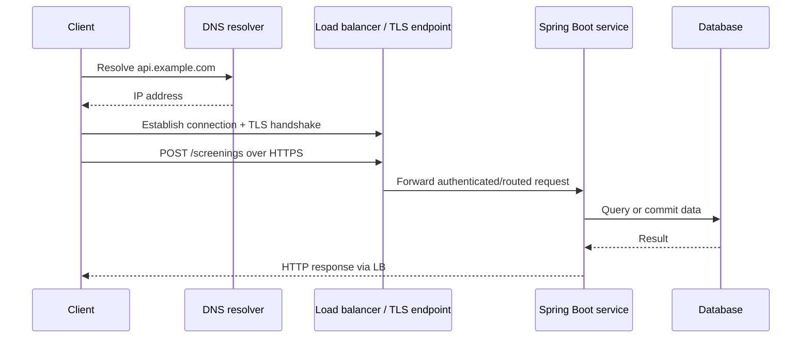

Real deployments may terminate TLS at different places, and reuse established connections. Don't assume every request repeats DNS and TLS handshakes.

- **DNS:** Name resolution; not a database or load balancer by itself.
- **TCP:** Reliable ordered transport used by HTTP/1.1 and HTTP/2. Connection establishment, loss and retransmission affect latency.
- **TLS:** Encryption and server authentication; mTLS may authenticate both services on internal calls.
- **HTTP timeout:** Bounds a caller's wait. A timeout does **not** prove the server didn't commit its work.
- **Connection pool:** Reuses a limited number of connections. An exhausted DB/HTTP pool can create long queues even when CPU is low.

### B. OS and JVM basics (high-value interview follow-ups)

| Concept | Easy explanation | Production symptom |
|---|---|---|
| **Process** | Running program with its own address space | Process crashes or gets OOM-killed |
| **Thread** | Execution path within a process | Too many blocked request threads |
| **CPU saturation** | More work than available processing capacity | Queues and latency grow |
| **Memory / JVM heap** | Memory used for application objects | GC pauses or out-of-memory |
| **File descriptor / socket** | OS resource for open files/network connections | Connection failures when exhausted |
| **DB connection pool** | Controlled number of DB connections per app | Waiting threads and database overload |

**Example:** p99 suddenly rises with low CPU. Investigate DB connection pool exhaustion, long SQL locks, blocked threads, network waits and downstream timeouts—not only "add more pods."

### C. How a cloud deployment maps to your architecture

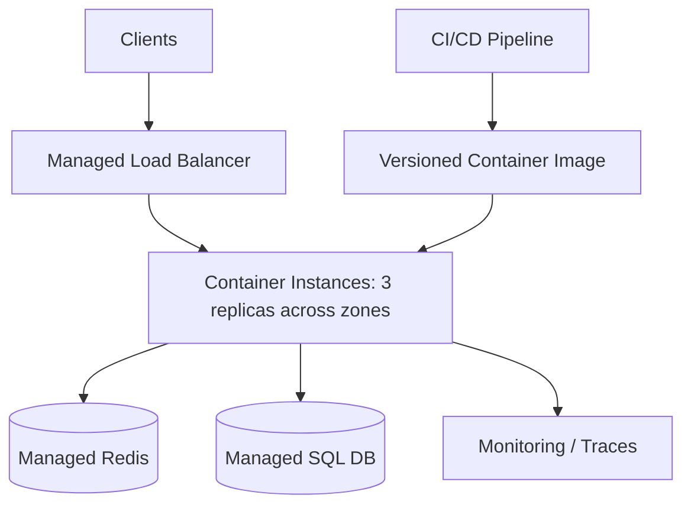

You can describe generic managed services first. If the interviewer wants AWS-specific examples, a possible mapping is **ALB → EKS/ECS → ElastiCache/RDS → CloudWatch**, with the caveat that every component adds cost and operational considerations.

### D. Explain deployment under real constraints

**Prompt:** "How would you deploy version 2 without disrupting payment screening?"

1. Build, test and scan a versioned image in CI.
2. Apply **backward-compatible schema changes** first; old and new app versions may coexist.
3. Deploy to staging; run smoke and integration tests.
4. Roll out a small canary with readiness checks and sufficient spare capacity.
5. Compare error rate, p99, saturation **and risk decision distribution** against baseline.
6. Promote only if healthy; otherwise halt and safely revert application/rules. Do not assume a database migration can always be rolled back.

### Interview Q&A

**Q: Why does restarting a Pod not fix a slow database?**  
**A:** Pod restart only resets the application instance; shared DB contention or locks remain. It may increase reconnection load.

**Q: What's the difference between liveness and readiness?**  
**A:** Liveness asks whether restart may help; readiness controls whether the instance should receive new requests.

**Q: Why is autoscaling insufficient for a 10× traffic spike?**  
**A:** It takes time to scale, and database, network, hot keys or other shared dependencies may still be saturated.


---

# 04 — API Design, Database Modeling & Correctness

**Grab Round 2 | Intermediate | Priority P0**

> **One-line idea:** Before picking SQL or NoSQL, define *what must be stored, how it is accessed, and which correctness rules must never be broken*.

## 1. Start with the real business operation

**Example prompt:** "Design a transaction-screening service that returns ALLOW, HOLD, or BLOCK."

Ask:

- Is a screening **decision** different from executing a **payment**? (Yes; screening generally advises/controls a separate payment flow.)
- Can a screening request be repeated with the same logical transaction ID?
- Must the same request return the same saved decision after the rule version changes?
- How long must decisions be stored for audit?
- Do users need synchronous results, or can they poll later?

**Core correctness rule (invariant):** A repeated request for the same logical screening operation must not create inconsistent duplicate decisions or double-count risk features.

## 2. API design: show a clear contract

```http
POST /v1/screenings
Idempotency-Key: request-key-123
Content-Type: application/json

{
  "transaction_id": "TX-123",
  "customer_id": "U-9",
  "amount_minor": 500000,
  "currency": "MYR"
}
```

Possible synchronous response:

```json
{
  "screening_id": "SC-123",
  "decision": "HOLD",
  "reason_codes": ["HIGH_VELOCITY"],
  "rule_version": "rules-v4"
}
```

- **Minor units:** `500000` MYR sen = RM5,000; avoid binary floating-point for money calculations.
- **Validation:** Allowed currencies, positive amount, authorized caller, size/format limits.
- **Idempotency key:** Scope it to the authenticated client/tenant and a logical operation; store a request fingerprint.
- **Same key + same request:** Return the original result (or status if still processing).
- **Same key + different request:** Reject conflict, e.g. HTTP `409` with an explanatory code.
- **HTTP 200:** Successful synchronous decision; `BLOCK` is a valid *business* decision, not automatically a 500 error.
- **HTTP 202:** If processing is asynchronous, return an operation ID and a way to check status.

## 3. Data modeling: entities and relationships

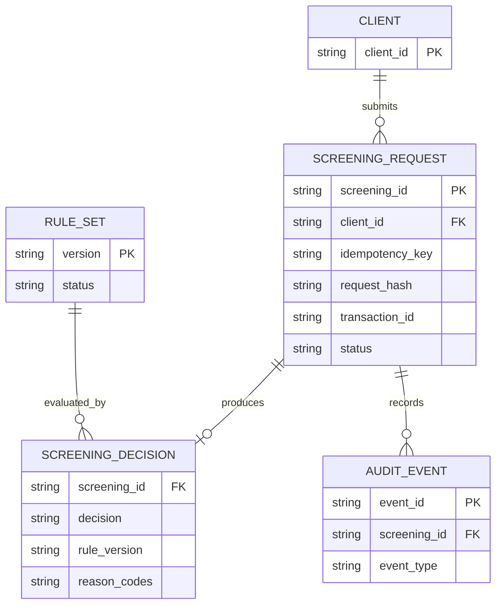

Suggested relational rules:

- `UNIQUE(client_id, idempotency_key)` protects against simultaneous duplicate claims.
- `UNIQUE(screening_id)` for one final decision per screening, if your model requires it.
- Foreign keys protect relationships in one database.
- `created_at`, `updated_at`, `decided_at` with consistent time semantics and UTC timestamps.
- Separate immutable decision/audit records from mutable processing state when appropriate.
- Add indexes **based on query patterns** (e.g. `(client_id, created_at DESC)`), not every column.

## 4. Indexes: why they're useful and costly

Suppose analysts often search:

```sql
SELECT screening_id, decision, created_at
FROM screenings
WHERE client_id = :client_id
ORDER BY created_at DESC
LIMIT 50;
```

An index on `(client_id, created_at DESC)` can support this access pattern.

- **Gain:** Fewer rows scanned for common filtered/sorted queries.
- **Cost:** More disk, more index maintenance during writes.
- **Trap:** An index that doesn't match filters/sort or has poor selectivity may not help much. Confirm using `EXPLAIN ANALYZE` and representative data.

## 5. Transactions & concurrency

**Race condition example:** Two API replicas receive the same request at the same time.

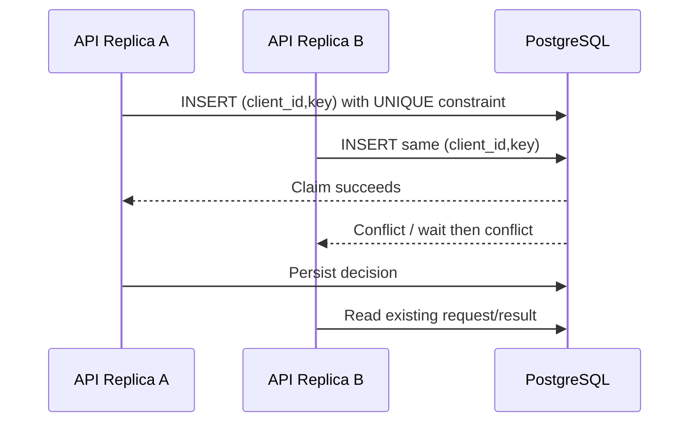

- **Atomicity:** Changes in one DB transaction commit together or roll back together.
- **Consistency:** Constraints and app rules preserve valid states.
- **Isolation:** Concurrent transactions cannot observe/overwrite each other arbitrarily; exact behavior depends on isolation level.
- **Durability:** Committed data survives according to DB's durability configuration.

**Pessimistic locking:** Lock a row while updating it; useful when conflicting writes are likely, at the cost of waiting/contention.

**Optimistic locking:** Use a version column or compare-and-swap; useful when conflicts are rare, at the cost of retries on conflicts.

**Important:** A Redis lock by itself does **not** make updates across different databases atomic.

## 6. SQL vs NoSQL: choose by access and correctness

| SQL (e.g. PostgreSQL) | NoSQL (e.g. key-value/document) |
|---|---|
| Structured relationships, constraints, transactions | Flexible data models and access patterns depending on engine |
| Useful for authoritative screening decisions/audit records | Useful for high-throughput features or specific query workloads |
| Joins and transactional consistency | Consistency and transaction guarantees vary greatly by product |
| Scaling may require careful partitioning/read replicas | Denormalization and access-pattern planning often important |

**Interview line:** "I would use PostgreSQL for authoritative decisions and unique idempotency claims, and consider Redis for frequently updated short-lived counters. I would not rely solely on Redis for the auditable financial record."

## 7. State machines: prevent invalid transitions

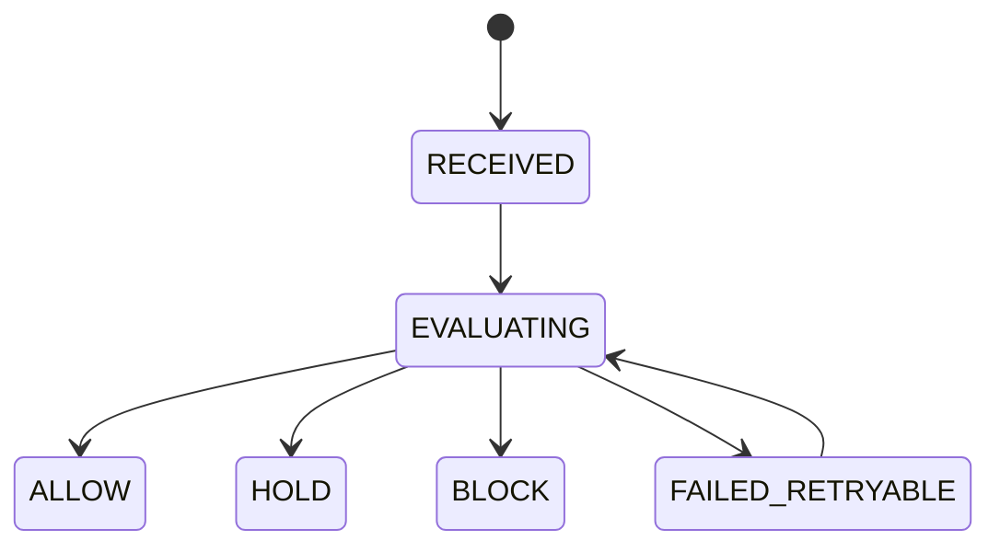

- Define which states are terminal.
- Guard transitions with DB conditions/version numbers to avoid two workers writing conflicting final states.
- Keep decision IDs, rule versions and timestamps for audit.
- If response is lost after commit, retry with the **same identity** and retrieve the persisted result.

## 8. Failures to discuss

### Problem A: DB commits, client times out

- **Effect:** Caller cannot tell whether the operation succeeded.
- **Fallback:** Retry using the same idempotency key or check operation status; don't create a new logical operation.

### Problem B: Two workers finalize same decision

- **Effect:** Inconsistent audit and duplicate downstream effects.
- **Fallback:** Unique constraints + conditional updates/version control + idempotent consumers.

### Problem C: Write throughput grows 10×

- **Effect:** Index maintenance, lock waits, or DB connections could become bottlenecks.
- **Fallback:** Measure; batch safe work, optimize indexes/queries, pool connections, isolate async processing, partition only when warranted.

## 9. Interview questions

**Q: Would you store all transaction data as JSON?**  
Not automatically. JSON is useful for flexible metadata, but fields used for constraints, indexing, joins and auditing often deserve structured columns.

**Q: What's the point of idempotency if we already have a transaction?**  
DB transactions protect one execution's atomicity; idempotency protects against repeating the *logical business operation* across retries.

**Q: When would you use pessimistic locking?**  
When a contested row must be updated consistently and conflict probability/impact justify lock waits. Otherwise evaluate optimistic versioning or atomic conditional updates.

## 10. Quick memory card

**Start with:** business invariants → API contract → schema → constraints/indexes → concurrency → failure behavior.

**Further reading:** [PostgreSQL transaction isolation](https://www.postgresql.org/docs/current/transaction-iso.html) · [PostgreSQL indexes](https://www.postgresql.org/docs/current/indexes.html)

---

## Grab interview add-on — Extensibility and maintainability

Grab explicitly asks whether systems are **extensible** (easy to add new behavior) and **maintainable** (safe to understand, change and operate).

### Example: 3 fraud rules today, 100 next year

**Bad approach:** Hard-code every rule in one large controller `if/else`, then redeploy the whole service for every rule change.

**Better approach:** Separate **rule definitions** (approved, versioned data) from **rule evaluation** (well-tested execution logic).

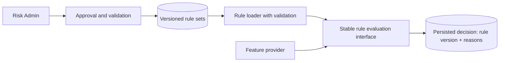

**Illustrative rule definition:**

```json
{
  "rule_id": "high_velocity_v2",
  "version": 2,
  "feature": "txn_count_5m",
  "operator": ">=",
  "threshold": 8,
  "outcome": "HOLD"
}
```

These numbers are mock data, not genuine risk policy. Do not execute arbitrary user-provided scripts or SQL as "rules" without strong controls.

**Design principles worth explaining:**

- **Single responsibility:** API handles request validation; a separate evaluation component handles risk rules; a persistence component handles durable decisions.
- **Stable interface:** e.g. `evaluate(ruleSetVersion, features) -> Decision`; callers shouldn't depend on internal rule implementation.
- **Versioning:** Persist the exact rule version with each decision, so future rule changes don't rewrite history.
- **Extensibility:** New risk features can be introduced behind a feature provider interface with versioned schema/semantics.
- **Maintainability:** Unit-test rules in isolation, review config changes, use structured logs and ownership documentation.
- **Safe rollout:** Validate new rules offline; use shadow/canary evaluation and monitor decision ratios before broad activation.
- **Don't over-engineer:** A modular monolith is often enough initially. Microservices need a clear independent scaling or ownership reason.

### Architecture trade-off: hard-coded rules vs versioned configuration

| Choice | Advantage | Cost |
|---|---|---|
| Hard-coded simple rules | Easy to start; compiler/test support | Requires code release to change behavior |
| Versioned declarative rule data | Faster governed changes and auditability | Needs validation, rule compatibility, rollback and permission controls |
| Custom scripting/plugin engine | Highly flexible | Security, latency and debugging complexity; avoid without a clear need |

### Whiteboard exercise — explain your chosen boundaries

Start with **Client → Screening API → Rules → Database**. Ask whether the rules need independent updates. If yes, introduce a versioned rules store with an approved rollout. Only add Kafka or Redis when you have a concrete need for async events or low-latency counters.

**Interviewer:** "How will this support a new fraud rule next month?"  
**Answer:** "I'd separate rule definitions from the evaluator. An approved version can be validated, tested and rolled out gradually, and I'd persist the rule version with each decision. The main API contract remains stable."

## Grab interview add-on — Present your Ant International architecture

They explicitly say there may be a short discussion about **systems you've built**. Prepare a 2-minute architecture walk-through, not only STAR-format HR storytelling.

**Safe facts from your experience:** Ant payment routing, roughly **17 → 1 peak database writes per transaction**, senior collaboration, and asynchronous persistence/message queue work.

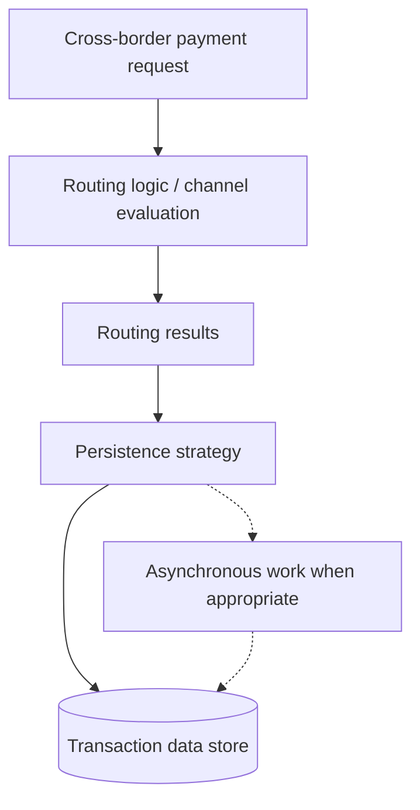

**Note:** This is an **illustrative discussion outline**, not a reconstructed diagram of Ant's internal architecture. Replace it with only the components and guarantees you can personally verify.

**2-minute speaking structure:**

1. **Business problem:** Multiple routing/channel results made persistence expensive along a transaction flow.
2. **Original bottleneck:** Explain where the ~17 writes happened, based on what you actually worked on.
3. **Your contribution:** Data representation and async persistence decisions; distinguish your work from seniors' contributions.
4. **Trade-off:** Fewer writes vs more complex reads, queue reliability, and harder recovery paths.
5. **Validation:** State the concrete measurement and tests you really performed; don't invent production metrics or "exactly-once" guarantees.

**Likely follow-ups:** What happens if the consumer repeats? If a message is lost? Why not use an in-process thread? How did you prove the DB write reduction? What data is still authoritative?


---

# 05 — Advanced Failure Handling & Resilience

**Grab Round 2 | Intermediate → Advanced | Priority P1**

> **One-line idea:** Distributed systems fail partially. A timeout does **not** tell you whether the remote side completed its work.

## 1. Understand partial failure

**Problem:** Payment API calls Risk API. Risk API writes a decision to the DB, but the network drops before Payment API receives the response.

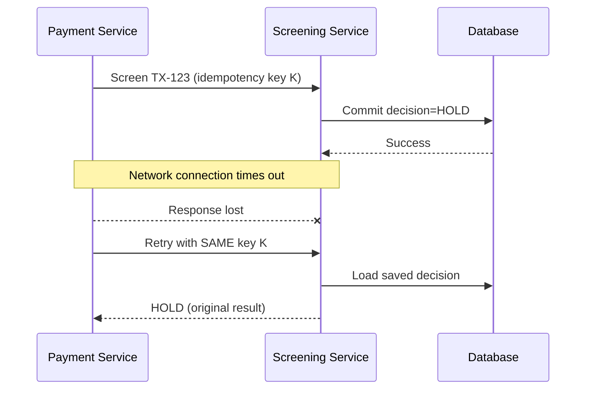

- **Danger:** Retrying with a brand-new ID may repeat a financial effect or recompute a decision under different rules.
- **Safe approach:** Stable operation identity, durable result lookup, bounded retries and reconciliation when outcome is uncertain.

## 2. Timeouts vs retries vs circuit breaker

- **Timeout:** Stop waiting forever. It limits damage, but does not prove the remote call failed.
- **Retry:** Try again for *transient* problems, when operation identity and semantics make retries safe.
- **Backoff:** Wait longer between attempts to avoid hammering an unhealthy service.
- **Jitter:** Add randomness so many clients don't retry together.
- **Circuit breaker:** Temporarily stop sending calls to a repeatedly failing dependency; allow controlled probes later.
- **Bulkhead:** Separate resource pools so one failing dependency cannot exhaust every connection/thread.
- **Backpressure:** Slow, reject or buffer work when consumers can't keep up; queues must be bounded.

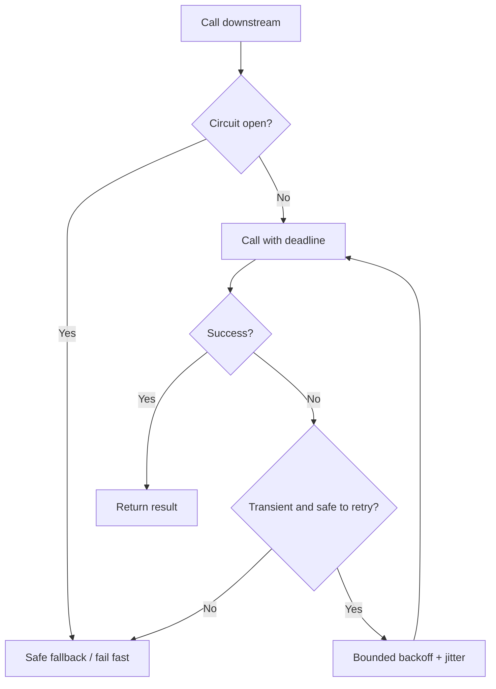

## 3. Retry only when it is safe

| Error | Typical action | Reason |
|---|---|---|
| Network timeout | Check status or retry with same ID | Remote outcome unknown |
| HTTP 429 | Respect retry hints + backoff | Downstream is throttling |
| HTTP 503 | Bounded retry or circuit breaker | Temporary overload/unavailability |
| HTTP 400 invalid request | Do not retry unchanged | Permanent input problem |
| HTTP 403 access denied | Do not retry unchanged | Permission problem |
| DB unique-key conflict | Retrieve existing operation or reject conflicting payload | Likely duplicate identity |

**Retry budget example (hypothetical):** At most two retries within an overall 200 ms request budget, only if the remaining deadline permits. You do not automatically retry financial side effects.

## 4. Transactional outbox: DB + Kafka dual-write problem

**Without outbox:** DB commits, app crashes before publishing to Kafka → event lost.

```mermaid
flowchart LR
    S[Service] --> T[One DB transaction]
    T --> D[(Business data)]
    T --> O[(Outbox event)]
    O --> R[Outbox relay]
    R --> K[Kafka]
    K --> C[Idempotent consumer]
```

- Save business change and outbox event **in the same DB transaction**.
- Relay publishes pending outbox records to Kafka, then marks progress.
- If relay crashes after publish but before marking delivered, Kafka may see a duplicate.
- Use `event_id` deduplication and guard business state changes in the consumer.
- **Outbox = reliable intent to publish, not exactly-once business delivery.**
- For ordered events on the same aggregate, define a stable key and ordering strategy; do not assume global ordering in Kafka.

## 5. DLQ, poison messages and backlog

- **DLQ (dead-letter queue):** Holds messages that cannot be processed after an agreed retry policy, so they can be investigated or replayed.
- **Poison message:** An event that repeatedly fails because content or code cannot handle it.
- **Consumer lag:** How far behind the consumer is. Large lag means data dependent on those events can become stale.
- **Backlog recovery:** You may need more consumer capacity, but Kafka partition count and downstream limits constrain parallelism.
- **Replay safety:** Reprocessing DLQ events must not duplicate financial changes.

## 6. Fail-open vs fail-closed vs HOLD

Suppose a required sanctions screening provider is unavailable.

- **Fail-open:** Continue without the check. This may violate business/regulatory risk policy.
- **Fail-closed:** Reject/block. Safer for some controls but may harm customers and availability.
- **HOLD / step-up:** Defer transaction pending review or restored data, when permitted by product rules.

**Important:** The fallback is a business and compliance policy decision, not only a technical choice. Clarify which operations may be delayed, rejected or held.

## 7. Cascading failure example

**Problem:** External provider is slow. Every request waits for 10 seconds. Threads fill up, queues grow, other requests time out, and clients retry. One bad dependency destabilizes the platform.

**Effect:** Latency and resource saturation increase across services.

**Fallback:**

- Short, budgeted timeouts.
- Bulkhead around external calls.
- Circuit breaker under repeated failures.
- Bounded retries with jitter; no automatic retry storm.
- Load shedding or HOLD decisions following approved policy.
- Alerts on latency, error rate, queue depth and pool saturation.

## 8. What failure scenarios should you prepare?

| Scenario | Good design discussion |
|---|---|
| Redis down | Redundant setup; stale/missing features; controlled fallback |
| Kafka down | Outbox buffering; lag and backlog; eventual catch-up |
| DB down | Write availability, read consistency, recovery, safe reject/defer |
| Duplicate request | Idempotency claim, original result, payload conflict |
| Service crashes midway | Transaction boundary, durable checkpoint, retry safety |
| Traffic spikes 10× | Rate limiting, autoscale, backpressure, bottleneck analysis |
| Two regions split | Consistency/availability requirements; avoid duplicate authoritative writers |

## 9. Interview answer template

> "For every external dependency, I'd define a timeout and a failure policy. For transient errors I might use bounded retries with jitter, but only for idempotent operations. I'd use a circuit breaker and bulkhead to avoid cascading failures. For a DB update that must produce an event, I'd use a transactional outbox and idempotent consumers. When the outcome is unknown, I'd preserve the same operation ID and reconcile instead of assuming failure."

**Q: Is a timeout the same as failure?**  
No. The remote side might have committed before the response was lost.

**Q: Is at-least-once message delivery safe for payments?**  
Only if the *business effect* is deduplicated/idempotent and state changes are guarded.

**Q: Why not retry forever?**  
It amplifies load and exhausts latency budgets; permanent failures never resolve by retries.

## 10. Quick memory card

**Timeout → Unknown outcome → Same ID → Status/reconciliation.**  
**Outbox → At-least-once publish → Idempotent consumer.**  
**Overload → Limit retries + circuit breaker + backpressure.**

**Further reading:** [AWS Retry with Backoff](https://docs.aws.amazon.com/prescriptive-guidance/latest/cloud-design-patterns/retry-backoff.html) · [AWS Transactional Outbox](https://docs.aws.amazon.com/prescriptive-guidance/latest/cloud-design-patterns/transactional-outbox.html) · [AWS Circuit Breaker](https://docs.aws.amazon.com/prescriptive-guidance/latest/cloud-design-patterns/circuit-breaker.html)

---

## Grab interview add-on — Talk through failures like an owner

The interviewer may change requirements mid-design: **"Kafka is unavailable for 20 minutes. Now what?"** Don't just add a second Kafka cluster. Explain the consequence and recovery sequence.

### Failure-handling decision tree

```mermaid
flowchart TD
    A[Dependency fails or times out] --> B{Is it on the synchronous critical path?}
    B -->|No| C[Persist work or event durably]
    C --> D[Retry asynchronously with bounded attempts]
    D --> E[Observe lag and recover / investigate]
    B -->|Yes| F{Can an approved safe decision be made?}
    F -->|Yes| G[Return approved degraded decision]
    F -->|No| H[HOLD or reject under policy]
    G --> I[Record reason and metrics]
    H --> I
```

The right policy depends on financial controls and product requirements. Do not invent a universal "fail-open" or "fail-closed" answer.

| Failure | Likely impact | First action | Recovery design |
|---|---|---|---|
| **Kafka outage** after decision commit | Notifications/analytics delayed | Keep outbox row; alert on lag | Relay retries; consumer dedupes |
| **Redis outage** during risk decision | Missing recent-activity features | Use bounded timeout and approved HOLD/deny strategy | Redis redundancy or trusted fallback; restore freshness |
| **DB commit succeeded, response timed out** | Caller doesn't know the result | Retry/query using same idempotency key | Return saved result; don't redo business effect |
| **External screening provider slow** | Tail latency and thread saturation | Set deadline and concurrency limit | Circuit breaker; approved fallback and monitoring |
| **Retry storm after recovery** | Downstream overload | Backoff + jitter, cap attempts | Backpressure and admission control |

### Short incident role-play

**Interviewer:** "We add 10 API replicas. Why didn't latency improve?"  
**You:** "I'd first check where the time is spent. If the shared DB or external provider is saturated, more replicas may make contention worse. I'd inspect traces, pool waits and dependency metrics, then mitigate the actual bottleneck."

**Interviewer:** "The DB commits but the caller receives a timeout. Do we retry?"  
**You:** "Yes, only with the same logical operation identity and idempotency contract. I cannot assume a timeout means no commit; the caller should retrieve the persisted result or retry safely."

### Principle to remember

**Retries are not recovery by themselves.** A reliable design also needs bounded timeouts, durable work when required, deduplication, clear user-visible status, monitoring and a way to reconcile uncertain outcomes.


---

# 06 — Testing, CI/CD & Safe Release Strategies

**Grab Round 2 | Intermediate | Priority P1**

> **One-line idea:** A system isn't reliable because its architecture diagram looks good. You need tests, safe releases, monitoring and recovery procedures.

## 1. The testing layers, explained simply

```mermaid
flowchart TD
    U[Many fast unit tests] --> I[Integration tests with real dependencies]
    I --> C[API / Contract tests]
    C --> E[Small set of end-to-end tests]
    E --> P[Performance / Failure tests]
```

- **Unit test:** Verify small business logic in isolation. Example: `rule(amount,velocity)` returns HOLD.
- **Integration test:** Check actual interaction with PostgreSQL, Redis or Kafka using test instances; test transactions and constraints.
- **Contract test:** Verify caller and provider agree on API schemas and semantics.
- **End-to-end test:** Follow a business flow across multiple components.
- **Load test:** Measure performance at a defined request rate/concurrency and data size.
- **Failure/chaos test:** Deliberately make Redis slow or Kafka unavailable to verify expected behavior.
- **Security test:** Check unauthorized access, bad tokens, input validation and sensitive data handling.

**Testcontainers** can run real containerized dependencies for JVM integration tests. For concurrency correctness, use deliberate simultaneous-request fixtures instead of only sequential happy-path tests.

## 2. Example tests for a screening service

| Test | Input | Expected result |
|---|---|---|
| Happy path | Valid transaction | Deterministic ALLOW/HOLD/BLOCK |
| Invalid amount | Negative amount | 400 validation error |
| Missing token | No auth | 401, no data disclosure |
| Wrong tenant | Authorized user, another tenant's ID | 403/404 per policy |
| Duplicate requests | Same key and same payload concurrently | One logical screening operation |
| Key conflict | Same key, different payload | 409 conflict |
| Rule version update | Retry previous request | Original persisted decision remains stable |
| Redis timeout | Feature store unavailable | Defined safe fallback; not blind ALLOW |
| Kafka unavailable | Business commit succeeded | Outbox event retained for later publishing |
| Slow external provider | Response beyond budget | Timeout and approved fallback |

**Interview insight:** The highest-value tests often target invariants: "No duplicate effect", "No unauthorized access", "No missing audit record".

## 3. A CI/CD pipeline

```mermaid
flowchart TD
    A[Pull Request] --> B[Compile + Unit Tests]
    B --> C[Static Analysis / Secret Scan]
    C --> D[Integration + Contract Tests]
    D --> E[Build immutable container image]
    E --> F[Staging smoke test]
    F --> G[Canary production rollout]
    G --> H{SLO and business metrics healthy?}
    H -->|Yes| I[Roll forward]
    H -->|No| J[Stop / revert release]
```

- **Immutable image:** Use a specific image digest/version so the same artifact moves through environments.
- **Approval gate:** More important for sensitive financial services and DB changes.
- **Staging:** Useful, but may not reproduce production load or traffic mix.
- **Feature flag:** Turn on/off a feature independently of shipping code; risk rule changes require auditing and authorization.

## 4. Safe database schema migrations: expand → migrate → contract

Suppose you want to replace `customer_name` with separate `first_name`, `last_name` fields.

1. **Expand:** Add new nullable columns without removing the old column. Deploy code that understands both schemas.
2. **Migrate/backfill:** Populate new data in controlled batches and verify correctness.
3. **Switch:** New application versions read/write new fields, with compatibility during rollout.
4. **Contract:** Remove old column only after all readers/writers have migrated and evidence shows it is safe.

**Why?** During rolling deployments, old and new instances may run simultaneously. A destructive migration can break old instances and make application rollback impossible.

## 5. Performance testing: measure before promising

**Illustrative target:** 10,000 RPS, p99 under 200 ms. This is a hypothetical design goal—not a claim about Grab's platform.

Record:

- Hardware/instance configuration.
- Number of API replicas and DB connections.
- Test data volume, indexes, and traffic shape (steady vs burst).
- RPS achieved, error rate, p50/p95/p99 latency.
- CPU/memory, DB latency, Redis latency, Kafka lag.
- Which bottleneck reached its limit first.

**Trap:** A 10,000 RPS benchmark with empty business logic and no database proves little about real performance.

## 6. Canary vs rolling vs blue/green

| Method | Gain | Limitation |
|---|---|---|
| Rolling | Gradual replica replacement | Old and new versions coexist |
| Canary | Measure behavior on a small traffic share | Need representative sample and careful routing |
| Blue/green | Fast traffic switch between environments | More capacity; data compatibility still matters |
| Feature flag | Separate code rollout from feature release | Flag management and testing complexity |

**What do you monitor before expanding canary?** p99, 5xx, timeouts, CPU/pool saturation, dependency health, and **risk decision distribution**. New code might return HTTP 200 while incorrectly changing BLOCK rates.

## 7. Failure scenarios

### Problem A: Unit tests pass, production errors rise

- **Effect:** Uncovered integration, configuration or load behavior.
- **Fallback:** Check canary metrics; stop rollout or revert; add regression test based on root cause.

### Problem B: DB migration fails halfway

- **Effect:** Partial data backfill or incompatible schema.
- **Fallback:** Make migrations idempotent/restartable, inspect state, restore from backups when needed; often safer to roll forward than blindly reverse destructive changes.

### Problem C: New rule causes too many HOLD decisions

- **Effect:** Customers experience unnecessary delays.
- **Fallback:** Stop rule rollout, compare decision metrics, restore previously approved version, audit the change.

## 8. Grab-style interview questions

**Q: How would you test idempotency?**  
Send the exact same key/payload concurrently through multiple instances, verify one business effect and identical/stable result; also test same key/different payload and client timeout/retry.

**Q: Unit tests or integration tests—what matters more?**  
Both. Unit tests validate logic quickly; integration tests verify transactions, constraints and real component behavior.

**Q: How do you deploy with zero downtime?**  
Use compatible schema changes, readiness checks, rolling/canary rollout, metrics gates and a safe revert plan; truly zero downtime is a goal that needs validation.

## 9. Quick memory card

**Tests:** unit → integration → contract → e2e → load/failure.  
**Releases:** build → verify → stage → canary → observe → expand/revert.  
**Schema:** expand → backfill → switch → contract.

**Further reading:** [Spring Boot Testcontainers](https://docs.spring.io/spring-boot/reference/testing/testcontainers.html) · [Kubernetes Deployments](https://kubernetes.io/docs/concepts/workloads/controllers/deployment/)

---

## Grab interview add-on — "How do you know this is production-ready?"

Grab's email explicitly mentions **testing** and **monitoring**. Avoid stopping at "I'll write unit tests."

```mermaid
flowchart TD
    A[Define business invariants and SLOs] --> B[Unit and integration tests]
    B --> C[Concurrency and fault-injection tests]
    C --> D[Load and security tests]
    D --> E[Stage, smoke-test, canary]
    E --> F{Health + business metrics acceptable?}
    F -->|Yes| G[Gradually promote release]
    F -->|No| H[Stop, rollback safely, investigate]
```

### Test the design itself, not just code paths

| Test | Concrete example | Must be true |
|---|---|---|
| Unit | Evaluate `txn_count_5m >= threshold` | Correct decision and reason code |
| Integration | PostgreSQL unique idempotency claim | Same logical request has one stable result |
| Concurrency | 100 concurrent retries of same request | No inconsistent duplicate decision/business effect |
| Contract | API v1 client calls newer service | Old client still works during rollout |
| Fault injection | Kafka fails after DB commit | Pending outbox row is preserved and eventually published after recovery |
| Failure policy | Redis counters unavailable | Documented HOLD/deny/degraded behavior; no silent bypass |
| Load | Ramp to hypothetical peak traffic | Measured throughput, p99, errors and resource saturation |
| Security | Unauthorized caller changes rule set | Denied and audited |

### A useful rollout checklist

- [ ] CI passes and covers critical concurrency/business invariants.
- [ ] Backward-compatible API and database changes validated.
- [ ] Readiness/liveness checks configured correctly.
- [ ] Observability dashboard and on-call owner exist.
- [ ] Canary compares p99, 5xx, pool waits and **decision ratios**.
- [ ] Known rollback/forward-fix plan for app **and** rules; DB changes need special caution.
- [ ] Incident/runbook guidance exists for Kafka lag, stale features and unavailable providers.

### Interview response (45–60 seconds)

> "Before shipping, I'd define invariants—especially stable idempotent decisions—and non-functional targets. I'd run unit, DB/message integration, concurrency and failure tests, then benchmark realistic traffic. CI produces a versioned image, deployed to staging and then a canary. I'd monitor error rate, p99, dependency saturation and risk decision rates. If metrics degrade, I'd stop the rollout and revert safely."


---

# 07 — Fraud Detection & Real-Time Transaction Screening

**Grab Round 2 | Intermediate → Advanced | Priority P1 (role-specific)**

> **One-line idea:** A risk system makes a fast, explainable, auditable decision using available data. The hard part is balancing latency, accuracy, data freshness, availability and customer friction.

## 1. Clarify the business decision first

**Prompt:** "Design a digital-bank transaction screening service."

Ask the interviewer:

1. Is it **pre-transaction** screening, post-transaction monitoring, or both?
2. What outcomes are allowed: `ALLOW`, `HOLD`, `BLOCK`, `STEP_UP`?
3. Which rules matter: velocity, unusual amount, device, geographic risk, name/sanctions screening?
4. What is the peak request rate and p99 latency target?
5. Which features must be fresh, and what happens when they are missing?
6. Are decisions required to be explainable and auditable?

**Example assumptions for practice only:** peak 10,000 RPS, p99 under 200 ms, results `ALLOW/HOLD/BLOCK`. These are **not verified Grab production metrics**.

## 2. Start with a minimal architecture

```mermaid
flowchart TD
    P[Payment Service] --> G[Gateway / Auth]
    G --> S[Screening API]
    S --> F[Feature Fetch / Data Orchestrator]
    F --> R[(Fast Counters / Redis)]
    F --> DB[(Risk Reference Data)]
    F --> E[Rules Engine]
    E --> S
    S --> D[(Decision DB + Audit / Outbox)]
    S -->|ALLOW / HOLD / BLOCK| P
    D --> O[Outbox Relay]
    O --> K[Kafka]
    K --> W[Analytics / Investigation Workers]
    A[Approved Rule Editor] --> V[(Versioned Rules)]
    V --> E
```

**Synchronous critical path:** request → authentication → features → rule evaluation → persist authoritative decision → response (subject to requirements).

**Asynchronous path:** committed decision event → outbox → Kafka → analytics, notifications or investigation workflows.

**Important:** If the decision must be durable before payment continues, do not return success before the required commit. Rule-engine and feature architecture depend on the product's guarantees.

## 3. What is a risk feature?

A **feature** is an input the rules engine can use:

- Count of transfers by user in last 5 minutes.
- Total amount transferred by account in last hour.
- Number of distinct destination accounts today.
- Whether a device was recently registered.
- Whether a watchlist/name match needs further review.

A simple rule might be:

```text
IF 5-minute transaction_count >= 8
AND current_amount_minor >= 500000
THEN HOLD with reason HIGH_VELOCITY
```

That's illustrative business logic, **not** a recommended fraud threshold. Real thresholds depend on policy, data analysis and false-positive impact.

## 4. Real-time counters: what makes them hard?

**Problem:** 30 requests for one account arrive concurrently on different API replicas. All must see coherent enough counters for the required policy.

Options:

| Approach | Good for | Trade-off |
|---|---|---|
| Redis increment + TTL | Simple approximate time buckets | Fixed windows have boundary effects |
| Redis sorted set + timestamps | More precise recent-event windows | Memory and per-event cleanup/cost |
| Sliding bucket aggregation | Scalable approximate windows | Approximation and boundary semantics |
| Stream processor from Kafka | Async feature computation and analytics | Consumer lag / data freshness |
| SQL authoritative event history | Durable history and audit | Direct hot-window queries may be slow |

**Key correctness questions:**

- Does the feature count **attempts**, **successful payments**, or **approved screenings**? These are different.
- If a request is retried, is it counted twice? Use stable event/request identity and atomic deduplication for the chosen feature semantics.
- Is the update + read atomic where your rule requires it? Check Redis transactions/scripts and cluster key constraints.
- How fresh is the feature? Async Kafka projections can lag, so high-risk decisions may require a stronger live path.

## 5. Rule versioning and decision audit

Store enough information to explain a decision later:

```json
{
  "screening_id": "SC-9",
  "transaction_id": "TX-123",
  "decision": "HOLD",
  "rule_version": "risk-rules-v17",
  "reason_codes": ["HIGH_VELOCITY"],
  "feature_snapshot_ref": "snapshot-123",
  "decided_at": "2026-11-11T06:00:00Z"
}
```

- Rules must be versioned and rolled out safely.
- Keep reason codes and necessary feature provenance; don't log raw sensitive data unnecessarily.
- A retry should retrieve the persisted decision for the same logical screening request unless explicit business policy requires reevaluation.
- Rule changes should be restricted, reviewed and auditable.

## 6. False positives vs false negatives

- **False positive:** Legitimate transaction incorrectly held/blocked → user friction and support cost.
- **False negative:** Fraudulent transaction incorrectly allowed → losses and risk exposure.

You must discuss how to measure both. A higher BLOCK rate does not automatically mean better fraud detection.

A **HOLD** decision can route to manual review or additional verification, but it needs status tracking, deadlines and a customer communication strategy.

## 7. The most important failure policies

### Failure A: Redis counters unavailable

- **Effect:** Recent-activity features are missing.
- **Fallback:** Redundant Redis, bounded timeout, maybe alternate trusted data source. Use policy-driven HOLD/deny/limited processing rather than inventing counts or blindly ALLOW for critical checks.

### Failure B: Kafka consumer lag rises

- **Effect:** Features computed from the stream are stale.
- **Fallback:** Monitor age of latest processed event and lag. If freshness limit exceeded, use alternate live features or an approved degraded decision policy.

### Failure C: Rule update accidentally blocks everyone

- **Effect:** Huge spike in HOLD/BLOCK ratio despite HTTP 200 responses.
- **Fallback:** Version/approval workflow, canary rollout, anomaly detection, fast rollback to prior approved rule set.

### Failure D: Client times out after screening decision committed

- **Effect:** Client thinks status is unknown.
- **Fallback:** Retry with same operation ID and return original saved decision; do not recompute under arbitrary new rules.

### Failure E: External sanctions/name screening is slow

- **Effect:** p99 grows and payment flow stalls.
- **Fallback:** Isolate dependency, enforce deadline and use compliance-approved HOLD/deny policy; never silently skip mandated checks.

## 8. Name screening vs transaction fraud screening

**Name/sanctions screening:** Match person/entity names against relevant lists. Issues include transliteration, aliases, false matches, list version and human review.

**Transaction fraud screening:** Evaluate behavioral/payment features and context. Issues include fast counters, fresh features, model/rule consistency and low latency.

**Interview tip:** Ask which problem the interviewer wants. One architecture does not automatically cover both with the same rules and latency requirements.

## 9. Capacity and scaling exercise

Assume **10,000 peak RPS** and each request needs **3 lookups**:

- Naively there may be up to **30,000 feature lookups/sec**, before caching/batching or parallelization.
- If the critical path serializes three calls, latency adds. Independent calls may be parallelized within a shared deadline.
- Hot accounts can create hot keys and contention. Scale API replicas won't remove a single-key hot spot.
- Distinguish average RPS from peaks. Benchmark with bursty and skewed traffic, not uniform synthetic traffic only.

## 10. Grab-style follow-up questions

**Q: Why not run fraud detection purely on Kafka?**  
Streaming is useful for feature updates and offline analysis, but a synchronous pre-payment decision needs a bounded response path and a clear strategy for stream lag and data freshness.

**Q: Why store rule version with decisions?**  
So investigators can explain which policy was applied at decision time and avoid silently reinterpreting history after rules change.

**Q: What if two identical screening requests arrive together?**  
Deduplicate by stable operation identity, store/request state with unique constraints, avoid double-counting, and return a consistent result.

**Q: How do you know a new rule is good?**  
Offline evaluation, shadow mode when safe, canary rollout, false-positive/negative metrics, customer impact and alerting.

**Q: How would you handle a partial failure?**  
Define which features are critical, their freshness limit, deadline per dependency, and an approved HOLD/deny/degraded policy; keep auditable failure reasons.

## 11. 90-second interview explanation

> "I would first clarify whether we're screening before a payment and what decision latency is required. I'd create a stateless Screening API that authenticates the caller, gathers recent activity features, evaluates versioned rules, and saves an auditable decision. Redis or a similar fast store can handle recent counters, while SQL stores authoritative decision and rule metadata. I'd use an outbox and Kafka for asynchronous analytics and investigations, not as an unexamined dependency on the synchronous path. Important failure policies include stale features, duplicate requests, slow external providers and rule misconfiguration. Finally I'd monitor p99, feature freshness, decision ratios and false-positive impact."

## 12. Quick memory card

**Requirements → Fast features → Versioned rules → Auditable decisions → Safe failure policy → Monitor customer impact.**

**Further reading:** [Grab Griffin (public historical architecture)](https://engineering.grab.com/griffin) · [Grab Trust Counter Service](https://engineering.grab.com/using-grabs-trust-counter-service-to-detect-fraud-successfully)

---

## Grab interview add-on — Full whiteboard walk-through (60-minute style)

**This is not a script to memorize.** It's a sequence of decisions you should be able to lead when the interviewer gives an ambiguous prompt. The interviewer may interrupt or redirect; respond flexibly.

| Approx. time | What YOU lead | Useful sentence |
|---|---|---|
| 0–5 min | Clarify product scope and decisions | "Is this pre-payment screening, and is HOLD supported?" |
| 5–10 min | Functional/non-functional requirements | "Let's agree on a latency target and expected peak." |
| 10–15 min | Back-of-envelope estimate | "At 10k peak RPS and 3 lookups each, that's up to 30k lookups/sec before optimization." |
| 15–25 min | Draw smallest working request flow | "I'll start with a screening API, feature lookups, rule evaluation and decision persistence." |
| 25–35 min | API, data model, correctness | "I'll store screening identity, idempotency key, result and rule version." |
| 35–50 min | Deep dive most difficult failure/bottleneck | "Let's inspect concurrency on counters and stale features under Kafka lag." |
| 50–60 min | Security, tests, monitoring, deployment, trade-offs | "I'll define the production gates and a policy when required features fail." |

**All scale/latency values in this example are hypothetical, not Grab's internal numbers.**

### How to grow the whiteboard drawing gradually

```mermaid
flowchart TD
    C[Client / Payment API] --> S[Screening API]
    S --> E[Rule evaluation]
    E --> D[(Decision database)]
    S --> O[Decision ALLOW / HOLD / BLOCK]
    F[Fast feature store] --> E
    V[(Versioned rule sets)] --> E
    D --> X[Outbox relay]
    X --> K[Kafka for asynchronous consumers]
```

Start by drawing **Client → Screening API → Decision DB → Response**. Add feature store/rules when requirements demand them; add outbox/Kafka only for asynchronously delivered events. Explain each addition: **which problem does it solve, and what new failure mode does it create?**

### The interviewer changes a requirement

**Interviewer:** "Traffic increases 10× and one customer generates half the events."  
**You:** Explain that API horizontal scaling may not solve a hot-account/hot-key problem. Discuss atomic counter updates, partition strategy, per-key limits and measurement.

**Interviewer:** "We must change rules without redeploying the API."  
**You:** Explain versioned rule data, restricted approval flow, shadow/canary evaluation and auditable rule version per decision.

**Interviewer:** "We have to operate it next week."  
**You:** Describe integration/concurrency tests, canary metrics, business decision-ratio alerts, tracing, rollbacks and on-call policy.

### Practice: your own project architecture — Swap N Go

Grab may ask about a system **you** built. Give a 90-second explanation of your Go/Kafka wallet project without presenting benchmark results as production guarantees:

1. **Purpose:** Blockchain-powered e-wallet final-year project.
2. **Your implementation:** Go backend and Kafka for the transaction-processing experiment; identify which components you personally wrote.
3. **Performance result:** Reported benchmark **16.7 → 78.4 TPS across 8 Kafka partitions**. Explain workload, test duration, hardware and measurement method as actually performed.
4. **Correctness:** You observed no duplicate settlements in the benchmark. That does **not** prove exactly-once effects for every possible failure.
5. **Trade-offs:** Kafka partitioning improves parallelism only when keying/ordering and consumer assignment support it; consumers still need idempotency and failure recovery.

**Possible follow-ups:** Why eight partitions? What is the ordering key? What if the consumer crashes after commit? How did you measure TPS? What did you do to verify duplicate avoidance?

### 60-second overall explanation (rehearse aloud)

> "First I'll clarify whether this is synchronous pre-payment screening and define decisions, traffic and a latency budget. I'll start with a small API that validates the caller, fetches risk features, evaluates a versioned rule set and durably records the decision with an idempotency key. I'd use Redis for recent counters only if freshness and concurrency requirements justify it, and PostgreSQL for authoritative audit data. A transactional outbox can publish committed decisions to Kafka asynchronously. I'd explain the Redis/Kafka/DB failure policies, then show concurrency, load and security tests, p99 and decision-ratio monitoring, and a safe canary rollout."

