# Design a Distributed Key–Value Store
## System Design Interview Study Notes

> Goal: Understand WHY each component exists, how the system works, and what happens when servers fail.

**Practical example:** An e-commerce shopping cart.

---

# 0. Distributed Cache vs Distributed Key-Value Store

These systems share many concepts, but their purposes are different.

| Feature           | Distributed Cache         | Distributed Key-Value Store          |
| ----------------- | ------------------------- | ------------------------------------ |
| Main purpose      | Speed up data access      | Persistently store data              |
| Examples          | Redis, Memcached          | DynamoDB, Cassandra                  |
| Data loss         | Often recoverable from DB | Must protect authoritative data      |
| Storage           | Usually memory-first      | Often disk + memory                  |
| Common components | Sharding, replication     | Sharding, replication, WAL, SSTables |

**Important:**

A cache is often not the source of truth.

A durable key-value store usually is.

For example:

```text
Application
    |
    v
Redis Cache
    |
    | Cache miss
    v
Database
```

The rest of these notes focuses on a durable distributed key-value store using a Dynamo-style design.

---

# 1. Requirement Gathering

Before proposing the architecture, clarify requirements with the interviewer.

## 1.1 Functional Requirements

Our system should support:

1. `GET(key)` — Retrieve value
2. `PUT(key, value)` — Insert or update value
3. `DELETE(key)` — Remove a key

Example:

```go
Put("cart:user101", "iphone")

Get("cart:user101")
// Result: iphone

Delete("cart:user101")
```

Additional questions:

- Do keys have TTL?
- What is the maximum value size?
- Do we need versioning?
- Do we support conditional writes?
- Do we need batch operations?

## 1.2 Non-Functional Requirements

### Scalability

Support billions of keys across potentially thousands of nodes.

### Low Latency

Example target:

```text
p99 latency < 10ms
```

This means 99% of requests should complete within 10ms.

Actual feasibility depends on region, workload, storage, and consistency requirements.

### Availability

The system should continue working when some servers fail.

### Durability

Acknowledged writes should survive failures according to the promised durability guarantee.

### Consistency

Can users read stale data?

For example:

```text
Alice writes balance = 500

But another replica returns 400.
```

Is this acceptable?

For shopping carts, temporary inconsistency might be acceptable.

For financial ledgers, stronger consistency is generally required.

### Symmetry

In a decentralized design, different healthy nodes can coordinate requests.

However, not every key-value store needs this architecture.

---

# 2. CAP Theorem

CAP stands for:

- Consistency
- Availability
- Partition Tolerance

The important question:

**What happens when nodes cannot communicate?**

Imagine:

```text
Node A: cart = [Shoes]
Node B: cart = [Shoes]
```

A network partition occurs.

Alice adds a shirt through A.

```text
Node A: [Shoes, Shirt]
Node B: [Shoes]
```

Now the replicas disagree.

## CP Approach

Prioritize consistency.

If the system cannot safely coordinate a write, reject or delay it.

Example:

```text
Banking ledger
```

## AP Approach

Prioritize availability.

Continue accepting permitted requests even if replicas temporarily disagree.

Example:

```text
Shopping cart
```

Conflicts may need to be reconciled later.

**Important correction:**

CAP does not simply mean choosing any two properties all the time.

The trade-off matters specifically during network partitions.

---

# 3. Overall Architecture

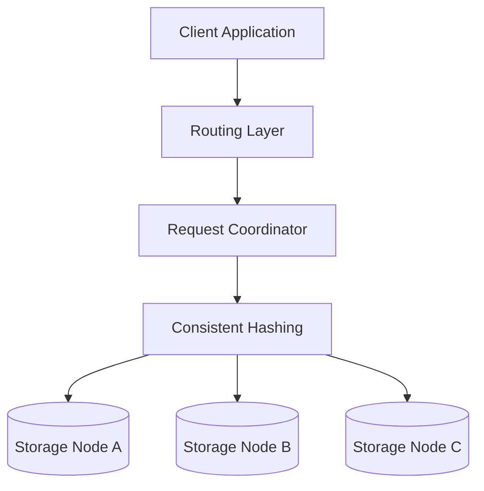

## Responsibilities

### Routing Layer

Receives client requests and forwards them to an appropriate coordinator.

### Coordinator

Responsible for:

1. Finding the correct replicas.
2. Sending read/write requests.
3. Waiting for required acknowledgments.
4. Handling version conflicts.
5. Returning responses.

### Storage Nodes

Responsible for:

- Persisting data.
- Serving reads.
- Replicating data.
- Recovering after crashes.

---

# 4. Data Storage: LSM Tree

A common durable key-value storage engine uses an LSM Tree.

LSM stands for:

**Log-Structured Merge Tree**

Main components:

1. Write-Ahead Log
2. Memtable
3. SSTable
4. Compaction
5. Bloom Filter

## 4.1 Complete Write Flow

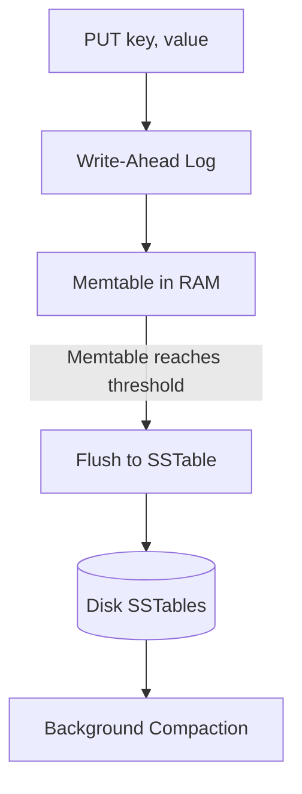

## 4.2 Write-Ahead Log (WAL)

### What is it?

A log that records changes sequentially on disk.

Example:

```text
PUT user101 Alice
PUT user102 Bob
DELETE user101
```

### Why do we need it?

Imagine data is only stored in RAM.

```text
PUT user101 = Alice

Memtable contains:
user101 = Alice
```

Suddenly, the server crashes.

RAM contents disappear.

Without WAL, the recent update may be lost.

With WAL:

```text
1. Append update to WAL
2. Update Memtable
3. Acknowledge according to durability policy
```

When the server restarts:

```text
Read WAL
   |
   v
Replay writes
   |
   v
Reconstruct Memtable
```

### Why sequential writes?

Sequential disk writes are generally more efficient than many small random writes.

### Important

Appending to a log does not automatically guarantee durability.

The system's disk synchronization policy, such as fsync or group commit, matters.

---

# 5. Memtable

## What is it?

An in-memory sorted structure storing recent key-value updates.

Possible implementations:

- Red-black tree
- Skip list
- Other ordered structures

Example:

```text
Memtable:

user101 -> Alice
user102 -> Bob
user103 -> Charlie
```

## Why use it?

Memory access is fast.

A balanced tree provides approximately:

```text
Lookup: O(log N)
Insert: O(log N)
```

Actual complexity depends on the implementation.

## Important Correction

Memtable does NOT guarantee crash durability.

The properly persisted WAL handles crash recovery.

Memtable primarily improves performance.

---

# 6. SSTable

SSTable means:

**Sorted String Table**

It is an immutable, sorted file containing key-value entries.

Example:

```text
SSTable 1:

user101 -> Alice
user102 -> Bob
user103 -> Charlie
```

Because keys are sorted, the system can use indexes to locate relevant disk blocks efficiently.

Typical components:

```text
SSTable
   |
   +-- Data Blocks
   |
   +-- Index Blocks
   |
   +-- Metadata
```

## Why immutable?

Instead of constantly modifying existing disk files, new sorted files are written.

Benefits include:

- Sequential disk writes
- Easier batching
- Efficient compression
- Simpler concurrent reads

But this creates another problem.

We accumulate multiple SSTables.

---

# 7. Compaction

Imagine:

```text
SSTable 1:
user101 = Alice

SSTable 2:
user101 = Alicia

SSTable 3:
user101 = Alice Tan
```

Three versions of the same key exist.

Compaction merges and reorganizes SSTables.

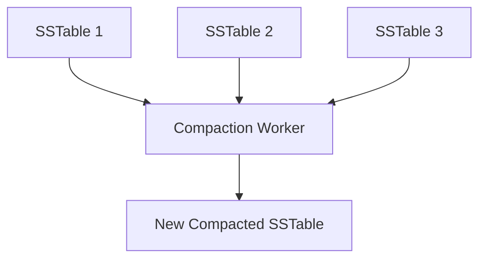

After eligible old versions are discarded:

```text
user101 = Alice Tan
```

## Why is Compaction important?

Without compaction:

- Too many SSTables accumulate.
- Reads become more expensive.
- Old versions occupy unnecessary space.

## Trade-off

Compaction consumes:

- CPU
- Disk I/O
- Temporary disk space

### What about DELETE?

Distributed databases commonly write a tombstone.

Example:

```text
user101 -> TOMBSTONE
```

Why?

Because an offline replica might still contain an older value.

Deleting the tombstone too early could cause deleted data to reappear.

---

# 8. Bloom Filter

## Problem

Suppose the key is not in the Memtable.

The system might have hundreds of SSTables.

Should we search every file?

That would be expensive.

## Solution: Bloom Filter

A Bloom Filter helps determine whether a key MIGHT exist in a particular SSTable.

It uses:

1. A bit array.
2. Multiple hash functions.

Example:

```text
Key: "abd"

Hash1("abd") = 2
Hash2("abd") = 5
Hash3("abd") = 7
```

Bit array:

```text
Index: 0 1 2 3 4 5 6 7 8
Bits:  0 1 0 0 1 1 0 1 0
```

Check positions:

```text
Position 2 = 0
Position 5 = 1
Position 7 = 1
```

Since position 2 is zero:

**The key is definitely absent from that SSTable.**

We can skip the disk lookup.

## Bloom Filter Rules

| Result | Meaning |
|---|---|
| At least one required bit is 0 | Definitely absent |
| All required bits are 1 | Possibly present |

Bloom Filters can produce false positives.

But properly maintained Bloom Filters do not produce false negatives.

## Time Complexity

Checking K hash positions:

```text
O(K)
```

For a fixed small K, the operation is effectively constant-time.

## Practical Read Flow

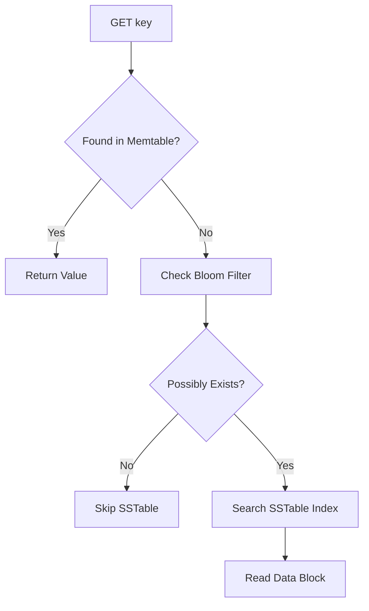

---

# 9. API Design

We can expose APIs using RPC.

Example:

```go
Get(key string)
Put(key string, value []byte)
Delete(key string)
```

For version-aware operations:

```go
Get(key string) (value, version, error)

Put(key string, value, versionContext)

Delete(key string, versionContext)
```

## Why RPC?

RPC stands for:

**Remote Procedure Call**

It allows an application to invoke functionality on a remote server through a function-like interface.

Example:

```go
client.Get("user101")
```

The RPC framework helps handle:

- Serialization
- Network transport
- Request/response communication

But remote calls are still different from local calls.

They can:

- Time out
- Fail
- Experience network latency
- Execute even if the caller never receives the response

Therefore, retries and idempotency require careful design.

---

# 10. Partitioning with Consistent Hashing

## Problem with Modulo Hashing

Traditional approach:

```go
serverID := hash(key) % 3
```

Now add another server:

```go
serverID := hash(key) % 4
```

Many keys are assigned to different servers.

But the actual records still exist on their previous servers.

This creates an expensive migration problem.

## Solution: Consistent Hashing

Instead of using the server count in the modulo operation, place nodes in a fixed hash space.

Example:

```text
Server A -> Position 10
Server B -> Position 40
Server C -> Position 75
```

The key:

```text
hash(user101) = 25
```

Move clockwise to the first server.

Result:

```text
user101 -> Server B
```

## Diagram

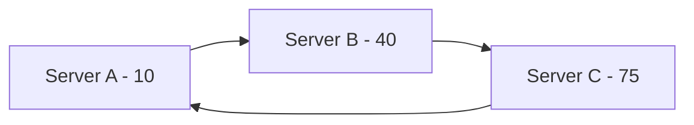

Now add Server D at position 30.

```text
Before:

Keys in (10, 40] -> B

After:

Keys in (10, 30] -> D
Keys in (30, 40] -> B
```

Only the affected range changes ownership.

## Why use Consistent Hashing?

It minimizes key remapping when nodes join or leave.

### Important

Consistent Hashing determines ownership.

It does not automatically transfer the records.

Safe migration is still required.

---

# 11. Virtual Nodes

## Problem

Random placement can produce uneven ranges.

Example:

```text
Server A owns 10%
Server B owns 20%
Server C owns 70%
```

Server C could become overloaded.

## Solution

Give each physical server multiple virtual positions.

```text
Physical A:
A1, A2, A3

Physical B:
B1, B2, B3

Physical C:
C1, C2, C3
```

## Why?

Each physical server owns multiple smaller ranges distributed around the ring.

This generally improves load distribution.

It also makes rebalancing easier.

### Important Correction

Virtual Nodes do not guarantee perfect load balancing.

Hot keys and uneven access patterns can still overload servers.

---

# 12. Replication

## Why do we need replication?

Consistent Hashing alone cannot recover lost data.

Imagine:

```text
user101 -> Server B
```

If B crashes permanently, what happens?

Without another copy, the data may be lost.

## Solution

Store multiple replicas.

Example:

```text
Replication factor N = 3
```

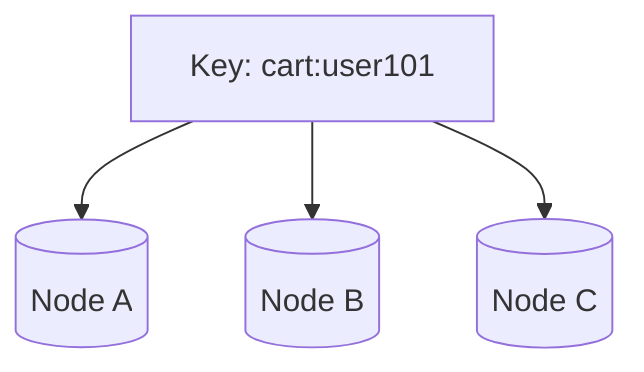

Each node maintains a copy of the data.

## Replica Placement

In a ring-based system, the next distinct physical nodes clockwise may be selected as replicas.

For example:

```text
Primary placement: B
Other replicas: C, A
```

But note:

**Dynamo-style replication does not require Raft roles.**

Raft has:

- Leader
- Candidate
- Follower

A Dynamo-style key-value store may be leaderless, with any suitable node coordinating an operation.

---

# 13. Quorum: N, W and R

Remember our previous discussion about quorum?

We can apply it to a distributed key-value store.

## Definitions

```text
N = Number of designated replicas

W = Required write acknowledgments

R = Required read responses
```

Example:

```text
N = 3
W = 2
R = 2
```

## Write Example

Alice writes:

```text
cart:user101 = v2
```

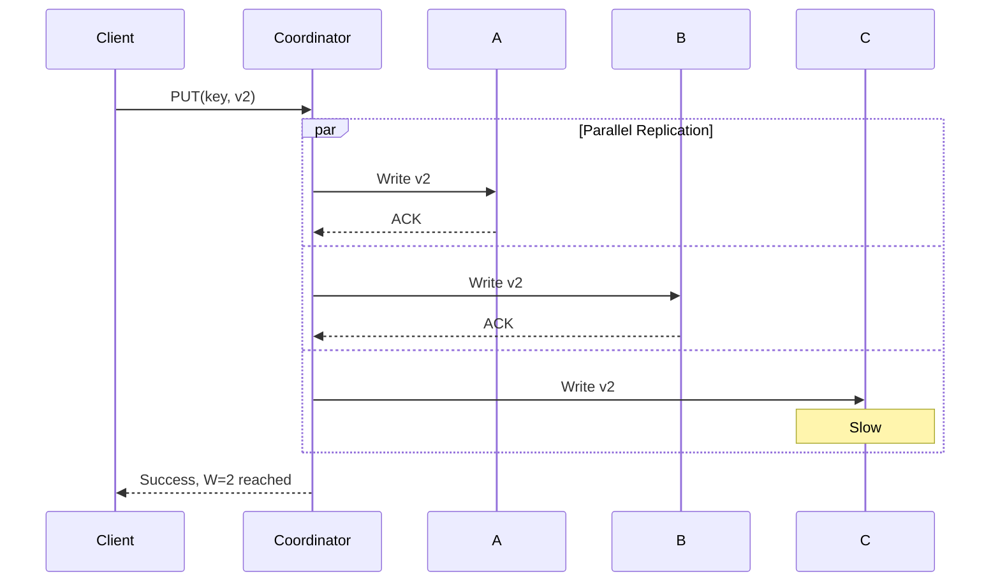

## Why W = 2?

If only one server acknowledges and then crashes, the latest update could be lost.

Waiting for two replicas reduces that risk.

But W=2 is a replication acknowledgment policy, not automatically a consensus protocol.

---

# 14. Eventual Consistency

Configuration:

```text
N = 3
W = 1
R = 1
```

Scenario:

```text
A stores v2
B still has v1
C still has v1
```

The coordinator receives one acknowledgment from A and returns success.

Then the user reads from C.

```text
GET -> C -> v1
```

The user sees stale data.

Later:

```text
B updates to v2
C updates to v2
```

All replicas eventually converge.

## Why choose this?

Potential benefits:

- Lower latency
- Higher write availability
- Less waiting for replicas

## Disadvantage

Users might temporarily read stale data.

---

# 15. Strong Consistency and Quorum Intersection

Consider:

```text
N = 3
W = 2
R = 2
```

The common formula is:

```text
R + W > N
```

Here:

```text
2 + 2 > 3
```

Suppose:

```text
A = v2
B = v2
C = v1
```

Write quorum:

```text
A + B
```

Read quorum:

```text
B + C
```

The read includes B, which knows about v2.

## Why does it work?

With a fixed replica set, the read quorum and write quorum must overlap.

However:

**R + W > N does not automatically guarantee linearizable consistency.**

Additional factors include:

- Concurrent writes
- Version selection
- Sloppy quorum
- Changing replica membership
- Failed or incomplete writes

A stronger protocol is required if the database promises the latest committed value for every linearizable read.

## Difference from Raft

| Dynamo-Style Quorum | Raft |
|---|---|
| Configurable R and W | Majority-based replicated log |
| Can use leaderless writes | Elected leader |
| Can permit conflicting versions | Agrees on committed log ordering |
| May favor availability | Prioritizes committed-log safety |

Do not automatically include Raft in a Dynamo-style design.

They are different architectural choices.

---

# 16. Conflict Resolution

## Problem

Two users or devices update the same data concurrently.

Example:

```text
Original Cart:
[Shoes]
```

Phone:

```text
[Shoes, Shirt]
```

Laptop:

```text
[Shoes, Hat]
```

Which result should win?

## Strategy A: Last Write Wins (LWW)

Assign a timestamp or ordered version to each update.

Example:

```text
Update A: 10:00:01
Update B: 10:00:02
```

Choose B.

### Advantage

Simple.

### Disadvantage

Valid concurrent changes can be lost.

Physical clocks can also differ across nodes.

---

# 17. Vector Clocks

Vector Clocks help track causal relationships between versions.

Initial version:

```text
Cart: [Shoes]

Vector:
[N1:1, N2:0]
```

Node 1 adds a shirt:

```text
Cart: [Shoes, Shirt]

Vector:
[N1:2, N2:0]
```

Node 2 independently adds a hat:

```text
Cart: [Shoes, Hat]

Vector:
[N1:1, N2:1]
```

## How do we detect concurrent writes?

Compare:

```text
A = [2,0]
B = [1,1]
```

A has the larger first component.

B has the larger second component.

Neither vector dominates the other.

Therefore:

**The updates are concurrent.**

## Diagram

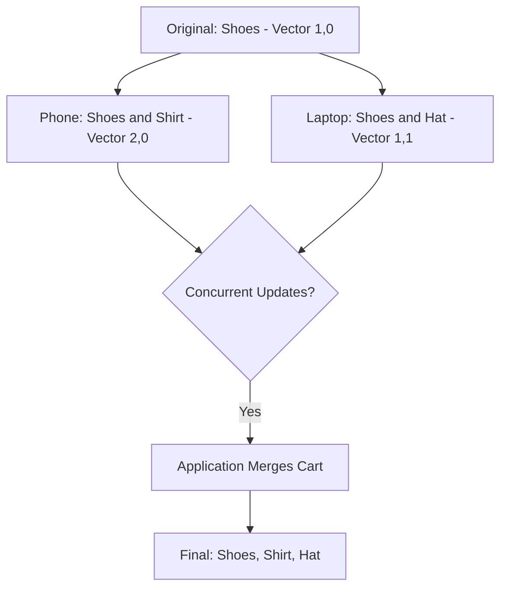

## How do we merge versions?

Component-wise maximum:

```text
max([2,0], [1,1]) = [2,1]
```

This represents the combined causal context.

If Node 1 creates a new merged version:

```text
[3,1]
```

Node 1 increments its own counter.

## Important

Vector Clocks detect conflicts.

They do not automatically resolve conflicts.

For shopping carts, merging item additions may make sense.

For bank balances, simply combining two versions may be incorrect.

---

# 18. Gossip Protocol

## Problem

We have 100 servers.

How does each server know when another server becomes unavailable?

A centralized monitoring system is one possible solution, but it adds dependencies.

## Gossip Protocol

Each server periodically exchanges membership and health information with selected peers.

Like spreading a rumor.

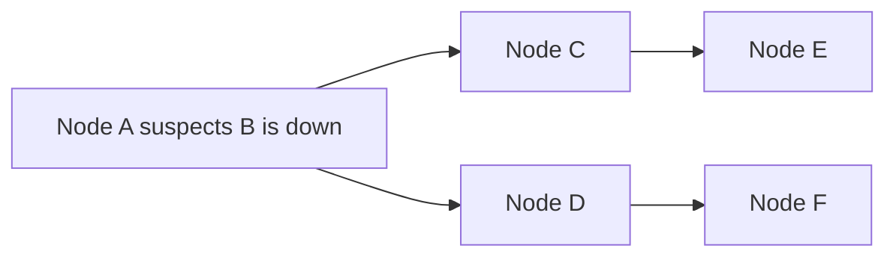

Eventually, membership information spreads throughout the cluster.

## Why Gossip?

Benefits:

- Decentralized membership dissemination
- Scalable across many nodes
- Avoids requiring every node to contact all other nodes directly

## Important

Gossip does not guarantee failure detection in under 100ms.

Actual detection depends on:

- Heartbeat intervals
- Timeouts
- Network conditions
- Cluster size
- Failure suspicion rules

A delayed node might be suspected even when it is still running.

---

# 19. Sloppy Quorum

## Problem

Our normal replicas:

```text
A, B, C
```

Configuration:

```text
N = 3
W = 2
```

Now:

```text
A = Healthy
B = Down
C = Down
```

Only A can acknowledge.

Normal W=2 cannot be satisfied.

## Solution: Sloppy Quorum

Use another healthy node D as a temporary substitute.

```text
A -> Stores update
D -> Stores update temporarily
```

Now:

```text
A + D = 2 acknowledgments
```

The system can accept the write under its sloppy-quorum policy.

## Why?

To improve availability during temporary replica failures.

## Trade-off

D isn't part of the normal home replica set.

Therefore, strict read/write quorum intersection assumptions may no longer hold.

---

# 20. Hinted Handoff

After writing to temporary Node D, we eventually need to restore the normal replica placement.

Suppose B recovers.

D has stored:

```text
Key: cart:user101
Value: v2
Hint: Forward to B
```

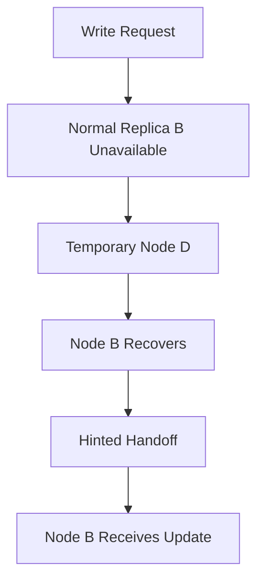

## Why do we need this?

Because D was only temporarily holding data.

Hinted Handoff transfers that data to its intended replica.

### Limitation

Hints may expire or be lost.

For longer-term inconsistencies, anti-entropy repair may still be necessary.

---

# 21. Merkle Trees

## Problem

Node A and Node B store millions of records.

After a failure, their data might not match.

How do we identify differences efficiently?

We could compare every record.

But that may require transferring a large amount of data.

## Solution: Merkle Tree

A Merkle Tree hashes smaller groups of data and combines those hashes into higher-level hashes.

Example:

```text
          Root Hash
          /       \
      Hash A     Hash B
      /   \       /   \
    K1    K2    K3    K4
```

We compare the root hashes of two replicas.

If the roots match, their represented contents match under the hashing scheme.

If not, inspect the child hashes.

## Diagram

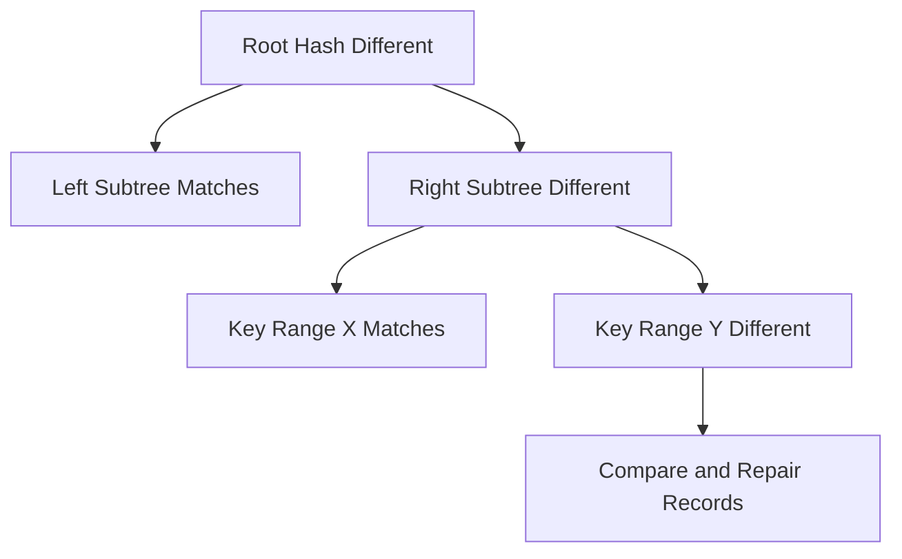

## Why use Merkle Trees?

We can narrow down mismatched ranges without comparing every value across the network.

This process supports anti-entropy repair.

## Important

Merkle Trees identify differences.

They don't decide which conflicting value is correct.

That still requires versioning or conflict-resolution rules.

---

# 22. Complete Write Architecture

Let's connect everything.

The client calls:

```go
Put("cart:user101", newCart)
```

## Step-by-step

1. App sends a request.
2. Routing layer selects a coordinator.
3. Coordinator hashes the key.
4. It identifies the replica nodes.
5. Coordinator sends writes in parallel.
6. Each replica appends the update to WAL.
7. Each replica updates its Memtable.
8. Replicas send acknowledgments.
9. Coordinator waits for W acknowledgments.
10. Coordinator returns success according to policy.

## Diagram

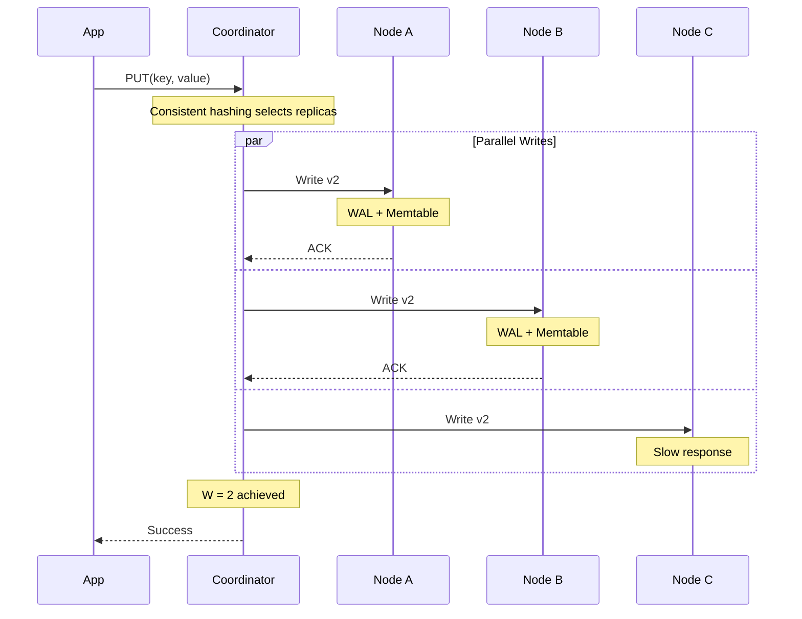

## Important

This is a Dynamo-style quorum write.

It does not automatically require Raft.

A Raft-based database would use a leader and its own replicated-log commit rules.

---

# 23. Complete Read Architecture

The client calls:

```go
Get("cart:user101")
```

## Step-by-step

1. App sends GET request.
2. Routing layer selects coordinator.
3. Coordinator finds the replicas.
4. Coordinator requests data from replicas.
5. Each replica checks its local storage.
6. Coordinator waits for R responses.
7. Coordinator compares versions.
8. If versions differ, it determines the appropriate resolution.
9. It may perform read repair.
10. It returns the value or conflicts according to policy.

## Diagram

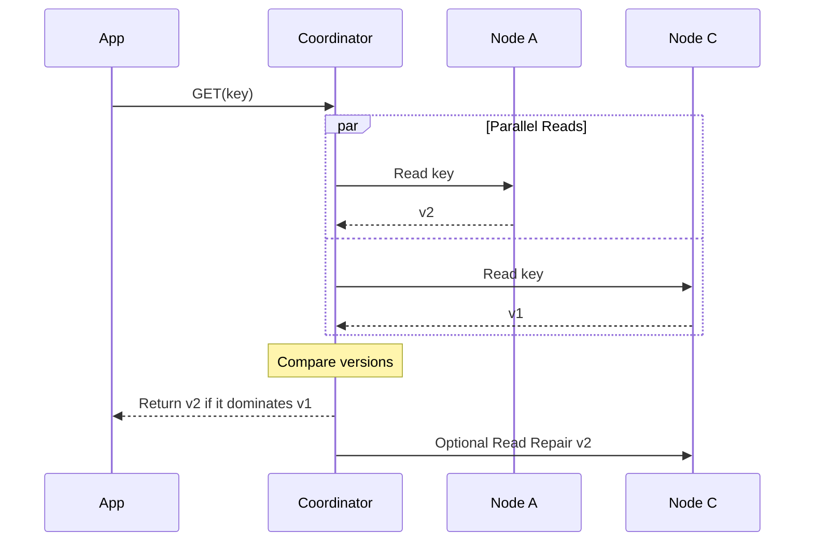

If the versions are concurrent, the database may need to preserve both versions rather than blindly selecting one.

---

# 24. Hot Partitions

## Problem

A celebrity or extremely popular product receives huge traffic.

Example:

```text
product:iphone17
```

Millions of users request the same key.

Even if key distribution is balanced, one server may receive most of the traffic.

This is called a hot key or hot partition.

## Possible Solutions

### 1. Caching

Store frequently requested data closer to clients.

### 2. Read Replicas

Distribute reads across additional replicas.

### 3. Request Coalescing

Combine multiple simultaneous requests for the same value into one backend lookup.

### 4. Dynamic Replication

Replicate selected hot keys to additional servers.

### 5. Split Workloads

When the data model supports it, partition related workloads more finely.

## Important

Consistent Hashing distributes ownership of keys.

It does not guarantee equal request traffic.

---

# 25. Availability Zone Awareness

## Problem

Suppose we store three replicas:

```text
A
B
C
```

But all three are in the same availability zone.

If that zone experiences a major outage, all replicas may become unavailable.

## Solution

Distribute replicas across failure domains.

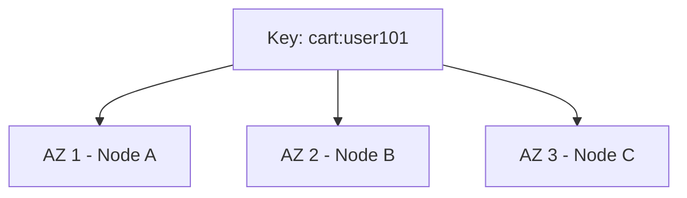

Benefits:

- Better fault isolation
- Better resilience against AZ outages
- Reduced risk of losing all replicas simultaneously

But cross-AZ replication can introduce additional network latency.

---

# 26. Common Interview Mistakes

## Mistake 1

"Modulo hashing causes unequal distribution."

Correction:

Modulo hashing can distribute keys evenly.

The main issue is widespread key remapping when server counts change.

## Mistake 2

"Memtable guarantees durability."

Correction:

A properly persisted WAL provides crash recovery.

Memtable is primarily an in-memory performance structure.

## Mistake 3

"R + W > N guarantees strong consistency."

Correction:

It guarantees quorum intersection only under the appropriate fixed replica-set assumptions.

Strong consistency requires additional protocol guarantees.

## Mistake 4

"All replicated databases use Raft."

Correction:

Dynamo-style systems can use decentralized coordinators and configurable quorums.

Raft is a separate consensus-based architecture.

## Mistake 5

"Vector Clocks resolve conflicts."

Correction:

They identify causal order and concurrency.

The application must still resolve conflicts.

## Mistake 6

"Consistent Hashing prevents data loss."

Correction:

Consistent Hashing assigns ownership.

Replication and durability mechanisms protect data.

## Mistake 7

"Gossip detects failures immediately."

Correction:

Failure detection is based on timeouts and suspicion.

It can make mistakes during network delays.

---

# 27. Interview Answer: Design a Distributed Key-Value Store

You can practise this explanation:

> First, I would clarify whether we need a distributed cache or a durable key-value store.
>
> I would gather functional requirements such as GET, PUT and DELETE, followed by non-functional requirements covering scalability, latency, availability, durability and consistency.
>
> For a Dynamo-style distributed key-value store, I would use Consistent Hashing with virtual nodes to distribute data across multiple storage servers.
>
> Each key would be replicated to N distinct nodes, ideally across different availability zones.
>
> Any suitable coordinator could handle requests and communicate with the appropriate replica set.
>
> For writes, I would configure W required acknowledgments, and for reads, R required responses, according to the application's requirements.
>
> I would use versioning and Vector Clocks to identify concurrent updates, while application-specific logic handles conflict resolution.
>
> Gossip would help distribute node-membership information, Hinted Handoff would support temporary failures, and Merkle Trees would help repair differences between replicas.
>
> For local storage, an LSM-tree-based design could use WAL for crash recovery, Memtable for fast in-memory updates, SSTables for persistent sorted storage, and Bloom Filters to avoid unnecessary disk reads.
>
> Finally, I would discuss hot partitions, monitoring, retries, replica placement, and recovery strategies.

---

# 28. Quick Revision Table

| Problem | Solution | Why |
|---|---|---|
| Single node cannot store all data | Sharding | Distribute storage |
| Adding servers remaps too many keys | Consistent Hashing | Stable key placement |
| Uneven hash ranges | Virtual Nodes | Improve distribution |
| Server crashes | Replication | Keep additional copies |
| Need write acknowledgment threshold | Write Quorum | Define successful write policy |
| Need read response threshold | Read Quorum | Coordinate replica reads |
| Conflicting updates | Vector Clocks | Detect concurrent versions |
| Need to detect unhealthy nodes | Gossip | Spread membership information |
| Temporary replica unavailable | Sloppy Quorum | Use substitute holders |
| Restore data to recovered replica | Hinted Handoff | Deliver temporary writes |
| Replica data differs | Merkle Tree | Efficiently locate mismatches |
| Server crashes before disk flush | WAL | Recover recorded updates |
| Need fast memory operations | Memtable | Efficient recent writes and lookups |
| Need sorted disk storage | SSTable | Efficient persistent storage |
| Too many old versions | Compaction | Reorganize and clean SSTables |
| Avoid unnecessary disk lookups | Bloom Filter | Rule out absent keys |
| Popular key overloads node | Caching / Read Replicas | Distribute traffic |
| Entire AZ fails | AZ-aware replication | Improve fault tolerance |

---

# 29. Practice Interview Questions

## Question 1

Your database has:

```text
N = 3
W = 1
R = 1
```

Can a client receive stale data immediately after a successful write?

**Answer:**

Yes. The read might reach a replica that has not received the latest update.

## Question 2

Why do we use Virtual Nodes?

**Answer:**

To distribute each physical server across multiple hash ranges, improving expected balance and reducing rebalancing concentration.

## Question 3

What happens if a Bloom Filter returns "possibly present"?

**Answer:**

We must check the SSTable because Bloom Filters can produce false positives.

## Question 4

How does Vector Clock comparison detect concurrent versions?

**Answer:**

If neither vector dominates the other component-wise, the versions are concurrent.

## Question 5

Can Consistent Hashing recover permanently lost data without replication or backups?

**Answer:**

No. It only determines data placement.

---

# 30. Final Mental Model

Remember these connections:

```text
SCALABILITY
    |
    +-- Sharding
    |
    +-- Consistent Hashing
    |
    +-- Virtual Nodes


AVAILABILITY
    |
    +-- Replication
    |
    +-- Gossip
    |
    +-- Sloppy Quorum
    |
    +-- Hinted Handoff


CONSISTENCY
    |
    +-- Read / Write Quorum
    |
    +-- Versioning
    |
    +-- Vector Clocks
    |
    +-- Conflict Resolution