# Design a Distributed Key-Value Store
> **Goal:** Design a database that stores billions of key-value pairs, provides low latency, and remains available when servers fail.

**Practical Example:** Shopee Shopping Cart
```json
{
  "key": "cart:user101",
  "value": {"shoes": 1, "shirt": 2}
}
```
A single database works initially, but as traffic grows, we face problems with storage capacity, request overload, server failures, data consistency, and scaling. Let's design a distributed key-value store to solve these problems.

---
# 1. Requirement Gathering

## 1.1 Functional Requirements
Our database should support three basic operations:
- **GET(key):** Retrieve a value.
- **PUT(key, value):** Insert or update a value.
- **DELETE(key):** Remove a key-value pair.

```go
Put("cart:user101", cart)
Get("cart:user101")
Delete("cart:user101")
```
Additional questions: Do we need TTL, data versioning, batch operations, or conditional updates?

## 1.2 Non-Functional Requirements
| Requirement | Explanation |
|---|---|
| Scalability | Horizontally scale to thousands of nodes |
| Low Latency | Target p99 < 10ms |
| Availability | Continue serving requests despite node failures |
| Durability | Protect acknowledged writes against specified failures |
| Consistency | Define whether stale reads are acceptable |
| Symmetry | Allow different nodes to coordinate requests |

### CAP Theorem
During a network partition, distributed systems face a trade-off between consistency and availability.
- **CP:** Prioritize consistency. Reject or delay requests when safe coordination is impossible.
- **AP:** Prioritize availability. Continue accepting requests but potentially return stale or conflicting data.

**Example:** A shopping cart can often tolerate eventual consistency, while a banking ledger generally requires stronger consistency.

**Key Point:** CAP's consistency-versus-availability trade-off applies during network partitions, not simply during normal operation.

---
# 2. Data Storage — LSM Tree
A distributed database first needs an efficient local storage engine. A common approach is an **LSM Tree (Log-Structured Merge Tree)**, which combines WAL, Memtable, SSTables, Compaction, and Bloom Filters.

## 2.1 Write-Ahead Log (WAL)
**Problem:** If recent writes exist only in RAM and the server crashes, the data may disappear.
**Solution:** Append each write to a log on disk before acknowledging it according to the durability policy.
```text
PUT user101 Alice
PUT user102 Bob
DELETE user101
```
When the server restarts, it replays the WAL to recover recent changes.
**Why WAL?**
- Supports crash recovery.
- Sequential writes are generally faster than many random disk writes.
- Protects writes that haven't been flushed to SSTables.

**Important:** WAL durability depends on disk synchronization (such as fsync or group commit), not merely appending data to an OS buffer.

## 2.2 Memtable
A Memtable is an in-memory structure holding recent writes. It can be implemented using a Red-Black Tree or Skip List.
```text
Memtable:
user101 → Alice
user102 → Bob
user103 → Charlie
```
For a balanced tree, insertion and lookup are approximately **O(log N)**.
**Why Memtable?** RAM provides fast access, and sorted data can be flushed efficiently into SSTables.
**Remember:** WAL provides crash recovery; Memtable improves performance.

## 2.3 SSTable (Sorted String Table)
A Memtable cannot grow forever. When it reaches a threshold, its contents are flushed into an immutable SSTable on disk.
```text
SSTable:
user101 → Alice
user102 → Bob
user103 → Charlie
```
SSTables commonly contain:
- Data blocks storing sorted key-value records.
- Index blocks helping locate data blocks.
- Metadata describing the file.

**Why SSTables?** Immutable sorted files support efficient sequential writing, indexed lookups, and background compaction.

### Complete Local Write Flow
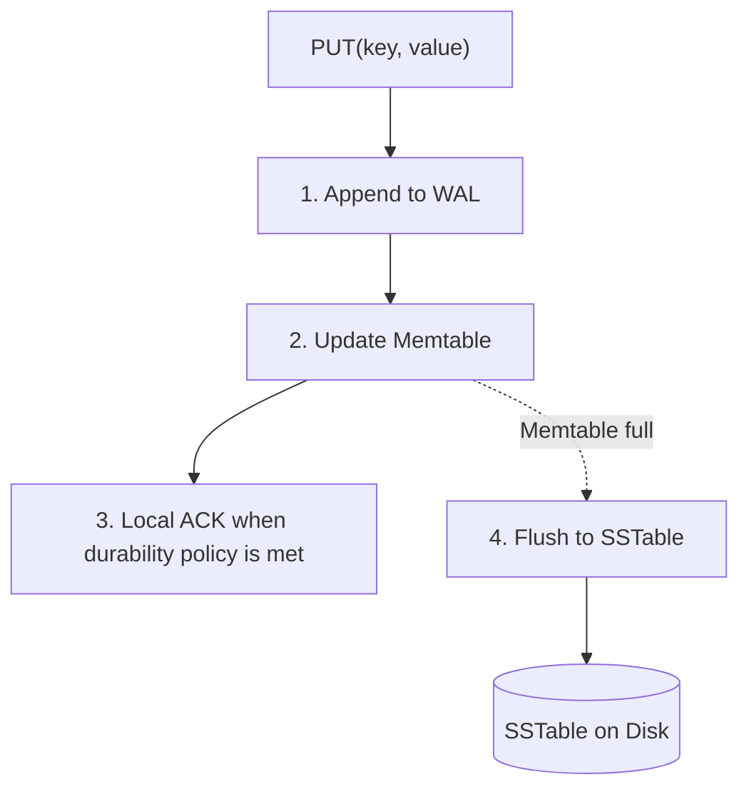

## 2.4 Compaction
**Problem:** Multiple SSTables may contain different versions of the same key.
```text
SSTable 1: user101 = Alice
SSTable 2: user101 = Alicia
SSTable 3: user101 = Alice Tan
```
**Solution:** A background compaction worker merges and reorganizes SSTables, discarding obsolete versions when safe.
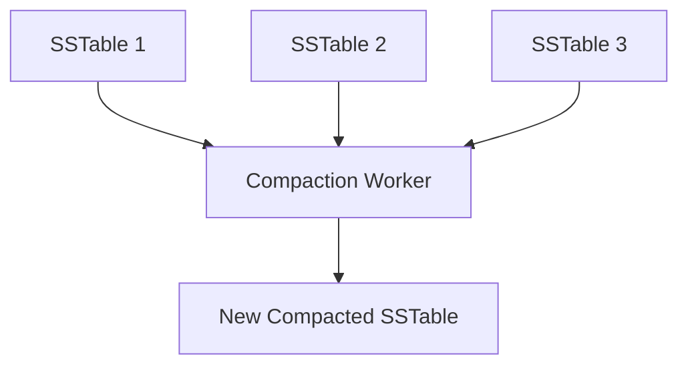
**Benefits:** Fewer files, improved reads, and reclaimed disk space.
**Trade-off:** Compaction consumes CPU, disk I/O, and temporary disk space.

### What About DELETE?
A delete is commonly recorded as a **tombstone**:
```text
user101 → TOMBSTONE
```
Tombstones prevent deleted data from reappearing through old SSTables or replicas. They should only be removed when safe.

## 2.5 Bloom Filter
**Problem:** If a key isn't in the Memtable, checking hundreds of SSTables is expensive.
**Solution:** Use a Bloom Filter to determine whether a key might exist in a particular SSTable.

Example:
```text
Hash("abd") → positions 2, 5, 7

Index: 0 1 2 3 4 5 6 7 8
Bits:  0 1 0 0 1 1 0 1 0
```
Position 2 is zero, so `"abd"` is definitely absent from the represented SSTable.

| Bloom Filter Result | Meaning |
|---|---|
| Any required bit = 0 | Definitely absent |
| All required bits = 1 | Possibly present |

**Important:**
- False positives are possible.
- Properly maintained Bloom Filters do not produce false negatives.
- Checking K hash positions costs O(K), effectively O(1) when K is fixed.

### Local Read Flow
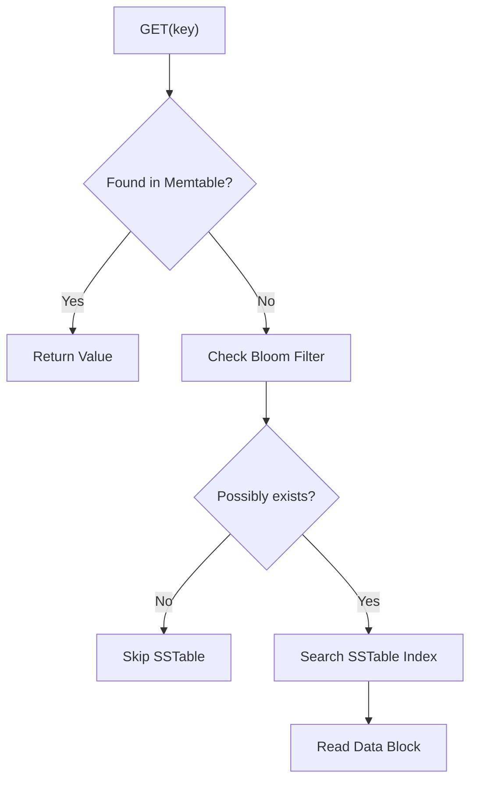

**Storage Summary:**
| Component | Purpose |
|---|---|
| WAL | Crash recovery |
| Memtable | Fast in-memory writes |
| SSTable | Persistent sorted storage |
| Compaction | Merge and clean SSTables |
| Bloom Filter | Avoid unnecessary disk reads |

---
# 3. API Design

We can expose operations using **RPC (Remote Procedure Call)**.
```go
Get(key) -> value, version
Put(key, context, value)
Delete(key)
```
**Why RPC?**
- Provides a function-like interface for remote operations.
- Handles serialization and network communication.
- Makes communication between application and storage nodes easier.

**Important:** Remote calls are not equivalent to local function calls. They can time out, fail, or execute without the caller receiving a response. We still need retries, timeouts, and idempotency where appropriate.

---
# 4. Deep Dive 1 — Partitioning & Replication

## 4.1 Consistent Hashing
**Problem:** With modulo hashing, changing the number of servers remaps many keys.
```go
serverID := hash(key) % 3
// Adding a new server:
serverID := hash(key) % 4
```
The new formula can assign many existing keys to different servers even though their data hasn't moved.

**Solution:** Place servers on a Consistent Hashing Ring.
```text
Server A → Position 10
Server B → Position 40
Server C → Position 75

hash(user101) = 25
```
Move clockwise from position 25. The first server is B at position 40.
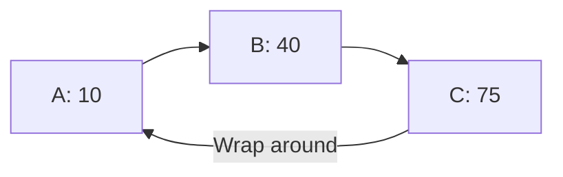
### What If We Add Server D at Position 60?
Before:
```text
(40,75] → Server C
```
After:
```text
(40,60] → Server D
(60,75] → Server C
```
Only the affected keys change ownership.

**Why Consistent Hashing?** It minimizes key remapping when nodes join or leave.
**Important:** It decides ownership but doesn't automatically migrate the actual records.

## 4.2 Virtual Nodes
**Problem:** Random server positions can produce unequal ownership ranges.
```text
A owns 10%
B owns 20%
C owns 70%
```
**Solution:** Assign multiple positions to each physical server.
```text
Server A → A1, A2, A3
Server B → B1, B2, B3
Server C → C1, C2, C3
```
Each physical server owns several smaller ranges across the ring.

**Why Virtual Nodes?**
- Improve expected key distribution.
- Support easier rebalancing.
- Allow capacity-weighted placement.

**Important:** Virtual Nodes don't guarantee perfect distribution or prevent hot keys.

## 4.3 Replication
**Problem:** Consistent Hashing determines the responsible server, but if that server crashes, data may become unavailable.
**Solution:** Maintain multiple copies on different physical nodes.

Example:
```text
Replication Factor N = 3
```
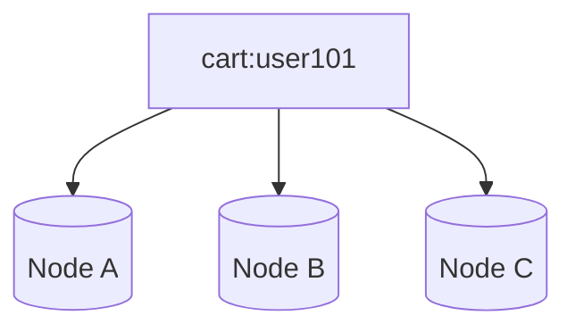
If one replica fails, another may still contain the data.

### Leader-Based vs Leaderless Replication
**Leader-based:** A leader coordinates writes and followers replicate them. Raft uses Leader, Candidate, and Follower roles.
**Leaderless / Dynamo-style:** Different nodes can coordinate requests and communicate with the selected replicas.

**Important:** Not every replicated database uses Raft. Our key-value store follows a Dynamo-style approach.

---
# 5. Deep Dive 2 — Quorum, Consensus & Consistency

## 5.1 Quorum
Quorum defines how many acknowledgments or responses are needed.

| Parameter | Meaning |
|---|---|
| N | Number of designated replicas |
| W | Required write acknowledgments |
| R | Required read responses |

Example:
```text
N = 3
W = 2
R = 2
```
Alice updates her cart to v2. The coordinator sends the write to A, B, and C. Once A and B acknowledge, it can return success according to the configured W=2 policy.

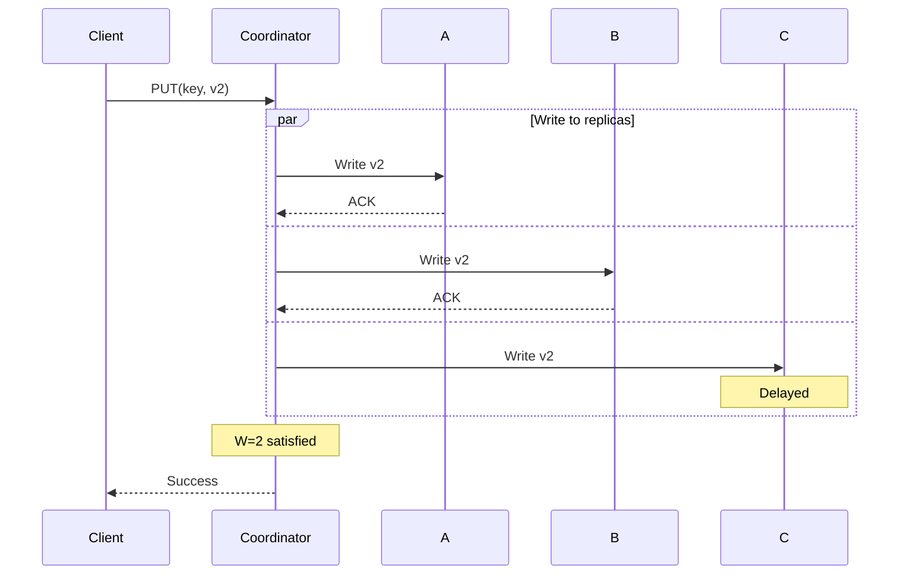
**Why quorum?** Requiring multiple replicas to acknowledge reduces the risk of losing the latest acknowledged write after a node failure.

## 5.2 Eventual Consistency
Configuration:
```text
N = 3, W = 1, R = 1
```
Alice writes v2:
```text
A = v2
B = v1
C = v1
```
A acknowledges the write, so the coordinator returns success. If the next read reaches C, it may return v1.

**Why choose this?**
- Lower latency.
- Greater availability during some failures.
- Less waiting for replicas.

**Trade-off:** Users may temporarily receive stale data. Eventually, replication and repair should bring healthy replicas into agreement.

## 5.3 Read & Write Quorum
A common rule is:
```text
R + W > N
```
Example:
```text
N = 3
W = 2
R = 2
R + W = 4 > 3
```
Suppose:
```text
A = v2
B = v2
C = v1
```
The read quorum contacts B and C:
```text
B returns v2
C returns v1
```
If v2 causally supersedes v1, the coordinator can choose v2 and potentially repair C.

### Why R + W > N?
With the same fixed replica set, every R-sized read group must overlap every W-sized write group.

**Important Correction:** Quorum intersection alone does not guarantee linearizable consistency. Concurrent writes, version ordering, sloppy quorum, and changing membership can affect the guarantees.

## 5.4 Quorum vs Consensus
**Quorum:** Defines how many acknowledgments or votes are sufficient.
**Consensus:** Coordinates agreement on decisions and committed operation ordering.

| Dynamo-Style | Raft-Based |
|---|---|
| Configurable R/W | Majority-based commit protocol |
| Can use decentralized coordinators | Elected leader |
| May retain concurrent versions | Agrees on committed log sequence |
| Can favor availability | Protects committed-log consistency |

**Remember:** Raft uses quorums, but configurable Dynamo-style R/W acknowledgments are not equivalent to Raft consensus.

---
# 6. Deep Dive 3 — Conflict Resolution & Failure Recovery

## 6.1 Why Conflicts Happen
Alice's original cart:
```text
["Shoes"]
```
During a network partition:
```text
Phone → ["Shoes", "Shirt"]
Laptop → ["Shoes", "Hat"]
```
Both updates are valid but neither device knows about the other change.

## 6.2 Last Write Wins (LWW)
Attach a timestamp or other ordered version to each write.
```text
Phone:  10:00:01
Laptop: 10:00:02
```
The system chooses the laptop's version.

**Advantage:** Simple and fast.
**Disadvantage:** The shirt update could be lost. Physical clock differences can also cause problems.

## 6.3 Vector Clocks
Vector Clocks help determine causal ordering between different versions.

### Original Version
```text
Cart: ["Shoes"]
Vector: [N1:1, N2:0]
```
### Node 1 Adds Shirt
```text
Cart: ["Shoes", "Shirt"]
Vector: [N1:2, N2:0]
```
### Node 2 Independently Adds Hat
```text
Cart: ["Shoes", "Hat"]
Vector: [N1:1, N2:1]
```
Compare:
```text
A = [2,0]
B = [1,1]
```
A has a higher first counter, while B has a higher second counter. Neither vector dominates the other, so the updates are concurrent.

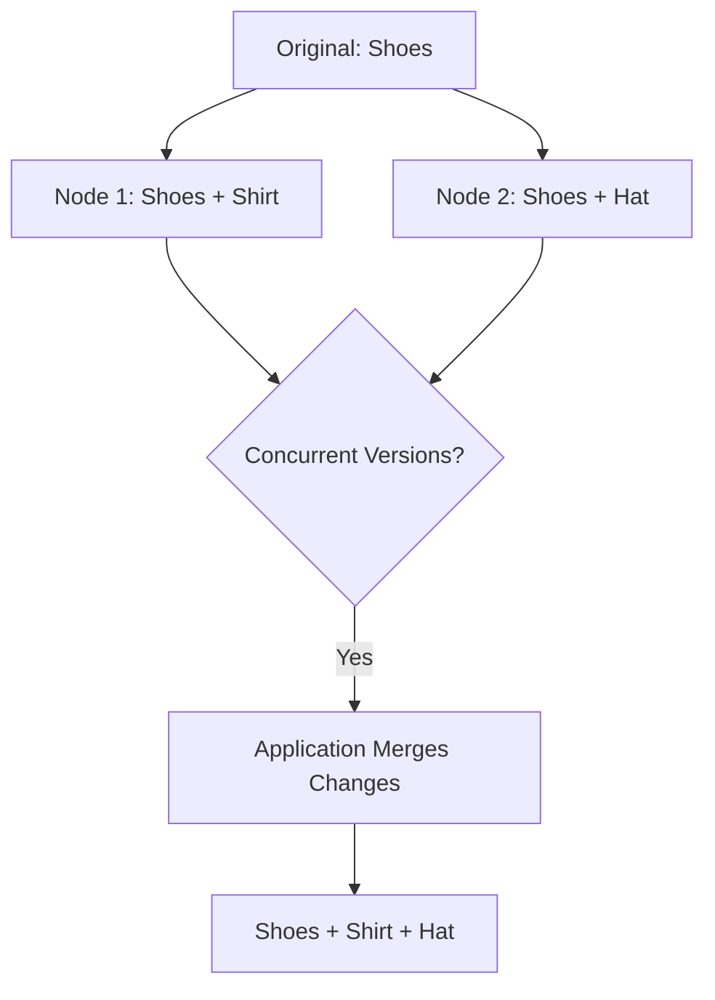
### Resolution
For this cart, the application may merge the changes:
```text
Merged Cart: ["Shoes", "Shirt", "Hat"]
```
Combined causal context:
```text
max([2,0], [1,1]) = [2,1]
```
If Node 1 creates the next version after merging:
```text
[3,1]
```
**Important:** Vector Clocks detect conflicts; they don't automatically resolve them. A delivery address conflict, for example, may require a different business rule.

## 6.4 Failure Detection — Gossip Protocol
**Problem:** We have hundreds or thousands of nodes. How do they discover that another node is unavailable?
**Solution:** Gossip Protocol spreads health and membership information between peers, like spreading a rumor.

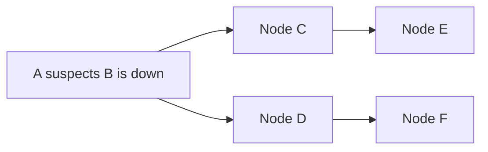
Each node periodically exchanges information with selected peers.

**Why Gossip?**
- Decentralized communication.
- Scales to large clusters.
- Avoids requiring every node to communicate with every other node continuously.

**Important:** Failure detection isn't instantaneous. A slow network may make a healthy server appear unavailable.

## 6.5 Sloppy Quorum — Temporary Failures
Normal replica set:
```text
A, B, C
N = 3
W = 2
```
But:
```text
A = Healthy
B = Down
C = Down
```
Only A can acknowledge, so a strict W=2 write cannot succeed.

**Solution:** Use another healthy node D as a temporary substitute.
```text
A stores update
D stores update temporarily
```
Under a sloppy-quorum policy, A and D can satisfy the configured acknowledgment threshold.

**Why?** Improves write availability during temporary replica failures.
**Trade-off:** A and D are not a strict quorum of the original A, B, C replica set, so normal quorum-intersection assumptions may not hold.

## 6.6 Hinted Handoff
**Problem:** Node D temporarily stored data intended for unavailable Node B.
**Solution:** When B recovers, D transfers the missed update back to B.

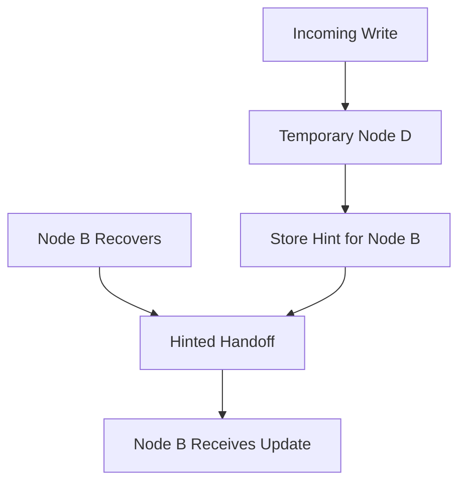
**Why Hinted Handoff?** It helps restore the intended replica placement after a temporary failure.
**Important:** Hints may expire or be insufficient for long outages, so additional repair mechanisms are necessary.

## 6.7 Permanent Failures — Merkle Trees
**Problem:** After a long outage, two nodes might contain millions of records with some differences. Comparing every record across the network is expensive.
**Solution:** Use a Merkle Tree to compare hashes of data ranges.

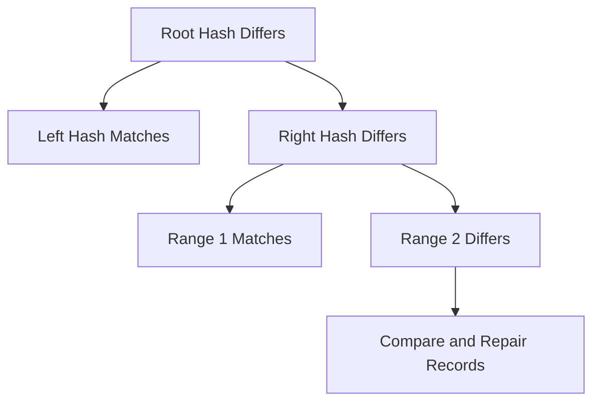
### How It Works
1. Compare root hashes.
2. If the roots match, the represented data matches under the hashing scheme.
3. If they differ, compare child hashes.
4. Narrow down the mismatched ranges.
5. Synchronize the affected records.

**Why Merkle Trees?** They efficiently identify inconsistent data without transferring every record.
**Important:** Merkle Trees detect differences but don't decide which conflicting version is correct.

---
# 7. Complete Architecture

## 7.1 Overall Architecture
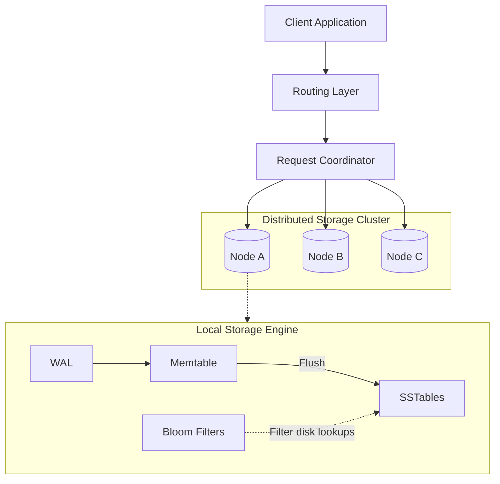
The routing layer selects a coordinator. The coordinator identifies replicas, manages read/write responses, and handles version information. Each storage node has its own local persistence engine.

## 7.2 Complete Write Flow
Client:
```go
Put("cart:user101", newCart)
```
### Steps
1. Client sends PUT request.
2. Routing layer selects a coordinator.
3. Coordinator locates replicas using Consistent Hashing.
4. Coordinator sends writes in parallel.
5. Each replica records the write in its WAL.
6. Each replica updates its Memtable.
7. Replicas acknowledge according to their local durability policy.
8. Coordinator waits for W acknowledgments.
9. Coordinator returns success.

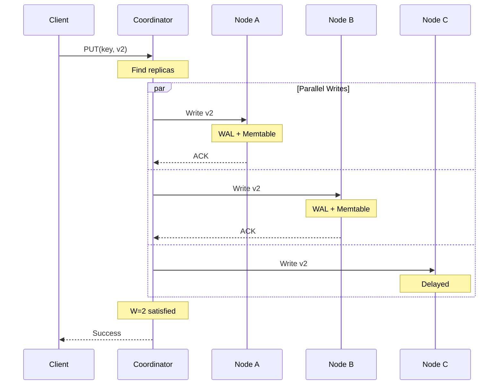
**Why this design?** Parallel writes reduce latency, quorum controls acknowledgment requirements, and the local storage engine handles persistence.

## 7.3 Complete Read Flow
Client:
```go
Get("cart:user101")
```
### Steps
1. Client sends GET request.
2. Coordinator identifies the replicas.
3. Coordinator sends read requests.
4. Replicas perform local lookups.
5. Coordinator waits for R responses.
6. Coordinator compares version information.
7. It returns the appropriate value or unresolved conflicts.
8. It may repair stale replicas.

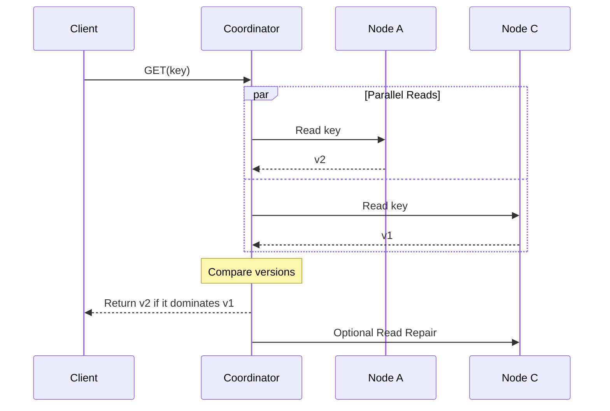
**Why Read Repair?** It helps synchronize stale replicas during normal read traffic.
**Important:** If versions are concurrent, the system must resolve or expose the conflict rather than blindly choosing the highest-looking version.

---
# 8. Additional Discussion Points

## 8.1 Hot Partitions
**Problem:** A popular key receives millions of requests.
```text
product:popular_iphone
```
Even with Consistent Hashing, that key may overload its owner or replica set.

**Solutions:**
- **Caching:** Serve frequently accessed data from fast caches.
- **Read Replicas:** Spread reads across additional copies.
- **Request Coalescing:** Combine simultaneous reads into fewer backend queries.
- **Dynamic Replication:** Create extra copies for hot keys when supported.

**Key Point:** Consistent Hashing distributes key ownership, not necessarily request traffic.

## 8.2 Data Center / Availability Zone Awareness
**Problem:** Three replicas are stored in the same data center. If the data center fails, all replicas may become unavailable.
**Solution:** Distribute replicas across independent failure domains.

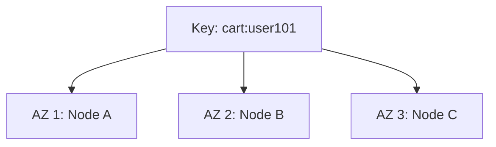
**Benefits:** Better resilience against zone-level failures and reduced correlated-failure risk.
**Trade-off:** Cross-AZ replication can increase network latency and cost.

## 8.3 What If Two of Three Replicas Fail?
Suppose:
```text
N=3, W=2
A=Healthy
B=Down
C=Down
```
**Strict Quorum:** Cannot achieve W=2, so the write must wait or fail.
**Sloppy Quorum:** Another healthy node D may temporarily acknowledge the write if the system supports this policy.
**Raft:** A three-node Raft voting group cannot normally commit new log entries after losing two voting nodes.

These systems make different availability and consistency trade-offs.

## 8.4 Important Interview Trade-offs
| Decision | Advantage | Trade-off |
|---|---|---|
| W=1 | Lower write latency | Weaker replica acknowledgment guarantee |
| W=2 | More replicated acknowledgments | Higher write latency |
| R=1 | Lower read latency | Greater chance of stale reads |
| R=2 | More information about replicas | Higher read latency |
| More replicas | Better potential availability | More storage and network cost |
| Virtual Nodes | Better expected balance | More metadata and rebalancing complexity |
| LWW | Simple conflict handling | Can discard valid concurrent updates |
| Vector Clocks | Detect concurrent versions | Requires conflict resolution |
| Sloppy Quorum | Higher availability | Weaker strict-quorum assumptions |
| Multi-AZ | Better fault tolerance | Cross-AZ latency and cost |

---
# Interview Summary

When asked to **Design a Distributed Key-Value Store**, explain your design in this order:

1. **Requirements:** Clarify GET, PUT, DELETE, scale, latency, availability, durability, and consistency needs.
2. **Local Storage:** Use WAL for recovery, Memtable for fast writes, SSTables for persistent sorted storage, Compaction for cleanup, and Bloom Filters to reduce disk lookups.
3. **Partitioning:** Use Consistent Hashing with Virtual Nodes to distribute keys while minimizing remapping.
4. **Replication:** Maintain multiple replicas across distinct physical nodes and availability zones.
5. **Consistency:** Choose N, W, and R according to application requirements. Use versioning to detect concurrent updates.
6. **Failure Recovery:** Use Gossip for membership information, Sloppy Quorum and Hinted Handoff for temporary failures, and Merkle Trees for anti-entropy repair.
7. **Trade-offs:** Discuss hot keys, network latency, data consistency, recovery, durability, and scalability.

## Quick Revision Table
| Problem                     | Solution             | Reason                              |
| --------------------------- | -------------------- | ----------------------------------- |
| Database too large          | Sharding             | Split data across nodes             |
| Adding servers remaps keys  | Consistent Hashing   | Minimize ownership changes          |
| Uneven data distribution    | Virtual Nodes        | Improve load distribution           |
| Server crashes              | Replication          | Maintain additional copies          |
| Write acknowledgment policy | Write Quorum         | Define sufficient acknowledgments   |
| Read response policy        | Read Quorum          | Gather sufficient replica responses |
| Need agreed committed order | Consensus / Raft     | Coordinate a consistent log         |
| Concurrent updates          | Vector Clocks        | Detect causal conflicts             |
| Node failure detection      | Gossip               | Spread membership information       |
| Temporary replica failures  | Sloppy Quorum        | Allow substitute write holders      |
| Restore missed writes       | Hinted Handoff       | Forward temporary writes            |
| Inconsistent replicas       | Merkle Trees         | Locate differing data ranges        |
| Crash recovery              | WAL                  | Recover recent recorded changes     |
| Fast recent writes          | Memtable             | Use memory                          |
| Persistent sorted data      | SSTable              | Efficient disk storage              |
| Too many old SSTables       | Compaction           | Merge and clean files               |
| Too many disk lookups       | Bloom Filter         | Skip absent keys                    |
| Popular key overload        | Caching / Replicas   | Spread read traffic                 |
| Availability zone failure   | Multi-AZ Replication | Reduce correlated failure risk      |

## Final Mental Model
```text
SCALABILITY
├── Sharding
├── Consistent Hashing
└── Virtual Nodes

AVAILABILITY
├── Replication
├── Gossip
├── Sloppy Quorum
└── Hinted Handoff

CONSISTENCY
├── Read / Write Quorum
├── Versioning
├── Vector Clocks
└── Conflict Resolution

STORAGE & DURABILITY
├── Write-Ahead Log
├── Memtable
├── SSTables
├── Compaction
└── Bloom Filters

FAILURE RECOVERY
├── Replication
├── Hinted Handoff
├── Merkle Trees
└── Anti-Entropy Repair
```

**Remember:**
- **Consistent Hashing:** Where should data live?
- **Replication:** How many copies should exist?
- **Quorum:** How many responses are sufficient?
- **Consensus:** How do nodes agree on committed decisions?
- **Vector Clocks:** Are two updates causally ordered or concurrent?
- **Gossip:** Which nodes appear healthy?
- **Hinted Handoff:** How do we deliver missed writes after temporary failures?
- **Merkle Trees:** Which data ranges disagree?
- **WAL + SSTables:** How do we persist data efficiently?
- **Bloom Filters:** How do we avoid unnecessary disk reads?

> **Interview Tip:** Start with the problem, explain why it matters, and introduce the technology that solves it. Understanding the trade-offs is more important than memorizing the components.