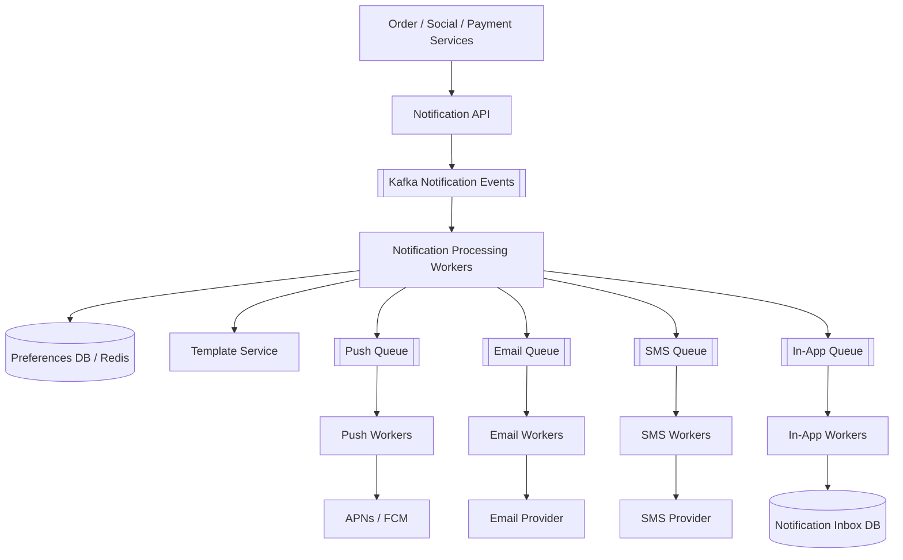
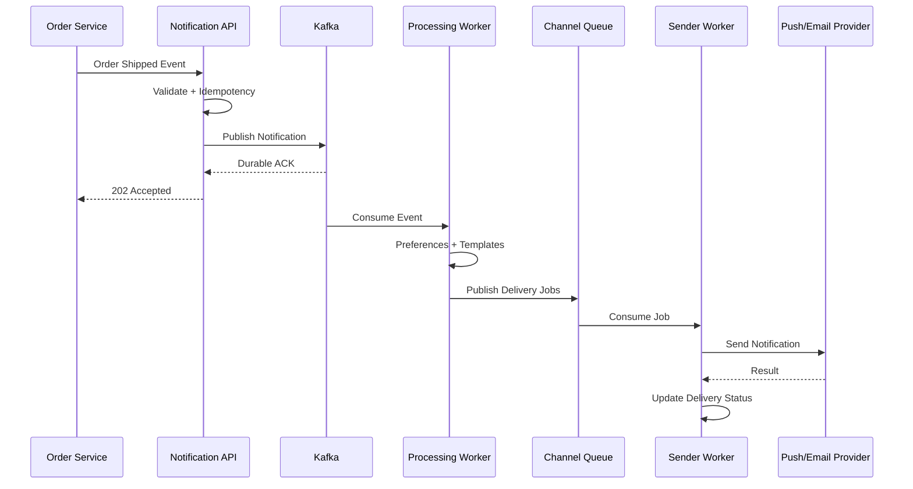
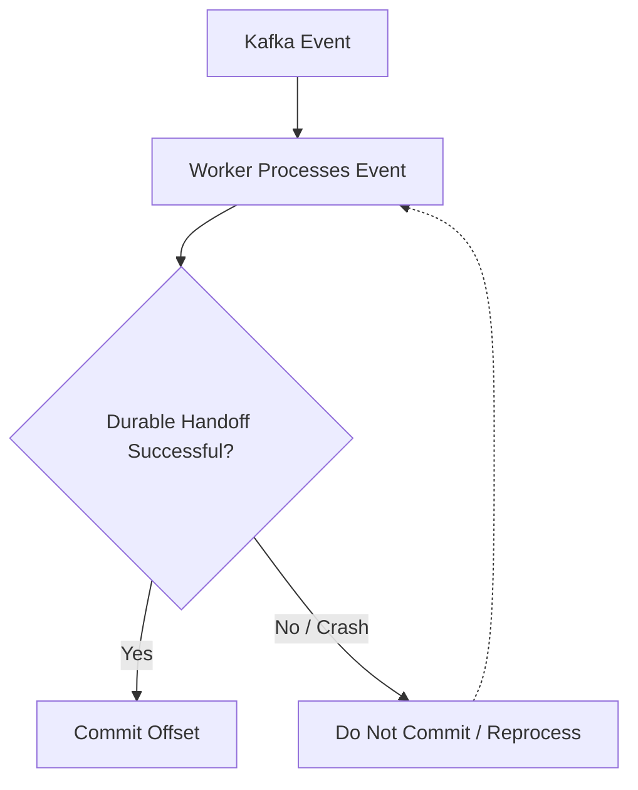
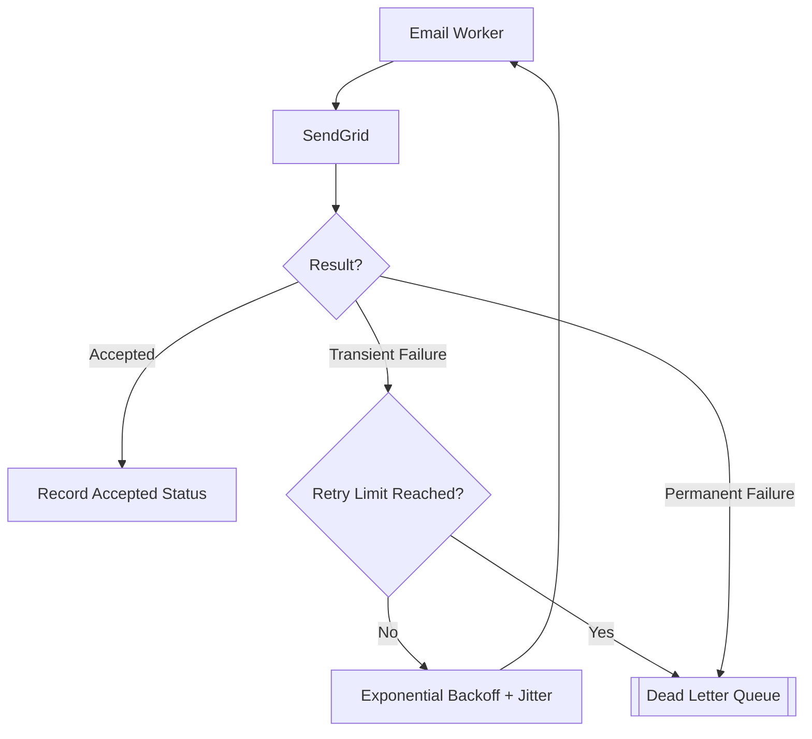
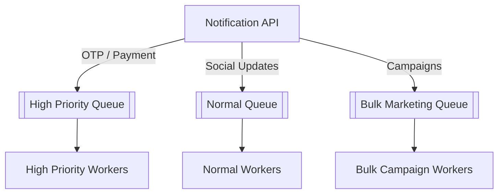
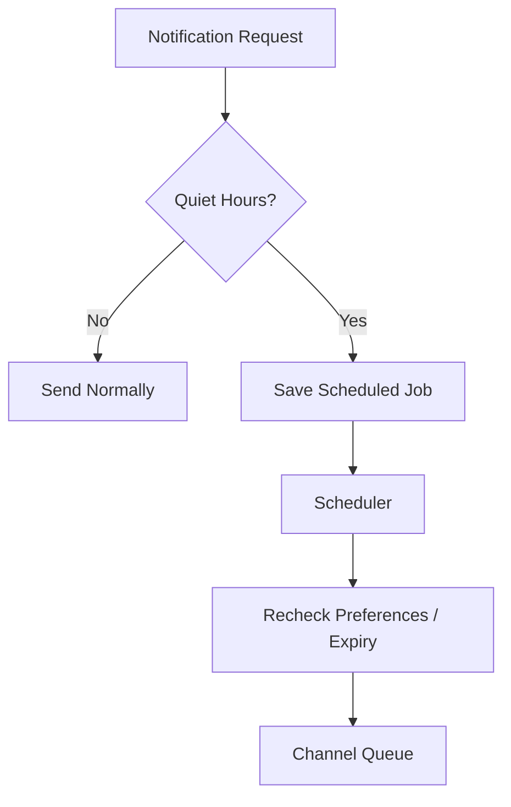

# Design a Notification System
> **Goal:** Design a scalable, reliable notification service that delivers Push, Email, SMS, and In-App notifications asynchronously.

**Practical Example:** Shopee / Instagram / Grab

When an order ships, a user might receive:
- Push notification on their phone.
- Email confirming shipment.
- SMS with delivery information.
- In-app notification.

**Core Idea:** Receive events from different services, determine who should be notified, select delivery channels, and send notifications reliably without blocking the original service.

---
# Step 1 — Clarify Requirements

## 1.1 Functional Requirements
| Requirement | Description |
|---|---|
| Send Notifications | Services can trigger notifications |
| Multiple Channels | Push, Email, SMS, In-App |
| User Preferences | Users can enable or disable channels |
| Scheduled Notifications | Send notifications at a future time |
| Notification Templates | Reusable message formats |
| Notification History | Retrieve and mark in-app notifications as read |
| Delivery Tracking | Track sending status and failures |

Optional:
- Bulk marketing campaigns.
- Quiet hours.
- Notification priority.
- Grouping similar notifications.
- Rate limiting.

## 1.2 Questions to Ask Interviewer
**Q: Do notifications need real-time delivery?**
- High-priority notifications should be dispatched quickly.
- A small delay is acceptable for regular notifications.

**Q: How many notifications per day?**
- Assume 1 billion notification requests/day.

**Q: Should we guarantee exactly-once delivery?**
- Aim for at-least-once processing with deduplication.
- Exactly-once delivery to external devices cannot generally be guaranteed.

**Q: Can users disable notifications?**
- Yes, respect notification preferences and quiet hours.
- Essential transactional and promotional notifications may have different policies.

**Important:** One notification request can produce multiple channel deliveries.

Example:
```text
Order Shipped Event
    |
    +-- Push
    +-- Email
    +-- In-App
```

---
# Step 2 — Non-Functional Requirements

| Requirement | Target |
|---|---|
| Scalability | 1B notification requests/day |
| Latency | High-priority dispatch p95 < 5 seconds |
| Availability | 99.99% target |
| Reliability | At-least-once processing |
| Consistency | Eventual consistency for in-app inbox |
| Durability | Accepted notification requests should not disappear |
| Fault Tolerance | Recover from worker/provider failures |
| Security | Authenticated services and protected user data |

## 2.1 Why Eventual Consistency?
Imagine someone likes your Instagram photo.
```text
T=0s → User likes photo
T=2s → Notification appears
```
The notification doesn't need to appear instantly.

We can accept small delays in exchange for better scalability and availability.

However, security-sensitive preferences and authorization require careful consistency handling.

## 2.2 Why At-Least-Once Processing?
Imagine:
```text
1. Worker sends email to SendGrid.
2. SendGrid accepts the request.
3. Worker crashes before saving success status.
4. Another worker retries the request.
```
The user might receive two emails.

**Problem:** We cannot always tell whether the first request failed or succeeded but lost its response.

**Solution:**
- At-least-once processing.
- Idempotency keys.
- Durable delivery records.
- Deduplication.
- Provider-supported idempotency when available.

**Trade-off:** We prioritize not losing accepted work, but duplicate delivery attempts may occur.

---
# Step 3 — Estimate Scale

## 3.1 Traffic Estimation
Assumptions:
```text
Daily Active Users = 100M
Notification Requests = 1B/day
Peak Multiplier = 5x
Average Channel Deliveries/Request = 1.5
```
### Average Request QPS
```text
1,000,000,000 / 86,400
≈ 11,574 requests/sec
```
### Peak Request QPS
```text
11,574 × 5
≈ 58,000 requests/sec
```
### Average Delivery QPS
```text
11,574 × 1.5
≈ 17,361 deliveries/sec
```
### Peak Delivery QPS
```text
58,000 × 1.5
≈ 87,000 deliveries/sec
```
**Why separate requests and deliveries?**

Because one notification can trigger multiple delivery channels.

Example:
```text
One notification request
    |
    +-- Push delivery
    +-- Email delivery
    +-- In-App delivery
```

## 3.2 Storage Estimation
Assume:
```text
1B notification requests/day
50% generate an in-app notification
500 bytes per notification
```
Daily storage:
```text
1B × 50% × 500 bytes
= 250GB/day
```
For 90-day retention:
```text
250GB × 90
= 22.5TB
```
This excludes replication, indexes, and metadata overhead.

## 3.3 What Do These Numbers Tell Us?
We need:
1. Horizontal scaling for API servers.
2. Message queues to absorb traffic spikes.
3. Multiple workers processing notifications concurrently.
4. Scalable notification storage.
5. Rate limiting for third-party providers.

**Design Decision:** Use asynchronous, event-driven architecture.

---
# Step 4 — High-Level Architecture

## 4.1 Overall Architecture


We divide the system into five layers:
1. Event Producers.
2. Notification API.
3. Kafka + Processing Workers.
4. Channel-Specific Queues and Workers.
5. Storage + Third-Party Providers.

## 4.2 Layer 1 — Event Producers
These are services that trigger notifications.

Examples:
```text
Order Service → Order Shipped
Social Service → New Follower
Payment Service → Payment Received
Marketing Service → Promotion
```
Instead of each service implementing email, SMS, and push logic, all services send requests to the Notification Service.

**Why?**
- Centralized notification management.
- Reusable templates.
- Consistent user preferences.
- Easier monitoring and rate limiting.

## 4.3 Layer 2 — Notification API
Responsibilities:
1. Authenticate the calling service.
2. Validate request data.
3. Check idempotency key.
4. Durably persist or enqueue the notification request.
5. Return `202 Accepted`.

### Why Return 202?
`202 Accepted` means the request has been accepted for processing, not that the notification has already been delivered.

Example:
```text
Order Service
    |
    v
Notification API
    |
    v
Kafka
    |
    v
202 Accepted
```
The Order Service doesn't need to wait for SendGrid, FCM, or Twilio.

**Important:** Return 202 only after the request is durably accepted. Otherwise, a crash could silently lose an acknowledged notification.

## 4.4 Layer 3 — Kafka
### Why Do We Need Kafka?
Imagine a marketing campaign suddenly produces 100,000 notifications.

Without a queue:
```text
100K requests
    |
    v
Notification Workers
    |
    v
Workers / Providers Overloaded
```
With Kafka:
```text
100K requests
    |
    v
Kafka Buffers Events
    |
    v
Workers Process at Available Capacity
```
### Kafka Responsibilities
- Buffer notification events.
- Decouple producers and consumers.
- Absorb traffic spikes.
- Support asynchronous processing.
- Retain events for retry/recovery.
- Scale processing using partitions and consumers.

### What Do Processing Workers Do?
Example event:
```json
{
  "notification_id": "n123",
  "user_id": "u101",
  "type": "order_shipped",
  "data": {
    "order_id": "789"
  }
}
```
Worker flow:
1. Retrieve user preferences.
2. Get email, phone number, and device tokens.
3. Check quiet hours and notification priority.
4. Render templates.
5. Route eligible deliveries into channel-specific queues.

Example:
```text
Order Shipped
    |
    v
Processing Worker
    |
    +-- Push Enabled → Push Queue
    +-- Email Enabled → Email Queue
    +-- SMS Disabled → Skip
    +-- In-App Enabled → Inbox Queue
```

## 4.5 Layer 4 — Channel-Specific Queues
### Why Separate Queues?
Each delivery channel has different providers, performance, rate limits, and failure behavior.

| Channel | Provider | Characteristics |
|---|---|---|
| iOS Push | APNs | Apple device token |
| Android Push | FCM | Android registration token |
| Email | SendGrid / SES | Bounces and throttling |
| SMS | Twilio | Cost and carrier delivery |
| In-App | Own Database | Stored and retrieved by application |

### Practical Failure Example
Suppose SendGrid goes down.

With separate queues:
```text
Email Queue → Retry / Pause
Push Queue → Continue
SMS Queue → Continue
In-App Queue → Continue
```
**Why?** Failure isolation prevents one provider outage from blocking unrelated notification channels.

## 4.6 Layer 5 — Delivery Providers
```text
Push Worker → APNs / FCM → Device
Email Worker → SendGrid → Email
SMS Worker → Twilio → Phone
In-App Worker → Inbox Database
```
**Important:** A provider accepting a message doesn't necessarily mean the recipient has received or read it.

For example:
```text
Sent → Provider accepted
Delivered → Provider/device confirms delivery, if supported
Read → User opened/read notification, if tracked
```

---
# Step 5 — API + Database Design

## 5.1 API Design
| API | Purpose |
|---|---|
| POST /v1/notifications | Create notification |
| POST /v1/notifications/bulk | Start bulk campaign |
| GET /v1/notifications | Get in-app inbox |
| PATCH /v1/notifications/{id}/read | Mark as read |
| PUT /v1/notification-preferences | Update preferences |
| POST /v1/devices | Register device token |

### Create Notification
```http
POST /v1/notifications
Idempotency-Key: order-789-shipped
Content-Type: application/json
```
Request:
```json
{
  "user_id": "u101",
  "type": "order_shipped",
  "priority": "high",
  "channels": ["push", "email", "in_app"],
  "data": {
    "order_id": "789"
  }
}
```
Response:
```http
HTTP/1.1 202 Accepted
```
```json
{
  "notification_id": "n123",
  "status": "queued"
}
```
**Why Idempotency-Key?** If the producer retries the same logical request after a timeout, we should avoid creating duplicate notification jobs.

## 5.2 Database Selection
| Storage | Data | Why |
|---|---|---|
| PostgreSQL | Preferences, templates, campaigns | Structured transactions |
| Cassandra / DynamoDB | Notification inbox | High write throughput |
| Redis | Cached preferences, rate limits, unread counts | Fast access |
| Kafka | Notification events | Durable asynchronous processing |

**Important:** Redis is a cache for this design, not the sole durable source of notification preferences or history.

## 5.3 Database Schema

### A. User Preferences — PostgreSQL
| Field | Example |
|---|---|
| user_id (PK) | u101 |
| push_enabled | true |
| email_enabled | true |
| sms_enabled | false |
| quiet_hours | 22:00–07:00 |
| timezone | Asia/Kuala_Lumpur |
| type_overrides | JSON |

**Why PostgreSQL?** Preferences require reliable updates and consistent application of user choices.

### B. Devices
| Field | Example |
|---|---|
| device_id | d100 |
| user_id | u101 |
| platform | ios |
| device_token | token_xyz |
| last_seen_at | timestamp |

One user may have multiple devices:
```text
User 101
    |
    +-- iPhone
    +-- Android Tablet
```
Therefore, one push notification may produce multiple delivery jobs.

### C. Notification Inbox — Cassandra
| Field | Example |
|---|---|
| user_id | u101 |
| notification_id | n123 |
| created_at | timestamp |
| title | Order Shipped |
| body | Your order is on the way |
| is_read | false |

Main access pattern:
```text
Get latest 20 notifications for user101
```
Suggested key design:
```text
Partition Key:
(user_id, month_bucket)

Clustering Key:
(created_at DESC, notification_id)
```
**Why partition by user_id?** Most inbox queries are user-specific.

**Why month_bucket?** It prevents a highly active user's partition from growing indefinitely.

### D. Notification Delivery Records
| Field | Example |
|---|---|
| delivery_id | n123:push:d100 |
| notification_id | n123 |
| channel | push |
| target_id | d100 |
| status | sent |
| attempt_count | 1 |
| next_retry_at | null |
| provider_message_id | provider_abc |

Possible statuses:
```text
QUEUED
SENDING
SENT
DELIVERED
FAILED
RETRYING
SKIPPED
EXPIRED
```
A useful uniqueness key:
```text
(notification_id, channel, target_id)
```
This helps prevent duplicate logical delivery jobs.

## 5.4 Complete Notification Flow


---
# Step 6 — Deep Dive + Failure Handling

## 6.1 How Do We Prevent Notification Loss?

### Problem
```text
1. Kafka delivers event to Worker A.
2. Worker A starts processing.
3. Worker A crashes.
4. Event hasn't reached channel queue.
```
If Kafka already considered the event completed, the notification could disappear.

### Solution — At-Least-Once Processing
Kafka tracks consumer progress using offsets.

Commit the offset only after processing and durable handoff succeed.



### Additional Problem — Dual Write
Suppose:
```text
1. Worker saves delivery record in DB.
2. Worker crashes before publishing to Kafka.
```
Now the database says the delivery job exists, but the queue has no event.

### Solution — Transactional Outbox
1. Save delivery record and outbox event in one database transaction.
2. Outbox publisher sends event to Kafka.
3. Mark event as published after Kafka ACK.
4. Consumers use idempotency because publishing may repeat.

**Why?** Ensures the durable state change and intent to publish are recorded together.

The Order Service can use the same pattern when recording an order-status change and its notification event.

---

## 6.2 How Do We Prevent Duplicate Notifications?

### Problem
```text
1. Worker sends email.
2. SendGrid accepts.
3. Worker crashes before recording success.
4. Kafka redelivers event.
5. Another email might be sent.
```
### Solution
Use deterministic delivery IDs:
```text
delivery_id = notification_id + channel + target_id
```
Example:
```text
n123:email:user101
```
When processing:
1. Check the durable delivery record.
2. Atomically claim/lease the job.
3. Skip known completed jobs.
4. Send using provider idempotency if supported.
5. Record the result.

### Important Limitation
A provider may accept the request before the worker records success.

Therefore, application-side deduplication alone cannot guarantee exactly-once delivery to an external provider.

**Trade-off:** At-least-once processing favors reliability but may require reconciliation when outcomes are uncertain.

---

## 6.3 What If a Third-Party Provider Is Down?

### Problem
SendGrid returns:
```http
HTTP/1.1 503 Service Unavailable
```
Repeated immediate retries may overload the provider further.

### Solution
Use:
1. Exponential Backoff.
2. Dead Letter Queue (DLQ).
3. Circuit Breaker.
4. Retry with Jitter.

### Retry Strategy
| Attempt | Delay |
|---|---|
| 1 | Immediately |
| 2 | 5 seconds |
| 3 | 15 seconds |
| 4 | 45 seconds |
| Still failing | Dead Letter Queue |

### Retry Flow

**Retry transient errors:** Timeouts, HTTP 429, HTTP 5xx.

**Don't blindly retry:** Invalid device tokens or permanently invalid destinations.

### Circuit Breaker
If a provider repeatedly fails:
```text
Provider errors increase
    |
    v
Circuit Breaker Opens
    |
    v
Pause Provider Calls
    |
    v
Retain Pending Jobs
    |
    v
Probe Provider Recovery
```
**Why?** Prevents wasting resources on a service that is temporarily unavailable.

**Important:** Expired notifications should not be delivered late. An OTP that has expired should not arrive hours afterward.

---

## 6.4 How Do We Handle Large Notification Spikes?

### Problem
A campaign sends 10 million notifications simultaneously.

If they enter the same queue as OTPs or payment alerts, important notifications may be delayed.

### Solution — Priority-Based Queues

### Why Separate Priority Queues?
- High-priority requests avoid bulk campaign congestion.
- Different workloads can scale independently.
- Bulk traffic can be throttled.
- Failures are easier to isolate.

### Scaling Kafka
Increase:
- Number of Kafka partitions.
- Consumer instances.
- Channel workers.

**Important:** Consumer parallelism is limited by partition count within one consumer group. Scaling workers alone won't help if partitions or downstream providers are the bottleneck.

---

## 6.5 Rate Limiting

### Why Do We Need Rate Limiting?
Third-party providers may impose quotas.

Example:
```text
SendGrid → Limited requests/sec
Twilio → Limited SMS throughput
APNs / FCM → Provider-specific limits
```
Without rate limiting, workers may trigger provider throttling.

### Solution — Token Bucket + Redis
```text
Key:
rate_limit:provider:sendgrid

Value:
tokens = 100
last_refill = timestamp
```
Each send attempt consumes a token.

Redis Lua can atomically:
```text
GET state
REFILL tokens
CHECK capacity
DECREMENT token
RETURN ALLOW / REJECT
```
### Redis Sharding
At large scale, use Redis Cluster to partition rate-limit keys across nodes.

Example:
```text
rate_limit:provider1 → Redis Shard A
rate_limit:provider2 → Redis Shard B
rate_limit:user101   → Redis Shard C
```
For atomic operations across multiple Redis keys, the related keys must live in the same Redis Cluster hash slot.

### Why Token Bucket?
It supports controlled bursts while limiting sustained sending rates.

For a provider that cannot handle bursts, consider smooth queue dispatch or a Leaky Bucket approach.

---

## 6.6 What If Redis Is Down?
Redis may be used for:
- Preferences cache.
- Device token cache.
- Rate limiting.
- Recent inbox cache.
- Unread counters.

But it should not be the only durable source of important records.

| Cached Data | Fallback |
|---|---|
| User Preferences | Read PostgreSQL |
| Device Tokens | Read durable device database |
| Inbox | Query Cassandra |
| Unread Counter | Reconstruct from durable inbox |
| Rate Limiting | Local conservative limiter or alternate limiter |

### Fail Open vs Fail Closed
**Fail Open:** Continue processing when Redis is unavailable.

**Fail Closed:** Stop processing until the required policy can be enforced.

### Hybrid Fallback
For promotional notifications:
```text
Redis Down
    |
    v
Pause / Restrict Marketing Campaigns
```
For transactional notifications:
```text
Redis Down
    |
    v
Use Conservative Local Quota
    |
    v
Continue Critical Notifications
```
**Why Hybrid?** Critical notifications should remain available where safe, while noncritical marketing traffic can be delayed.

---

## 6.7 How Do We Handle Notification Ordering?

### Problem
A user should ideally receive:
```text
1. Order Placed
2. Order Shipped
3. Order Delivered
```
But different workers and retries may cause notifications to arrive out of order.

### Solution — Kafka Partitioning
Use:
```text
partition_key = user_id
```
Events with the same user ID are routed to the same partition.

Kafka preserves append order within that partition.

**Important:** Kafka ordering does not automatically guarantee final delivery order across different channels or external providers.

For stricter requirements:
- Include an event sequence number.
- Use per-order ordering.
- Check current order status.
- Avoid displaying obsolete state changes.

---

## 6.8 Scheduled Notifications and Quiet Hours

### Problem
A user disables marketing notifications between 10 PM and 7 AM.

At 11 PM, the system receives a promotional notification.

### Solution
1. Calculate the next eligible delivery time.
2. Save the job with `scheduled_at`.
3. Scheduler enqueues the notification when due.
4. Recheck preferences and expiration before sending.


**Why use a scheduler?** Keeping millions of workers sleeping until future send times would waste resources.

---

## 6.9 Monitoring
| Metric | Why |
|---|---|
| Kafka Consumer Lag | Detect processing backlog |
| Queue Age | Measure waiting time |
| p95 Dispatch Latency | Detect delayed notifications |
| Provider Error Rate | Detect external outages |
| Retry Count | Identify delivery instability |
| DLQ Size | Identify failed jobs |
| Delivery/Bounce Rate | Measure delivery quality |
| Notification Volume | Capacity planning |

**Most Important:** p95 dispatch latency, queue age, successful provider handoff rate, and DLQ growth.

---
# Step 7 — Trade-offs + Improvements

## 7.1 Main Trade-offs
| Decision | Advantage | Trade-off |
|---|---|---|
| Kafka | Handles spikes and asynchronous processing | Extra infrastructure |
| At-Least-Once | Reduces lost work | Duplicate attempts possible |
| Separate Channel Queues | Failure isolation | More queues/workers |
| Cassandra Inbox | Scalable writes and user-based reads | Less flexible queries |
| Redis Cache | Fast lookups | Cache invalidation |
| External Providers | Avoid building push/SMS/email infrastructure | Provider outages and cost |
| Priority Queues | Protect critical notifications | More operational complexity |
| Transactional Outbox | Reduces dual-write loss | Extra database and publisher logic |
| Idempotency | Reduces duplicate jobs | State management |
| Multi-Region | Better disaster resilience | Higher complexity and latency |

## 7.2 Kafka vs RabbitMQ vs SQS
| Technology | Best For |
|---|---|
| Kafka | High-throughput streams, replay, multiple consumers |
| RabbitMQ | Flexible routing and job queues |
| Amazon SQS | Managed queues with less operational overhead |

**Our Choice:** Kafka for the assumed large scale of 1B notification requests/day.

For a smaller application, SQS + workers or RabbitMQ may be easier to operate.

## 7.3 Database Sharding

### Cassandra Inbox Sharding
Primary access pattern:
```text
Get latest notifications for user101
```
Suggested partition key:
```text
(user_id, month_bucket)
```
**Why?** Keeps each user's time-bucketed notification data together while limiting partition size.

### Kafka Partitioning
Suggested key:
```text
user_id
```
**Why?** Keeps events for the same user ordered within a Kafka partition.

**Important:** Cassandra data partitioning and Kafka event partitioning solve different problems.

## 7.4 Further Improvements
If requirements expand, consider:
- Notification aggregation.
- Provider failover.
- Multi-region disaster recovery.
- Per-user personalization.
- Campaign scheduling by timezone.
- Stronger preference-update consistency.
- Channel-specific delivery analytics.

**Interview Tip:** Don't add every improvement immediately. Start with a simple architecture and introduce complexity when a requirement or bottleneck justifies it.

---
# Interview Summary

When asked **"Design a Notification System"**, I would explain:

> First, I would clarify the supported channels, delivery latency, traffic volume, user preferences, and reliability requirements.
>
> I would design the system using asynchronous, event-driven architecture.
>
> Internal services submit notification requests through a Notification API. The API validates requests, handles idempotency, and durably publishes events to Kafka before returning HTTP 202.
>
> Processing workers consume the events, retrieve user preferences and device details, render templates, and route eligible notifications to channel-specific queues.
>
> Push notifications are delivered through APNs or FCM, while email and SMS use external providers. In-app notifications are stored in a scalable inbox database.
>
> For scaling, I would partition Kafka topics, horizontally scale worker groups, cache frequently accessed data in Redis, and partition inbox data by user and time bucket.
>
> For reliability, I would use at-least-once processing, idempotency keys, transactional outbox, exponential-backoff retries, dead-letter queues, and circuit breakers.
>
> Finally, I would isolate high-priority transactional notifications from bulk campaigns, enforce provider rate limits, and monitor delivery latency and failures.

---
# Quick Revision Table

| Problem | Solution | Why |
|---|---|---|
| Multiple services need notifications | Notification API | Centralize notification handling |
| Producer waits for delivery | Kafka | Asynchronous processing |
| Traffic spikes | Message Queue | Buffer events |
| Multiple channels | Channel Queues | Independent processing |
| Worker crashes | At-Least-Once | Reprocess incomplete work |
| Duplicate delivery jobs | Idempotency | Reduce duplicates |
| DB update + Kafka publish failure | Transactional Outbox | Avoid dual-write loss |
| Provider unavailable | Retry + DLQ | Recover transient failures |
| Provider repeatedly fails | Circuit Breaker | Avoid unnecessary calls |
| Bulk campaigns delay OTP | Priority Queues | Protect critical traffic |
| Provider rate limits | Token Bucket + Redis | Control send rate |
| Redis unavailable | Durable DB Fallback | Preserve important data |
| Out-of-order events | Kafka Partitioning | Preserve per-partition order |
| Scheduled notifications | Scheduler | Delay delivery efficiently |
| Large notification history | Cassandra Partitioning | Scale inbox storage |
| High delivery latency | Monitoring / Auto-Scaling | Detect and reduce backlog |

## Final Mental Model
```text
EVENT PRODUCERS
├── Order Service
├── Payment Service
├── Social Service
└── Marketing Service

NOTIFICATION INTAKE
├── Notification API
├── Authentication
├── Validation
├── Idempotency
└── Durable Kafka Publish

ASYNC PROCESSING
├── Kafka
├── Processing Workers
├── User Preferences
├── Templates
└── Channel Routing

DELIVERY
├── Push → APNs / FCM
├── Email → SendGrid / SES
├── SMS → Twilio
└── In-App → Inbox DB

RELIABILITY
├── At-Least-Once Processing
├── Idempotency
├── Transactional Outbox
├── Exponential Backoff
├── Dead Letter Queue
└── Circuit Breaker

SCALABILITY
├── Kafka Partitions
├── Horizontal Workers
├── Redis Caching
├── Database Partitioning
└── Priority Queues

FAILURE HANDLING
├── Worker Crash → Reprocess
├── Provider Down → Retry / DLQ
├── Redis Down → Durable DB Fallback
├── Traffic Spike → Queue Buffering
└── Duplicate Event → Idempotency
```

## Most Important Takeaway
A Notification System is primarily an **asynchronous, event-driven architecture**.

- **Kafka:** Decouples services and buffers traffic.
- **Processing Workers:** Decide who receives which notification.
- **Channel Queues:** Isolate delivery channels.
- **Provider Workers:** Deliver messages through external services.
- **Idempotency:** Reduces duplicate logical notifications.
- **Transactional Outbox:** Protects against dual-write failures.
- **Retries + DLQ:** Recover from delivery failures.
- **Priority Queues:** Keep important notifications fast.

> **Interview Tip:** Start with Notification API + Kafka + Processing Workers + Channel Queues. Introduce idempotency, retries, database partitioning, and failure handling when the interviewer asks about reliability and scale.