# Design a Payment System — Complete System Design Interview Guide (2026 Edition)
> **7-Step Framework | Beginner-Friendly | Architecture Diagrams | Idempotency | Webhooks | Outbox | Ledger | Daily Capture | Payouts | Failure Recovery**

## Understand the Problem
Imagine an online marketplace where a customer purchases RM100 worth of products:
```text
Customer pays RM100
    |
    +-- Seller A: RM60
    +-- Seller B: RM40
```
Our payment platform needs to:
1. Collect RM100 from the customer.
2. Prevent duplicate charges.
3. Track authorization, capture, and settlement.
4. Record financial obligations to each seller.
5. Make eligible funds available for merchant payout.
6. Recover safely from server, network, and PSP failures.

### The Main Challenges
Imagine:
```text
1. Customer clicks Pay.
2. PSP successfully authorizes RM100.
3. Our server crashes before receiving the response.
4. Customer retries payment.
```
**Questions:**
- Do we accidentally authorize or charge RM200?
- How do we know whether the first operation succeeded?
- What happens if the PSP sends duplicate webhooks?
- What if a daily capture batch executes twice?
- What if money is captured but our database isn't updated?
- What if a merchant payout succeeds but the response is lost?
- What if our ledger disagrees with the PSP?

**Most Important Principle:**
A failed network request does not necessarily mean a failed financial operation.

**Our Scope:** Design a multi-merchant payment platform integrated with external Payment Service Providers (PSPs). We are not building Visa or Mastercard networks.

---
# Step 1 — Clarify Requirements

## 1.1 What Are We Building?
A payment platform connecting:
- **Customer:** Pays for products.
- **Merchant / Seller:** Receives money for sales.
- **Payment Platform:** Coordinates payments, accounting, and payouts.
- **PSP:** Handles external payment processing through banks and card networks.

### Simplified Flow
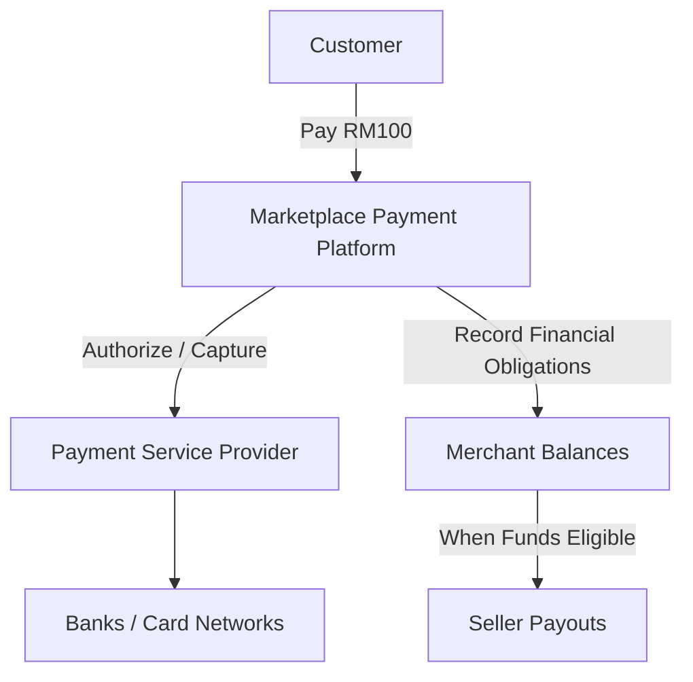
**Why use an external PSP?**
- Avoid building complex card-network and banking integrations.
- Reduce payment infrastructure complexity.
- Support hosted checkout and card authentication.
- Focus our system on correctness, orchestration, and accounting.

**Trade-off:** PSP fees, external dependency, and provider-specific behavior.

## 1.2 Functional Requirements
| Priority | Requirement | Description |
|---|---|---|
| P0 | Create Payment | Merchant creates payment for checkout |
| P0 | Authorize Payment | Reserve customer funds |
| P0 | Daily Capture Batch | Capture eligible authorizations daily |
| P0 | Payment Status | Retrieve authoritative payment state |
| P0 | PSP Webhooks | Receive asynchronous payment updates |
| P0 | Transaction History | Track financial operations |
| P0 | Reconciliation | Detect internal/external discrepancies |
| P1 | Merchant Wallet | Track pending and available balances |
| P1 | Merchant Payout | Transfer eligible funds to sellers |
| P1 | Refund | Return captured money to customers |

### Questions to Ask Interviewer
**Q1: Are we designing a payment gateway or merchant payment platform?**
- Assume a multi-merchant payment platform.
- External PSP handles banking infrastructure.

**Q2: Do we charge each seller separately?**
- No. For this scenario, charge the customer RM100 once.
- Internally allocate RM60 to Seller A and RM40 to Seller B.

**Q3: Do we capture immediately?**
- No. Our requirement specifies daily capture of eligible authorized payments.

**Q4: Do we need payouts?**
- Include merchant balances and payout design.
- Detailed payout workflow can be an extension.

**Q5: How strict is correctness?**
- No unintended duplicate financial operations.
- Every confirmed financial effect must be auditable and recoverable.

## 1.3 Payment Event vs Payment Order
This distinction is important.

Imagine:
```text
Checkout C001 = RM100

Seller A = RM60
Seller B = RM40
```
### Payment Event
Represents the entire customer checkout:
```text
Payment Event P001
Total = RM100
```
### Payment Orders
Represent individual seller allocations:
```text
Payment Order O001
Seller A = RM60

Payment Order O002
Seller B = RM40
```
### Relationship
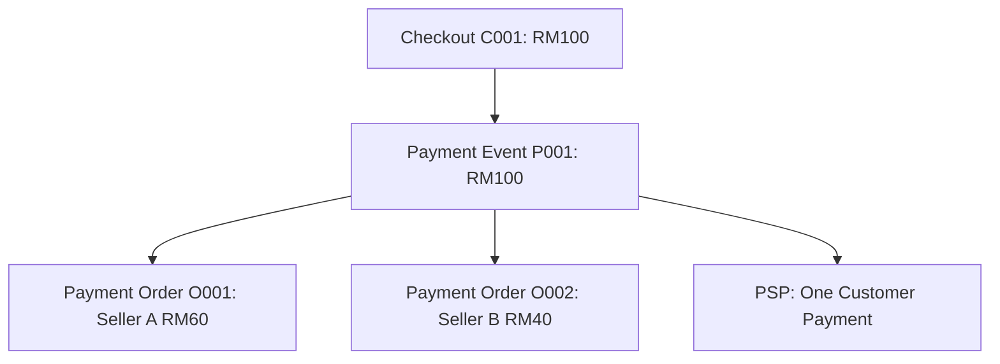
**Why separate them?**
- One customer charge can cover multiple sellers.
- We need to track financial obligations separately.
- Payout and accounting can operate on each seller's allocation.

**Alternative:** Execute separate external transactions for each seller.

**Trade-off:** More provider operations, idempotency keys, and recovery complexity.

**Our Decision:** One customer payment followed by internal financial allocation.

## 1.4 Payment Lifecycle

### 1. Authorization
The bank reserves customer funds.
```text
RM100 authorized.
```
The money has not necessarily been captured or settled.

### 2. Capture
The platform requests collection of the authorized amount.
```text
RM100 captured.
```

### 3. Settlement
The funds clear through the payment provider/acquiring process.

### 4. Merchant Payout
Eligible money is sent to the merchant's bank account.

### Lifecycle

This is a simplified business lifecycle; actual authorization, capture, settlement, and payout operations can have separate state machines.

| Stage | Meaning | Funds Available to Merchant? |
|---|---|---|
| AUTHORIZED | Amount reserved | No |
| CAPTURED | Collection initiated/confirmed | Not necessarily |
| SETTLED | Provider clearing completed | Depends on payout policy |
| PAYOUT INITIATED | Merchant transfer started | Not necessarily received |
| PAYOUT COMPLETED | Provider confirms payout completion | Bank arrival may still vary |

### Important: Daily Capture vs Settlement
Our requirement says:
> Settle all authorized payments once daily.

We interpret this as:
> Capture all eligible authorized payments in a controlled daily batch.

**Why?**
Our application can schedule capture operations, but it cannot force banks or payment networks to complete settlement immediately.

Settlement and merchant payout are tracked separately.

## 1.5 Out of Scope
Initially exclude:
- Subscriptions.
- Foreign-exchange conversion.
- Advanced fraud scoring.
- Disputes and chargebacks.
- Direct bank integrations.
- Complex international payouts.

---
# Step 2 — Non-Functional Requirements

## 2.1 Core Requirements
| Requirement | Design Goal | Solution |
|---|---|---|
| Correctness | No unintended duplicate financial effects | Idempotency + DB constraints |
| Strong Local Consistency | Atomic financial state changes | PostgreSQL transactions |
| Durability | No acknowledged critical write lost | WAL, replication, backup |
| Security | Protect card and financial data | Hosted checkout, TLS, mTLS |
| Scalability | 10k API QPS sustained target | Stateless services + partitioning |
| Reliability | Recover from dependency failures | Retry, Inbox, Outbox |
| Auditability | Trace money movement | Immutable ledger |
| Availability | Continue safe operations | Failover and controlled degradation |

## 2.2 Why Strong Consistency Matters
Imagine two workers attempt to capture the same payment:
```text
Payment P001 = AUTHORIZED

Worker A reads AUTHORIZED.
Worker B reads AUTHORIZED.

Worker A attempts capture.
Worker B attempts capture.
```
Without coordination, both may send capture requests.

### Solution — Atomic State Transition
```sql
UPDATE payments
SET status = 'CAPTURE_IN_PROGRESS',
    version = version + 1
WHERE payment_id = 'P001'
  AND status = 'AUTHORIZED'
RETURNING payment_id;
```
Only one worker can successfully claim this transition.

**Why?**
PostgreSQL ensures that concurrent updates are coordinated.

**Important:** This protects local work claiming. External PSP effects still need durable operation IDs, PSP idempotency, and recovery.

## 2.3 Strong vs Eventual Consistency

### Strong Local Consistency
Required for:
- Payment state transitions.
- Idempotency reservations.
- Ledger postings.
- Capture operation claims.
- Financial uniqueness constraints.

### Eventual Consistency
Acceptable for:
- Merchant notifications.
- Reporting.
- Analytics.
- Some balance projections.
- External provider reconciliation.

### Example
```text
PSP: CAPTURED
Our DB: CAPTURE_IN_PROGRESS
```
A temporary difference can occur after a lost response.

**Key Requirement:** Do not invent a definitive result. Recover the actual PSP outcome.

## 2.4 Durability vs Availability
**Durability:** A committed payment record survives failures.

**Availability:** The system can process requests.

These are different guarantees.

### Recovery Terms
| Term | Meaning |
|---|---|
| RPO | Maximum acceptable data loss |
| RTO | Maximum acceptable recovery time |
| WAL | Write-Ahead Log used for recovery |
| Replication | Maintain copies across servers |
| Backup | Restore data after major failures |

### Important
A nine-nines durability target is not automatically achieved by selecting PostgreSQL.

It requires an appropriate durability configuration, replication, backup, integrity checking, and tested recovery procedures.

**Decision:** Do not acknowledge critical financial state until the required durability boundary is satisfied.

---
# Step 3 — Estimate Scale

## 3.1 Traffic Assumptions
```text
Total API QPS = 10,000
New Payment TPS = 1,000
Other Requests = 9,000 QPS
Average Payment Record = 1KB
```
These are illustrative interview assumptions, not production measurements.

### Total API Requests Per Day
```text
10,000 × 86,400
= 864,000,000 requests/day
```

### New Payments Per Day
```text
1,000 × 86,400
= 86,400,000 payments/day
```

### Raw Payment Storage Per Day
```text
86.4M × 1KB
≈ 86.4GB/day
```

### Raw Payment Storage Per Year
```text
86.4GB × 365
≈ 31.5TB/year
```
This excludes:
- Ledger entries.
- Payment attempts.
- Capture operations.
- Webhook events.
- Database indexes.
- Replication.
- Backups.

## 3.2 What Do These Numbers Tell Us?
1. API servers must scale horizontally.
2. Financial writes need appropriate database capacity.
3. Payment status reads may be separated from financial writes.
4. Capture workers need backpressure and provider rate limiting.
5. Historical payment data may require partitioning and archiving.
6. Reconciliation and webhook processing should scale independently.

### Important
```text
10k API QPS ≠ 10k external PSP financial operations/sec
```
The PSP has its own capacity and rate limits.

**Design Decision:** Start with stateless services, transactional storage, and asynchronous workers. Introduce database partitioning as write volume justifies it.

---
# Step 4 — High-Level Architecture

## 4.1 Simple Architecture
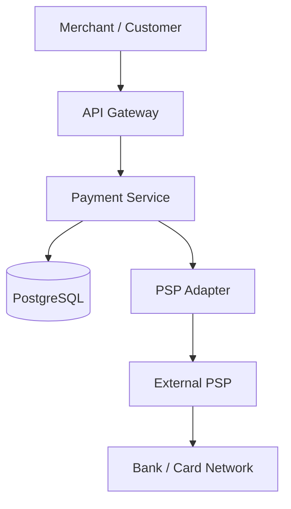
### Component Responsibilities
| Component | Responsibility | Why |
|---|---|---|
| API Gateway | Authentication, rate limiting | Protect APIs |
| Payment Service | Financial operation orchestration | Centralize business rules |
| PostgreSQL | Durable records and transactions | Correctness |
| PSP Adapter | Provider-specific API integration | Decouple business logic |
| PSP | External payment processing | Avoid implementing banking infrastructure |

## 4.2 Why PSP Adapter?
Different providers use different APIs, states, and webhook formats.

A common interface could be:
```java
interface PaymentProvider {
    PaymentSession createSession(PaymentRequest request);
    AuthorizationResult authorize(AuthorizationRequest request);
    CaptureResult capture(CaptureRequest request);
    ProviderPaymentStatus getPaymentStatus(String providerPaymentId);
    RefundResult refund(RefundRequest request);
}
```
**Why?**
- Avoid tightly coupling payment logic to one provider.
- Easier to integrate additional PSPs.
- Centralize provider-specific error translation.

**Trade-off:** Additional abstraction and maintenance.

**Important:** Switching PSPs during an unresolved operation can create duplicate financial effects.

## 4.3 Complete Architecture
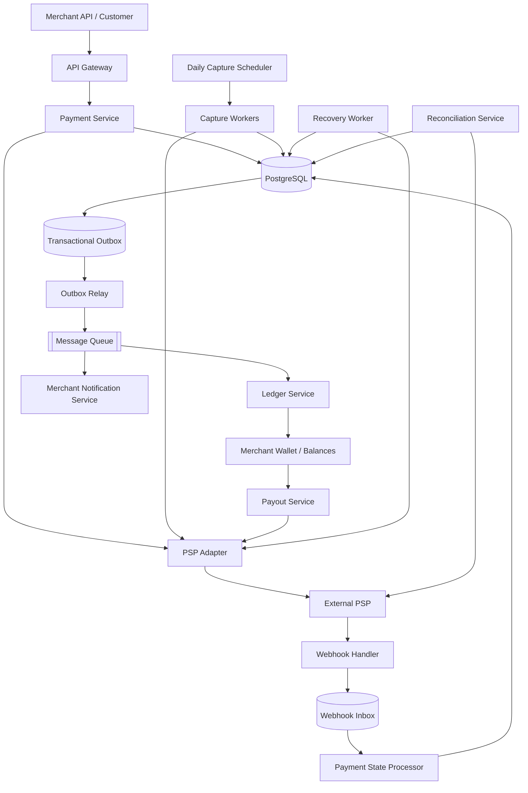
**Diagram Note:** This is a conceptual architecture. The ledger may be maintained transactionally within the financial database, or by an idempotent ledger service with reliable event delivery and reconciliation. Critical financial correctness must not depend on an unprotected asynchronous update.

## 4.4 Four Major Workflows
### Workflow A — Payment Creation and Authorization
```text
Merchant creates payment.
Customer opens PSP-hosted checkout.
PSP attempts authorization.
```

### Workflow B — Payment Confirmation
```text
PSP sends webhook.
Webhook Inbox stores event.
Payment State Processor updates payment.
```

### Workflow C — Daily Capture
```text
Scheduler selects eligible authorized payments.
Workers claim capture operations.
PSP processes captures.
Ledger records confirmed financial effects.
```

### Workflow D — Payout and Reconciliation
```text
Settlement is verified.
Merchant balance becomes eligible.
Payout operation transfers money.
Reconciliation detects discrepancies.
```

## 4.5 Happy Path — Customer Pays RM100
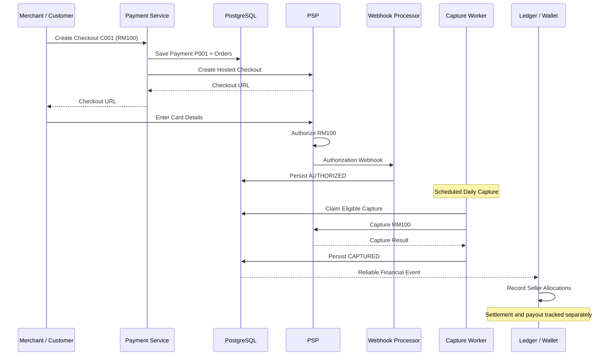

### Why Save Payment Before Calling PSP?
We need a durable internal payment identity to recover after a crash.

### Why Hosted Checkout?
Avoid routing raw card information through our backend.

### Why Webhook?
Provider authentication and processing can complete asynchronously.

### Why Daily Capture Worker?
Our requirements specify delayed capture.

### Why Track Settlement Separately?
Capture success does not automatically mean funds are settled or available for payout.

---
# Step 5 — API + Database Design

## 5.1 API Design
| API | Purpose |
|---|---|
| POST /v1/payments | Create payment |
| POST /v1/payments/{id}/confirm | Confirm tokenized payment |
| GET /v1/payments/{id} | Retrieve payment status |
| POST /v1/capture-batches | Start/reuse daily batch |
| POST /v1/payments/{id}/refunds | Refund payment |
| POST /webhooks/psp | Receive provider events |

### API 1 — Create Payment
```http
POST /v1/payments
Authorization: Bearer <merchant_api_key>
Idempotency-Key: checkout_C001
Content-Type: application/json
```
Request:
```json
{
  "checkout_id": "C001",
  "amount_minor": 10000,
  "currency": "MYR",
  "payment_orders": [
    {
      "seller_id": "S001",
      "amount_minor": 6000
    },
    {
      "seller_id": "S002",
      "amount_minor": 4000
    }
  ]
}
```
Response:
```json
{
  "payment_id": "P001",
  "status": "CREATED",
  "amount_minor": 10000,
  "currency": "MYR",
  "checkout_url": "https://checkout.example-psp.com/session/abc"
}
```
The URL is illustrative.

### Validation
```text
Seller A allocation = RM60
Seller B allocation = RM40
Total = RM100
```
The allocations must equal the checkout amount.

**Important:** Authenticate the merchant and derive/validate prices from trusted business records. Never blindly trust a browser-supplied amount.

### API 2 — Confirm Payment
For SDK/tokenized checkout:
```http
POST /v1/payments/P001/confirm
Idempotency-Key: confirm_P001
```
```json
{
  "payment_method_token": "pm_abc123"
}
```
The backend passes the token to the PSP using a stable operation identity.

**Alternative:** With fully hosted checkout, the PSP may handle confirmation without this endpoint.

### API 3 — Get Payment Status
```http
GET /v1/payments/P001
```
Response:
```json
{
  "payment_id": "P001",
  "authorization_status": "AUTHORIZED",
  "capture_status": "NOT_CAPTURED",
  "settlement_status": "NOT_SETTLED",
  "amount_minor": 10000,
  "currency": "MYR"
}
```
**Security:** Merchant and customer permissions must be checked before returning payment details.

### API 4 — Daily Capture Batch
```http
POST /v1/capture-batches
Idempotency-Key: capture_2026-10-21_M001
```
```json
{
  "merchant_id": "M001",
  "business_date": "2026-10-21"
}
```
Called by a trusted scheduler or authorized administrative service.

**Why Idempotency?**
If the scheduler triggers twice, we should reuse the existing logical batch rather than create duplicate work.

### API 5 — Refund
```http
POST /v1/payments/P001/refunds
Idempotency-Key: refund_P001_R001
```
```json
{
  "amount_minor": 2000,
  "reason": "requested_by_customer"
}
```
A refund is a separate financial operation with its own:
- Operation ID.
- Provider reference.
- State.
- Idempotency key.
- Reconciliation.

---

## 5.2 Database Schema

### Core Tables
| Table | Important Columns | Purpose |
|---|---|---|
| merchants | merchant_id, name, credential_reference, status | Merchant identity |
| payment_events | payment_id, merchant_id, checkout_id, amount_minor, currency, status | Checkout-level payment |
| payment_orders | order_id, payment_id, seller_id, amount_minor, currency | Seller allocations |
| payment_attempts | attempt_id, payment_id, provider, provider_ref, status | Provider interactions |
| financial_operations | operation_id, payment_id, type, amount_minor, status, provider_ref, idempotency_key | Authorization/capture/refund/payout operations |

### Reliability and Accounting Tables
| Table | Important Columns | Purpose |
|---|---|---|
| idempotency_keys | merchant_id, key, request_hash, operation_id | API deduplication |
| webhook_inbox | provider, provider_account, event_id, payload, processed_at | Incoming events |
| outbox_events | event_id, aggregate_id, type, payload, published_at | Outgoing events |
| capture_batches | batch_id, merchant_id, business_date, status | Daily batch tracking |
| capture_batch_items | batch_id, operation_id, status | Per-item batch tracking |
| ledger_entries | transaction_id, account_id, debit, credit, currency | Financial history |
| merchant_balances | merchant_id, pending_amount, available_amount, version | Balance view |
| payouts | payout_id, merchant_id, amount, status, provider_ref | Merchant transfers |

### Important Constraints
```text
Unique merchant + idempotency key
Unique provider + account + webhook event ID
Unique intended capture operation
Unique ledger posting identifier
Unique payout operation identifier
```
**Why?**
Application-level checks can race across multiple instances.

Database constraints provide durable protection.

## 5.3 Why Store Money as Integers?
For MYR:
```text
RM100.00 = 10000 sen
RM0.10 = 10 sen
```
Use integer minor units where appropriate, or exact decimal representations.

**Why not float/double?**
Binary floating-point arithmetic can introduce rounding errors.

**Important:** Not every currency has two decimal places.

## 5.4 Payment State Machine
A single Boolean `is_paid` is insufficient.

A simplified lifecycle:
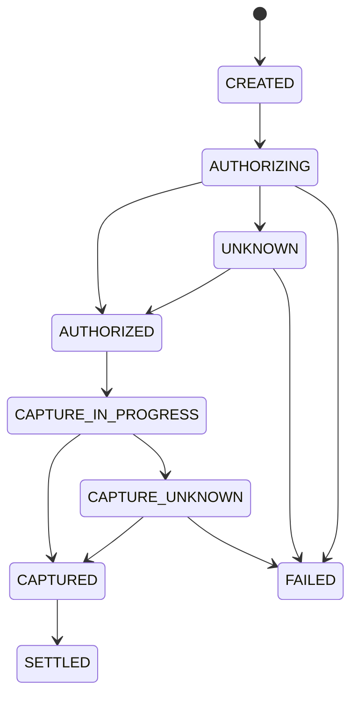
This is a conceptual lifecycle. Refunds, payouts, and partial captures require separate operation states.

### Why State Transitions Matter
Suppose payment is CAPTURED.

Then an old webhook arrives:
```text
payment.authorized
```
We must not reset the payment to AUTHORIZED.

### Atomic Claim Example
```sql
UPDATE payments
SET status = 'CAPTURE_IN_PROGRESS',
    version = version + 1
WHERE payment_id = 'P001'
  AND status = 'AUTHORIZED'
RETURNING payment_id;
```
This sample uses `payments` as a simplified payment-state table name.

### Why UNKNOWN?
Because:
```text
Request sent.
PSP processed it.
Response lost.
```
A timeout doesn't prove failure.

**UNKNOWN means:** Resolve the existing operation rather than creating a new financial operation.

---
# Step 6 — Deep Dive + Failure Handling

## 6.1 Deep Dive A — Payment Security

### Problem 1 — Raw Card Data
If our backend receives card numbers and CVV, we increase the security and PCI DSS compliance burden.

### Solution — Hosted Checkout + Tokenization
```text
Customer
   ↓
PSP Secure Form
   ↓
PSP Stores/Processes Card Details
   ↓
Our Backend Receives Payment Token
```
Example:
```text
Card Number → PSP-managed
Payment Token → pm_abc123
```
**Why?** Reduce exposure to sensitive card data.

**Important:** Tokens still require authorization and secure handling. They are not automatically safe to share publicly.

### Problem 2 — Internal Service Compromise
Should Notification Service be able to refund money?

No.

### Solution — mTLS + Authorization
- mTLS authenticates both communicating services.
- Authorization determines which actions each service may perform.

Additional controls:
- Merchant-scoped credentials.
- Least-privilege access.
- TLS encryption.
- Key rotation.
- Secrets management.
- Audit logging.
- Rate limiting.
- Webhook signature verification.

---

## 6.2 Deep Dive B — Idempotency

### Problem
Customer clicks Pay twice:
```text
Request 1 → Authorize RM100
Request 2 → Authorize RM100
```
Without protection, two financial operations may occur.

### Solution — Idempotency Key
```http
POST /v1/payments
Idempotency-Key: checkout_C001
```

### How It Works
```mermaid
flowchart TD
    A["Payment Request + Key K001"]
    B["Atomic DB Key Reservation"]
    C{"Existing Key?"}
    D["Create Logical Payment"]
    E["Call PSP With Stable Operation ID"]
    F["Persist Result"]
    G{"Same Request?"}
    H["Return Existing Payment"]
    I["409 Conflict"]

    A --> B --> C
    C -->|No| D --> E --> F
    C -->|Yes| G
    G -->|Yes| H
    G -->|No| I
```
### Behind the Scenes
```text
merchant_id = M001
idempotency_key = K001
payment_id = P001
request_hash = hash(original_request)
```
The first request creates the record.

Subsequent same-key requests reuse that logical operation.

### Why Store Request Hash?
If the same key is reused for another checkout/amount, reject it rather than returning an unrelated payment.

### Why Two Idempotency Layers?
| Layer | Prevents |
|---|---|
| Our API | Duplicate logical operations caused by client retries |
| PSP | Duplicate provider operations caused by service retries |

### Why Not Redis Alone?
Redis locks may expire or disappear.

A durable DB unique constraint is the primary correctness boundary.

### Important
Authorization, capture, refund, and payout require separate operation identities.

A payment ID links them together; it does not replace operation-level idempotency.

---

## 6.3 Deep Dive C — Transactional Outbox

### Problem — Dual Writes
After PSP confirms capture:
```text
1. Update DB: Payment CAPTURED.
2. Publish PaymentCaptured event.
```
Naive implementation:
```java
updatePaymentStatus("P001", "CAPTURED");
kafka.publish("PaymentCaptured", "P001");
```
Failure:
```text
DB update succeeds.
Server crashes.
Kafka event is never published.
```
Downstream accounting or notification processing may never occur.

### Solution — Transactional Outbox
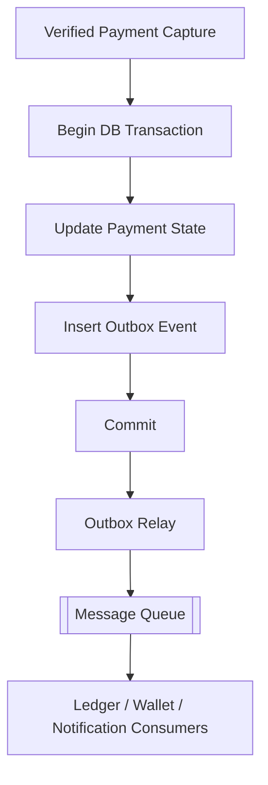
Example:
```sql
BEGIN;

UPDATE payments
SET status = 'CAPTURED'
WHERE payment_id = 'P001'
  AND status = 'CAPTURE_IN_PROGRESS';

-- Insert the event only when the required
-- transition has actually succeeded.

INSERT INTO outbox_events (
    event_id,
    event_type,
    aggregate_id,
    payload
)
VALUES (
    'EVT001',
    'PaymentCaptured',
    'P001',
    '{"amount_minor":10000,"currency":"MYR"}'
);

COMMIT;
```
**Why?**
The state update and event record commit together.

### What If the Relay Crashes?
```text
1. Relay publishes EVT001.
2. Queue acknowledges.
3. Relay crashes before marking published.
4. Relay publishes EVT001 again.
```
Duplicates are possible.

### Solution — Idempotent Consumer
```text
Consumer receives EVT001.
Check processed_events.
If new:
    Apply business effect.
    Record EVT001 processed.
If duplicate:
    Skip.
```
Perform business changes and deduplication within one local transaction.

### Outbox Relay Options
| Option | Advantage | Trade-off |
|---|---|---|
| Polling Publisher | Simple | DB polling |
| CDC | Uses database change stream | More infrastructure |

**Our Choice:** Polling initially; CDC when scale and operational needs justify it.

---

## 6.4 Deep Dive D — Webhook + Inbox

### Why Webhooks?
Payment processing can be asynchronous:
- 3D Secure authentication.
- Provider delays.
- Customer closes browser.
- Delayed capture/settlement events.

The PSP notifies us through callbacks.

Example:
```http
POST /webhooks/psp
```
```json
{
  "id": "evt_123",
  "type": "payment.authorized",
  "payment_id": "P001"
}
```

### Problems
**Duplicate Delivery**
```text
payment.authorized
payment.authorized
```

**Out-of-Order Delivery**
```text
payment.captured
payment.authorized
```

**Webhook Server Crash**
The handler may fail before updating payment state.

### Solution — Durable Inbox
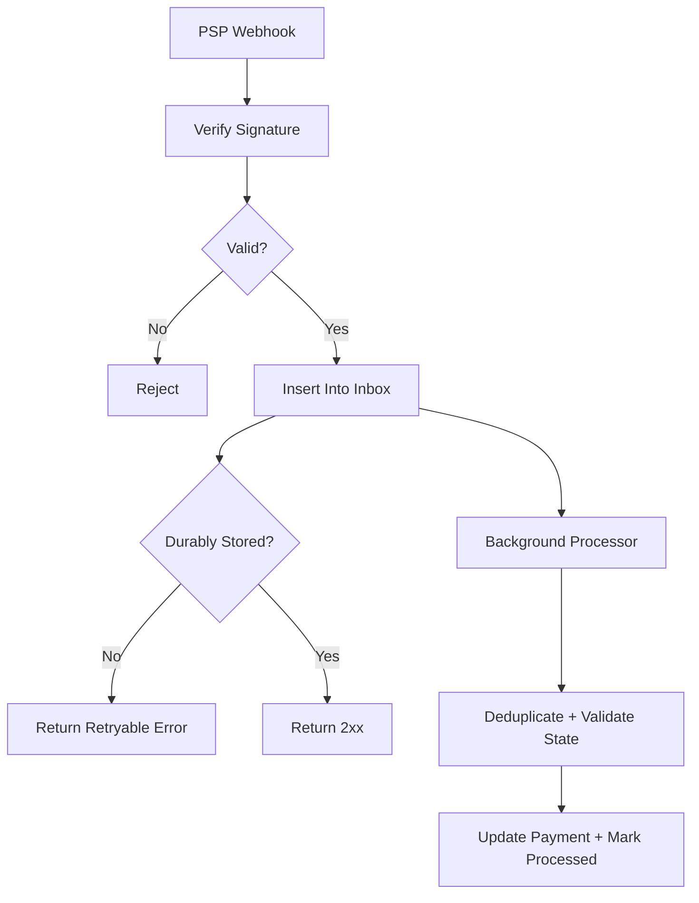
### How It Works
1. Verify PSP signature.
2. Insert event into PostgreSQL.
3. Enforce unique provider event ID.
4. Commit.
5. Return 2xx.
6. Process asynchronously.
7. Apply valid payment transitions idempotently.

### Unique Constraint
```sql
UNIQUE (provider, provider_account_id, event_id)
```
**Why?** Prevent duplicate incoming event records.

However, multiple distinct provider events can refer to the same logical financial operation, so business-level deduplication is also required.

### Webhook vs Inbox vs Outbox
| Concept | Direction | Purpose |
|---|---|---|
| Webhook | PSP → Our System | Receive event |
| Inbox | Incoming Event → DB | Durable acceptance/deduplication |
| Outbox | Our DB → Queue | Reliable outgoing event |

**Easy Memory:**
```text
Webhook = Receive the news
Inbox = Safely store the news
Outbox = Reliably send news to others
```

---

## 6.5 Deep Dive E — PSP Timeout

### Problem
```text
1. Payment Service requests RM100 authorization.
2. PSP successfully authorizes RM100.
3. Response is lost.
4. Payment Service times out.
```
Should we retry with a new operation ID?

**No.**

### Why?
The original operation may already have succeeded.

### Recovery
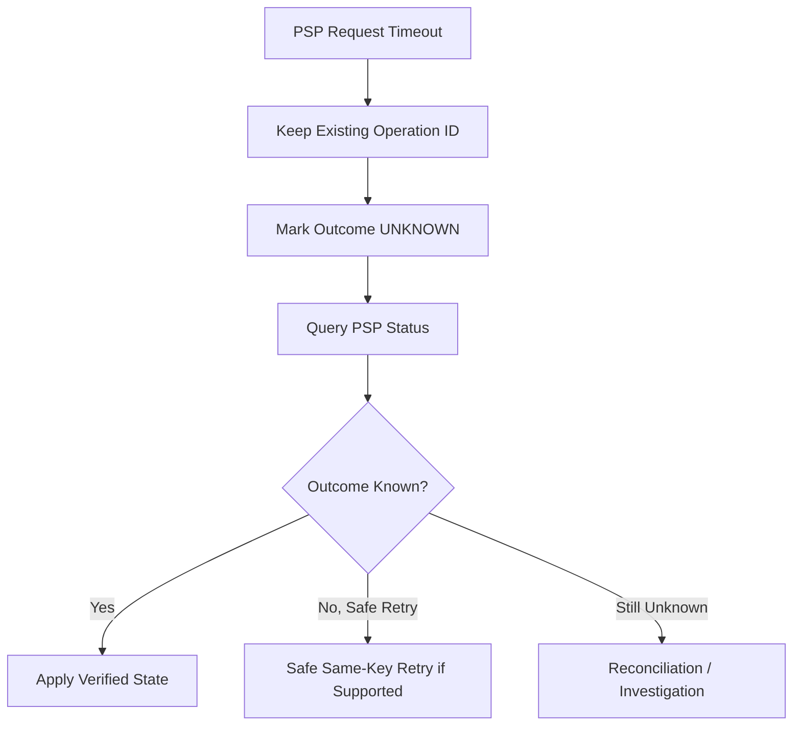
### Recovery Steps
1. Persist stable operation identity before external call.
2. Mark outcome UNKNOWN if response is lost.
3. Query PSP using existing provider reference.
4. Retry with same PSP key only when safe.
5. Reconcile unresolved operations.

### Important
PSP idempotency-key retention may be limited.

Do not assume an old key permanently prevents duplicate charges.

**Key Principle:** Never treat a timeout as proof of failure.

---

## 6.6 Deep Dive F — Daily Capture Batch

### Requirement
Capture eligible authorized payments once daily.

### Naive Implementation
```text
Every midnight:
    SELECT payments WHERE status = AUTHORIZED
    For every payment:
        PSP.capture(payment)
```
### Problems
- Two schedulers run simultaneously.
- Worker crashes after PSP capture.
- Batch restarts.
- Same payment appears in different batches.
- Authorization expires before capture.

### Solution — Durable Batch + Unique Capture Operation

### Batch Tables
```text
capture_batches
----------------
batch_id
merchant_id
business_date
status

capture_batch_items
-------------------
batch_id
operation_id
status
```

### Safe Capture Flow
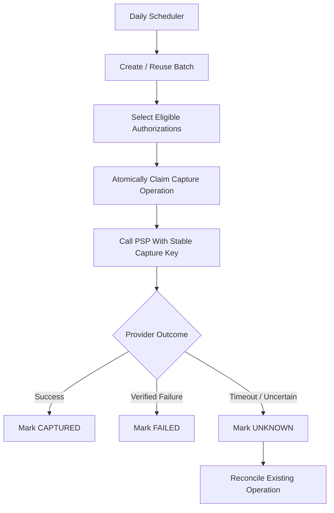
### Why Atomic Claim?
If Worker A and Worker B find P001, only one should claim the capture operation.

### Why Stable Capture Operation ID?
Suppose:
```text
Worker A captures RM100.
Worker A crashes before DB update.
Worker B retries.
```
Worker B must reuse or investigate the existing capture operation, not create a new one.

### Why Batch ID Alone Isn't Enough
P001 could appear in:
```text
Batch B001
Batch B002
```
Therefore, deduplicate based on the underlying financial operation, not only the batch.

### Fallback — Worker Crash
```text
Worker Crashes After PSP Capture
    ↓
DB Still CAPTURE_IN_PROGRESS
    ↓
Recovery Worker Finds Existing Operation
    ↓
Query PSP
    ↓
Apply Verified Result
```

### Fallback — Authorization Expired
Card authorizations have limited validity.

Track:
```text
authorized_at
authorization_expires_at
capture_eligibility
```
If expired:
- Do not assume capture will succeed.
- Follow PSP-specific rules.
- Obtain a new authorization when permitted.

**Key Principle:** Daily batch retries must not cause duplicate captures.

---

## 6.7 Deep Dive G — Ledger and Merchant Wallet

### Why Do We Need a Ledger?
Payment status tells us:
```text
Was RM100 captured?
```
The ledger tells us:
```text
Where should the RM100 be accounted for?
```

### Double-Entry Bookkeeping
Every transaction must balance:
```text
Total Debit = Total Credit
```

### Example
Customer pays RM100.

Seller allocations:
```text
Seller A = RM60
Seller B = RM40
```
Platform fee:
```text
Total Platform Fee = RM3
```
Net seller payables:
```text
Seller A = RM58
Seller B = RM39
Platform = RM3
```

### Simplified Ledger
| Account | Debit | Credit |
|---|---:|---:|
| PSP Receivable | 100 | 0 |
| Seller A Payable | 0 | 58 |
| Seller B Payable | 0 | 39 |
| Platform Fee Revenue | 0 | 3 |
| Total | 100 | 100 |

This is illustrative and assumes a suitable platform funds-flow and accounting model.

### Why Not Just Update a Balance?
Wrong as the only financial record:
```text
seller_balance = seller_balance + 58
```
This does not explain:
- Why the balance increased.
- Which customer payment funded it.
- Whether it was posted twice.
- How to reverse or refund it.

### Ledger
Records immutable financial movements.

### Wallet / Balance View
Answers:
```text
How much can Seller A withdraw?
```
Example:
```json
{
  "merchant_id": "S001",
  "pending_minor": 5800,
  "available_minor": 0,
  "currency": "MYR"
}
```
### Why Pending vs Available?
Captured money may not yet be settled or payout-eligible.

Once requirements are satisfied:
```text
PENDING → AVAILABLE
```
Actual eligibility depends on settlement, provider rules, reserves, and risk policies.

### Why Separate Ledger and Wallet?
| Ledger | Wallet |
|---|---|
| Financial history | Current balance view |
| Append-only postings | Optimized balance queries |
| Auditability | Fast merchant access |
| Source for reconciliation | Derived financial state |

**Important:** Wallet balances must reconcile with ledger postings.

---

## 6.8 Merchant Payout

### Problem
Seller A has RM58 available.

We want to transfer RM58 to the seller's bank account.

### Payout Flow
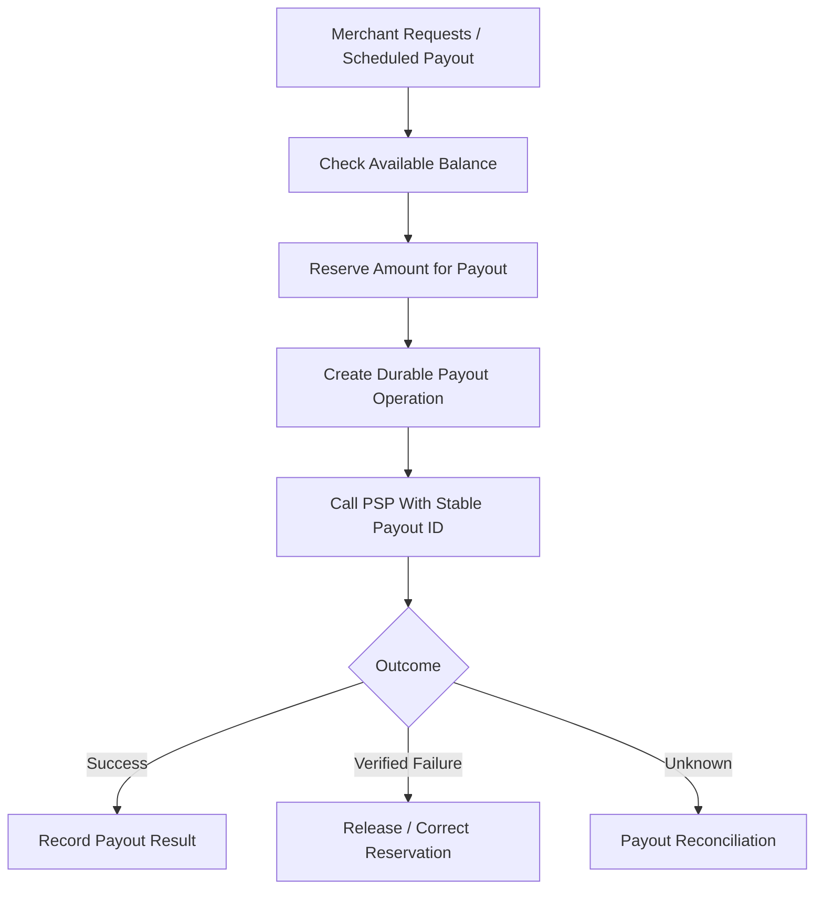
### Why Reserve Balance?
Prevent concurrent payout workers from using the same available money twice.

### Why Payout Idempotency?
A provider timeout does not mean the bank transfer failed.

### Why Track Payout Status?
```text
PAYOUT_CREATED
PAYOUT_PROCESSING
PAYOUT_COMPLETED
PAYOUT_FAILED
PAYOUT_UNKNOWN
```
Provider completion and actual bank arrival may differ.

### Fallback
If response is lost:
- Keep original payout operation.
- Query provider.
- Reconcile bank/provider reports.
- Never blindly initiate a second payout.

---

## 6.9 Deep Dive H — Reconciliation

### Definition
Compare independent records to find discrepancies.

### Example
Our database:
```text
P001 = AUTHORIZED
```
PSP:
```text
P001 = CAPTURED
```
Something is inconsistent.

### Two Types
**Operational Reconciliation**
- Frequently scan UNKNOWN or stuck operations.
- Query PSP for actual status.
- Recover missing transitions.

**Financial Reconciliation**
- Compare transaction reports.
- Verify captures.
- Verify refunds.
- Verify fees.
- Verify settlements.
- Verify payouts and bank records.

### Architecture
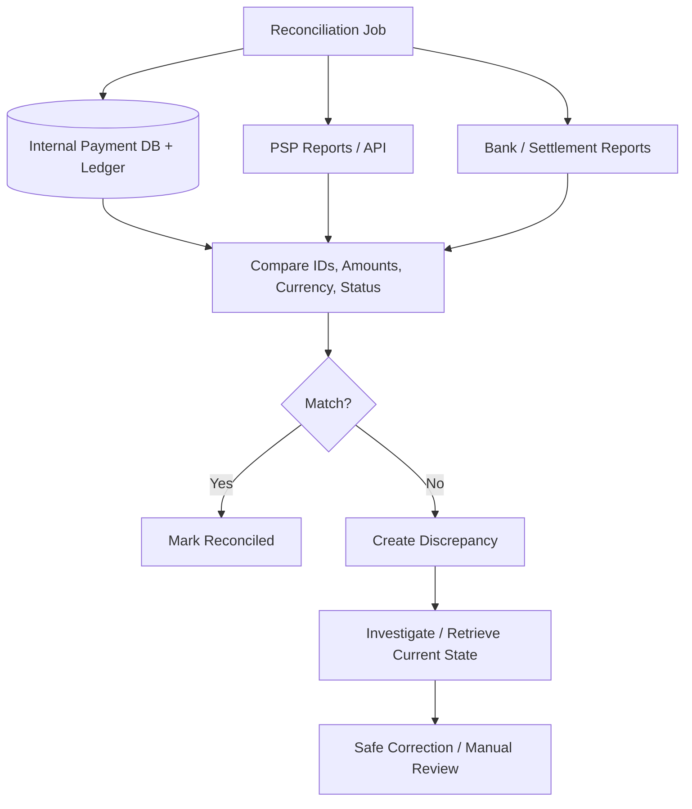

### Why Reconciliation?
Webhooks, retries, and queues cannot guarantee that every external system always agrees.

Reconciliation detects what the other mechanisms missed.

### Fallback — Missing Webhook
```text
PSP Captured RM100
Webhook Lost
DB Still AUTHORIZED
    ↓
Reconciliation Finds Mismatch
    ↓
Fetch PSP Result
    ↓
Apply Idempotent Capture Transition
```
### Important
Do not blindly initiate a charge or refund to force two records to match.

Investigate and apply controlled corrections.

---

## 6.10 Deep Dive I — Retry Queue and DLQ

### Why Retry?
Failures can be temporary:
- PSP returns 503.
- Database connection times out.
- Queue consumer crashes.
- Ledger consumer temporarily fails.

### Exponential Backoff
```text
Attempt 1 → Immediate
Attempt 2 → 1 second
Attempt 3 → 2 seconds
Attempt 4 → 4 seconds
Attempt 5 → 8 seconds
```
Add jitter to avoid synchronized retries.

### Why Not Retry Immediately?
Thousands of simultaneous retries may overload an already failing PSP.

### Payment-Specific Warning
Retrying message processing is different from retrying a financial operation.

**Safe:**
```text
Reprocess same event with idempotency.
```
**Potentially dangerous:**
```text
Create a new PSP charge after original timeout.
```

### Dead-Letter Queue
```text
Processing Failure
   ↓
Retry with Backoff
   ↓
Retry Limit Reached
   ↓
Dead-Letter Queue
   ↓
Investigation / Safe Replay
```
**Important:** DLQ does not replace payment reconciliation.

A financial operation with unknown status still requires investigation.

---

## 6.11 Complete Failure Handling Matrix

| Failure | Primary Solution | Fallback |
|---|---|---|
| Customer clicks Pay twice | Idempotency | Return existing payment |
| Concurrent authorization | DB unique constraint | Reuse operation |
| PSP times out | UNKNOWN + stable reference | Status lookup / safe retry |
| Duplicate webhook | Durable Inbox | Idempotent transition |
| Out-of-order webhook | State machine | Query latest PSP state |
| Webhook endpoint down | PSP retries | Recovery polling |
| DB commits, queue publish fails | Transactional Outbox | Relay retry |
| Outbox publishes twice | Idempotent consumer | processed_events |
| Worker crashes during capture | Durable capture operation | PSP reconciliation |
| Batch executes twice | Unique capture operation | Resume batch |
| PSP unavailable | Circuit breaker | Pending + controlled retry |
| Authorization expires | Eligibility checks | Reauthorize when permitted |
| Ledger consumer crashes | Durable event processing | Replay/reconcile |
| Merchant payout timeout | Payout idempotency | Provider lookup |
| Wallet/ledger mismatch | Financial reconciliation | Controlled correction |
| DB/region failure | Replication + failover | Recovery and PSP reconciliation |

**Most Important Failure Rule:**
Never create a new financial operation merely because the previous network request failed to return a response.

---
# Step 7 — Trade-offs + Improvements

## 7.1 Technology Decisions
| Decision | Our Choice | Reason | Alternative / Trade-off |
|---|---|---|---|
| Database | PostgreSQL | ACID transactions | Distributed SQL adds complexity |
| Idempotency | DB constraints | Durable correctness | Redis-only is insufficient |
| PSP Integration | Adapter | Provider abstraction | Direct integration is simpler |
| Card Security | Hosted checkout | Reduced exposure | Direct handling increases compliance scope |
| Status Updates | Webhook + polling | Async results + recovery | Polling alone is expensive |
| Events | Transactional Outbox | Reliable publishing | Direct publish has dual-write risk |
| Outbox Relay | Polling initially | Easy to implement | CDC adds operational complexity |
| Ledger | Double entry | Auditability | Mutable balances are insufficient |
| Capture | Daily batch | Meets requirement | Automatic capture is simpler |
| Multi-PSP | Controlled routing | Coverage and resilience | Increased operational complexity |

## 7.2 Why PostgreSQL Instead of NoSQL?
Financial operations often require atomic changes to:
```text
Payment status
Capture operation
Ledger posting
Outbox event
```
PostgreSQL supports transactions and durable uniqueness constraints.

NoSQL databases can also support transactions, but their exact guarantees and limitations must be evaluated.

### Why Not Read From Replicas for Every Decision?
Example:
```text
Primary = CAPTURED
Replica = AUTHORIZED
```
A stale replica could cause an incorrect capture decision.

**Decision:**
- Authoritative reads for financial decisions.
- Replicas/read models for reporting where lag is acceptable.

## 7.3 Why Not Use Synchronous HTTP Everywhere?
Naive design:
```text
Payment Service
    ↓
Ledger Service
    ↓
Wallet Service
    ↓
Notification Service
```
If Notification Service fails, should payment fail?

Usually no.

### Solution
Use reliable asynchronous events for work that can complete later.

**Why?**
- Better failure isolation.
- Independent scaling.
- Buffering during traffic spikes.

**Trade-off:**
- Eventual consistency.
- Duplicate event handling.
- Operational complexity.

For money-critical accounting, maintain a clearly defined consistency boundary or an idempotent ledger mechanism with reconciliation.

---

## 7.4 Multiple PSPs

### Benefit
Multiple PSPs can improve:
- Geographic coverage.
- Provider availability.
- Payment method support.
- Routing flexibility.

### Dangerous Scenario
```text
1. Stripe receives RM100 request.
2. Response times out.
3. System immediately sends RM100 to Adyen.
4. Both providers may charge.
```
### Safe Strategy
- Route new operations to a chosen provider.
- Keep unresolved operations tied to their original provider.
- Reconcile ambiguous outcomes before creating alternatives.

**Key Principle:** PSP failover must never create uncontrolled duplicate charges.

---

## 7.5 Do We Need Saga?

### What Is Saga?
A workflow across multiple independently managed services using separate operations and compensating actions.

Example:
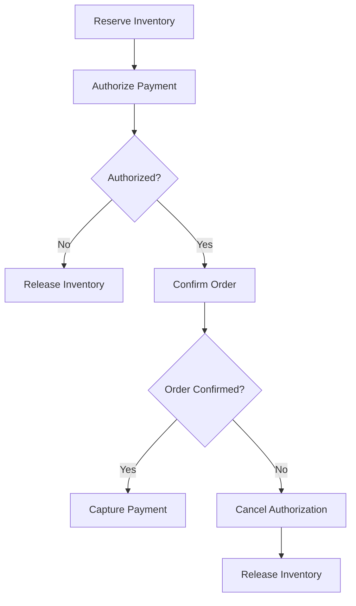
### Why Not One Transaction?
Inventory, Order Service, and PSP cannot all be rolled back through one ordinary local SQL transaction.

### Important
A refund is not an instantaneous rollback.

It is another financial operation with its own:
- State.
- Idempotency.
- Failures.
- Reconciliation.

**Decision:** Introduce Saga when coordinating multiple distributed business workflows becomes necessary.

---

## 7.6 Scalability Improvements

### A. Stateless Services
```text
Load Balancer
    ├── Payment Service A
    ├── Payment Service B
    └── Payment Service C
```
Scale application processing horizontally.

### B. Independent Workers
Scale separately:
- Webhook workers.
- Capture workers.
- Outbox relays.
- Reconciliation workers.
- Notification consumers.

### C. Database
Start with:
- Indexing.
- Connection pooling.
- Appropriate replication.
- Historical archiving.
- Partitioning large tables.

Consider sharding by merchant ID or payment ID only when workload demands it, while preserving transaction boundaries.

### D. Backpressure
If PSP accepts fewer operations than our system generates:
```text
Capture Queue Builds Up
    ↓
Limit Concurrent Captures
    ↓
Process at Provider-Safe Rate
```
**Why?** Prevent overloading providers and generating unnecessary failures.

### E. Monitoring
| Metric | Why |
|---|---|
| Authorization success rate | Detect payment problems |
| Capture success rate | Detect capture issues |
| UNKNOWN payment count | Unresolved money operations |
| PSP latency/error rate | Provider health |
| Webhook lag | Delayed state updates |
| Outbox backlog | Missing downstream events |
| Capture batch completion | Ensure daily job completes |
| Ledger mismatch count | Financial integrity |
| Reconciliation discrepancies | Detect incorrect records |
| Payout failure rate | Merchant transfer issues |

**Important:** Financial alerts should consider operation age, amount, and risk, not just service CPU usage.

---
# Final End-to-End Example

Imagine a customer buys RM100 of products from two sellers.

## Phase 1 — Create Payment
```text
1. Merchant creates Checkout C001.
2. Payment Platform validates RM100.
3. Create Payment Event P001.
4. Create Seller A allocation RM60.
5. Create Seller B allocation RM40.
6. Persist stable payment identity.
7. Create PSP checkout session.
```

## Phase 2 — Authorization
```text
8. Customer enters card details using PSP checkout.
9. PSP authorizes RM100.
10. PSP sends webhook.
11. Webhook is verified and saved to Inbox.
12. Processor updates payment to AUTHORIZED.
```

## Phase 3 — Daily Capture
```text
13. Daily scheduler starts capture batch.
14. Worker claims P001's capture operation.
15. PSP captures RM100.
16. Payment becomes CAPTURED.
17. Outbox event is published.
```

## Phase 4 — Accounting
```text
18. Ledger records RM100 receivable.
19. Seller A payable = RM58.
20. Seller B payable = RM39.
21. Platform fee revenue = RM3.
22. Merchant balances are updated or derived.
```

## Phase 5 — Settlement and Payout
```text
23. Settlement information arrives.
24. Eligible merchant balances become available.
25. Payout operations are created.
26. PSP processes payouts.
27. Payout results are reconciled.
```

## Phase 6 — Failure Recovery
Suppose capture succeeds but the worker crashes:
```text
1. PSP captured RM100.
2. Worker crashes before DB update.
3. Database shows CAPTURE_IN_PROGRESS.
4. Recovery Worker finds unresolved operation.
5. Worker queries PSP using stored reference.
6. PSP confirms CAPTURED.
7. Idempotent state transition updates DB.
8. Outbox event is created.
9. Ledger posting occurs once.
```

**Key Principle:** A crash may delay processing, but it must not cause duplicate financial effects.

---
# Interview Summary

When asked **"Design a Payment System"**, I would explain:

> First, I would clarify the scope as a multi-merchant payment platform integrating with external PSPs, supporting payment creation, authorization, daily capture, transaction history, and reconciliation.
>
> I would use PostgreSQL to maintain durable payment identities, controlled state transitions, and uniqueness constraints for financial operations.
>
> Customers would pay through PSP-hosted checkout, reducing exposure to raw card information.
>
> Each financial operation would use a stable idempotency key. This prevents client retries or worker crashes from unintentionally creating new charges or captures.
>
> Provider results would arrive through authenticated webhooks, stored in a durable Inbox, and processed idempotently.
>
> Payment state changes would generate transactional Outbox events so downstream accounting and notification services could process them reliably.
>
> For the daily capture requirement, I would use a scheduler and capture workers that atomically claim eligible payments and reuse durable capture operation IDs.
>
> If the PSP times out, I would keep the outcome UNKNOWN rather than FAILED and recover through status lookups, safe retries, and reconciliation.
>
> Financial movements would be recorded in a double-entry ledger, merchant balances would be derived from those records, and payouts would be processed as separate idempotent operations.
>
> Finally, I would scale stateless application services and background workers independently while protecting critical financial consistency.

---
# Quick Revision Table

| Problem | Solution | Why |
|---|---|---|
| Duplicate customer request | Idempotency key | One logical payment |
| Concurrent same-key requests | DB UNIQUE constraint | Atomic deduplication |
| PSP authorization timeout | UNKNOWN + status lookup | Don't guess outcome |
| Duplicate webhook | Durable Inbox | Safe repeated delivery |
| Fake webhook | Signature verification | Security |
| Out-of-order webhook | State machine | Prevent regression |
| DB commits, queue fails | Transactional Outbox | Reliable events |
| Outbox publishes twice | Idempotent consumer | Avoid repeated effects |
| Daily batch runs twice | Unique capture operation | Prevent double capture |
| Capture worker crashes | Durable operation ID | Resume safely |
| Authorization expires | Expiry tracking | Avoid invalid capture |
| Ledger consumer fails | Retry + deduplication | Reliable accounting |
| Merchant payout timeout | Payout operation ID | Avoid double payout |
| Wallet vs ledger mismatch | Reconciliation | Verify balances |
| PSP records disagree | Financial reconciliation | Investigate discrepancies |
| PSP unavailable | Circuit breaker + backoff | Limit cascading failures |
| High API QPS | Stateless services | Horizontal scaling |
| High capture volume | Rate-limited workers | Protect PSP |
| Multiple providers | PSP Adapter | Reduce coupling |

## Final Mental Model
```text
PAYMENT PLATFORM
├── Merchant API
├── API Gateway
├── Payment Service
├── PostgreSQL
└── PSP Adapter

FINANCIAL LIFECYCLE
├── Payment Created
├── Authorization
├── Daily Capture
├── Settlement
└── Merchant Payout

FINANCIAL CORRECTNESS
├── Durable Operation IDs
├── Idempotency
├── Database Constraints
├── State Machine
├── ACID Transactions
└── Double-Entry Ledger

INCOMING EVENTS
├── PSP Webhook
├── Signature Verification
├── Durable Inbox
└── Idempotent State Processor

OUTGOING EVENTS
├── Transactional Outbox
├── Outbox Relay
├── Message Queue
└── Idempotent Consumers

DAILY CAPTURE
├── Scheduler
├── Capture Batch
├── Atomic Operation Claim
├── Stable PSP Capture Key
├── Recovery Worker
└── Batch Reconciliation

MERCHANT ACCOUNTING
├── Seller Allocation
├── Ledger Posting
├── Pending Balance
├── Available Balance
├── Payout Operation
└── Settlement Reconciliation

FAILURE HANDLING
├── Duplicate Request → Existing Operation
├── PSP Timeout → UNKNOWN
├── Webhook Lost → PSP Status Recovery
├── Queue Failure → Outbox Retry
├── Worker Crash → Resume Existing Operation
├── Ledger Mismatch → Reconciliation
└── PSP Failure → Circuit Breaker + Safe Retry
```

## Five Most Important Takeaways
1. **Idempotency:** Every financial operation needs a stable identity.
2. **Webhook + Inbox:** Accept asynchronous provider results durably and process them safely.
3. **Transactional Outbox:** Prevent missing events after financial database updates.
4. **Capture and Payout Recovery:** A timeout or crash must never cause a new uncontrolled money movement.
5. **Ledger + Reconciliation:** Record where money moved and verify those records against external financial systems.

> **Interview Tip:** The strongest payment-system answer demonstrates how the design recovers when the PSP succeeds but our server crashes, a daily capture batch retries, or an event is delivered multiple times.

---
# Interview Preparation — 60-Minute Walkthrough

| Time | Topic | What to Focus On |
|---|---|---|
| 0–5 min | Requirements | Payment lifecycle and multi-merchant scope |
| 5–10 min | NFR + Estimation | Correctness, security, durability, 10k QPS |
| 10–20 min | High-Level Design | Services, PSP, payment flow |
| 20–30 min | API + Database | Payment orders, states, idempotency, ledger |
| 30–45 min | Deep Dive | Webhook, Inbox, Outbox, timeout, daily capture |
| 45–55 min | Failure Handling | Reconciliation and recovery |
| 55–60 min | Trade-offs | SQL vs NoSQL, queues, multi-PSP, scaling |

## Questions to Practice
1. A customer clicks Pay twice. How do you prevent duplicate charges?
2. PSP authorizes RM100 but our API times out. What happens?
3. Why do we need both an Inbox and an Outbox?
4. What if a daily capture batch executes twice?
5. What if a capture worker crashes immediately after PSP success?
6. Why isn't CAPTURED the same as SETTLED?
7. What if our ledger and the PSP disagree?
8. What if a merchant payout request times out?
9. Why choose PostgreSQL instead of Cassandra?
10. Why should we avoid automatic PSP failover for unknown payments?

---
# References
- [Payment System — System Design Notes, Chapter 26](https://github.com/lukeTheNeuromancer/system-design-notes-zh/tree/main/26.%20Payment%20System)
- [Stripe — Idempotent Requests](https://docs.stripe.com/api/idempotent_requests)
- [Stripe — Webhook Integration](https://docs.stripe.com/webhooks)
- [Adyen — Capture](https://docs.adyen.com/online-payments/capture)
- [AWS — Transactional Outbox Pattern](https://docs.aws.amazon.com/prescriptive-guidance/latest/cloud-design-patterns/transactional-outbox.html)