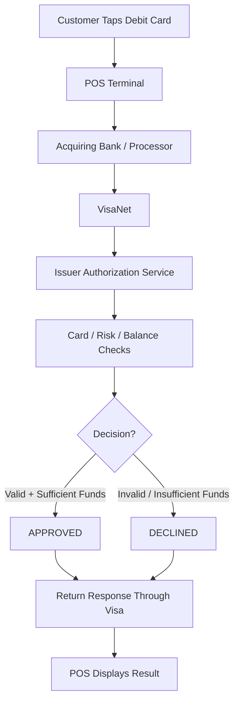
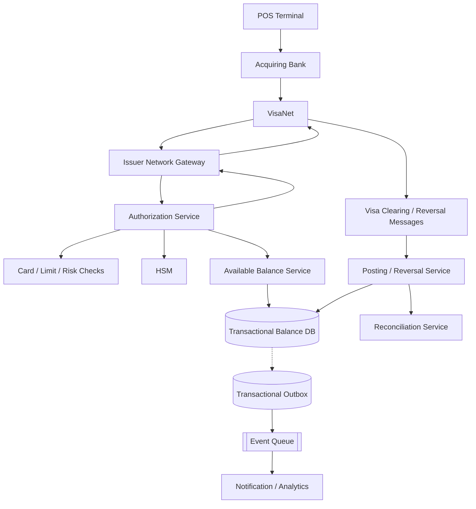
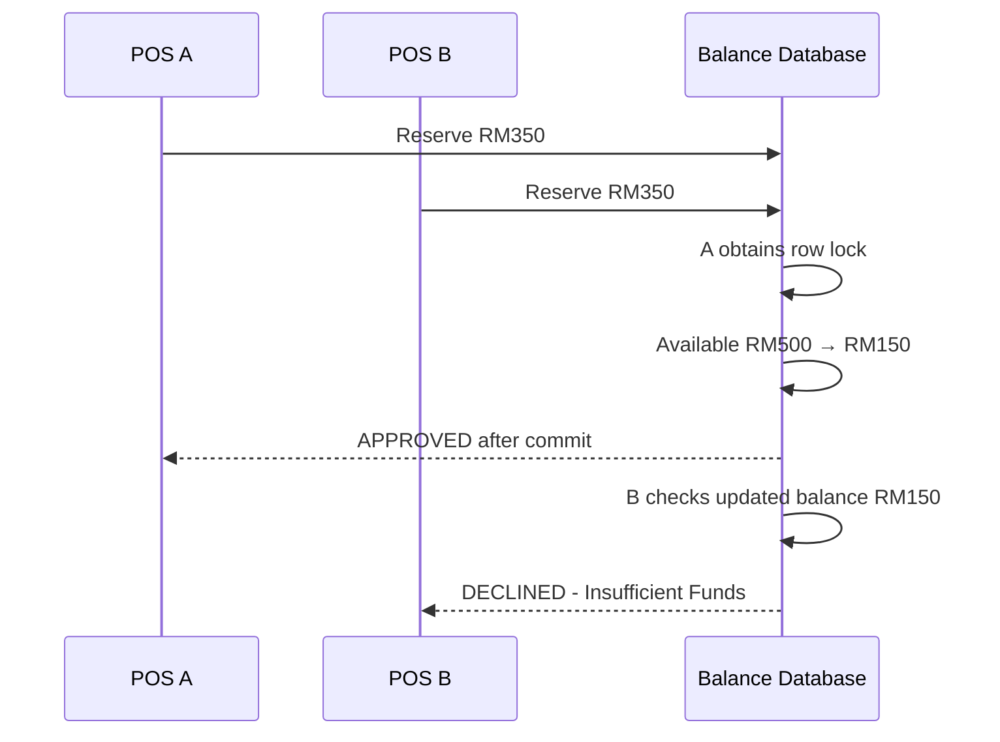
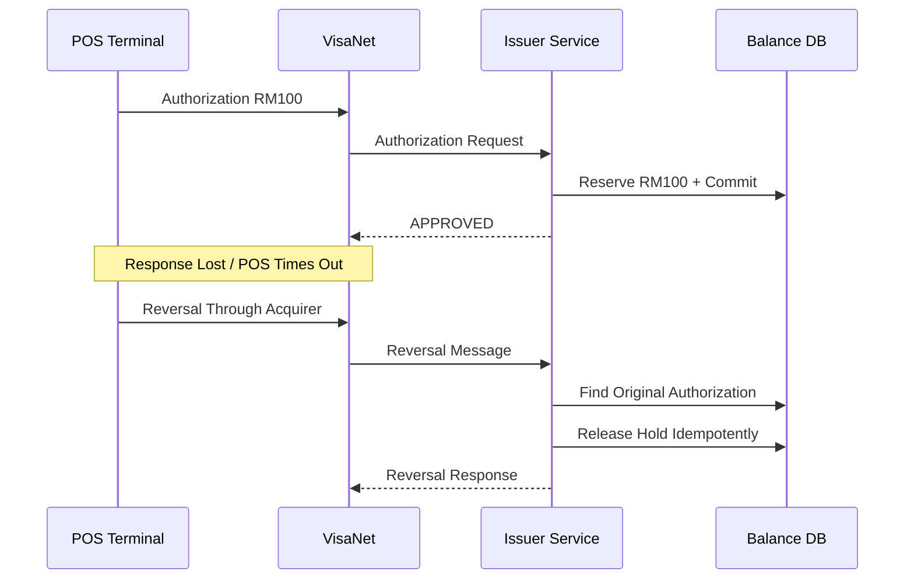
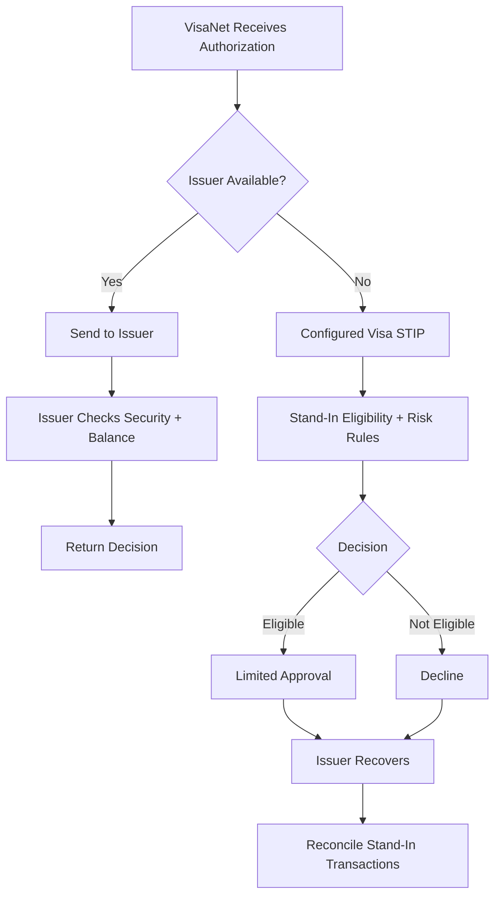

# Design a Visa Debit Card POS System — 20-Minute Interview Guide
> **Goal:** Design an issuer-side Visa Debit authorization system that returns an approve/decline decision within a 6-second customer-experience target, while preventing duplicate holds and overspending.

**Core Concepts:** Real-Time Authorization, VisaNet, HSM, Atomic Balance Reservation, ACID Transactions, Idempotency, Reversals, Clearing, STIP, High Availability

## Understand the Problem

Imagine a customer buys RM100 worth of groceries using a Visa Debit card.

```text
Customer Taps Visa Debit Card
            ↓
POS Terminal
            ↓
Acquiring Bank / Processor
            ↓
VisaNet
            ↓
Our Issuer Authorization System
            ↓
Approve or Decline
            ↓
Return Response to POS
```

**We are designing the issuer side**, meaning our system belongs to the bank that issued the debit card.

We are NOT designing:
- An e-commerce payment gateway.
- A merchant payment service.
- The Visa network itself.
- A complete settlement platform.

### Main Challenges
1. **Latency:** Return a decision within the 6-second target.
2. **Correctness:** Prevent two transactions from spending the same money.
3. **Idempotency:** Visa may retransmit the same authorization.
4. **Reliability:** Recover from database, network, and service failures.
5. **Timeout Handling:** Manage cases where approval succeeds but the POS never receives it.

**Most Important Principle:**
Keep the authorization path synchronous, minimal, secure, and financially correct. Move noncritical work to asynchronous processing.

### Important Visa Timing Distinction

The source notes describe a 6-second **internal customer-experience target**, not a universal Visa-mandated timeout.

They cite April 2026 Visa rules indicating an Asia-Pacific issuer authorization response limit of 10 seconds and separate POS/acquirer timeout requirements.

For this design, we will target:

```text
End-to-End Customer Experience ≤ 6 seconds
Example SLO: ≥ 99% of eligible requests
```

These are proposed engineering targets. Actual network rules and measured processing budgets must be verified for the specific issuer integration.

---
# Step 1 — Requirement Gathering (0–2 Minutes)

## 1.1 Functional Requirements

| Priority | Requirement | Description |
|---|---|---|
| P0 | Receive Authorization | Accept authorization requests routed by Visa |
| P0 | Validate Card | Check active, blocked, expired, or restricted status |
| P0 | Security Verification | Perform required PIN / EMV verification |
| P0 | Fraud and Limits | Check transaction restrictions and risk |
| P0 | Available Balance | Verify sufficient spendable funds |
| P0 | Reserve Funds | Atomically create authorization hold |
| P0 | Return Decision | Approve or decline within deadline |
| P1 | Idempotency | Prevent repeated authorization holds |
| P1 | Reversal | Release or adjust previous holds |
| P1 | Clearing | Finalize authorized transactions |
| P1 | Reconciliation | Resolve mismatched financial records |

### Questions to Ask Interviewer

**Q1: Are we the issuing bank or the acquiring bank?**
- Assume issuer-side system.
- Visa routes authorization requests to us.

**Q2: What is the latency requirement?**
- Target a 6-second end-to-end decision.
- Our issuer processing should consume much less than 6 seconds.

**Q3: Is this a debit or credit card system?**
- Debit card.
- We must check available deposit-account funds.

**Q4: What throughput should we support?**
- Assume 10,000 authorization requests/second for capacity planning.

**Q5: Do we support reversals and clearing?**
- Yes.
- Process them outside the online authorization critical path.

**Q6: What happens if the issuing system is unavailable?**
- Use infrastructure failover.
- Visa Stand-In Processing may be available under configured arrangements.

### Scope

Focus on:
```text
Visa Authorization Request
       ↓
Card / Security Checks
       ↓
Available Balance Check
       ↓
Atomic Balance Hold
       ↓
Approval / Decline Response
```

Background:
- Clearing.
- Reversal processing.
- Reconciliation.
- Analytics.
- Notifications.

**Interview Tip:** Don't spend most of the interview explaining settlement or Kafka. The interviewer wants to know how your issuer makes a safe, fast authorization decision.

---
# Step 2 — Non-Functional Requirements (2–4 Minutes)

| Requirement | Target | Reason |
|---|---|---|
| Latency | Within 6-second customer target | Fast POS checkout |
| Financial Correctness | No unintended double holds | Prevent overspending |
| Availability | Highly available | POS transactions depend on issuer |
| Security | PCI DSS + HSM | Protect card and PIN data |
| Scalability | Assume 10K QPS | Support high transaction volume |
| Durability | Persist committed holds | Survive crashes |
| Idempotency | One hold per logical authorization | Handle retransmissions |
| Consistency | Strong transactional balance updates | Avoid stale-balance approval |

## 2.1 Why Strong Consistency?

Suppose:
```text
Available Balance = RM500

POS A requests RM350.
POS B requests RM350.
```

If both transactions read the same RM500 balance:

```text
POS A reads RM500 → APPROVED
POS B reads RM500 → APPROVED

Total Authorized = RM700
Actual Available = RM500
```

We have overspending.

### Solution

The balance check and reservation must be atomic.

```text
POS A reserves RM350.
New Available = RM150.

POS B checks RM150.
POS B declines RM350.
```

**Decision:** Use a strongly consistent transactional database for authoritative balances and holds.

### Why Not Eventual Consistency?

A replica or cache might show the old balance before a recent hold has been applied.

This is unacceptable for an authoritative debit authorization.

## 2.2 Why Durability?

Imagine:
```text
1. Transaction approved.
2. Issuer sends APPROVED.
3. Database crashes.
4. Authorization hold disappears.
```

The bank has issued an approval but lost its reservation record.

**Solution:** Commit the authorization and hold durably before returning approval.

## 2.3 What If We Cannot Verify Essential Information?

For example:
```text
HSM Unavailable
Balance Database Unavailable
```

**Do not simply approve every transaction.**

If the issuer cannot safely authorize, it must use an approved failure response or an appropriately configured network stand-in mechanism.

**Key Principle:** Availability cannot come at the cost of uncontrolled financial risk.

---
# Step 3 — Understand the Visa POS Transaction Flow

## 3.1 Visa POS Authorization



### Who Is Responsible for What?

| Participant | Responsibility |
|---|---|
| POS Terminal | Collect transaction/card data |
| Acquirer | Processes transaction for merchant |
| VisaNet | Routes authorization to issuer |
| Issuer | Decides approve or decline |
| Issuer Balance DB | Checks and reserves funds |

### Example

Customer spends RM100.

```text
1. POS sends authorization request.
2. Visa routes request to issuer.
3. Issuer validates card.
4. Issuer verifies required security data.
5. Issuer checks transaction limits and fraud.
6. Issuer checks available balance.
7. Issuer reserves RM100 atomically.
8. Issuer returns APPROVED.
```

### Authorization Is Not Settlement

**Authorization:**
```text
Reserve RM100.
```

**Clearing / Posting:**
```text
Convert the authorization into a final financial debit.
```

These are different stages.

Why?

Because authorization must happen immediately at the POS, while clearing records can arrive later.

---
# Step 4 — High-Level Architecture (4–7 Minutes)

## 4.1 Overall Architecture



## 4.2 Component Responsibilities

| Component | Responsibility | Why |
|---|---|---|
| Issuer Network Gateway | Visa connectivity, message parsing, response formatting | Network protocol handling |
| Authorization Service | Coordinate approve/decline logic | Central decision point |
| Card / Risk Checks | Validate card, limits, fraud rules | Security and risk |
| HSM | Required PIN / EMV cryptographic operations | Secure cryptography |
| Available Balance Service | Verify funds and create hold | Prevent overspending |
| Transactional DB | Store account balances and holds | ACID correctness |
| Outbox + Queue | Publish authorization results asynchronously | Reliable side effects |
| Posting Service | Handle clearing and reversals | Finalize or release holds |
| Reconciliation | Detect mismatches | Financial recovery |

## 4.3 Why Not Use Kafka in the Critical Path?

### Option A — Kafka in Authorization Path

```text
Visa
 ↓
Kafka
 ↓
Authorization Worker
 ↓
Database
 ↓
Kafka
 ↓
Visa Response
```

### Problem

Kafka can scale throughput, but here it adds:
- Queue waiting time.
- Consumer scheduling latency.
- More failure dependencies.
- Additional response-correlation complexity.

We must return a decision within a tight deadline.

### Better Design — Synchronous Authorization

```text
Visa
 ↓
Authorization Service
 ↓
Security + Balance Checks
 ↓
Database Transaction
 ↓
Immediate Visa Response
```

After committing:

```text
Committed Authorization
        ↓
Transactional Outbox
        ↓
Queue
        ├── Notification
        ├── Analytics
        └── Reporting
```

### Why?

Authorization is a request-response operation.

Everything necessary to make the decision belongs in the synchronous path.

Everything not required for the decision should be asynchronous.

**Our Decision:** Don't use Kafka to coordinate the online authorization request/response.

This doesn't mean Kafka is unsuitable for payment systems generally. It is useful for background processing.

## 4.4 Why Not Split Everything Into Microservices?

Imagine:
```text
Authorization Service
      ↓
Card Service
      ↓
Fraud Service
      ↓
PIN Service
      ↓
Balance Service
      ↓
Database
```

Each remote call adds:
- Network latency.
- Timeout risk.
- Dependency failures.

### Better Design

```text
Authorization Service
├── Card Validation Module
├── Limit / Risk Module
├── HSM Integration
└── Balance Authorization Module
```

Keep required dependencies low latency and avoid unnecessary network hops.

**Trade-off:**
- Fewer calls → More predictable latency.
- Highly separated services → Greater independent scalability but more network overhead.

**Our Choice:** Tightly integrated, well-defined authorization modules for the hot path.

---
# Step 5 — 6-Second Latency Budget (7–10 Minutes)

## 5.1 End-to-End Timing

The 6-second target covers the route from the transaction being sent by the terminal through the network and back.

It is NOT just our database-processing time.

### Illustrative Latency Budget

| Stage | Budget |
|---|---:|
| POS / Acquirer Request Path | 900 ms |
| Visa Routing to Issuer | 600 ms |
| Issuer Network Gateway | 200 ms |
| HSM Cryptographic Verification | 500 ms |
| Card / Risk / Limits | 400 ms |
| Atomic Balance Hold + Commit | 500 ms |
| Return Response to Terminal | 1,100 ms |
| Buffer for Variability | 1,800 ms |
| **Total** | **6,000 ms** |

These are illustrative engineering allocations from the source notes, not measured Visa network performance.

They assume customer PIN entry/card interaction is already completed.

### Our Issuer Internal Target

```text
Gateway          = 200 ms
HSM Verification = 500 ms
Risk / Limits    = 400 ms
Database Commit  = 500 ms
-------------------------
Issuer Budget    = 1,600 ms
```

**Why target 1.6 seconds internally?**

Because we don't control:
- POS terminal.
- Acquiring bank.
- All Visa network routing.
- Return network latency.

We need sufficient headroom for those components.

## 5.2 How to Reduce Authorization Latency

### A. Minimize Network Hops
Deploy required services and dependencies in a low-latency topology.

**Why?** Every extra remote call introduces latency and another potential timeout.

### B. Cache Safe Reference Data
Examples:
```text
Card Configuration
Card Restrictions
Spending Limit Configuration
Precomputed Risk Features
```

**Why?** Avoid repeated expensive lookups.

**Important:** Cache invalidation and freshness matter for blocked cards or changed restrictions.

### C. Don't Cache Authoritative Available Balance for Approval
Wrong:
```text
Redis Available Balance = RM500

Two requests read RM500.
Both approve RM350.
```

**Better:** Use atomic operations in the authoritative balance database.

### D. Use Connection Pooling
Reuse:
- Database connections.
- Persistent network connections.
- HSM connectivity where supported.

**Why?** Avoid connection-setup overhead per transaction.

### E. Set Dependency Deadlines
Example:
```text
Risk Check Takes Too Long
        ↓
Apply Preapproved Fallback Policy
        ↓
Continue or Decline as Policy Requires
```

Not all checks can be skipped.

**Essential cryptographic checks and authoritative balance validation must not be silently bypassed.**

### F. Monitor Tail Latency
Track:
```text
p50
p95
p99
p99.9
```

### Why p99?

Imagine:
```text
Average Latency = 200 ms
1% of Requests = 8 seconds
```

The average looks good, but many customers experience timeouts.

**Decision:** Monitor p99/p99.9 issuer processing latency as well as end-to-end performance.

---
# Step 6 — Database, Atomic Holds and Failure Handling (10–18 Minutes)

## 6.1 Why Is Debit Different From Credit?

Debit authorization checks funds associated with a deposit account.

### Example

```text
Posted Balance = RM500
Existing Holds = RM100

Available Balance = RM400
```

Simplified formula:

```text
Available Balance
= Posted Balance - Active Holds
```

Actual banking logic may also consider overdrafts, restrictions, pending credits, and additional reserves.

Suppose the customer buys RM350:

```text
Before:
Posted Balance = RM500
Active Holds   = RM100
Available      = RM400

New Purchase = RM350
```

After approval:

```text
Posted Balance = RM500
Active Holds   = RM450
Available      = RM50
```

**Important:** Authorization reserves funds; it doesn't necessarily reduce the posted balance immediately.

---

## 6.2 Race Condition — Concurrent Purchases

### Problem

The customer has RM500 available.

Two POS transactions arrive simultaneously:

```text
POS A → RM350
POS B → RM350
```

### Wrong Implementation

```java
BigDecimal balance = account.getAvailableBalance();

if (balance.compareTo(amount) >= 0) {
    createHold(amount);
    return APPROVED;
}
```

### Why Is This Wrong?

Two requests may read the same balance before either writes its hold.

```text
A reads RM500.
B reads RM500.

A decides APPROVED.
B decides APPROVED.

Total Held = RM700.
```

This is a race condition.

### Solution — Atomic Conditional Balance Reservation

Use PostgreSQL with an ACID transaction.

Conceptual SQL:

```sql
UPDATE account_balances
SET held_minor = held_minor + 35000
WHERE account_id = :account_id
  AND posted_minor - held_minor >= 35000
RETURNING account_id;
```

### How It Works

If one row is updated:
```text
Sufficient funds found.
RM350 reserved.
```

If zero rows are updated:
```text
Insufficient available balance
OR account not found / not eligible.
```

Inspect the reason and apply the correct decline logic.

### Why Is This Atomic?

PostgreSQL coordinates concurrent updates to the same row.

One transaction updates the balance first.

The competing transaction checks the updated state.

### Concurrent Example



**Result:**
```text
POS A = APPROVED
POS B = DECLINED

No overspending.
```

---

## 6.3 Atomic Authorization Transaction

We need more than just updating the balance.

The transaction must also record that the authorization happened.

### Correct Flow

```text
BEGIN TRANSACTION

1. Check existing network transaction identity.
2. Lock/validate relevant account state.
3. Validate sufficient available balance.
4. Update reserved amount.
5. Insert authorization hold.
6. Store APPROVED decision.
7. Commit transaction.

Return approval to Visa.
```

For a declined request:
```text
Record appropriate decline decision
without reserving funds.
```

### Why Store Decision and Hold Together?

Imagine:
```text
Balance Hold Committed
Authorization Record Missing
```

If Visa retries, we might not recognize the earlier hold.

### Better

```text
Balance Reservation
+
Authorization Record
+
Hold Record

All in ONE transaction.
```

**Key Principle:** Atomicity prevents partial financial state.

---

## 6.4 Database Schema

| Table | Important Fields | Purpose |
|---|---|---|
| cards | card_id, account_id, status, limits | Card information |
| accounts | account_id, currency, status | Deposit account |
| account_balances | account_id, posted_minor, held_minor, version | Available funds |
| authorizations | authorization_id, network_txn_key, amount, status, response_code | Decisions + deduplication |
| authorization_holds | hold_id, authorization_id, amount, status | Reserved money |
| financial_postings | posting_id, transaction_id, account_id, amount | Final debit entries |
| outbox_events | event_id, type, payload | Async notifications |

### Important Constraints

```sql
UNIQUE (network_txn_key)
UNIQUE (authorization_id)
```

A valid deduplication key must follow the actual Visa/acquirer message specification.

### STAN and RRN

**STAN:**
System Trace Audit Number.

**RRN:**
Retrieval Reference Number.

These identifiers help trace card-network transactions.

**Important:** STAN alone is not globally unique.

The deduplication identity may need relevant transaction identifiers, acquirer information, terminal identifiers, and date/context fields.

Do not assume that every message with the same STAN is necessarily the same logical transaction.

---

## 6.5 Authorization Hold vs Final Debit

### Example: Authorization RM100

Before:
```text
Posted Balance = RM500
Active Holds   = RM0
Available      = RM500
```

After authorization:
```text
Posted Balance = RM500
Active Holds   = RM100
Available      = RM400
```

After matching clearing:
```text
Posted Balance = RM400
Active Holds   = RM0
Available      = RM400
```

### Why Remove the Hold?

Because the transaction has now become a final debit.

**Wrong:**
```text
Posted Balance = RM400
Active Holds = RM100

Available = RM300
```

This would deduct the same amount twice from available funds.

### Correct Clearing Transaction

```text
BEGIN

1. Find original authorization.
2. Match clearing record.
3. Apply financial posting.
4. Release / adjust corresponding hold.
5. Mark clearing as processed.

COMMIT
```

### Important Edge Cases
- Partial clearing.
- Clearing amount differs from authorization.
- Hold already reversed.
- Hold expired.
- Duplicate clearing message.

**Fallback:** Use network-compliant matching, posting, exception handling, and reconciliation.

---

## 6.6 Failure A — Visa Retransmits Same Authorization

### Problem

```text
Visa sends A001.
Issuer reserves RM100.

Response lost.

Visa sends A001 again.
```

Without idempotency:
```text
First Request  → Hold RM100
Second Request → Hold RM100

Total Held = RM200
```

### Solution — Durable Idempotency

Use a unique network transaction identity.

```text
First Request:
A001 → Reserve RM100
A001 → Store APPROVED
COMMIT

Repeated Request:
A001 → Existing Authorization Found
Return Recorded APPROVED
No New Hold
```

### Why Database Uniqueness?

Two issuer instances may receive equivalent transactions concurrently.

Application checks alone can race.

### Fallback

If the first application instance crashes after committing but before responding:
- Second instance retrieves committed authorization.
- Returns the recorded response.
- Does not reserve again.

**Key Concept:** Idempotency protects against network retries.

---

## 6.7 Failure B — Authorization Approved but POS Times Out

### Problem

```text
1. Issuer reserves RM100.
2. Issuer commits APPROVED.
3. Response is sent toward Visa.
4. POS times out before receiving approval.
```

Our database:
```text
Authorization = APPROVED
Hold = RM100
```

POS:
```text
Transaction outcome unknown / timed out.
```

### Solution — Authorization Reversal

A reversal requests cancellation or adjustment of an earlier authorization.



### What Is a Reversal?

It cancels or adjusts an authorization.

**Not the same as a refund.**

| Reversal | Refund |
|---|---|
| Adjusts/cancels authorization | Returns funds after payment posting |
| Releases or adjusts hold | Creates a separate financial movement |
| Before or around clearing | Typically after capture/posting |

### What If Reversal Arrives Twice?

```text
Reversal 1 → Release RM100
Reversal 2 → Already Released, No Extra Credit
```

**Solution:** Idempotent reversal processing.

### What If Clearing Arrives After Reversal?

Do not silently discard a valid clearing record.

Use scheme-compliant posting, exception handling, and reconciliation.

**Important:** Reversal correctness must be based on original authorization identity and current financial state.

---

## 6.8 Failure C — Issuer Completely Unavailable

### Problem

```text
Visa sends authorization.
Issuer Service = DOWN.
```

The issuer cannot return a normal decision.

### Solution — Visa Stand-In Processing (STIP)

**STIP = Stand-In Processing.**

Under configured network arrangements, Visa can make certain authorization decisions on behalf of an unavailable issuer.



### Why STIP?

It can preserve some payment availability when the issuing bank is offline.

### Main Risk

Visa may not have the issuer's exact live available balance.

Example:
```text
Customer Balance = RM500
Issuer Offline

Several stand-in transactions occur.
```

The issuer must reconcile what Visa approved when its systems recover.

### Risk Controls
- Configured transaction limits.
- Card restrictions.
- Stand-in eligibility.
- Available risk/account information.
- Recovery reconciliation.

### Important

STIP is not a blanket rule to approve all transactions.

Not every transaction qualifies, and capabilities depend on the actual issuer/network arrangements.

---

## 6.9 Failure D — Database Primary Crashes

### Problem

```text
Authorization Service = Healthy
Primary Balance DB = DOWN
```

We cannot safely create new authoritative holds.

### Solution — Highly Available Database

Deploy:
```text
Availability Zone A → Primary DB
Availability Zone B → Standby/Replica
Availability Zone C → Additional Replica
```

Use safe failover procedures that preserve committed state.

### Why Must Failover Be Careful?

Imagine two database primaries accidentally accept writes at the same time.

```text
Primary A sees RM500.
Primary B sees RM500.

Both approve RM350.
```

This is a split-brain failure.

### Solution
- One authoritative writer per account.
- Safe leader/primary failover.
- No split-brain balance updates.
- Appropriate replication/durability guarantees.

### Fallback

If correctness cannot be guaranteed during failover:
- Stop direct issuer approvals temporarily.
- Use approved network stand-in procedures if available.
- Resume normal authorization once authoritative state is safe.

---

## 6.10 Why Not Use Redis as Backup Balance Database?

### Problem

```text
PostgreSQL = DOWN
Redis Cached Balance = RM500
```

The actual current balance may be lower because recent holds haven't reached Redis.

### Wrong Fallback

```text
Use cached RM500.
Approve RM350.
```

### Risk

Two transactions can spend the same money.

### Better

```text
Authoritative DB Healthy
    ↓
Normal Authorization

Authoritative DB Unavailable
    ↓
Safe Failover or Configured STIP
```

**Decision:** Never treat a potentially stale Redis balance as the final authorization authority.

Redis can still cache suitable reference or risk data with freshness controls.

---

## 6.11 Failure E — HSM or Risk Service Slow

### HSM Unavailable

Required cryptographic verification may not be possible.

**Fallback:**
- Use available redundant HSM capacity.
- Apply approved cryptographic/network failure policy.
- Do not silently skip mandatory verification.

### Fraud/Risk Service Slow

Use fast local or precomputed signals where supported.

If an optional risk dependency times out:
- Apply a documented risk-approved fallback policy.
- Do not automatically approve high-risk transactions.

### Why?

We must balance latency, availability, and fraud risk.

**Important:** Not every dependency has the same failure policy.

---

## 6.12 Complete Failure Handling Table

| Failure | Solution | Fallback |
|---|---|---|
| Two transactions spend same balance | Atomic Conditional Update | Decline insufficient funds |
| Visa retransmits authorization | Durable Idempotency | Return existing decision |
| Application crashes after DB commit | Stored authorization response | Replay existing response |
| POS times out after approval | Authorization Reversal | Reconcile pending hold |
| Reversal duplicated | Unique reversal identity | Skip repeated release |
| Clearing after reversal | Scheme-compliant posting rules | Exception reconciliation |
| Issuer service crashes | Multi-instance failover | Healthy instance |
| Database primary crashes | Safe DB failover | Pause issuer approvals if necessary |
| Redis down | Authoritative DB still used | Bypass safe caches |
| HSM unavailable | Redundant HSM | Approved failure handling |
| Risk check slow | Deadline + precomputed signals | Risk-approved fallback |
| Entire issuer offline | Visa STIP where configured | Risk-limited stand-in |
| Event queue down | Transactional Outbox | Retry asynchronously |
| Clearing duplicated | Idempotent posting | Skip repeated financial effect |
| Balance/posting mismatch | Reconciliation | Investigation/correction |

---
# Step 7 — Trade-offs + Improvements (18–20 Minutes)

## 7.1 Key Technology Decisions

| Decision | Why Choose It? | Trade-off |
|---|---|---|
| Synchronous Authorization | Predictable low latency | Required dependencies must be available |
| Transactional SQL Balance | Prevents overspending | Account-row contention |
| Atomic Conditional Updates | Safe concurrent authorization | DB coordination |
| Durable Idempotency | Prevent duplicate holds | More stored state |
| HSM | Secure PIN/EMV verification | Specialized infrastructure |
| Redis Reference Cache | Faster safe lookups | Cache invalidation |
| Async Outbox + Queue | Keeps noncritical work off hot path | Delayed downstream updates |
| Multi-AZ DB | Better availability | Replication/failover complexity |
| Visa STIP | Limited outage continuity | Potential balance/risk exposure |
| Reconciliation | Financial correctness verification | Background operations |

## 7.2 Should We Use Redis for Balance?

**No**, not as the final approval authority if it is a potentially stale cache.

Use the authoritative transactional balance store.

## 7.3 Should We Use Kafka?

**Yes**, for suitable asynchronous processing:
- Notifications.
- Analytics.
- Audit consumers.
- Background event workflows.

**Not necessarily**, as an intermediary in the online Visa request/response path.

## 7.4 Should We Use Read Replicas?

For reporting and noncritical reads, they can help.

But authorization must not depend on stale replica balances.

### Why?
Replication lag can cause the issuer to approve against an outdated available balance.

### Decision
Read and update authoritative balance state within a concurrency-safe transactional protocol.

## 7.5 Should We Use Multiple Regions?

Multi-region deployment can improve regional resilience.

But debit account correctness is difficult if two regions independently approve spending from the same balance.

### Safer Options
- Single authoritative writer per account.
- Controlled failover.
- Replicated committed state.
- Network stand-in for certain outages.

### Trade-off
More consistency coordination can increase latency and reduce write availability during partitions.

---

## 7.6 Monitoring

| Metric | Why |
|---|---|
| End-to-End Authorization Latency | Customer experience |
| Issuer p95/p99/p99.9 Latency | Detect tail latency |
| Visa Response Timeout Rate | Detect network/issuer problems |
| Technical Approval/Failure Rate | Detect service issues |
| Business Decline Rate | Distinguish insufficient funds/risk declines |
| Database Lock Wait | Detect account contention |
| HSM Latency | Detect crypto bottleneck |
| Duplicate Authorization Attempts | Monitor retransmissions |
| Duplicate Hold Count | Financial correctness |
| Unmatched Reversals | Detect unreleased holds |
| Unmatched Clearing | Detect posting issues |
| STIP Activation | Monitor issuer outage exposure |
| Reconciliation Discrepancies | Detect financial mismatches |

**Important:** A declined transaction is not always a system failure.

Example:
```text
Insufficient Funds → Legitimate Decline
```

Monitor technical failures separately from legitimate business declines.

---
# Complete End-to-End Example

Customer has:

```text
Posted Balance = RM500
Existing Holds = RM100
Available      = RM400
```

Customer taps card for RM350.

## Phase 1 — Network

```text
1. Customer taps Visa Debit card.
2. POS sends authorization through acquirer.
3. VisaNet routes authorization to issuer.
4. Issuer Network Gateway parses request.
```

## Phase 2 — Validation

```text
5. Validate card status.
6. Perform required HSM cryptographic checks.
7. Check spending limits.
8. Apply fraud/risk checks.
```

## Phase 3 — Atomic Reservation

```text
9. Check network transaction identity.
10. Start DB transaction.
11. Check available balance RM400.
12. Atomically reserve RM350.
13. Save authorization and hold.
14. Commit.
```

New state:

```text
Posted Balance = RM500
Active Holds   = RM450
Available      = RM50
```

## Phase 4 — Response

```text
15. Return APPROVED to Visa.
16. Visa routes decision to acquirer.
17. POS displays Approved.
```

## Phase 5 — Later Clearing

```text
18. Visa clearing record arrives.
19. Match original authorization.
20. Post final debit.
21. Release matching hold.
22. Reconcile accounting state.
```

Assuming RM350 is cleared:

```text
Posted Balance = RM150
Remaining Holds = RM100
Available       = RM50
```

## Phase 6 — Failure Recovery

If POS times out after approval:
```text
Reversal arrives.
   ↓
Match original authorization.
   ↓
Release RM350 hold once.
   ↓
Reconcile if required.
```

If issuer becomes unavailable:
```text
Normal authorization unavailable.
   ↓
Safe infrastructure failover.
   ↓
Configured Visa STIP when applicable.
   ↓
Reconcile stand-in transactions after recovery.
```

---
# Final 60-Second Interview Answer

When asked **"Design a Visa Debit POS Authorization System with a 6-second response target"**, I would explain:

> I would focus on issuer-side real-time authorization. When a customer taps their Visa Debit card, the request travels from the POS terminal through the acquirer and VisaNet to our issuer authorization service.
>
> The issuer validates card status, performs required cryptographic verification using an HSM, checks transaction limits and fraud rules, and verifies sufficient available balance.
>
> To prevent overspending, I would use an authoritative transactional database with atomic conditional balance updates. The balance reservation, hold record, and authorization decision must commit together before returning approval.
>
> For latency, I would keep the critical path synchronous and minimal, avoid unnecessary service calls, cache only suitable reference data, use connection pooling, and monitor p99 latency.
>
> For reliability, I would implement durable idempotency to handle repeated Visa messages, authorization reversals when transactions time out, and clearing reconciliation to finalize holds correctly.
>
> I would deploy the issuer across multiple availability zones with safe database failover. During wider issuer outages, Visa Stand-In Processing may provide limited authorization continuity under configured risk controls.
>
> Finally, I would keep notifications and analytics asynchronous so they do not delay the authorization response.

---
# Quick Revision Table

| Problem | Solution | Why |
|---|---|---|
| POS requires fast response | Minimal synchronous path | Reduce latency |
| Multiple services add delay | Tightly integrated auth modules | Fewer network hops |
| Debit overspending | Atomic balance reservation | Prevent double spending |
| Concurrent POS requests | SQL conditional update | Serialize conflicting balance changes |
| Visa retransmits request | Durable idempotency | Avoid duplicate holds |
| Response lost after commit | Stored authorization decision | Safe retry |
| POS times out | Authorization Reversal | Release abandoned hold |
| Duplicate reversal | Idempotent release | Avoid extra credit |
| Clearing arrives later | Match + Post + Release Hold | Finalize debit |
| Database crashes | Safe failover | Preserve balance correctness |
| Redis stale | Never use as balance authority | Prevent incorrect approval |
| HSM slow/unavailable | Redundancy + approved fallback | Security and latency |
| Entire issuer offline | Visa STIP | Limited availability |
| Queue unavailable | Transactional Outbox | Preserve async events |
| Financial mismatch | Reconciliation | Detect and correct discrepancies |

## Final Mental Model

```text
VISA POS AUTHORIZATION
├── POS Terminal
├── Acquirer
├── VisaNet
├── Issuer Network Gateway
└── Authorization Service

SYNCHRONOUS HOT PATH
├── Card Validation
├── HSM Verification
├── Fraud / Limits
├── Available Balance
├── Atomic Hold
└── Visa Response

FINANCIAL CORRECTNESS
├── ACID Transaction
├── Atomic Conditional Update
├── Durable Hold
├── Unique Authorization Identity
├── Idempotency
└── Strong Consistency

LATENCY OPTIMIZATION
├── Minimal Network Hops
├── Safe Reference Caching
├── Precomputed Risk Signals
├── Connection Pooling
├── Bounded Dependency Calls
└── p99 Monitoring

BACKGROUND PROCESSING
├── Transactional Outbox
├── Message Queue
├── Notifications
├── Clearing
├── Financial Posting
└── Reconciliation

FAILURE HANDLING
├── Duplicate Request → Existing Decision
├── POS Timeout → Reversal
├── Duplicate Reversal → Skip
├── DB Failure → Safe Failover
├── Redis Down → Authoritative DB
├── Issuer Down → STIP If Configured
└── Financial Mismatch → Reconciliation
```

## Most Important Takeaway

For this 20-minute interview, prioritize five concepts:

**1. Atomic Balance Reservation**
- Two transactions must not spend the same available money.

**2. Latency Budget**
- Six seconds covers the overall POS-to-issuer-and-back journey, not just database processing.

**3. Durable Idempotency**
- Visa retransmissions must not create additional holds.

**4. Reversal + Clearing**
- Reversals release or adjust authorizations.
- Clearing creates final postings and resolves matching holds.

**5. Fault Tolerance + STIP**
- Handle database/issuer failures safely.
- Maintain limited availability through configured network stand-in mechanisms where applicable.

> **Interview Tip:** Spend around 70% of your technical discussion on the authorization hot path, atomic funds reservation, latency, and failure recovery. These are the most important differences between an issuer-side debit POS system and a general e-commerce payment system.

---
# Source References

The original notes reference:
- [Visa Malaysia](https://www.visa.com.my/)
- [Visa](https://usa.visa.com/)
- [Worldpay Documentation](https://docs.worldpay.com/)

The ISO 8583 message types mentioned in the source include `0100/0110` for authorization request/response and `0400/0410` for reversal request/response in relevant implementations. The exact interface depends on the issuer's network integration.

**Remember:** Authorization, reversal, clearing, and settlement are distinct stages. The six-second target concerns authorization, not the completion of financial settlement.