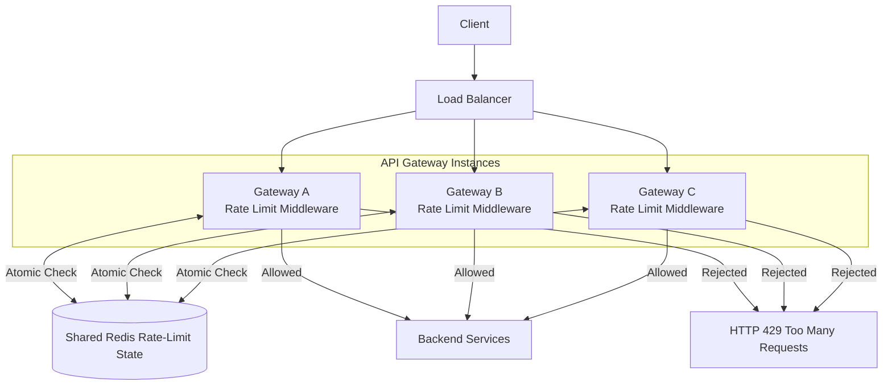
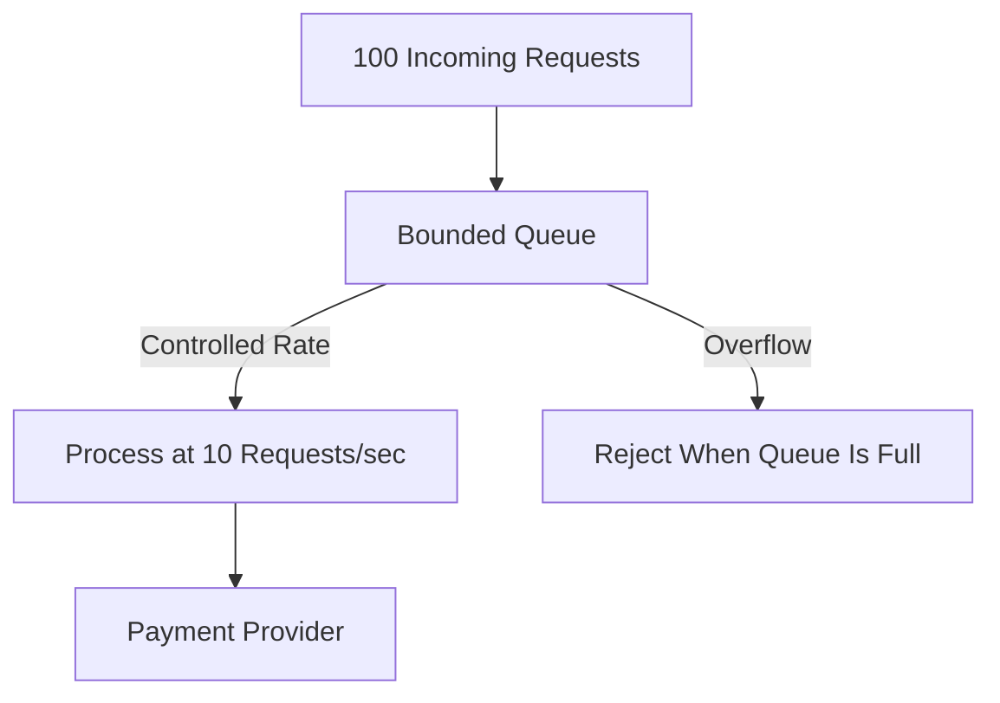
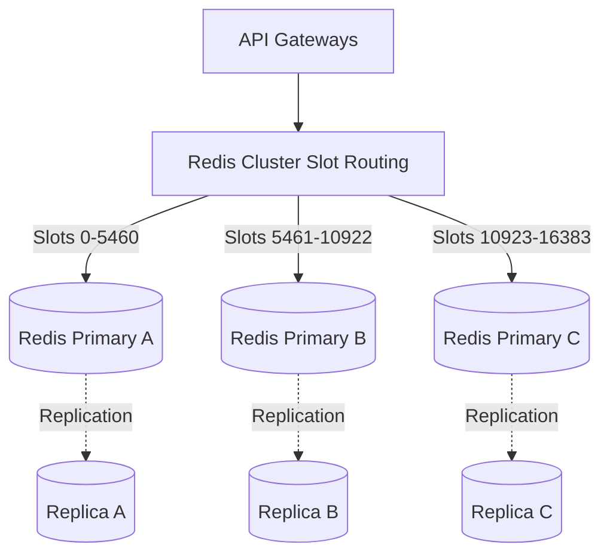
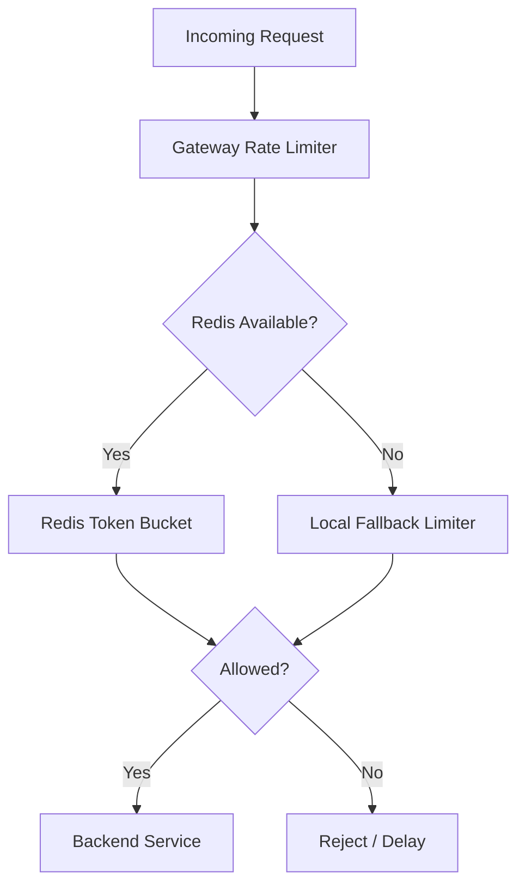
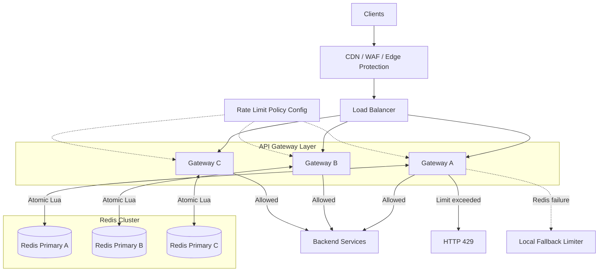
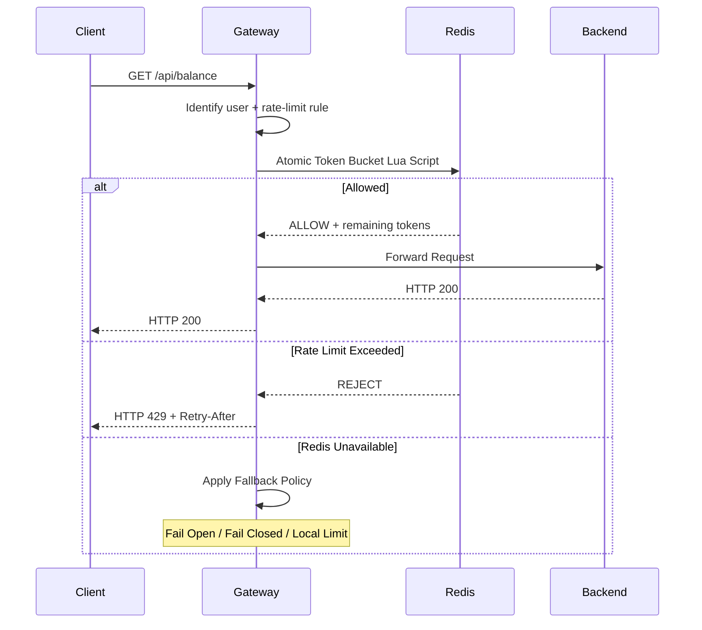

# Design a Distributed Rate Limiter
> **Goal:** Design a scalable rate limiter that protects backend services from excessive requests while maintaining low latency and high availability.

**Practical Example:** Banking API / Social Media API

Imagine our application has several endpoints:
```text
GET  /api/balance    → 100 requests/min/user
POST /api/transfer   → 10 requests/min/user
GET  /api/posts      → 100 requests/min/user
```
A user or bot might send thousands of requests simultaneously. Without rate limiting, this could overload backend servers and databases.

**Our goal:** Control request rates, prevent individual clients from abusing shared resources, and protect backend capacity.

---
# 1. Requirement Gathering

## 1.1 Functional Requirements
1. **Rate Limiting:** Limit requests based on user ID, IP address, or API key.
2. **Configurable Rules:** Different API endpoints have different limits.
3. **Reject Excessive Requests:** Return HTTP 429 when limits are exceeded.
4. **Distributed Enforcement:** Limits must work across multiple application and gateway instances.
5. **Multiple Policies:** Support per-user, per-endpoint, and global rate limits.

### Example
```text
User 101:
GET /api/balance

Limit = 100 requests/min

Requests 1–100 → Allowed
Request 101    → Rejected
```
This example assumes an exact fixed-window or rolling-window quota. A Token Bucket behaves differently because it permits controlled bursts.

## 1.2 Non-Functional Requirements
| Requirement | Explanation |
|---|---|
| Low Latency | Rate-limit checks should add minimal latency |
| High Availability | Minimize disruption if Redis or a gateway fails |
| Scalability | Support millions of requests per second |
| Consistency | Concurrent requests should not bypass the configured limit |
| Memory Efficiency | Avoid storing every request if unnecessary |
| Fault Tolerance | Define fallback behavior when Redis is unavailable |

### Traffic Estimation
Assume:
```text
Peak Traffic = 1,000,000 RPS
Average Rate Limit = 100 requests/min/user
```
At 1 million RPS:
```text
1,000,000 requests/second
≈ 86.4 billion requests/day
```
This means our rate limiter may need to perform approximately **1 million decisions per second**.

**Why is this challenging?**
- Every request needs a rate-limit decision.
- Multiple gateways may receive requests from the same user.
- The shared state store can become a bottleneck.
- Concurrent updates must be handled safely.

**Important:** Rate limiting helps prevent resource exhaustion and abusive traffic, but it is not a complete DDoS defense. Large-scale attacks also require edge protection, CDN, WAF, and DDoS mitigation.

---
# 2. High-Level Design

## 2.1 Where Should We Implement the Rate Limiter?
Possible locations:
1. Client-side
2. Backend application middleware
3. API Gateway

**Decision:** Implement general API rate limits in the **API Gateway / Middleware**.

### Why API Gateway?
- Reject excessive requests before they reach backend services.
- Centralize common rate-limit policies.
- Avoid duplicating logic in every API handler.
- Scale gateway instances horizontally.

Business-specific limits may still be implemented inside backend services.

## 2.2 Architecture


### Request Flow
1. Client sends an API request.
2. Load Balancer distributes the request to an API Gateway.
3. Gateway identifies the authenticated user or other rate-limit identity.
4. Gateway determines the applicable rate-limit rule.
5. Gateway checks and updates rate-limit state in Redis.
6. If allowed, forward request to the backend.
7. Otherwise, return HTTP 429.

### Why Redis?
- Fast in-memory operations.
- Shared state across multiple gateways.
- Supports key expiration (TTL).
- Supports atomic server-side operations.
- Can scale through Redis Cluster.

**Important:** Redis stores rate-limit state. It does not normally act as the HTTP proxy forwarding requests to backend services.

---
# 3. Rate-Limiting Algorithms

There are five common algorithms:
1. Fixed Window Counter
2. Sliding Window Log
3. Sliding Window Counter
4. Token Bucket
5. Leaky Bucket

## 3.1 Fixed Window Counter
### How It Works
Divide time into fixed intervals and count requests.

Example:
```text
Limit = 100 requests/min

12:00:00–12:00:59 → Maximum 100
12:01:00–12:01:59 → Maximum 100
```
### Problem: Boundary Burst
```text
12:00:59 → 100 requests
12:01:00 → 100 requests

Total = 200 requests in around 1 second
```
Both groups belong to different windows, so both are accepted.

### Redis Implementation
```text
Key:
rate_limit:user101:balance:minute123

Value:
100

TTL:
Until after the window expires
```
Commands:
```redis
INCR rate_limit:user101:balance:minute123
EXPIRE rate_limit:user101:balance:minute123 60
```
The initialization, counting, and expiry policy should be handled atomically to avoid races.

**Advantages:** Simple, fast, low memory usage.

**Disadvantage:** Allows excessive traffic around window boundaries.

**When to Use:** Simple quotas where short boundary bursts are acceptable.

---

## 3.2 Sliding Window Log
### How It Works
Instead of fixed time windows, store timestamps of accepted requests.

Example:
```text
Limit = 3 requests / rolling 60 seconds

10:00:10 → Allowed
10:00:20 → Allowed
10:00:50 → Allowed
10:01:05 → Rejected
10:01:11 → Allowed
```
At 10:01:05, the previous 60 seconds still contain three accepted requests.

At 10:01:11, the request from 10:00:10 has expired from the rolling window, so one slot becomes available.

### Redis Implementation
Use a Sorted Set:
```text
Key:
rate_limit:user101:balance

Score:
Request timestamp

Member:
Unique request ID
```
Conceptual operations:
```text
1. Remove timestamps outside the rolling window.
2. Count remaining accepted requests.
3. If count < limit:
      Insert the new timestamp.
      Allow request.
4. Otherwise:
      Reject request.
```
These operations must execute atomically.

### Why Use Sliding Window Log?
It provides precise rolling-window request counting.

### Disadvantage
It stores one entry per recorded request.

For millions of active users, memory usage can become expensive.

**When to Use:** Strict rolling-window limits where precise request counting matters.

---

## 3.3 Sliding Window Counter
### How It Works
Instead of storing every timestamp, keep:
- Previous window count
- Current window count

Estimate the number of requests in the rolling window.

### Formula
```text
Estimated Count =
Current Count + Previous Count × Remaining Previous-Window Weight
```
### Example
```text
Previous Minute = 80 requests
Current Minute = 20 requests
Elapsed Current Window = 15 seconds
Window Duration = 60 seconds
```
Remaining previous-window weight:
```text
(60 - 15) / 60 = 0.75
```
Estimated count:
```text
80 × 0.75 + 20 = 80 requests
```

### Why Use It?
Provides an approximation of a sliding window while storing only a few counters.

### Advantages
- Lower memory usage than Sliding Window Log.
- Better handling of window boundaries than Fixed Window.
- Suitable for large-scale APIs.

### Disadvantage
It assumes previous-window requests were reasonably uniformly distributed.

Therefore, the count is not exact.

**When to Use:** Large-scale request quotas where approximate rolling-window enforcement is acceptable.

---

## 3.4 Token Bucket — Recommended Default
### How It Works
Each user has a bucket containing tokens.

Example:
```text
Bucket Capacity = 10 tokens
Refill Rate = 2 tokens/second
Each Request = 1 token
```
### Practical Example
At t=0:
```text
Bucket contains 10 tokens.

User sends 10 requests.
10 requests allowed.

Tokens remaining = 0
```
At t=2 seconds:
```text
2 tokens/sec × 2 sec = 4 tokens

User sends 6 requests.

4 allowed
2 rejected
```
### Formula
```text
tokens = min(
    capacity,
    previousTokens + elapsedTime × refillRate
)
```
If at least one token is available:
```text
tokens = tokens - 1
ALLOW
```
Otherwise:
```text
REJECT
```

### Why Token Bucket?
Real users often make requests in short bursts.

For example, opening a banking application might trigger:
```text
GET /profile
GET /balance
GET /transactions
GET /notifications
```
We don't necessarily want to reject those requests just because they happen close together.

Token Bucket allows controlled bursts while limiting sustained traffic.

### Advantages
- Supports controlled bursts.
- O(1) state per rate-limit key.
- Efficient in Redis.
- No background refill worker required.

### Disadvantages
- Doesn't provide an exact rolling-window request limit.
- May allow sudden bursts that overload sensitive downstream services.

**When to Use:** General-purpose APIs that can tolerate controlled bursts.

---

## 3.5 Leaky Bucket
### How It Works
Incoming requests enter a queue.

The system processes them at a fixed rate.

Example:
```text
Incoming Requests = 100
Processing Rate = 10 requests/sec
```
If queue capacity is sufficient:
```text
Second 1 → Process 10
Second 2 → Process 10
Second 3 → Process 10
...
```
### Diagram

### Why Leaky Bucket?
Some downstream services cannot handle bursts.

Example:
```text
Payment provider supports only 10 requests/sec.
```
Token Bucket might immediately allow many requests, but a queue-based Leaky Bucket smooths the processing rate.

### Advantages
- Predictable request throughput.
- Protects downstream capacity.
- Smooths bursts.

### Disadvantages
- Introduces waiting time.
- Requires queue management.
- Full queues cause rejection.
- Queued requests may time out.

**When to Use:** Downstream services requiring a controlled processing rate.

## 3.6 Algorithm Comparison
| Algorithm | Advantage | Disadvantage | Suitable Use |
|---|---|---|---|
| Fixed Window | Simple and cheap | Boundary bursts | Basic quotas |
| Sliding Window Log | Accurate rolling limit | High memory usage | Strict limits |
| Sliding Window Counter | Balanced accuracy/memory | Approximate result | Large-scale quotas |
| Token Bucket | Controlled bursts | Burst traffic still possible | General APIs |
| Leaky Bucket | Smooth throughput | Queue latency | Limited-capacity services |

### Design Decision
**Choose Token Bucket** for general API rate limiting because it is <mark style="background:#ff4d4f">memory-efficient and allows realistic user traffic bursts.</mark>

For APIs requiring strict rolling-window limits, consider Sliding Window Log.

For downstream services that cannot handle bursts, consider a queue-based Leaky Bucket.

---
# 4. Deep Dive 1 — Redis Implementation & Atomicity

## 4.1 Redis Data Structure
Each user and endpoint can have its own bucket.

Example:
```text
Key:
rate_limit:user101:balance

Value:
tokens = 50
last_refill = 1760000000
```
We need to store:
1. Remaining tokens.
2. Last refill timestamp.

### Why Separate Keys by Endpoint?
Different APIs have different limits.

Example:
```text
rate_limit:user101:balance
rate_limit:user101:transfer
rate_limit:user101:posts
```
This prevents balance requests from consuming the transfer-specific quota.

We may also maintain a separate global per-user quota.

## 4.2 Race Condition
### Problem
Suppose:
```text
Remaining tokens = 1
```
Two gateway instances receive requests simultaneously.

```text
Gateway A reads tokens = 1
Gateway B reads tokens = 1

Gateway A → Allow
Gateway B → Allow
```
Both requests are allowed even though only one token was available.

### Why Does This Happen?
The operations:
```text
GET
CHECK
UPDATE
```
are not atomic if executed separately.

Another gateway can read the old value before the update finishes.

## 4.3 Solution — Redis Lua Script
Redis executes Lua scripts atomically on the server.

Conceptual pseudocode:
```text
function checkRateLimit(key, capacity, refillRate):
    now = redisServerTime()

    state = redis.GET(key)

    if state does not exist:
        tokens = capacity
        lastRefill = now
    else:
        tokens = state.tokens
        lastRefill = state.lastRefill

    elapsed = max(0, now - lastRefill)

    tokens = min(
        capacity,
        tokens + elapsed × refillRate
    )

    if tokens >= 1:
        tokens = tokens - 1
        allowed = true
    else:
        allowed = false

    redis.SET(
        key,
        {tokens, lastRefill: now},
        TTL
    )

    return allowed, tokens
```
**Important:** This is conceptual pseudocode. The GET, calculation, decision, and SET run inside one Redis Lua script, not as separate application-side calls.

### Why Lua?
- Prevents concurrent requests from consuming the same token.
- Executes the decision and update atomically.
- Reduces multiple client-server round trips.
- Keeps state consistent within one Redis primary's execution.

### Why TTL?
A user may stop using the application.

We don't want their rate-limit key stored forever.

Example:
```text
Capacity = 100
Refill = 10 tokens/sec

Time to refill completely = 10 seconds
```
After the bucket has been idle long enough to become full, its state can safely expire. A new bucket starts full.

Use a suitable TTL longer than the refill-to-full period.

### Why No Background Refill Worker?
Tokens can be calculated lazily when the next request arrives.

Example:
```text
Last Request = 10 seconds ago
Refill Rate = 2/sec

20 tokens may have refilled.
```
We calculate this only when needed.

This avoids continuously updating millions of inactive buckets.

---
# 5. Deep Dive 2 — Redis Sharding & Scaling

## 5.1 Why Redis Sharding?
Our current architecture uses one Redis instance.

But suppose:
```text
Peak Requests = 1M RPS
```
If every request checks the same Redis instance, that instance could become a bottleneck.

### Solution
Distribute rate-limit keys across multiple Redis primary nodes.

This is called **Redis Sharding**.

## 5.2 How Redis Cluster Sharding Works
Redis Cluster divides the key space into **16,384 hash slots**.

For ordinary keys:
```text
hashSlot = CRC16(key) % 16384
```
Each Redis primary owns a range or set of hash slots.

### Example
```text
Redis Primary A → Slots 0–5460
Redis Primary B → Slots 5461–10922
Redis Primary C → Slots 10923–16383
```
Redis Cluster routes each key to the primary responsible for its hash slot.

### Architecture


### Practical Example
```text
rate_limit:user101:posts → Hash Slot X → Primary A
rate_limit:user202:posts → Hash Slot Y → Primary B
rate_limit:user303:posts → Hash Slot Z → Primary C
```
The actual slot depends on the hash function.

### Why This Works
Different users' buckets can be distributed across different Redis primaries.

But **all requests for the same rate-limit key must reach the same authoritative primary**, so the token count stays consistent.

### What Happens When We Add Redis Nodes?
Redis Cluster can move selected hash slots and their keys to new nodes.

This spreads memory and throughput across additional primaries.

Unlike classic Consistent Hashing, Redis Cluster uses fixed hash slots, so we don't need to build our own hash ring.

## 5.3 How Many Redis Shards?
Suppose a benchmark shows:
```text
One Redis Primary = 80K checks/sec
Peak Traffic = 1M checks/sec
```
Minimum theoretical primary count:
```text
1,000,000 / 80,000 = 12.5

At least 13 primary nodes
```
But 13 is only the theoretical minimum.

We should add headroom for:
- Uneven key distribution.
- Traffic spikes.
- Failover.
- Network overhead.
- Lua execution costs.

**Important:** 80K checks/sec is an illustrative benchmark assumption, not a guaranteed Redis capacity. We need actual load testing.

## 5.4 What If We Have Multiple Rate-Limit Rules?
Suppose User 101 has:
```text
Global user limit = 200 requests/min
Transfer limit = 10 requests/min
```
A transfer request must satisfy both rules.

### Problem
If we check and decrement the two buckets separately, one operation may succeed and the other fail.

Example:
```text
Global bucket decremented.
Transfer bucket rejects request.
```
Now the rejected request has consumed a global token.

### Solution A — Same Redis Hash Slot
Use a Redis hash tag to place related keys in the same slot:
```text
rate_limit:{user101}:global
rate_limit:{user101}:transfer
```
The substring inside `{}` determines the Redis Cluster hash slot.

Both keys map to the same slot, allowing one Lua script to check and update both atomically.

**Trade-off:** Grouping too many hot keys on one slot can create load concentration.

### Solution B — Separate Global Capacity Limiter
A system-wide global limit may not share a slot with per-user buckets.

We can enforce it through:
- Separate admission control.
- Allocated gateway quotas.
- A dedicated global limiter.
- An explicitly approximate policy.

**Important:** A single Redis Cluster Lua script cannot atomically operate on unrelated keys distributed across different hash slots.

## 5.5 Hot-Key Problem
### Problem
A malicious user sends 100K RPS.

All requests use:
```text
rate_limit:user101:posts
```
Even with Redis Cluster, the same key routes to one primary.

That shard could become overloaded.

### Solutions
1. **Local Rejection Cache:** After identifying a blocked client, reject subsequent requests locally for a short, carefully bounded period.
2. **Edge Rate Limiting:** Block abusive traffic before it reaches the gateway.
3. **Per-Gateway Quotas:** Allocate limited capacity to gateways when approximate enforcement is acceptable.
4. **IP/API-Key Blocking:** Apply additional abuse-protection rules.

### Trade-off
Local caches reduce Redis traffic but may make enforcement less immediately responsive to policy changes.

**Key Point:** Redis Sharding spreads different keys across servers. It doesn't automatically distribute one extremely hot key.

---
# 6. Deep Dive 3 — Failure Handling & Fallback

This is an important interview follow-up.

## 6.1 What If Redis Goes Down?
Suppose the gateway cannot read the user's remaining tokens.

Should we accept or reject the request?

There are three practical strategies.

### Strategy A — Fail Open
```text
Redis unavailable
   ↓
Allow request
   ↓
Backend processes request
```
**Advantages:**
- Preserves API availability.
- Users can continue accessing the application.

**Disadvantages:**
- Rate limits are temporarily unenforced.
- Excessive traffic may overload the backend.

**Suitable for:** Low-risk, lightweight endpoints such as product search or content reads.

### Strategy B — Fail Closed
```text
Redis unavailable
   ↓
Reject request
```
**Advantages:**
- Protects expensive backend operations.
- Avoids accepting unverified traffic.

**Disadvantages:**
- Legitimate requests may be rejected.
- Redis failure can cause application unavailability.

**Suitable for:** Very expensive or sensitive operations where uncontrolled admission is unacceptable.

For infrastructure failures, HTTP 503 may be more appropriate than HTTP 429 because the request wasn't necessarily over its quota.

### Strategy C — Hybrid / Degraded Mode (Recommended)
Different endpoints use different fallback policies.

| Endpoint | Normal Policy | Redis Down |
|---|---|---|
| GET /products | Token Bucket | Fail Open + Local Limit |
| GET /balance | Token Bucket | Conservative Local Limit |
| POST /transfer | Strict Policy | Restrict or Fail Closed |
| POST /AI-inference | Cost-Based Limit | Conservative Limit / Reject |

### Why Hybrid?
Different operations have different risks.

A product-search request is usually inexpensive.

A transfer or expensive AI inference request may consume significantly more resources.

**My Choice:** Use a hybrid strategy based on endpoint criticality.

## 6.2 Local Fallback Rate Limiter
When Redis fails, each gateway can temporarily use an in-memory limiter.


### Problem with Local Fallback
Suppose we have three gateways, each enforcing:
```text
100 requests/min/user
```
A user might receive:
```text
Gateway A → 100
Gateway B → 100
Gateway C → 100

Total = 300 requests/min
```
Because the local limiters don't share state.

### Improvement
Use conservative per-instance quotas.

Example:
```text
Global Target = 100 requests/min
3 Gateways

Local Emergency Limit ≈ 30 requests/min/gateway
```
This is only an approximation and works best when the gateway count and traffic routing are controlled.

**Trade-off:** We improve availability but lose exact global enforcement.

For stricter guarantees, use coordinated quota allocation or fail closed.

## 6.3 Redis Replica Failover
Redis Cluster can maintain replicas for each primary.

Example:
```text
Primary A → Replica A1
Primary B → Replica B1
Primary C → Replica C1
```
If Primary A crashes:
1. Cluster detects the failure.
2. An eligible replica may be promoted.
3. Clients update their routing.
4. Rate-limit operations resume.

### Important Limitation
Redis replication is commonly asynchronous.

The promoted replica might not contain the latest token updates.

**Result:** Some recently consumed tokens could appear available again, temporarily allowing additional requests.

Lua provides atomicity during normal execution but doesn't guarantee zero lost counter updates across all failover scenarios.

### Possible Improvements
- Redis replicas and automatic failover.
- Appropriate persistence and replication settings.
- Conservative fallback rules.
- Load testing during failover.
- Accept a documented small rate-limit error if exact enforcement isn't required.

## 6.4 What If a Gateway Crashes?
Because gateway instances are stateless with respect to authoritative limiter state:
1. Load Balancer detects the unhealthy instance.
2. Traffic is sent to healthy gateways.
3. Other gateways continue using the same Redis state.

This is another reason to keep shared rate-limit state outside individual gateway processes.

## 6.5 What If Redis Latency Increases?
We don't want all API requests to wait indefinitely.

### Solution
Configure:
- Short Redis timeouts.
- Circuit breakers.
- Connection pooling.
- Redis health monitoring.
- Endpoint-specific fallback behavior.

### Circuit Breaker
```text
Redis repeatedly times out
   ↓
Circuit Breaker Opens
   ↓
Stop sending every request to failing Redis
   ↓
Use configured fallback
   ↓
Periodically test recovery
```
**Why?** Prevents failing Redis calls from adding latency and overwhelming connection pools.

## 6.6 What If a User Switches Regions?
Suppose the same user sends requests through:
```text
Malaysia Region → Redis A
Singapore Region → Redis B
```
If both regions independently allow 100 requests/min:
```text
Malaysia → 100
Singapore → 100

Total → 200
```
The user exceeds the intended global limit.

### Possible Solutions
1. **Sticky Routing:** Route each user's rate-limit checks to one home region.
2. **Global Shared State:** Coordinate across regions, accepting higher latency.
3. **Regional Quotas:** Divide the global allowance between regions.

**Trade-off:** Strong global enforcement requires more coordination. Independent regional limits offer better regional availability but weaker global accuracy.

---
# 7. Complete Architecture

## 7.1 Final Architecture

**Diagram Note:** Any gateway can communicate with any Redis primary through cluster-aware routing. The arrows are simplified to keep the diagram readable.

## 7.2 Complete Request Flow


## 7.3 HTTP 429 Response
When a user exceeds the limit:
```http
HTTP/1.1 429 Too Many Requests
Retry-After: 10
```
Example:
```json
{
  "error": "rate_limit_exceeded",
  "message": "Please retry later."
}
```
### Why Retry-After?
It tells the client when to retry.

Without it, poorly designed clients might immediately retry rejected requests and create even more traffic.

Clients should use backoff and jitter where appropriate.

---
# 8. Trade-offs + Improvements

## 8.1 Trade-off Summary
| Decision | Advantage | Trade-off |
|---|---|---|
| Token Bucket | Controlled bursts | Not an exact rolling quota |
| Sliding Window Log | Precise rolling limit | Higher memory usage |
| Sliding Window Counter | Memory-efficient approximation | Can be inaccurate for bursts |
| Leaky Bucket | Smooth downstream traffic | Adds queue latency |
| Redis | Fast shared state | Additional infrastructure dependency |
| Lua Script | Atomic decision and update | Script execution must stay short |
| Redis Sharding | Horizontal throughput scaling | More cluster complexity |
| Redis Replicas | Improved availability | Possible counter rollback on failover |
| Fail Open | Preserve availability | Backend may become overloaded |
| Fail Closed | Protect resources | Legitimate users may be rejected |
| Local Fallback | Maintain partial protection | Global limits become approximate |
| Global Rate Limit | Protect total capacity | Coordination overhead |

## 8.2 Improvement 1 — Dynamic Rate-Limit Configuration
Avoid hardcoding all limits in every gateway.

Instead, maintain a centralized policy configuration.

Example:
```json
{
  "balance": {
    "capacity": 100,
    "refill_per_second": 1.67
  },
  "transfer": {
    "capacity": 10,
    "refill_per_second": 0.167
  }
}
```
These values implement Token Bucket refill rates with the given bucket capacities. They do not guarantee exact rolling-minute maximums.

### Why?
Allows operators to change policies without redeploying all gateway services.

Gateways can cache policies locally and refresh or receive updates.

## 8.3 Improvement 2 — Layered Rate Limits
One per-user limiter may not be sufficient.

Example:
```text
Per User:     100 requests/min
Per Endpoint: 10 transfers/min/user
Global API:   100K requests/sec
```
### Why?
Per-user limits provide fairness.

Global limits protect total backend capacity.

**Important:** A global rate limit requires its own safe coordination or approximate capacity-allocation strategy.

## 8.4 Improvement 3 — Monitoring
Track:
- Allowed requests/sec.
- Rejected requests/sec.
- Redis latency and CPU.
- Lua script execution time.
- Redis memory usage.
- Hot keys / hot shards.
- Failover events.
- Fail-open and fail-closed events.
- Rate-limit policy errors.
- Backend overload during fallback.

**Why?** A limiter that silently fails to enforce rules can be just as dangerous as a limiter that rejects too many legitimate requests.

## 8.5 Improvement 4 — Cost-Based Rate Limiting
Not all API requests have the same processing cost.

Example:
```text
GET /balance          → 1 token
POST /transfer        → 5 tokens
POST /generate-report → 20 tokens
```
We can assign different token costs based on resource consumption.

### Why?
A single expensive API request might consume more CPU, database queries, or external service capacity than many lightweight reads.

This is particularly useful for AI inference APIs, report generation, and other costly operations.

## 8.6 Improvement 5 — Protect Against DDoS
Application-level rate limiting isn't enough for large-scale DDoS attacks.

Even rejected requests consume some gateway and network resources.

Add upstream protection:
```text
Client
  ↓
CDN / WAF / DDoS Protection
  ↓
API Gateway Rate Limiter
  ↓
Backend
```
### Why?
Block or absorb abusive traffic before it reaches the application infrastructure.

---
# Interview Summary

If an interviewer asks **"Design a Distributed Rate Limiter"**, I would explain:

> First, I would clarify whether limits are per user, IP, API key, or endpoint, and whether we need controlled bursts or an exact rolling-window guarantee.
>
> I would implement rate limiting at the API Gateway so excessive requests are rejected before reaching backend services.
>
> For general-purpose APIs, I would choose Token Bucket because it allows controlled bursts and requires constant state per rate-limit key.
>
> I would use Redis to share bucket state across multiple gateway instances. Each bucket would store remaining tokens and the last refill timestamp.
>
> To prevent race conditions, I would use Redis Lua scripts to perform the read, refill, decision, and update atomically.
>
> For scaling, I would use Redis Cluster to distribute keys across multiple primaries using its 16,384 hash slots. Each user's bucket would remain on one authoritative shard.
>
> To improve availability, I would use Redis replicas and automatic failover.
>
> If Redis becomes unavailable, I would apply endpoint-specific fallback policies. Lightweight APIs may fail open with local limits, while sensitive or expensive APIs may use conservative limits or fail closed.
>
> Finally, I would address hot keys, multiple simultaneous policies, regional consistency, monitoring, and HTTP 429 responses.

---
# Quick Revision Table

| Problem | Solution | Why |
|---|---|---|
| User sends excessive requests | Rate Limiter | Protect shared resources |
| Different API limits | Configurable Policies | Match endpoint requirements |
| Need controlled bursts | Token Bucket | Allow realistic traffic patterns |
| Downstream cannot handle bursts | Leaky Bucket | Smooth request throughput |
| Fixed window boundary burst | Sliding Window | Reduce boundary errors |
| Multiple gateways have separate counters | Redis | Shared authoritative state |
| Concurrent requests bypass limits | Lua Script | Atomic check and update |
| One Redis instance overloaded | Redis Cluster | Shard different keys |
| One user overloads a Redis shard | Local Rejection / Edge Protection | Reduce hot-key traffic |
| Redis primary crashes | Replica Failover | Restore limiter availability |
| Redis unavailable | Hybrid Fallback | Balance availability and protection |
| Gateway crashes | Load Balancer | Route to healthy instances |
| Cross-region quota inconsistency | Regional Quotas / Global Coordination | Control total allowance |
| Different endpoint processing costs | Weighted Token Costs | Reflect resource usage |
| DDoS attacks | CDN / WAF | Protect infrastructure upstream |

## Final Mental Model
```text
RATE LIMITING ALGORITHMS
├── Fixed Window
├── Sliding Window Log
├── Sliding Window Counter
├── Token Bucket
└── Leaky Bucket

DISTRIBUTED ARCHITECTURE
├── API Gateway Middleware
├── Shared Redis State
├── Atomic Lua Scripts
└── Configurable Policies

SCALABILITY
├── Horizontal Gateway Scaling
├── Redis Cluster Sharding
├── Redis Hash Slots
├── Hot-Key Protection
└── Multi-Region Quotas

FAILURE HANDLING
├── Fail Open
├── Fail Closed
├── Hybrid / Local Fallback
├── Redis Replica Failover
└── Circuit Breaker

IMPROVEMENTS
├── Dynamic Policies
├── Global Limits
├── Cost-Based Tokens
├── Monitoring
└── WAF / DDoS Protection
```

## Most Important Takeaway
A distributed rate limiter is not just an algorithm for counting requests.

**The real design challenges are:**
1. Choosing the correct algorithm for the workload.
2. Sharing rate-limit state across multiple gateway instances.
3. Making concurrent decisions atomic.
4. Scaling Redis through sharding.
5. Handling Redis failures without overwhelming backend services.

**Remember:**
- **Token Bucket:** Allow controlled bursts.
- **Leaky Bucket:** Smooth downstream throughput.
- **Redis:** Share rate-limit state.
- **Lua:** Prevent race conditions.
- **Redis Cluster:** Distribute keys across shards.
- **Fallback:** Decide what happens when rate limiting is unavailable.

> **Interview Tip:** Start with Token Bucket + API Gateway + Redis + Lua. Introduce Redis Cluster, replicas, and fallback strategies when the interviewer asks about scalability and failure handling.