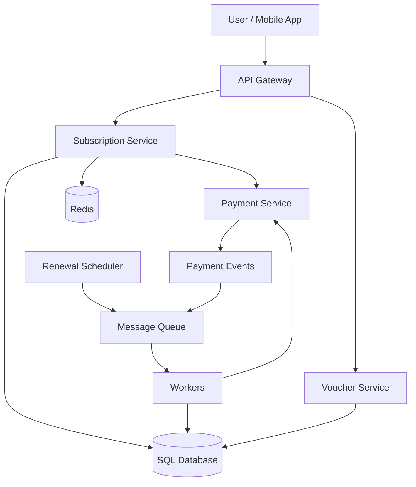

# System Design: Subscription & Voucher System

## 1. Clarify Requirements

### Functional Requirements

1. **Buy Subscription**
   - Users can purchase monthly or biweekly plans.
   - Payment is handled by an external Payment Service.
   - Subscription activates only after successful payment.

2. **Check Subscription Status**
   - Users can view their active plan.
   - Display subscription start date, expiry date, and auto-renewal status.

3. **Cancel Subscription**
   - Users can cancel at any time.
   - Cancellation stops future auto-renewal.
   - Access remains valid until the current billing cycle ends.

4. **Access Vouchers**
   - Users receive vouchers after successful payment.
   - Vouchers are valid only within the paid billing cycle.
   - Expired vouchers cannot be used.

5. **Auto-Renewal**
   - The system automatically charges users when their billing cycle ends.
   - Successful renewal extends the subscription and issues new vouchers.
   - Failed renewal must not issue new vouchers.

### Subscription Plans

| Plan | Price | Duration |
|---|---|---|
| Monthly | $9.99 | 1 calendar month |
| Biweekly | $5.99 | 14 days |

### Example: Cancellation

- 1 Jan: User purchases a monthly subscription.
- 15 Jan: User cancels the subscription.
- 15 Jan - 31 Jan: Subscription and vouchers remain valid.
- 1 Feb: Subscription expires and vouchers become invalid.
- No further payment is charged.

### Assumptions

- One active subscription per user per product.
- Each successful billing cycle issues 5 vouchers.
- Unused vouchers do not carry forward.
- Failed renewal does not extend access beyond the paid period.
- Payment retries use the same logical payment identity.

---

## 2. Non-Functional Requirements

### Scale

- 50 million users/month.
- 1 million transactions/day.
- 99.99% availability.

### Performance

- Subscription status API: Target p95 < 200 ms.
- Payment processing is asynchronous where appropriate.
- Voucher validation should respond quickly.

### Consistency

- Strong consistency for payment, subscription, and voucher entitlement.
- Eventual consistency is acceptable for notifications and non-critical reporting.

### Reliability

- Prevent duplicate payments.
- Prevent duplicate voucher issuance.
- Support automatic retries.
- Ensure users are not charged after a cancellation that was accepted before the renewal cutoff.

### Availability

- Use multiple service instances.
- Deploy database failover.
- Use durable message queues.
- Handle temporary service failures gracefully.

**Key Decision:**

Prioritize correctness over availability for payment operations.

If payment status cannot be verified, do not blindly retry with a new payment identity.

---

## 3. Back-of-the-Envelope Estimation

### Traffic

Given:

- 1 million transactions/day.

Average TPS:

1,000,000 / 86,400 = approximately 12 TPS

Assume peak traffic is 20x average:

12 x 20 = approximately 240 TPS

### Voucher Storage

Assume every transaction represents a successful billing cycle that issues 5 vouchers.

- 1 million billing cycles/day.
- 5 million vouchers/day.
- 150 million vouchers/month.

Actual storage depends on the ratio of payments, renewals, and other transactions.

### Availability

99.99% availability means approximately:

- 4.32 minutes of downtime per 30-day month.

### Design Implications

- A relational database can initially handle the estimated transaction rate.
- Voucher records may grow rapidly and require partitioning.
- Renewal jobs should be distributed across multiple workers.
- Status and voucher-list reads can be optimized with caching and indexes.

---

## 4. High-Level Architecture

### Main Components

1. **API Gateway**
   - Authentication.
   - Rate limiting.
   - Request routing.

2. **Subscription Service**
   - Create subscriptions.
   - Check subscription status.
   - Cancel subscriptions.
   - Maintain billing periods and renewal settings.

3. **Payment Service**
   - Process payments.
   - Handle payment failures.
   - Support payment idempotency.
   - Report verified payment outcomes.

4. **Voucher Service**
   - Issue vouchers.
   - List vouchers.
   - Validate voucher ownership and expiry.

5. **SQL Database**
   - Store subscriptions.
   - Store billing cycles.
   - Store payments.
   - Store vouchers.

6. **Redis**
   - Cache subscription plans.
   - Cache non-critical read data.
   - Reduce database load.

7. **Message Queue**
   - Process renewal jobs.
   - Trigger voucher issuance.
   - Support retries and failure recovery.

8. **Renewal Scheduler**
   - Find subscriptions due for renewal.
   - Create renewal jobs.

### Architecture Diagram



### Flow A: Buy Subscription

```text
User
  |
  v
API Gateway
  |
  v
Subscription Service
  |
  v
Create PENDING subscription
  |
  v
Payment Service
  |
  v
Payment Successful?
  |
  +-- YES --> Activate Subscription
  |               |
  |               v
  |         Create Paid Billing Cycle
  |               |
  |               v
  |         Queue Voucher Issuance
  |               |
  |               v
  |         Issue Vouchers
  |
  +-- NO --> Keep Subscription Inactive
```

**Explanation:**

1. User chooses a subscription plan.
2. Subscription Service creates a pending subscription.
3. Payment Service processes the payment.
4. Once payment success is verified, the subscription is activated.
5. A paid billing cycle is recorded.
6. Voucher issuance is triggered through a durable event.
7. Voucher Worker creates vouchers for the paid cycle.

**Problem:** Payment succeeds, but the application crashes before issuing vouchers.

- Effect: User pays successfully but receives no vouchers.
- Fallback:
  - Store the successful payment and outbox event in one database transaction.
  - Publish the event asynchronously.
  - Retry voucher issuance safely using a unique billing-cycle identifier.

### Flow B: Check Subscription Status

```text
User
  |
  v
GET /subscriptions/me
  |
  v
Subscription Service
  |
  v
Database / Safe Cache
  |
  v
Return Subscription Details
```

Example response:

```json
{
  "subscriptionId": "sub_123",
  "status": "ACTIVE",
  "plan": "MONTHLY",
  "expiresAt": "2026-12-09T00:00:00Z",
  "autoRenew": true
}
```

For authorization and voucher entitlement, verify the actual paid period instead of trusting a potentially stale cached status.

### Flow C: Cancel Subscription

```text
User
  |
  v
POST /subscriptions/{id}/cancel
  |
  v
Subscription Service
  |
  v
Set auto_renew = false
  |
  v
Keep Current Subscription Active
  |
  v
Expire At Current Billing End
```

**Important:**

Cancellation does not immediately terminate the subscription.

Example:

- Subscription expires on 1 February.
- User cancels on 15 January.
- `auto_renew = false`.
- Access continues until 1 February.

---

## 5. Database & API Design

### Database Schema

#### Table 1: subscription_plans

```sql
CREATE TABLE subscription_plans (
    id BIGINT PRIMARY KEY,
    name VARCHAR(100),
    price_minor BIGINT,
    currency VARCHAR(3),
    duration_unit VARCHAR(20),
    duration_count INT,
    voucher_quantity INT
);
```

**Purpose:**

Defines available subscription plans.

Use integer minor currency units instead of floating-point values to avoid rounding errors.

#### Table 2: subscriptions

```sql
CREATE TABLE subscriptions (
    id BIGINT PRIMARY KEY,
    user_id BIGINT NOT NULL,
    plan_id BIGINT NOT NULL,
    status VARCHAR(30),
    auto_renew BOOLEAN DEFAULT TRUE,
    current_period_start TIMESTAMP,
    current_period_end TIMESTAMP,
    next_billing_at TIMESTAMP,
    cancel_requested_at TIMESTAMP,
    version BIGINT DEFAULT 0,
    created_at TIMESTAMP,
    updated_at TIMESTAMP
);
```

**Purpose:**

Stores the current subscription state.

Important fields:

- `status`: PENDING_PAYMENT, ACTIVE, PAST_DUE, EXPIRED.
- `auto_renew`: Controls whether future charges are allowed.
- `current_period_end`: Determines current entitlement expiry.
- `next_billing_at`: Used by the renewal scheduler.
- `version`: Can support optimistic locking.

#### Table 3: billing_cycles

```sql
CREATE TABLE billing_cycles (
    id BIGINT PRIMARY KEY,
    subscription_id BIGINT NOT NULL,
    period_start TIMESTAMP NOT NULL,
    period_end TIMESTAMP NOT NULL,
    amount_minor BIGINT NOT NULL,
    status VARCHAR(30),
    payment_id BIGINT,
    created_at TIMESTAMP,

    UNIQUE(subscription_id, period_start)
);
```

**Purpose:**

Records each billing period separately.

Example:

```text
Subscription: 123

Cycle 1: Jan 1 - Feb 1  -> PAID
Cycle 2: Feb 1 - Mar 1  -> PAID
Cycle 3: Mar 1 - Apr 1  -> PENDING
```

This makes payment history, renewal retries, and voucher ownership easier to manage.

#### Table 4: payments

```sql
CREATE TABLE payments (
    id BIGINT PRIMARY KEY,
    billing_cycle_id BIGINT NOT NULL,
    provider_payment_id VARCHAR(255) UNIQUE,
    idempotency_key VARCHAR(255) UNIQUE,
    amount_minor BIGINT,
    status VARCHAR(30),
    created_at TIMESTAMP
);
```

**Purpose:**

Stores payment operations and their outcomes.

A production implementation may separate payment attempts from the logical payment to support controlled retries.

#### Table 5: vouchers

```sql
CREATE TABLE vouchers (
    id BIGINT PRIMARY KEY,
    user_id BIGINT NOT NULL,
    billing_cycle_id BIGINT NOT NULL,
    slot_number INT NOT NULL,
    status VARCHAR(30),
    valid_from TIMESTAMP,
    valid_until TIMESTAMP,
    redeemed_at TIMESTAMP,

    UNIQUE(billing_cycle_id, slot_number)
);
```

**Purpose:**

Each voucher belongs to a specific paid billing cycle.

`UNIQUE(billing_cycle_id, slot_number)` prevents duplicate voucher issuance for the same slot.

### Important Indexes

```sql
CREATE INDEX idx_user_subscriptions
ON subscriptions(user_id);

CREATE INDEX idx_user_vouchers
ON vouchers(user_id, valid_until);

CREATE INDEX idx_renewals
ON subscriptions(next_billing_at)
WHERE auto_renew = TRUE;
```

### API Design

| Method | Endpoint | Purpose |
|---|---|---|
| GET | /plans | List plans |
| POST | /subscriptions | Buy subscription |
| GET | /subscriptions/me | Check status |
| POST | /subscriptions/{id}/cancel | Cancel renewal |
| GET | /vouchers | List vouchers |
| GET | /vouchers/{id}/validity | Check validity |

### Example: Buy Subscription

Request:

```http
POST /subscriptions
Idempotency-Key: purchase-abc123
Content-Type: application/json
```

```json
{
  "planId": "monthly_999",
  "paymentMethodToken": "pm_xyz"
}
```

Example initial response:

```json
{
  "subscriptionId": "sub_123",
  "status": "PENDING_PAYMENT"
}
```

Payment confirmation can happen asynchronously.

### Subscription State Machine

```text
PENDING_PAYMENT
    |
    +-- Payment Success --> ACTIVE
    |
    +-- Payment Failed --> PAYMENT_FAILED

ACTIVE
    |
    +-- Renewal Success --> ACTIVE (New Cycle)
    |
    +-- Renewal Failure --> PAST_DUE
    |
    +-- No Renewal At Expiry --> EXPIRED

PAST_DUE
    |
    +-- Payment Recovery --> ACTIVE
    |
    +-- Retry Exhausted --> EXPIRED
```

**Important:**

A cancellation can keep the status as ACTIVE while setting `auto_renew = false`.

PAST_DUE does not grant additional access unless the product explicitly supports a grace period.

---

## 6. Deep Dive: Critical Problems & Solutions

### 6.1 Auto-Renewal

**Problem:**

The system must automatically renew subscriptions without charging users twice.

Two workers may process the same renewal job because of retries, scheduling overlap, or message duplication.

**Solution: Scheduler + Message Queue + Idempotency**

```text
Renewal Scheduler
       |
       v
Find Due Subscriptions
       |
       v
Publish Renewal Jobs
       |
       v
Renewal Worker
       |
       v
Atomically Claim Billing Cycle
       |
       v
Check Auto-Renewal Status
       |
       v
Call Payment Service
       |
       +-- SUCCESS
       |     |
       |     v
       |   Record Paid Cycle
       |     |
       |     v
       |   Issue New Vouchers
       |     |
       |     v
       |   Schedule Next Renewal
       |
       +-- FAILURE
             |
             v
           Record Failure
             |
             v
           Retry According To Policy
```

**How to prevent duplicate payments:**

Use an idempotency key based on the subscription and billing cycle.

```text
renewal:{subscriptionId}:{periodStart}
```

Example:

```text
renewal:sub_123:2026-12-09
```

If the same job runs twice:

1. Both workers reference the same billing cycle.
2. A database unique constraint prevents duplicate logical cycles.
3. Workers use atomic claims or locks to coordinate processing.
4. Payment Service receives the same idempotency key.
5. If payment status is unknown, reconcile the original charge.

- Effect: Multiple requests do not create multiple logical payments.
- Fallback: Query the payment provider before attempting another charge.
- Limitation: Provider-side idempotency is needed to protect against duplicate external charges.

### 6.2 Duplicate Voucher Issuance

**Problem:**

Payment succeeds, but the voucher worker crashes.

The message queue retries the same event.

Without protection, users may receive duplicate vouchers.

**Solution: ACID Transaction + Unique Constraint**

```sql
BEGIN;

-- Verify billing cycle is PAID.

-- Insert all voucher slots for this cycle.
-- Each (billing_cycle_id, slot_number) is unique.

-- Mark voucher issuance as completed.

COMMIT;
```

The complete voucher batch should be inserted within one transaction.

- Effect: All vouchers are committed together, or none are.
- Fallback: Retry the same billing-cycle job.
- Protection: Unique constraints prevent duplicate voucher slots.

### 6.3 Transactional Outbox Pattern

**Problem:**

Payment succeeds and the database commits, but the service crashes before publishing the voucher issuance event.

The user has paid, but no voucher job is created.

**Solution: Transactional Outbox**

```text
Database Transaction
       |
       +-- Mark Billing Cycle PAID
       |
       +-- Insert Outbox Event
       |
       v
      COMMIT
       |
       v
Outbox Publisher
       |
       v
Message Queue
       |
       v
Voucher Worker
```

**Why it works:**

The payment state update and outbox event are saved in the same transaction.

- Effect: A committed payment state has a durable event waiting to be published.
- Fallback: The publisher retries until the event is delivered.
- Limitation: Messages may still be delivered more than once, so workers must be idempotent.

### 6.4 Cancellation vs Auto-Renewal Race Condition

**Problem:**

A user cancels the subscription while a renewal worker is processing payment.

Example:

```text
Worker A: Checks auto_renew = true

User: Cancels subscription

Worker A: Charges the user
```

This may violate the intended cancellation behavior.

**Solution: Atomic Claim + Database Locking**

```sql
BEGIN;

SELECT *
FROM subscriptions
WHERE id = ?
FOR UPDATE;

-- Verify auto_renew.
-- Atomically claim renewal or update cancellation state.

COMMIT;
```

Both cancellation and renewal must follow the same concurrency protocol.

**Important:**

Do not hold a database lock while waiting for a slow external payment API.

Instead:

1. Lock the subscription.
2. Validate renewal eligibility.
3. Create a durable renewal claim.
4. Commit the transaction.
5. Call the Payment Service using the stable claim identity.
6. Reconcile the final result.

- Effect: The renewal decision is coordinated with cancellation.
- Fallback: Apply a defined cancellation cutoff and refund/reconciliation policy if payment has already been submitted externally.

### 6.5 Voucher Expiration

**Problem:**

The subscription expires, but the background expiration job is delayed.

An expired voucher may still have status AVAILABLE.

**Solution: Validate Expiration During Access**

```sql
SELECT v.*
FROM vouchers v
JOIN billing_cycles b
  ON v.billing_cycle_id = b.id
WHERE v.id = ?
  AND v.user_id = ?
  AND v.status = 'AVAILABLE'
  AND v.valid_from <= NOW()
  AND v.valid_until > NOW()
  AND b.status = 'PAID';
```

The validation must also respect refunds, revoked entitlements, and other applicable business rules.

**Why it works:**

Voucher validity depends on timestamps and paid entitlement, not solely on a scheduled expiration job.

- Effect: Expired vouchers cannot be used even if cleanup is delayed.
- Fallback: If the authoritative database is unavailable, do not approve voucher use without validation.

### 6.6 Failure Handling

| Failure | Effect | Recovery / Fallback |
|---|---|---|
| User clicks Buy twice | Duplicate requests | Idempotency key |
| Payment timeout | Unknown payment result | Reconcile with provider |
| Duplicate webhook | Repeated payment events | Event deduplication |
| Worker crashes | Job incomplete | Queue retry |
| Voucher job runs twice | Duplicate vouchers | Unique constraint |
| Cancellation races renewal | Incorrect charge | Atomic claim + cutoff policy |
| Redis unavailable | Slower reads | Fall back to SQL |
| Database primary fails | Writes unavailable | Multi-AZ failover |
| Queue unavailable | Delayed processing | Transactional Outbox |
| Renewal payment fails | No new paid cycle | Retry or expire access |

---

## 7. Trade-offs, Scaling & Monitoring

### Trade-offs

| Choice | Gain | Cost / Limitation |
|---|---|---|
| SQL Database | Strong consistency and ACID | More complex scaling |
| Redis | Fast reads | Cache invalidation |
| Message Queue | Asynchronous processing | Duplicate delivery possible |
| Separate Payment Service | Isolation of payment logic | Distributed coordination |
| Renewal Scheduler | Automated recurring billing | Overlapping jobs possible |
| Transactional Outbox | Reliable event publication | Additional infrastructure |
| Pessimistic Locking | Prevents concurrent state changes | Lock contention |

### Scaling Strategy

#### Application Layer

- Use stateless service instances.
- Deploy multiple instances behind a load balancer.
- Scale Subscription and Voucher Services independently.

#### Database Layer

- Start with a relational database.
- Use indexes on frequently queried columns.
- Add read replicas for appropriate read-heavy operations.
- Partition large voucher and billing-history tables when needed.
- Use multi-AZ database failover.

#### Cache Layer

- Cache subscription plan information.
- Cache safe, non-authoritative status views where appropriate.
- Invalidate affected cache entries after subscription updates.
- Never use stale cache alone to authorize a voucher.

#### Background Processing

- Use multiple renewal workers.
- Use an atomic claim mechanism.
- Scale consumers based on queue backlog.
- Distribute renewal work instead of running every job at once.
- Use bounded retries and a dead-letter queue for unresolved failures.

### Monitoring

Important metrics:

1. Payment success rate.
2. Payment failure rate.
3. Auto-renewal success rate.
4. Queue processing delay.
5. Voucher issuance failures.
6. Duplicate payment prevention events.
7. API latency (p95/p99).
8. Database health.
9. Number of expired subscriptions.
10. Cancellation and renewal race incidents.

### Final Design Priorities

1. **Payment correctness:** Never charge twice for the same logical billing cycle.
2. **Reliable voucher issuance:** Issue vouchers only for confirmed paid cycles.
3. **Correct cancellation:** Preserve already-paid access while stopping future renewals.
4. **Accurate expiry:** Validate subscription and voucher validity using authoritative timestamps.
5. **Failure recovery:** Use idempotency, database transactions, outbox events, and retries.

---

## 90-Second Interview Summary

"I would design this subscription system using a Subscription Service, Voucher Service, and a separate Payment Service.

The main database would be relational because subscription payments and voucher issuance require transactional consistency.

When a user purchases a subscription, the system creates a pending subscription and processes the payment. Once the payment is confirmed, it activates the subscription and creates a paid billing cycle.

Voucher issuance would happen asynchronously through a message queue, with a transactional outbox to prevent losing events.

For auto-renewal, a scheduler identifies subscriptions due for payment and pushes renewal jobs to workers. Each renewal uses a stable idempotency key and database constraints to prevent duplicate charging.

When a user cancels, we disable auto-renewal but preserve access until the paid billing cycle expires.

For voucher validation, we check the actual expiry timestamp and paid billing-cycle status instead of relying only on background jobs.

Finally, I would improve availability through stateless services, database failover, durable message queues, and monitoring.

The most critical part of this design is ensuring payment correctness, preventing duplicate vouchers, and safely handling concurrency and service failures."

---

## Common Interview Follow-Up Questions

### Q1. What if the payment succeeds but the application crashes?

Use payment idempotency and reconciliation.

The payment outcome can be recovered from the Payment Service, and the Transactional Outbox ensures voucher issuance is eventually processed.

### Q2. What if two renewal workers process the same subscription?

Use an atomic database claim, a unique billing-cycle constraint, and the same payment idempotency key.

Only one logical renewal should succeed.

### Q3. What if the user cancels during auto-renewal?

Use a common concurrency protocol to coordinate cancellation and renewal claims.

Define the cancellation cutoff clearly, especially when the charge has already been sent to the external payment provider.

### Q4. Why use a relational database instead of MongoDB?

The system needs:

- ACID transactions.
- Unique constraints.
- Referential integrity.
- Consistent billing and voucher records.

A relational database is a practical default for this workload.

### Q5. Why use a message queue?

Because payment-related processing and voucher issuance should be reliable and independently retryable.

A queue supports:

- Asynchronous processing.
- Worker scalability.
- Retries.
- Failure isolation.

However, consumers must handle duplicate delivery.

### Q6. How do you prevent duplicate payments?

Combine:

1. Stable payment idempotency keys.
2. Unique database constraints.
3. Atomic renewal claims.
4. Payment provider reconciliation.

Database locking alone cannot guarantee that an external payment provider will not charge twice.

### Q7. How do you guarantee vouchers expire on time?

Validate expiry timestamps on every authoritative voucher check.

Background expiration jobs are only for cleanup and status maintenance.

---

## Key Concepts to Remember

| Concept | Why It Matters |
|---|---|
| Idempotency | Prevent duplicate payments |
| ACID Transactions | Prevent partial voucher issuance |
| Transactional Outbox | Prevent lost events |
| Message Queue | Reliable asynchronous processing |
| Pessimistic Locking | Coordinate concurrent state updates |
| Unique Constraints | Enforce one billing cycle or voucher slot |
| State Machine | Manage subscription lifecycle |
| Timestamp Validation | Ensure correct voucher expiration |
| Payment Reconciliation | Recover unknown external payment outcomes |

**Interview Key Takeaway:**

The difficult part of this system is not implementing CRUD APIs.

It is ensuring payment, subscription state, cancellation, and voucher issuance remain correct when requests are duplicated, services crash, and multiple workers execute concurrently.