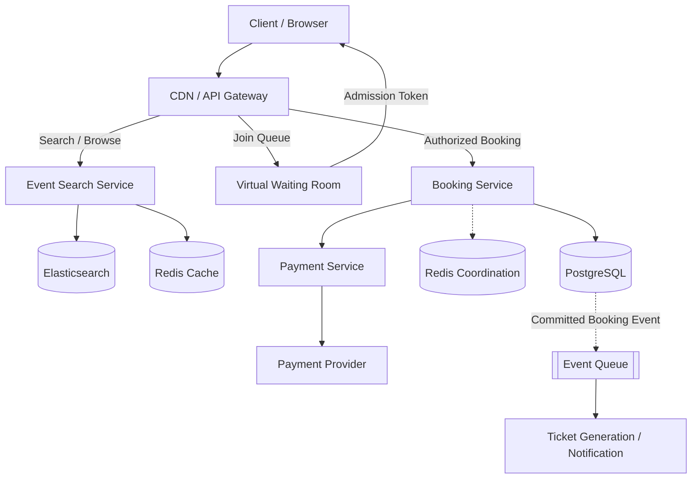
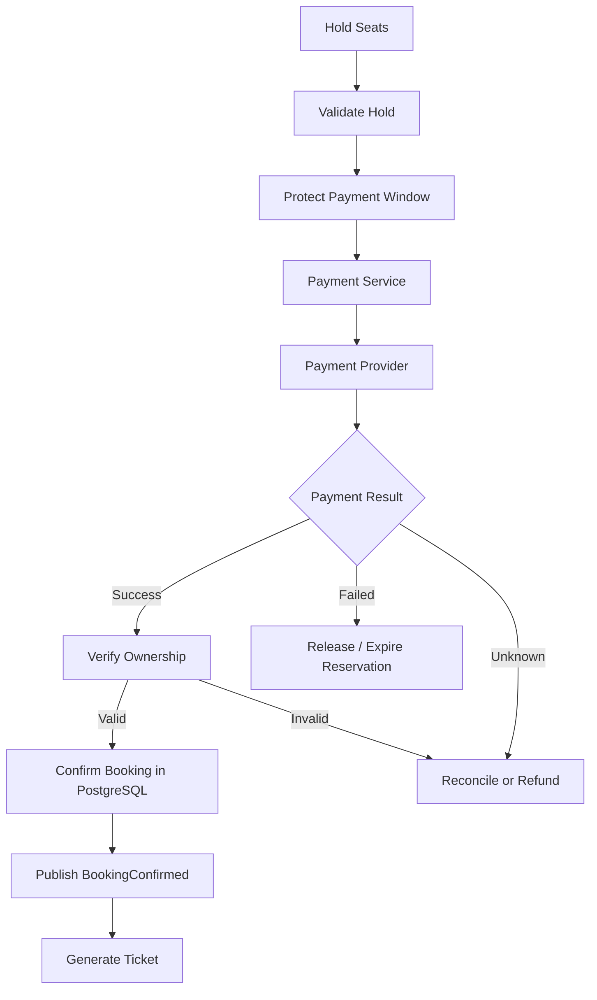
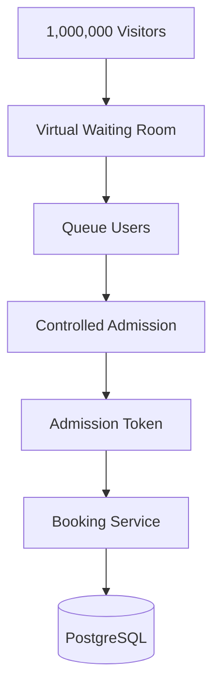
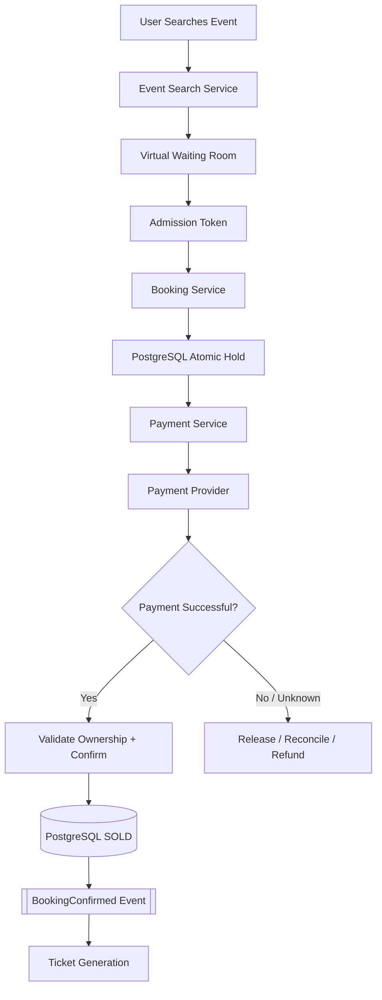

# Design Ticketmaster (Online Ticket Booking System)
> **Goal:** Design a scalable ticket-booking system that handles millions of concurrent users without double-booking seats.

**Difficulty:** Medium–Hard  
**Core Concepts:** Database Transactions, Concurrency, Redis, Distributed Locking, Virtual Waiting Room, Payment Saga, Idempotency

## Understand the Problem
Imagine Taylor Swift announces a concert:
```text
Available Tickets = 50,000
Interested Buyers = 1,000,000

Problems:
1. Thousands of users want the same seat.
2. Millions of users enter simultaneously.
3. Users reserve seats but never pay.
4. Payments may succeed after reservations expire.
5. Servers may crash during booking.
```
**The three biggest challenges:**
1. **Double Booking:** One seat must belong to only one buyer.
2. **High Traffic:** Protect the booking system during massive traffic spikes.
3. **Temporary Reservations:** Hold seats during checkout and safely release abandoned holds.

**Most Important Principle:**
- Browsing can tolerate slightly outdated information.
- Booking must use authoritative, strongly consistent seat ownership checks.

---
# Step 1 — Requirement Gathering

## 1.1 Functional Requirements
| Priority | Requirement |
|---|---|
| P0 | Search events by artist, venue, location, or date |
| P0 | View event details and available seats |
| P0 | Temporarily reserve selected seats |
| P0 | Purchase tickets and confirm bookings |
| P1 | View booking history |
| P2 | Ticket transfers, refunds, dynamic pricing |

**Scope:** Focus on search, seat reservation, checkout, and ticket confirmation.

## 1.2 Questions to Ask Interviewer
**Q1: Assigned seating or general admission?**
- Assume assigned seating.
- Each seat has an identifier such as `A12`.

**Why?** Assigned seating introduces concurrency problems because thousands of users may compete for the same seat.

**Q2: How long can a user hold a seat?**
- Assume 10 minutes.
- If checkout doesn't proceed under an authorized payment-protection policy, the hold expires.

**Q3: Can users reserve multiple seats?**
- Yes, up to six seats per booking.
- All requested seats must be reserved together, or none.

**Q4: Should we support high-demand launches?**
- Yes. Popular concerts may attract millions of visitors.

**Q5: What happens if payment fails?**
- Booking must not become CONFIRMED.
- Seats must eventually become available again.
- Payment and booking state must be reconciled safely.

---
# Step 2 — Non-Functional Requirements

| Requirement | Target | Reason |
|---|---|---|
| Strong Consistency | Seat ownership | Prevent double booking |
| High Availability | Event browsing | Users should discover events |
| Scalability | Millions of visitors | Handle flash-sale traffic |
| Low Latency | Search under 500ms | Responsive experience |
| Durability | Confirmed bookings persist | Avoid losing purchases |
| Fault Tolerance | Recover from failures | Avoid stuck reservations |
| Security | Authentication + secure payments | Protect booking operations |

## 2.1 Strong vs Eventual Consistency

### A. Event Search — Eventual Consistency
Example:
```text
Actual available seats = 98
Cached seat map = 100
```
This temporary difference is acceptable.

Why?
- The seat map is only informational.
- The Booking Service must verify current availability again.
- Cached search data doesn't determine ownership.

### B. Seat Booking — Strong Consistency
Example:
```text
Seat A12 = AVAILABLE

Alice tries to reserve A12.
Bob tries to reserve A12.

Only ONE reservation may succeed.
```
**Why?** Incorrect booking state can create two valid buyers for one physical seat.

**Design Decision:** Use PostgreSQL as the authoritative database for seat ownership and booking transactions.

---
# Step 3 — Estimate Scale

## 3.1 Traffic Assumptions
```text
Monthly Active Users = 50M
Popular Concert Capacity = 50,000 seats
Visitors During Launch = 1M
Arrival Window = 10 minutes
Average Hold Duration = 10 minutes
Read-to-Write Ratio = 100:1
```

### Arrival Rate
```text
1,000,000 visitors / 600 seconds
≈ 1,667 visitors/second
```
**Important:** This is visitor arrival rate, not API RPS.

One user might generate:
```text
GET /events
GET /seats
GET /availability
POST /holds
GET /booking
```
Therefore, actual request traffic may be significantly higher.

## 3.2 Storage Estimation
Assume:
```text
100,000 events
50,000 seat records/event
```
Total:
```text
100,000 × 50,000
= 5,000,000,000 seat records
```
This is a deliberately large planning assumption.

### What Does This Tell Us?
- Eventually, we may need database partitioning.
- Event search is read-heavy.
- Seat booking has high contention.
- Adding more servers doesn't solve two users competing for the same seat.

### Important Insight
Imagine:
```text
10,000 users attempt to reserve A12.

Successful reservations = 1
Failed attempts = 9,999
```
Even if the system supports 100K writes/sec, these users still compete for one seat.

**Ticketmaster is primarily a concurrency and contention problem, not just a high-throughput problem.**

---
# Step 4 — High-Level Architecture

## 4.1 Separate Read Path and Booking Path
### Read Path
Handles:
- Search events.
- View event details.
- View seat availability.

**Consistency:** Eventual consistency is acceptable for browsing.

### Booking Path
Handles:
- Hold seats.
- Process payments.
- Confirm bookings.
- Release expired reservations.

**Consistency:** Strong concurrency control is required.

### Why Separate?
Search traffic is much higher than booking traffic.

We don't want millions of search requests to overload the database responsible for seat ownership.

## 4.2 Complete Architecture


## 4.3 Component Responsibilities
| Component | Responsibility | Why |
|---|---|---|
| API Gateway | Routing, authentication, rate limiting | Protect entry points |
| Event Service | Event details and discovery | Separate browsing workload |
| Elasticsearch | Search artists, venues, dates | Efficient full-text search |
| Redis Cache | Cache popular event information | Reduce database reads |
| Waiting Room | Limit simultaneous buyers | Control contention |
| Booking Service | Hold and confirm seats | Enforce booking rules |
| PostgreSQL | Seats, bookings, payments | ACID transactions |
| Redis Coordination | Optional contention filtering | Reduce unnecessary DB work |
| Payment Service | Manage checkout and provider integration | Isolate payment lifecycle |
| Event Queue | Publish confirmed booking events | Async processing |
| Ticket Service | Generate and deliver tickets | Avoid slowing checkout |

## 4.4 Why Elasticsearch?
Example:
```text
Search:
"Taylor Swift concerts in Kuala Lumpur"
```
The Search Service queries Elasticsearch instead of scanning booking inventory.

### How Does Elasticsearch Get Updated?
```text
PostgreSQL
   ↓
Change Data Capture / Event Pipeline
   ↓
Elasticsearch
```
**Trade-off:** Search results may lag behind PostgreSQL.

That's acceptable because final booking always checks authoritative inventory.

**Fallback:** If Elasticsearch is unavailable, offer limited search using indexed PostgreSQL queries.

---
# Step 5 — API + Database Design

## 5.1 API Design
| API | Purpose |
|---|---|
| GET /events?query=Taylor | Search events |
| GET /events/{eventId} | Event information |
| GET /events/{eventId}/seats | View seat availability |
| POST /events/{eventId}/holds | Reserve seats temporarily |
| POST /bookings/{bookingId}/checkout | Start payment |
| GET /bookings/{bookingId} | Check booking status |

## 5.2 Hold Seats API
```http
POST /events/123/holds
```
Request:
```json
{
  "seatIds": ["A12", "A13"],
  "idempotencyKey": "request-abc"
}
```
Response:
```json
{
  "bookingId": "booking-456",
  "status": "HELD",
  "expiresAt": "2026-10-19T14:10:00Z"
}
```
**Why idempotencyKey?**
If the client times out and retries, the server should return the existing reservation rather than create another.

**Why expiresAt?**
The reservation must expire if the buyer abandons checkout.

The server determines the expiration time, not the client.

## 5.3 Database Schema

### Events
| Field | Purpose |
|---|---|
| event_id | Primary key |
| performer_id | Artist/team |
| venue_id | Venue |
| start_time | Concert time |
| name | Event name |

### Tickets
| Field | Purpose |
|---|---|
| ticket_id | Primary key |
| event_id | Event |
| seat_id | A12, A13, etc. |
| status | AVAILABLE / HELD / SOLD |
| hold_id | Reservation owner |
| hold_expires_at | Hold deadline |
| price | Ticket price |

Add:
```sql
UNIQUE (event_id, seat_id)
```
**Why?** Each physical seat should have exactly one inventory record per event.

### Bookings
| Field | Purpose |
|---|---|
| booking_id | Primary key |
| user_id | Buyer |
| status | HELD / PAYMENT_PENDING / CONFIRMED / FAILED / EXPIRED |
| total_amount | Total |
| expires_at | Hold deadline |
| payment_id | Payment reference |

### BookingItems
```text
booking_id
ticket_id
```
One booking can contain multiple seats.

### Payments
| Field | Purpose |
|---|---|
| payment_id | Primary key |
| booking_id | Associated booking |
| provider_payment_id | External payment reference |
| idempotency_key | Duplicate prevention |
| status | PENDING / SUCCEEDED / FAILED / REFUNDED |

## 5.4 Why PostgreSQL Instead of Cassandra?
| PostgreSQL | Cassandra |
|---|---|
| ACID transactions | High distributed write throughput |
| Row-level locking | Different conditional-write model |
| Multi-row atomic updates | Cross-partition transactions are more difficult |
| Good for seat ownership | Good for some high-volume distributed workloads |

**Decision:** PostgreSQL.

**Reason:** Reserving six seats requires an all-or-nothing operation.

For booking correctness, transactional guarantees are more important than raw write throughput.

---
# Step 6 — Deep Dive + Failure Handling

## 6.1 Deep Dive A — Prevent Double Booking

### Problem
Alice and Bob click seat A12 simultaneously.

```text
Seat A12 = AVAILABLE

Alice reads AVAILABLE.
Bob reads AVAILABLE.

Alice attempts reservation.
Bob attempts reservation.
```
If we use separate unprotected read and write operations, both applications might believe the seat is available.

This is a race condition.

### Wrong Approach — Check Then Update
```sql
SELECT status
FROM tickets
WHERE ticket_id = 12;
```
Then:
```sql
UPDATE tickets
SET status = 'HELD'
WHERE ticket_id = 12;
```
Without correct concurrency checks, one request can overwrite the other's reservation.

### Solution A — Atomic Conditional Update
```sql
UPDATE tickets
SET status = 'HELD',
    hold_id = :holdId,
    hold_expires_at = NOW() + INTERVAL '10 minutes'
WHERE ticket_id = :ticketId
  AND (
      status = 'AVAILABLE'
      OR (
          status = 'HELD'
          AND hold_expires_at <= NOW()
      )
  )
RETURNING ticket_id;
```
### How It Works
```text
Alice attempts UPDATE.
PostgreSQL locks and updates the matching row.
Alice succeeds.

Bob attempts UPDATE.
PostgreSQL checks the condition against the current row.
Seat is no longer available.
Bob fails.
```
### Why Is This Safe?
PostgreSQL ensures the conditional row update is atomic.

Only one competing reservation can successfully claim the same available seat.

### Why Check Expired Holds?
An expired `HELD` record should be logically available again.

We don't need to wait for a cleanup job before the seat can be reserved.

**Design Decision:** Use atomic conditional updates as the initial solution.

---

## 6.2 Why Not Hold a Database Lock for 10 Minutes?

### Wrong Approach
```text
BEGIN TRANSACTION

Lock Seat A12
Wait for User to Enter Card Details
Wait for Payment Provider
COMMIT
```
This could keep a database transaction open for several minutes.

### Problems
- Database connections remain occupied.
- Row locks remain held.
- Other users wait.
- Deadlocks and timeouts become more likely.
- Crash recovery becomes harder.

### Better Approach — Logical Hold
```text
BEGIN TRANSACTION

Update A12:
status = HELD
hold_expires_at = now + 10 minutes

COMMIT
```
The transaction finishes quickly.

The seat remains reserved because of persisted business state, not a continuously held database lock.

**Key Concept:** A 10-minute reservation is not a 10-minute SQL transaction.

---

## 6.3 Deep Dive B — Redis Distributed Locking

### Alternative Approach
Redis can help filter competing reservation requests before they hit PostgreSQL.

Example:
```redis
SET lock:event123:seatA12 hold-456 NX EX 600
```
Meaning:
| Parameter | Meaning |
|---|---|
| SET | Create key |
| NX | Only create if absent |
| EX 600 | Expire after 600 seconds |
| hold-456 | Unique ownership token |

If Alice acquires the lock:
```text
Alice → Redis SET NX succeeds
Bob   → Redis SET NX fails
```

### Why Redis?
- Fast in-memory operations.
- Atomic `SET NX`.
- TTL-based expiration.
- Can reduce repeated contention against the database.

### Important Problem
Redis locks alone are not enough to guarantee ticket ownership.

Example:
```text
1. Alice acquires Redis lock.
2. Redis primary crashes.
3. Lock is lost during failover.
4. Bob acquires the same lock.
5. Both attempt payment.
```
If we trust Redis alone, double booking could occur.

### Better Design
```text
Redis → Optional fast contention filtering
PostgreSQL → Authoritative seat ownership
```
Even if Redis loses its lock, PostgreSQL must prevent both bookings from becoming valid.

### Fallback — Redis Unavailable
```text
Redis Down
   ↓
Disable Optional Redis Lock Optimization
   ↓
Use PostgreSQL Conditional Updates
   ↓
Apply Stricter Admission Limits
```
**Decision:** Start with PostgreSQL. Add Redis contention filtering only if needed.

### Safe Lock Release
Do not blindly call:
```redis
DEL lock:event123:seatA12
```
The original lock might have expired and been replaced by another owner.

Instead, atomically check that the ownership token matches before deleting the lock.

---

## 6.4 Redis Sharding for Ticket Locks

### Why Sharding?
An extremely popular concert may create many lock requests.

Redis Cluster distributes keys across hash slots.

Example:
```text
lock:event123:seatA12
lock:event123:seatA13
lock:event456:seatB01
```
### Redis Hash Tags
To place locks for the same event in one hash slot:
```text
lock:{event123}:seatA12
lock:{event123}:seatA13
lock:{event123}:seatA14
```
Redis Cluster hashes the value inside `{}`.

Therefore, all three keys map to the same slot.

### Why Is This Useful?
Suppose Alice wants three seats.

A Redis Lua script could atomically check and acquire all three locks, provided they are on the same shard.

Redis Cluster requires all keys accessed by one multi-key Lua operation to belong to the same hash slot.

### Problem: Hot Shard
Imagine one concert receives massive traffic.

If all its lock keys are grouped using:
```text
{event123}
```
One Redis shard might become overloaded.

### Trade-off
| Strategy | Advantage | Disadvantage |
|---|---|---|
| Hash by seat | Better distribution | Multi-seat atomic Lua becomes difficult |
| Hash by event | Atomic multi-seat Lua possible | Popular event can create hot shard |
| Use SQL transactions | Strong correctness | More database contention |

**Our Choice:** PostgreSQL for authoritative multi-seat transactions. Use Redis sharding only for optimizations justified by measured load.

---

## 6.5 Deep Dive C — Reserving Multiple Seats

### Problem
Alice wants:
```text
A12
A13
A14
```
But Bob already reserved A13.

Should Alice receive A12 and A14?

For our requirement, **no**.

A multi-seat reservation must be all-or-nothing.

### Solution — PostgreSQL Transaction
```text
BEGIN TRANSACTION

1. Lock A12, A13, A14 in consistent order.
2. Check all three seats are available.
3. If all available:
      Assign the same hold_id.
      Set reservation expiration.
      Create booking and booking items.
4. Otherwise:
      ROLLBACK.

COMMIT.
```
### Why One Transaction?
If we reserve seats in separate transactions:
```text
A12 → Success
A13 → Failure
A14 → Success
```
The user receives only part of the requested booking.

That violates our requirement.

### Why Consistent Lock Order?
Suppose:
```text
Alice locks A12, then A13.
Bob locks A13, then A12.
```
They may wait on each other and create a deadlock.

Instead:
```text
Always lock seats by ascending ticket_id.
```
This reduces deadlock risk.

### Fallback
If a deadlock or transient transaction conflict occurs:
- Roll back the entire operation.
- Retry with a bounded retry policy and jitter.
- Preserve the same idempotency key.

**Key Concept:** Atomicity — either every selected seat is held, or none are.

---

## 6.6 Deep Dive D — Seat Reservation Expiration

### Seat States
```text
AVAILABLE
   ↓
HELD
   ↓
SOLD
```
A HELD seat may also return to AVAILABLE after expiration.

### Example
```text
10:00 → Alice reserves A12.
10:05 → Alice is entering payment information.
10:10 → Hold expires.
10:11 → Bob reserves A12.
```
At 10:10, the database might still physically contain:
```text
status = HELD
hold_expires_at = 10:10
```
But logically, the hold has expired.

### Solution
Always check:
```text
status == AVAILABLE
OR
(status == HELD AND hold_expires_at <= NOW())
```
This allows expired seats to be reclaimed safely.

### Why Not Depend on Cron?
Imagine cleanup runs every five minutes.

A hold expires at 10:10, but cleanup runs at 10:15.

The seat would remain unnecessarily unavailable for five minutes if cleanup controlled correctness.

### Better Design
- Reservation queries enforce expiration.
- Background cleanup updates old rows for maintenance.
- Correctness never depends on cleanup running on time.

### Important Exception — Payment Pending
If the system supports a protected payment window, seat ownership must include that state and its deadline.

Do not reclaim a protected `PAYMENT_PENDING` reservation using only the original hold deadline.

---

## 6.7 Deep Dive E — Payment Processing

### Problem
Seat reservation and payment involve two systems:
```text
PostgreSQL
Payment Provider
```
We cannot place an external payment provider inside a normal SQL transaction.

### Why?
A SQL transaction cannot atomically commit both:
- Our PostgreSQL booking changes.
- An external bank/payment provider transaction.

This is a distributed workflow problem.

### Solution — Saga-Style Checkout


### Successful Flow
```text
1. Alice reserves A12.
2. Booking status = HELD.
3. Alice starts checkout.
4. Booking Service verifies valid ownership.
5. Booking status = PAYMENT_PENDING.
6. Seat is protected for a bounded payment window.
7. Payment Service requests payment.
8. Payment Provider confirms success.
9. Booking Service revalidates ownership.
10. PostgreSQL transaction:
      Seat → SOLD
      Booking → CONFIRMED
11. Publish BookingConfirmed event.
12. Generate and deliver ticket.
```
**Why Not Generate Ticket Immediately After Payment Response?**
We must first ensure the booking confirmation was committed successfully.

A successful external payment doesn't automatically mean the seat can still be confirmed.

---

## 6.8 Critical Edge Case — Payment Succeeds After Hold Expires

### Scenario
```text
10:00 → Alice reserves A12.
10:09 → Alice starts payment.
10:10 → Original hold expires.
10:10:05 → Bob reserves A12.
10:11 → Alice's payment succeeds.
```
Who owns the seat?

We cannot confirm both bookings.

### Solution A — Simple Fallback
If Alice's reservation expired and Bob already owns the seat:
```text
Reject Alice's booking.
Initiate payment reversal/refund.
Notify Alice.
```
**Advantage:** Correctness is preserved.

**Disadvantage:** Poor user experience.

### Solution B — Payment Protection Window
When Alice starts checkout:
```text
1. Verify A12 is still held by Alice.
2. Transition to PAYMENT_PENDING atomically.
3. Protect A12 for a bounded payment deadline.
4. Send payment request.
5. Confirm or compensate based on result.
```
### Important
Payment protection must have a maximum deadline.

Otherwise, abandoned payments could block seats indefinitely.

### What If Payment Status Is Unknown?
Example:
```text
Payment API times out.
```
We don't know whether the provider charged the customer.

**Do not immediately assume payment failed.**

Fallback:
- Save payment status as UNKNOWN/PENDING.
- Query provider using payment reference.
- Process provider webhooks.
- Reconcile outstanding payment attempts.
- Confirm booking only when ownership is valid.
- Refund/reverse payment when confirmation is impossible.

**Key Principle:** Payment success and ticket ownership must be reconciled safely.

---

## 6.9 Deep Dive F — Payment Idempotency

### Problem
Payment provider sends:
```text
payment_succeeded
payment_succeeded
```
Webhooks may be retried.

Without protection:
- Duplicate confirmation processing.
- Duplicate ticket issuance.
- Repeated downstream notifications.

### Solution — Idempotency
Store:
```text
provider_payment_id
provider_event_id
booking_id
payment_status
```
### Webhook Flow
```text
Receive Webhook
   ↓
Verify Provider Authenticity
   ↓
Check Existing Event / Payment State
   ↓
Already Processed?
   ├── Yes → Return Success
   └── No  → Reconcile Payment
              ↓
           Validate Ownership
              ↓
           Commit Booking State
              ↓
           Record Event for Ticket Generation
```
### Why Transactional Outbox?
Imagine:
```text
1. PostgreSQL confirms booking.
2. Booking Service crashes.
3. Kafka event was never published.
4. Customer never receives ticket.
```
### Solution
Inside the same database transaction:
```text
UPDATE booking = CONFIRMED
UPDATE ticket = SOLD
INSERT outbox_event = BookingConfirmed
COMMIT
```
Then a background publisher sends the event to the queue.

### Fallback
If publishing fails:
- Outbox event remains pending.
- Publisher retries.
- Ticket Service deduplicates using booking_id.

**Key Concept:** Transactional Outbox prevents the database commit / event publishing gap.

---

## 6.10 Deep Dive G — Virtual Waiting Room

### Problem
One million users open the ticket page simultaneously.

Without admission control:
```text
1M Users
   ↓
Booking Service
   ↓
PostgreSQL
   ↓
Massive Contention / Overload
```
Even with 100 Booking Service instances, many users may compete for the same seat.

### Why Not Just Use Rate Limiting?
Rate limiting might return:
```http
429 Too Many Requests
```
to hundreds of thousands of legitimate buyers.

This protects infrastructure but creates a poor customer experience.

### Solution — Virtual Waiting Room


### How It Works
1. Users join the waiting room.
2. Server assigns queue positions or admission priority.
3. Admission controller monitors booking capacity.
4. Users are admitted in controlled batches.
5. Admitted users receive short-lived, signed admission tokens.
6. Booking endpoints verify tokens before accepting requests.

### Why Admission Tokens?
Otherwise, users could bypass the queue:
```http
POST /events/123/holds
```
directly.

The Booking Service must verify that the request belongs to an admitted session.

### Redis Sorted Set Implementation
A possible queue structure:
```redis
ZADD queue:event123 100001 userA
ZADD queue:event123 100002 userB
ZADD queue:event123 100003 userC
```
Scores represent server-assigned ordering.

**Important:** Queue ordering should not trust client timestamps.

### Why Redis Sorted Set?
- Maintains sorted positions.
- Efficient priority ordering.
- Useful for admission coordination.

### Trade-off
A massive event can overload one Redis queue structure if we constantly update millions of sessions.

For extreme scale, consider partitioned queues or a managed waiting-room solution.

### Fallback — Waiting Room Down
```text
Waiting Room Unavailable
   ↓
Stop New Admissions
   ↓
Preserve Already Admitted Sessions
   ↓
Recover Queue State
```
**Important:** Don't allow everyone to bypass the waiting room when it fails.

That would immediately overload the booking system.

### Key Decision
Use a waiting room to control concurrency rather than relying only on adding more database servers.

---

## 6.11 Deep Dive H — Real-Time Seat Availability

### Problem
Alice reserves A12.

Bob's browser still displays:
```text
A12 = AVAILABLE
```
because the seat map is cached.

### Possible Solutions
| Approach | Advantage | Disadvantage |
|---|---|---|
| Polling | Simple | Repeated requests |
| SSE | Efficient server-to-client updates | One-way communication |
| WebSocket | Bidirectional real-time updates | Connection complexity |

### Our Choice — SSE
Seat availability mostly flows from server to client.

Example:
```text
Alice reserves A12.
   ↓
Booking state changes.
   ↓
Server emits seat update.
   ↓
Bob's browser marks A12 unavailable.
```
### Why Not WebSocket?
WebSocket also works, but SSE is simpler when clients mainly receive updates.

### Important
The seat map is not authoritative.

Even if Bob's browser shows A12 as available, the Booking Service must recheck PostgreSQL.

### Fallback
If SSE disconnects:
- Reconnect.
- Refresh seat-map snapshot.
- Fall back to periodic polling.

**Key Principle:** Real-time UI improves experience, but SQL transactions guarantee correctness.

---

## 6.12 Complete Failure Handling Table

| Failure | Primary Protection | Fallback |
|---|---|---|
| Two users reserve same seat | Atomic SQL update | Reject loser with 409 |
| One of six seats unavailable | SQL transaction | Rollback all seats |
| Reservation expires | Durable deadline | Reclaim on next booking attempt |
| Redis lock lost | PostgreSQL ownership | Reject invalid confirmation |
| Redis unavailable | DB-backed holds | Tighten admission limits |
| Cache unavailable | DB is source of truth | Protected DB reads |
| Booking Service crashes | Durable booking state | Retry on another instance |
| Payment times out | Persist uncertain status | Provider reconciliation |
| Payment succeeds after expiry | Ownership validation | Refund/reverse or protected checkout |
| Duplicate payment webhook | Idempotency | Ignore already processed event |
| Ticket event publish fails | Transactional Outbox | Retry publisher |
| Waiting room fails | Signed admission control | Pause new admissions |
| Elasticsearch fails | PostgreSQL event data | Limited SQL search |
| SSE disconnects | DB authoritative | Reconnect/poll |
| PostgreSQL primary fails | Replication + failover | Pause booking if correctness uncertain |

### Most Important Failure Rule
**Never sacrifice booking correctness just to maintain availability.**

If the system cannot safely establish seat ownership, temporarily rejecting bookings is better than overselling.

---
# Step 7 — Trade-offs + Improvements

## 7.1 Technology Decisions
| Decision | Why Choose It? | Trade-off |
|---|---|---|
| PostgreSQL | ACID transactions and row locking | Hot-row contention |
| DB-backed holds | Durable seat ownership | Requires expiry logic |
| Redis locking | Fast contention filtering | Lock loss/failover risks |
| Elasticsearch | Efficient event search | Eventual consistency |
| Virtual Waiting Room | Controls overload | Queue management complexity |
| SSE | Simple availability updates | Reconnection handling |
| Kafka / Queue | Async ticket processing | Eventual completion |
| Transactional Outbox | Reliable event publishing | More infrastructure |
| Payment Saga | Handles cross-system workflow | Compensation and reconciliation complexity |

## 7.2 Why Not Cassandra for Booking?
Cassandra is excellent for distributed writes, but our main requirement is atomic ownership of seats.

Booking multiple seats in one operation is easier to model using PostgreSQL transactions.

**Our Choice:** PostgreSQL for authoritative inventory.

Cassandra may be suitable for supporting workloads, but not ordinary eventually consistent updates to enforce seat ownership.

## 7.3 Database Sharding

### When Should We Shard?
Suppose ticket inventory grows to billions of records.

We might partition by:
```text
event_id
```
Example:
```text
Event 1001 → Shard A
Event 1002 → Shard B
Event 1003 → Shard C
```
### Why event_id?
Most booking transactions involve seats from one event.

Keeping the event's inventory together allows booking transactions to remain local.

### Problem — Extremely Popular Event
If Event 1001 becomes extremely popular:
```text
Shard A → Very Hot
Shard B → Normal
Shard C → Normal
```
Event-based sharding doesn't solve this hotspot automatically.

### Possible Improvement
Partition large events by venue section:
```text
Event 1001 Section A → Shard 1
Event 1001 Section B → Shard 2
```
### Trade-off
Booking seats across different sections may require distributed transactions or additional coordination.

**Our Decision:** Start with event-based partitioning and waiting-room admission control. Introduce finer sharding only if necessary.

---

## 7.4 Horizontal Scaling vs Waiting Room

### Horizontal Scaling
Add Booking Service instances:
```text
Booking A
Booking B
Booking C
```
**Advantage:** Process more independent requests.

**Limitation:** All instances still compete for the same seat record.

### Waiting Room
Control how many buyers enter simultaneously.

**Advantage:** Reduces unnecessary contention and protects database capacity.

**Best Approach:** Use both, because they solve different problems.

---

## 7.5 Build in Phases

### Phase 1 — Correctness First
- PostgreSQL.
- Atomic conditional updates.
- Multi-seat transactions.
- Durable logical holds.
- Payment idempotency.

### Phase 2 — Scale Reads
- Redis caching.
- CDN.
- Elasticsearch if search complexity justifies it.

### Phase 3 — Handle Flash Sales
- Virtual Waiting Room.
- Signed admission tokens.
- Rate limiting.
- Anti-bot protection.

### Phase 4 — Optimize Hotspots
- Redis contention filtering if needed.
- Event-based database partitioning.
- Capacity-aware admissions.
- Reliable asynchronous ticket delivery.

**Interview Principle:** Start with the simplest correct design. Add complexity only when a real bottleneck or failure mode justifies it.

---

## 7.6 Monitoring
| Metric | Why |
|---|---|
| Hold Success Rate | Detect contention |
| Booking Conflict Rate | Identify hot seats |
| DB Transaction Latency | Detect lock waits |
| DB Deadlocks | Detect concurrency problems |
| Waiting Room Queue Length | Measure demand |
| Admission Rate | Control booking capacity |
| Payment Failure Rate | Detect provider problems |
| Payment Reconciliation Backlog | Detect uncertain payments |
| Confirmed Booking Count | Track successful purchases |
| Expired Holds | Monitor abandoned reservations |
| Outbox Lag | Detect delayed ticket delivery |

---
# Complete End-to-End Example

Imagine Alice wants to purchase seats A12 and A13.

## Phase 1 — Search
```text
1. Alice searches for an event.
2. Event Service queries Elasticsearch.
3. Alice views event details and seat map.
```

## Phase 2 — Waiting Room
```text
4. Alice joins the waiting room.
5. Admission controller waits for available capacity.
6. Alice receives a verified admission token.
```

## Phase 3 — Seat Reservation
```text
7. Alice selects A12 and A13.
8. Booking Service validates admission.
9. PostgreSQL transaction checks both seats.
10. Both seats are AVAILABLE.
11. Booking Service creates a 10-minute hold.
12. Transaction commits.
13. Alice receives booking_id and expires_at.
```

## Phase 4 — Payment
```text
14. Alice starts checkout.
15. Booking Service validates her hold.
16. Payment protection state/deadline is recorded.
17. Payment Service contacts provider.
18. Provider confirms success.
19. Booking Service revalidates ownership.
20. PostgreSQL marks seats SOLD.
21. Booking becomes CONFIRMED.
```

## Phase 5 — Ticket Delivery
```text
22. BookingConfirmed event is saved to outbox.
23. Publisher sends event to queue.
24. Ticket Service generates tickets.
25. Alice receives confirmation.
```

## Phase 6 — Failure Recovery
Suppose the Booking Service crashes after confirming the booking but before notifying Alice:
```text
1. PostgreSQL already contains CONFIRMED.
2. Outbox event remains pending.
3. Outbox publisher retries.
4. Ticket Service processes event idempotently.
5. Alice receives tickets without a second booking.
```

### End-to-End Diagram


---
# Interview Summary

When asked **"Design Ticketmaster"**, I would explain:

> First, I would clarify the main requirements: event search, seat availability, temporary reservations, and ticket purchase.
>
> The biggest challenge is preventing double booking when thousands of users compete for the same seat.
>
> I would separate the system into a read path and a booking path. Event search can use Elasticsearch and Redis caching, while booking uses PostgreSQL for authoritative seat ownership.
>
> To prevent double booking, I would use atomic conditional updates or short database transactions. Only one request can successfully reserve an available seat.
>
> I would implement reservations as durable logical holds with expiration timestamps rather than keeping SQL locks open during checkout.
>
> For multiple seats, I would use one transaction so either all requested seats are reserved or none.
>
> To handle high-demand launches, I would introduce a Virtual Waiting Room that controls admission into the booking system.
>
> For payments, I would use a Saga-style workflow with idempotency, bounded payment protection, webhook processing, and reconciliation.
>
> After booking confirmation, a transactional outbox would reliably publish an event for asynchronous ticket generation.
>
> Finally, I would discuss Redis failures, late payments, expired reservations, database failover, event-based partitioning, and hotspot management.

---
# Quick Revision Table

| Problem | Solution | Why |
|---|---|---|
| Two users want one seat | Atomic Conditional Update | Prevent double booking |
| User reserves six seats | SQL Transaction | All-or-nothing |
| User abandons checkout | Logical Hold + Expiration | Release inventory |
| SQL lock held too long | Short Transaction | Reduce contention |
| Redis lock lost | PostgreSQL Authority | Maintain correctness |
| Redis shard overloaded | Admission Control | Reduce hot contention |
| Payment takes too long | PAYMENT_PENDING Deadline | Protect valid checkout |
| Payment succeeds late | Revalidate + Refund/Reconcile | Avoid overselling |
| Payment webhook duplicated | Idempotency | Avoid duplicate effects |
| Booking confirmed but event lost | Transactional Outbox | Reliable ticket generation |
| Millions arrive together | Waiting Room | Controlled admission |
| Queue bypass | Signed Admission Token | Enforce access |
| Search traffic high | Elasticsearch + Cache | Scale reads |
| Seat map is stale | Recheck PostgreSQL | Never trust UI |
| Database becomes large | Partition by event_id | Keep booking local |
| One event becomes hot | Waiting Room / Traffic Shaping | Reduce contention |
| Primary DB unavailable | Safe Failover / Pause Writes | Protect seat ownership |

## Final Mental Model
```text
READ PATH
├── API Gateway
├── Event Search Service
├── Elasticsearch
├── Redis Cache
└── Eventual Consistency

BOOKING PATH
├── Virtual Waiting Room
├── Signed Admission Token
├── Booking Service
├── PostgreSQL
└── Strong Concurrency Control

SEAT RESERVATION
├── Atomic Conditional Update
├── Multi-Seat Transaction
├── Logical Hold
├── Expiration Deadline
└── Idempotency

PAYMENT
├── PAYMENT_PENDING
├── Bounded Payment Window
├── Payment Provider
├── Webhook
├── Reconciliation
└── Refund / Compensation

TICKET DELIVERY
├── Booking Confirmed
├── Transactional Outbox
├── Event Queue
└── Ticket Service

FAILURE HANDLING
├── Redis Down → PostgreSQL Fallback
├── Expired Hold → Reclaim Safely
├── Payment Timeout → Reconcile
├── Duplicate Webhook → Idempotency
├── Queue Down → Pause Admissions
├── Event Publish Failure → Outbox Retry
└── DB Ownership Uncertain → Stop Booking

SCALABILITY
├── Horizontal Services
├── Search Cache
├── Virtual Waiting Room
├── Event-Based Database Partitioning
└── Hotspot Monitoring
```

## Most Important Takeaway

**Ticketmaster is a high-contention distributed transaction problem.**

Five concepts matter most:

1. **Atomic SQL Operations:** Prevent two users from reserving the same seat.
2. **Temporary Logical Holds:** Reserve seats without holding long-running database locks.
3. **Payment Saga + Idempotency:** Handle payments, timeouts, late success, and retries safely.
4. **Virtual Waiting Room:** Control massive demand before it overwhelms inventory.
5. **Database as Source of Truth:** Redis and caches improve performance but never decide final seat ownership.

> **Interview Tip:** If you can clearly explain what happens when two buyers race for one seat, payment succeeds after a hold expires, and Redis crashes during checkout, you understand the hardest parts of Ticketmaster system design.