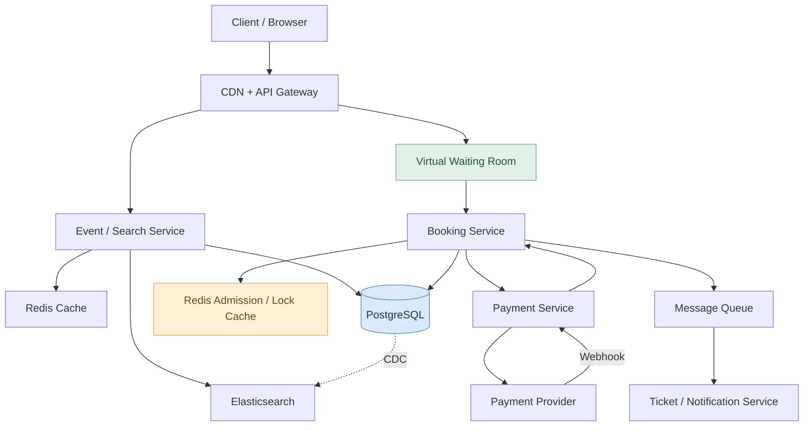

1. Requirment
	1. Functional
		1. Search events by artist, location, date
		2. View event details and available seat
		3. Temporarily reserve selected seats
		4. Purchases tickets and confirm booking
		5. View purchase history
	2. Non Functional
		1. Are seats assigned or general admission
			1. Assume assigned seating,each have unique identifier like A-12 , 
			2. Many users might select the exact same seat
		2. How long can user hold tickets? ->10min
		3. can users buy multiple seats tgt
			1. assume up to 6 per booking
		4. are we desiging for massive concert launches?
			1. YES
		5. Strong consistency for booking, never sell one seat twice
		6. Availability, user still can search events 
		7. Scalability : Millions of visitors
		8. Search latency <500ms
		9. Durability : Confirm booking persist
		10. Fault tolerance : Recover from services failures : Avoid lost payments or stuck reservations
		11. Authenticated booking and secure payments
	3. Event Search -> Eventual Consistency
	4. Ticket Booking -> Strong consistency
2. Scale
	1. 50M MAU
	2. Peak attendance capacity for 1 event : 50k
	3. Visitors during one launch 1M
	4. Arrival Window 10min
	5. Avg ticket hold duration :10min
	6. Read-to-write 100:1 
	7. if 1m visitors arrive within 10min(peak)
		1. 1M/600 = 1667 per second
	8. 100k events with an avg of 50k seats would need 5B record for seat
		1. if 1 record 500bytes? we would need 2.5TB
	9. if db can process 20k write per second, but what if 10k users simultaneously reserve one seat?
	10. This is a high contention problem 
3. High Level Design
	1. Split to read path and write path

.
	2. ![[Pasted image 20261019215028.png]]
5. API & DB Design
	1. API
		1. GET / events?query=Taylor
		2. GET /events/{eventId}
		3. GET /events/{eventId}/seats
		4. POST /events/{eventId}/holds
		5. POST /bookings/{bookingId}/checkout
		6. GET /bookings/{bookingId}
	2. DB Table
		1. Events![[Pasted image 20261019215255.png]]
		2. Tickets![[Pasted image 20261019215306.png]]
		3. Bookings![[Pasted image 20261019215351.png]]
		4. Payment![[Pasted image 20261019215402.png]]
	3. Why PostgreSQL > Cassandra![[Pasted image 20261019215431.png]]
		1. i think PostgreSQL provide atomic transactional ownership (strong consistency) > maximizing raw write throughput
6. Deep Dive
	1. Double Booking
		1. Solution A Atomic conditional update
			1. update ticket status to "HELD" with hold_id with 10min to lock for user
			2. Why not we just SELECT for UPDATE to execute SQL lock for 10min?
			3. it is only appropriate for a short transaction last ms
			4. Keeping it open we may 
				1. hold locks unnecessarily
				2. Increase contention and resource usage
				3. Complicate recovery and potentially cause timeout
		2. How about Redis distributed locking work?
			1. we can issue this in redis
			2. SET lock:event123:seatA12 hold-456 NX EX 600
			3. why? in Redis, locking is fast and TTL based auto expire
			4. However a redis lock alone should not be the final authority for a paid ticket
			5. what if redis crash when redis lock is acquired?
		3. So for a robus design, hybrid is selected
			1. Redis : Reject competing request before they reach the db
			2. Postgres : Last gate for final correctness to ensure one reservation can be confirmed
		4. is Redis need sharding?
		5. if user book multiple seats?
			1. ALL OR NOTHING (atomicty)
			2. so we have to lock all requested row and try transaction
		6. Payment
			1. Add a mid state like PENDING_PAYMENT to hold the booking first to avoid booking failed and get reserved by others
			2. What if payment webhook arrive twice 
				1. Idempotency key
		7. What if millions of user arriving together
			1. Thundering Herd Problem
			2. Solution : Virtual Waiting Room
				1. Assign queue position before they get into the website![[Pasted image 20261020010911.png]]
				2. Why dont just scale horizontally :Increasing server here dont slve the contention on the limited record
			3. How do we keep seat maps updated?
				1. SSE : Server push seat availability updates to client
				2. Websocket : Bidirectional communication
				3. Polling : Simpler fallback that refresh availability
			4. Failure Handling![[Pasted image 20261020012447.png]]
7. Trade Off
	1. ![[Pasted image 20261020013242.png]]
	
