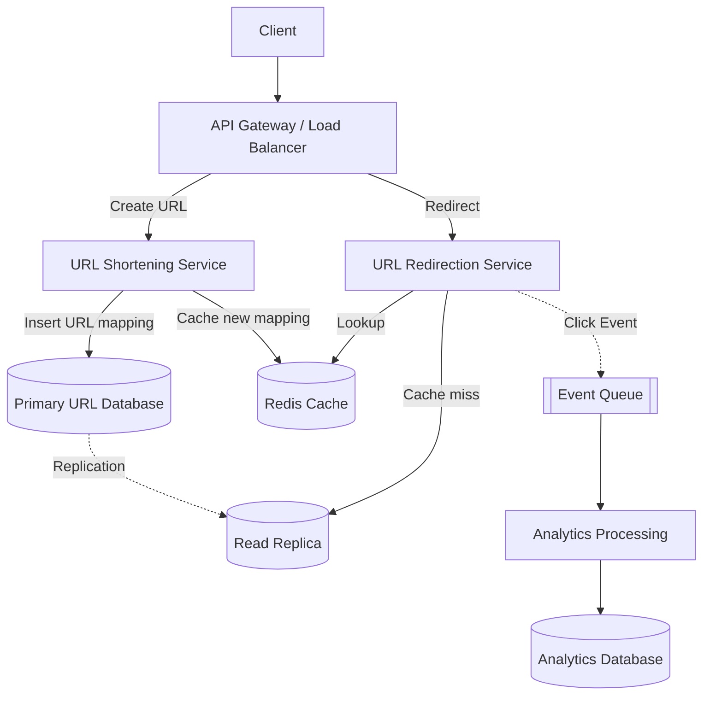
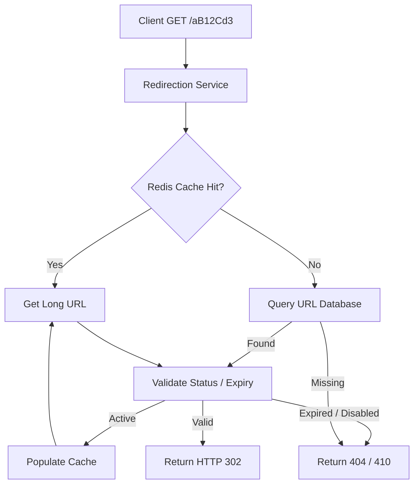
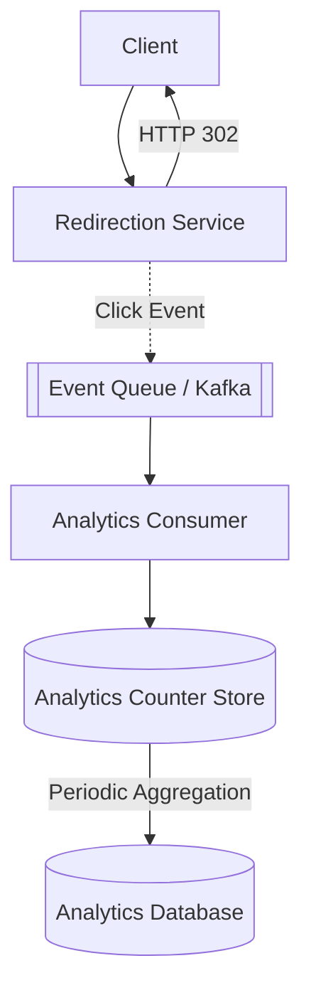
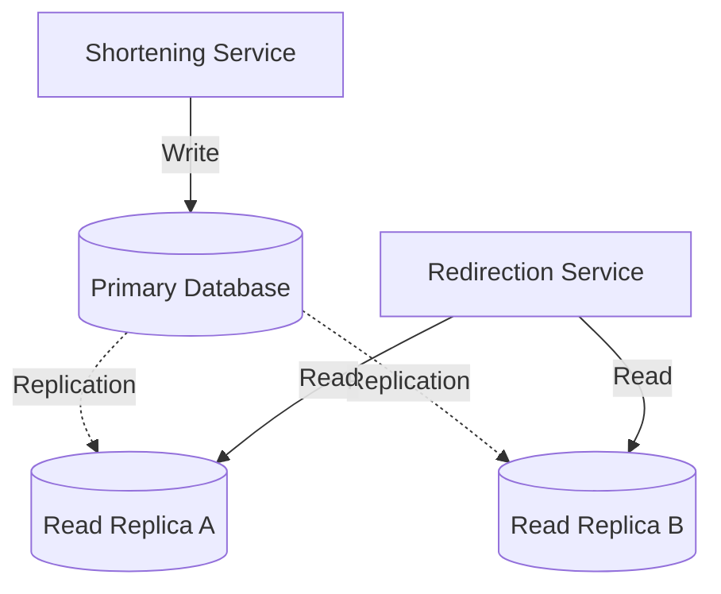
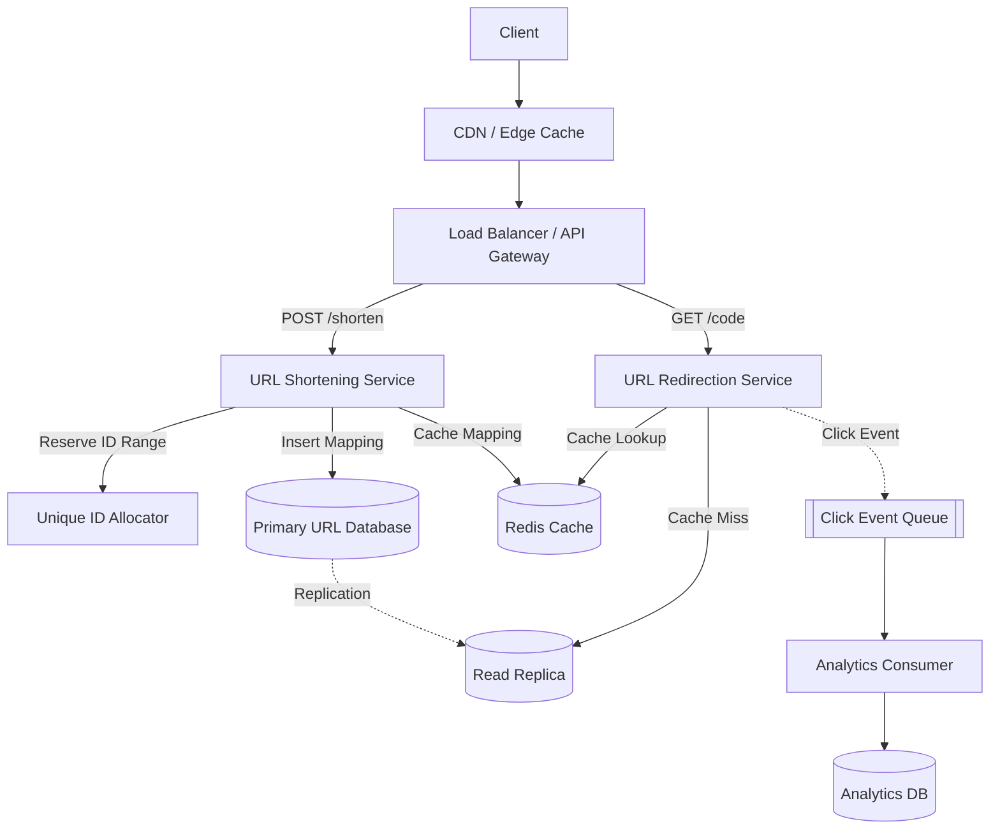
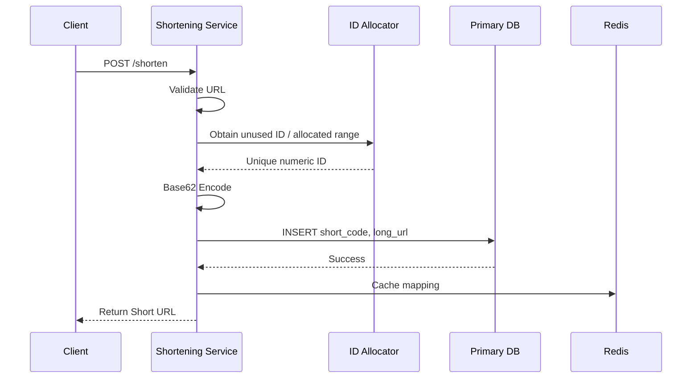
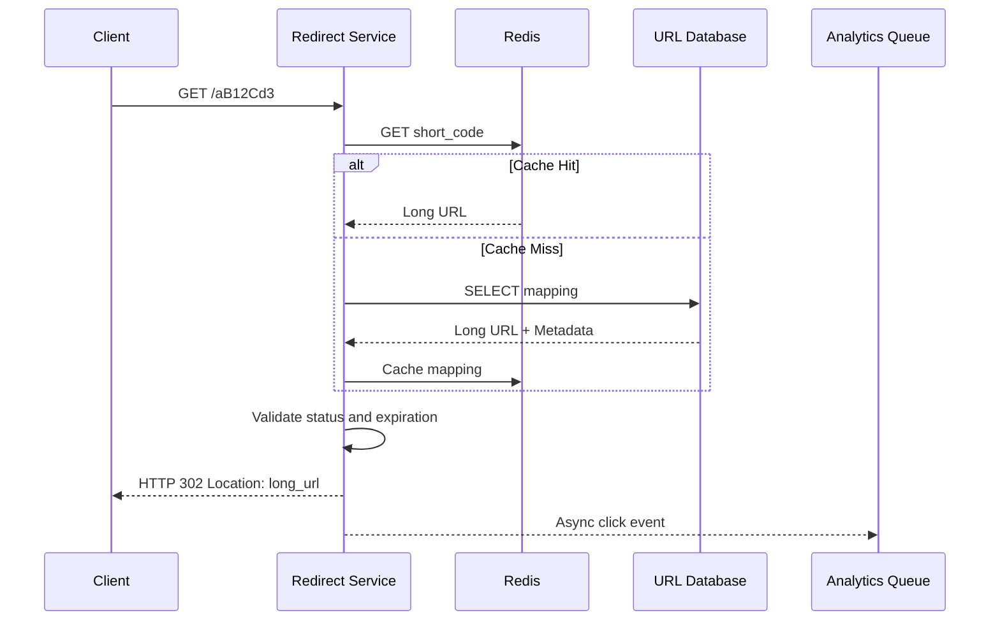

# Design a URL Shortener (TinyURL)
> **Goal:** Design a scalable URL shortening service supporting billions of links, fast redirection, unique short codes, and optional click analytics.

**Example:**
```text
Long URL:
https://shopee.com.my/products/iphone17?campaign=1111

Short URL:
https://short.ly/aB12Cd3
```
The system has three main responsibilities:
1. **URL Shortening:** Generate a unique short code.
2. **URL Redirection:** Resolve the short code to the original URL.
3. **Analytics (Optional):** Track how often links are accessed.

---
# 1. Requirement Gathering

## 1.1 Functional Requirements
1. **Shorten URL:** Convert a long URL into a unique short URL.
2. **Unique Short Code:** Every short code maps to one URL record.
3. **URL Redirection:** Redirect users from short URLs to the original URL.
4. **Custom Alias (Optional):** Allow users to select a short code.
5. **Expiration (Optional):** Allow links to expire.
6. **Analytics (Optional):** Track clicks and traffic.

**Clarification:** Multiple short URLs may point to the same long URL. Uniqueness refers to the short code, not necessarily the destination URL.

## 1.2 Non-Functional Requirements
| Requirement | Description |
|---|---|
| Low Latency | Redirect users quickly, ideally served from cache |
| High Availability | Redirects should continue during individual server failures |
| Scalability | Support billions of links and high read traffic |
| Durability | Stored URL mappings should survive server failures |
| Unique IDs | Avoid collisions between different short codes |
| Read-Heavy | Redirect traffic greatly exceeds URL creation traffic |

### Traffic Estimation
Assumptions:
```text
100M Daily Active Users
10 redirects/user/day
0.1 new links/user/day

Reads:
100M × 10 = 1B redirects/day
1B / 86,400 ≈ 11,574 reads/sec

Writes:
100M × 0.1 = 10M new links/day
10M / 86,400 ≈ 116 writes/sec
```
Assume peak traffic is 10× average:
```text
Peak Reads ≈ 116K RPS
Peak Writes ≈ 1.2K RPS
```
**Why estimate peak traffic?** Popular links and special events can generate sudden traffic spikes. We should design for peak load rather than only average usage.

### Storage Estimation
Assume:
```text
5B URLs stored over system lifetime
Average record size = 1KB
```
Storage:
```text
5B × 1KB ≈ 5TB raw data

With replication factor 3:
5TB × 3 ≈ 15TB
```
This excludes indexes, backups, metadata, and storage overhead.

**Important:** Storage estimates should be based on URL records, not Pastebin text content. Our system stores URL mappings, not pasted documents.

### Read/Write Ratio
```text
1B reads/day / 10M writes/day
= 100:1
```
**Design Decision:** Optimize heavily for fast reads using caching and read scaling.

---
# 2. API Design + Database Design

## 2.1 Create Short URL
```http
POST /api/urls/shorten
```
Request:
```json
{
  "long_url": "https://shopee.com.my/iphone",
  "custom_alias": null,
  "expires_at": null
}
```
Response:
```json
{
  "short_url": "https://short.ly/aB12Cd3",
  "short_code": "aB12Cd3"
}
```
### Why POST?
Because we are creating a new resource and storing a new mapping.

## 2.2 URL Redirection
```http
GET /aB12Cd3
```
Response:
```http
HTTP/1.1 302 Found
Location: https://shopee.com.my/iphone
```
The browser receives the redirect response and navigates to the original URL.

### 301 vs 302
| Status | Meaning | When to Use |
|---|---|---|
| 301 | Permanent Redirect | Stable links where caching is desirable |
| 302 | Temporary Redirect | Links requiring server-side analytics or possible changes |

**Why choose 302?** If the browser permanently caches a 301 redirect, future clicks may bypass our shortener service.

A 302 makes it easier to observe subsequent redirects, although caching headers must still be configured appropriately.

**Trade-off:** 301 can reduce server load, while 302 is more suitable when tracking clicks matters.

## 2.3 Database Design

### URL Mapping Table
| Attribute | Type | Purpose |
|---|---|---|
| short_code | VARCHAR(7) | Primary key |
| long_url | TEXT | Original destination |
| user_id | BIGINT | Link owner |
| created_at | TIMESTAMP | Creation time |
| expires_at | TIMESTAMP | Optional expiration |
| status | VARCHAR | Active, disabled, deleted |

Example:
```sql
CREATE TABLE urls (
    short_code VARCHAR(7) PRIMARY KEY,
    long_url TEXT NOT NULL,
    user_id BIGINT,
    created_at TIMESTAMP NOT NULL,
    expires_at TIMESTAMP,
    status VARCHAR(20) NOT NULL DEFAULT 'active'
);
```
### Why use short_code as Primary Key?
Most reads search using a short code:
```sql
SELECT long_url
FROM urls
WHERE short_code = 'aB12Cd3';
```
A primary-key lookup is efficient.

### Why not put click_count in this table?
Imagine one viral URL receives 100K clicks/sec.

If we update the same `click_count` row on every redirect, the database may experience severe write contention.

**Better:** Store analytics separately and aggregate counts asynchronously.

---
# 3. High-Level Design

We separate our system into:
1. URL Shortening Service
2. URL Redirection Service
3. Analytics Service

## 3.1 Overall Architecture

**Important:** The diagram is simplified. On a cache miss immediately after creation, the service may need to read from the primary database because the replica could be lagging.

### Why separate services?
**URL Shortening:** Write-oriented, responsible for creating unique mappings.

**URL Redirection:** Read-heavy, optimized for fast lookups.

**Analytics:** Processes click events without delaying redirects.

This allows each component to scale independently.

---
# 4. Deep Dives

## 4.1 Deep Dive 1 — How Do We Generate Unique Short URLs?

### Option A: Hash the Long URL
We could use:
- CRC32
- MD5
- SHA-256

Example:
```text
Long URL
   ↓
Hash Function
   ↓
Hash Result
   ↓
Take characters / encode
   ↓
Short Code
```
### Problem: Hash Collision
Different long URLs may produce the same shortened hash prefix.

```text
URL A → aB12Cd3
URL B → aB12Cd3
```
This becomes increasingly likely as the number of stored links grows.

CRC32 is particularly unsuitable as the complete identifier for billions of URLs because it provides only 32 bits of hash output.

### How Do We Handle Collisions?
1. Generate a candidate code.
2. Attempt to insert the mapping.
3. Database UNIQUE constraint checks whether the code already exists.
4. If a collision occurs, generate another candidate and retry.

### What About Bloom Filters?
Bloom Filters can help reject some definitely unused/absent candidates or reduce unnecessary lookups, but they cannot guarantee uniqueness.

**Important:** The database UNIQUE constraint is the final correctness mechanism.

### Better Option: Unique ID + Base62

Instead of hashing the long URL, generate a globally unique numeric ID.

```text
Unique ID = 123456789
   ↓
Base62 Encode
   ↓
Short Code
```
Base62 uses:
```text
0-9 = 10 characters
a-z = 26 characters
A-Z = 26 characters

Total = 62 characters
```
### Why Base62?
It represents large numbers using fewer characters.

A 7-character code supports:
```text
62^7 = 3,521,614,606,208

≈ 3.52 trillion possible codes
```
Our requirement is only 5 billion stored URLs, so the namespace has sufficient capacity.

### How Do We Generate Unique Numeric IDs?

**Option 1: Central Counter**
```text
ID 1
ID 2
ID 3
...
```
Problem: A single counter service introduces a dependency and may become a bottleneck.

**Option 2: Distributed Range Allocation**
```text
Server A → IDs 1–1000
Server B → IDs 1001–2000
Server C → IDs 2001–3000
```
Each server can generate IDs from its allocated range locally.

**Why choose this?**
- Avoids duplicate IDs.
- Reduces network requests.
- Supports multiple instances.
- Numeric IDs are easy to encode using Base62.

The central allocator must assign ranges atomically and durably.

**Option 3: Snowflake**
Use timestamp + worker ID + sequence number.

This is a good distributed ID generator, but a full 64-bit Snowflake ID may require around 11 Base62 characters.

Therefore, Snowflake isn't a direct fit if we require exactly seven characters.

### My Design Choice
Use **globally unique numeric IDs + Base62 encoding**, with distributed range allocation.

For each new URL:
```text
1. Obtain unused numeric ID
2. Convert ID to Base62
3. Pad to 7 characters if necessary
4. Insert mapping into database
5. Return short URL
```
Database uniqueness constraints provide an additional safety check.

### Additional Trade-off
Sequential numeric IDs are predictable.

If hiding creation patterns matters, we could use a reversible keyed permutation or randomly generated codes with uniqueness checks.

**Important:** Obfuscation doesn't replace authorization.

---

## 4.2 Deep Dive 2 — URL Redirection

This is our most important performance path because reads greatly exceed writes.

### Read Flow


In an implementation, we would avoid repeatedly performing the same validation. The diagram emphasizes that cached and database results must both respect link status and expiration.

### Why Redis?
Suppose:
```text
1B redirect requests/day
```
Without caching, almost every request may hit the database.

With Redis:
```text
GET short_code
   ↓
Cache Hit
   ↓
Return Long URL
```
This reduces database traffic and redirect latency.

### Cache-Aside Strategy
On a cache miss:
1. Read from database.
2. Validate mapping.
3. Store result in Redis with TTL.
4. Return redirect.

### Cache Expiration
If a URL expires in 10 minutes, cached data must not remain usable after expiration.

A suitable cache TTL should not extend beyond the link's expiration time.

For links that can be edited or deleted, invalidate or update their cached entries when changes occur.

### Problem: Read Replica Lag
Suppose:
```text
T=0: URL created and written to primary
T=1: User immediately opens short URL
T=2: Read replica hasn't received mapping
```
The replica returns "not found", although the URL exists.

### Solutions
- Cache the mapping after successful creation.
- On a replica miss, optionally check the primary.
- Use primary reads when read-after-write consistency is required.
- Avoid long negative-cache TTLs for missing links.

**Why not always read from primary?**
Read replicas can reduce load on the primary, especially with billions of redirects.

However, replicas don't automatically guarantee the latest data.

### What If Redis Is Down?
Fallback:
```text
Redis unavailable
   ↓
Read from database
```
The redirect service remains operational, but database traffic increases.

To prevent overload:
- Apply rate limits or load shedding.
- Use additional read replicas.
- Consider CDN/edge caching for suitable hot links.

---

## 4.3 Deep Dive 3 — Hot URL Problem

### Problem
Suppose a celebrity shares:
```text
https://short.ly/viral123
```
Millions of users click it simultaneously.

Even with Consistent Hashing, the same key may be stored on one Redis shard and become a hot key.

### Solution A: Redis Caching
Cache frequently accessed mappings.

This prevents repeated database lookups.

### Solution B: Local Memory Cache
Each redirect instance can keep a small cache of extremely popular mappings.

```text
Client
  ↓
Redirect Service
  ↓
Local Cache
  ↓ Cache Miss
Redis
  ↓ Cache Miss
Database
```
### Why?
A local cache can reduce repeated access to a single overloaded Redis key.

### Solution C: CDN / Edge Cache
Cache stable redirect responses closer to users.

```text
Client → CDN → Redirect Service
```
If a redirect is safely cached at the edge, many requests never reach our servers.

**Trade-off:** CDN/browser caching can reduce our ability to record every individual click at the origin.

### Solution D: Horizontal Scaling
Run multiple stateless redirection-service instances behind a load balancer.

### Important
Read replicas help the database, but they don't necessarily solve a hot key in Redis.

Use caching at multiple layers when traffic justifies the additional complexity.

---

## 4.4 Deep Dive 4 — Analytics

### Requirement
Optionally track:
- Total clicks per URL.
- Clicks per hour/day.
- Traffic sources.
- Geographic distribution, if needed and permitted.

### Problem
If every redirect updates the primary URL database:
```sql
UPDATE urls
SET click_count = click_count + 1
WHERE short_code = 'viral123';
```
A viral URL could cause massive write contention.

### Solution: Asynchronous Analytics



### How It Works
1. User accesses short URL.
2. Redirection service looks up the destination.
3. Redirect service emits a click event asynchronously.
4. User receives HTTP 302 without waiting for analytics processing.
5. Analytics consumers process events.
6. Counters or analytics tables are updated in batches.

### Why Use a Queue?
It separates redirect traffic from analytics processing.

The queue can absorb spikes while consumers process events at a sustainable rate.

### What If Analytics Service Is Down?
**If analytics are optional:**
- Continue redirecting users.
- Buffer events if possible.
- Accept that some analytics might be delayed or lost.

**If analytics must be reliable:**
- Use a durable event queue.
- Retry failed processing.
- Use event IDs or deduplication to reduce double counting.

### Why Not Write Every 60 Seconds to the URL Master?
It could still overload the URL mapping database and mix two different workloads.

**Better:** Maintain a separate analytics database.

### Important: Analytics May Be Eventually Consistent
If a link receives 100 clicks, the dashboard may temporarily show 95.

This is acceptable if near-real-time analytics are sufficient.

**Trade-off:** We gain redirect performance but sacrifice immediate counter freshness.

---

## 4.5 Deep Dive 5 — Database Scaling and Replication

### Primary + Read Replicas

### How Replication Works
1. Primary accepts mapping writes.
2. Changes are replicated to read replicas.
3. Redirect service can distribute database reads across replicas.

**Important Correction:** Read replicas generally receive changes from the primary. We don't write new URLs to read replicas first and then synchronize them back to the master.

### Do We Need Raft or Quorum?
Not necessarily.

For a basic URL shortener:
- One primary database handles writes.
- Read replicas support read scaling.
- A failover mechanism can promote an eligible replica.

We only need to discuss Raft in depth if the interviewer specifically asks for stronger distributed coordination or consensus guarantees.

### What If the Primary Database Crashes?
Possible response:
1. Existing links may still redirect using Redis and healthy read replicas.
2. New URL creation may temporarily fail.
3. A replica can be promoted through a safe failover process.
4. The system resumes writes after routing is updated.

**Trade-off:** With asynchronous replication, the latest acknowledged writes might not yet exist on a replica.

If losing an acknowledged mapping is unacceptable, stronger durability or replication guarantees are required.

### Database Sharding
For 5B URL records, we may eventually need to split the mapping database across multiple shards.

**Sharding Key:**
```text
hash(short_code)
```
### Why?
Most requests retrieve mappings by short code.

Hash-based sharding distributes keys across storage nodes and avoids placing all increasing numeric IDs into one range-based shard.

**Important:** We can start with database replication and introduce sharding when storage or throughput requirements justify it.

---

## 4.6 Deep Dive 6 — Expiration, Deletion and Custom Aliases

### URL Expiration
Each mapping can contain:
```text
expires_at
```
On redirect:
```text
if now >= expires_at:
    return 410 Gone
```
An expiration worker can remove old records later.

### Why Not Depend Only on Background Cleanup?
The cleanup worker may run late.

The redirect service must still check whether the link has expired.

### Custom Alias
Example:
```text
https://short.ly/iphone
```
### Problem
Two users request the same alias.

### Solution
Use a UNIQUE constraint on `short_code`.

If the alias already exists:
```http
409 Conflict
```
Return an error asking the user to choose another alias.

### URL Validation and Abuse Protection
URL shorteners can be abused to distribute phishing or malicious links.

Basic protections:
- Accept appropriate HTTP/HTTPS destinations.
- Validate URL format and length.
- Rate-limit shortening requests.
- Prevent reserved aliases.
- Support disabling reported malicious links.
- Avoid following arbitrary user-supplied URLs from internal services without SSRF protection.

**Interview Tip:** Mention security briefly. Don't spend most of the interview designing anti-abuse systems unless it's required.

---
# 5. Complete Architecture

## 5.1 Proposed Production Architecture

The diagram shows the normal paths. Newly created links may require a primary fallback on a replica miss, and cache failures should trigger appropriate database fallback.

## 5.2 Complete Write Flow

**Important:** If the database insert fails, don't return success. A skipped numeric ID is acceptable.

## 5.3 Complete Read Flow

**Why this design?**
- Cache-first reads reduce database traffic.
- Primary writes protect authoritative mappings.
- Asynchronous analytics avoids slowing down redirects.
- Stateless services scale horizontally.

---
# 6. Failure Handling + Trade-offs

## 6.1 Failure Scenarios

| Failure | Impact | Fallback |
|---|---|---|
| Redis unavailable | More database reads | Read from DB, apply load shedding |
| Primary DB down | Cannot create URLs normally | Promote healthy replica safely |
| Read replica lag | Newly created link may appear missing | Cache after creation or read primary |
| ID allocator down | New ID ranges unavailable | Continue using safely reserved ranges |
| Duplicate short code | URL collision | UNIQUE constraint + retry |
| Analytics service down | Analytics delayed | Queue events, continue redirects |
| Viral URL | Hot cache key | Local cache, Redis scaling, CDN |
| Shortening instance crashes | Some requests fail | Route to healthy instances |
| Expired URL still cached | Invalid link may redirect | Bound TTL and validate expiration |
| Network retry on POST | Duplicate logical creation | Optional idempotency key |

## 6.2 Key Trade-offs

| Decision | Advantage | Trade-off |
|---|---|---|
| 301 Redirect | Less origin traffic | Less reliable origin-side click tracking |
| 302 Redirect | Better tracking flexibility | More origin requests |
| Redis Cache | Fast redirection | Cache invalidation and extra infrastructure |
| Read Replica | Scale database reads | Replication lag |
| Base62 Counter | No hash collisions if IDs are unique | Predictable codes |
| Random Short Code | Harder to enumerate | Collision checking required |
| Async Analytics | Fast redirects | Delayed counters |
| Multi-AZ Replication | Better availability | Higher infrastructure cost |
| Database Sharding | Larger storage capacity | More complex operations |

## 6.3 What Should We Prioritize?

### Phase 1 — Basic Working System
- Shortening service.
- Redirection service.
- Unique ID + Base62.
- Database with unique short_code.
- HTTP 302 redirects.

### Phase 2 — Scaling
- Redis cache.
- Horizontal scaling of stateless services.
- Database read replicas.
- Rate limiting.
- Cache invalidation and expiration handling.

### Phase 3 — Advanced Scale
- Async analytics.
- Hot-key caching / CDN.
- Database sharding.
- Multi-AZ replication.
- Automated recovery and monitoring.

**Why this order?** Start with the simplest solution that satisfies requirements, then introduce complexity only when a clear bottleneck or failure mode justifies it.

---
# 7. Interview Summary

When asked **"Design a URL Shortener"**, I would explain:

> First, I would clarify requirements such as URL creation, redirection, uniqueness, expiration, and optional analytics.
>
> Since redirects greatly exceed URL creations, I would optimize the system for high read throughput and low latency.
>
> For short-code generation, I would use globally unique numeric IDs encoded in Base62. A seven-character Base62 code provides more than enough combinations for billions of URLs.
>
> For storage, I would maintain a URL mapping database with short_code as the primary key. A unique constraint prevents duplicate codes.
>
> For redirection, I would use Redis as a cache in front of the database. On a cache miss, the service reads the mapping and populates the cache.
>
> I'd use HTTP 302 redirects when accurate server-side analytics or URL updates are required.
>
> For analytics, I would publish click events asynchronously to an event queue and process them separately, rather than updating the URL database on every click.
>
> Finally, I would address hot URLs, replica lag, database failover, URL expiration, caching strategies, and scaling the database as the system grows.

---
# 8. Quick Revision

| Problem | Solution | Why |
|---|---|---|
| Long URL needs shortening | Base62 | Compact URL code |
| Duplicate short codes | Unique ID + DB constraint | Guarantee uniqueness |
| Many redirect requests | Redis | Reduce DB queries |
| Cache miss | DB fallback | Retrieve mapping |
| Database read overload | Read Replicas | Distribute reads |
| Viral URLs | Local Cache / CDN | Reduce hot-key traffic |
| Analytics write overload | Event Queue | Async processing |
| Need click counts | Analytics DB | Separate workload |
| DB primary crashes | Failover | Restore write availability |
| Replica lag | Primary fallback / cache on create | Support new-link reads |
| Database too large | Sharding | Distribute URL mappings |
| Temporary URL | expires_at | Enforce expiration |
| Custom Alias collision | UNIQUE constraint | Prevent duplicate aliases |
| Malicious link creation | Validation + Rate Limiting | Reduce abuse |

## Final Mental Model
```text
URL CREATION
├── Validate Original URL
├── Generate Unique ID
├── Encode Base62
├── Insert into Primary DB
└── Return Short URL

URL REDIRECTION
├── Receive Short Code
├── Check Cache
├── Database Fallback
├── Validate Link
└── Return HTTP 302

ANALYTICS
├── Emit Click Event
├── Event Queue
├── Analytics Consumer
└── Analytics Database

SCALABILITY
├── Stateless Services
├── Redis Cache
├── Read Replicas
├── Hot-Key Handling
└── Database Sharding

FAILURE HANDLING
├── Cache Fallback
├── Replica Lag Handling
├── Database Failover
├── Unique ID Allocation
└── Event Processing Recovery
```

> **Most Important Takeaway:** A URL shortener is primarily a read-heavy system. Use unique ID generation to ensure correct mappings, caching to minimize redirect latency, and asynchronous analytics to prevent click tracking from slowing down the critical redirect path.