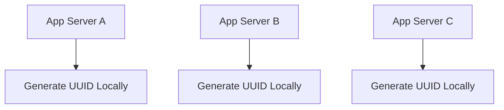
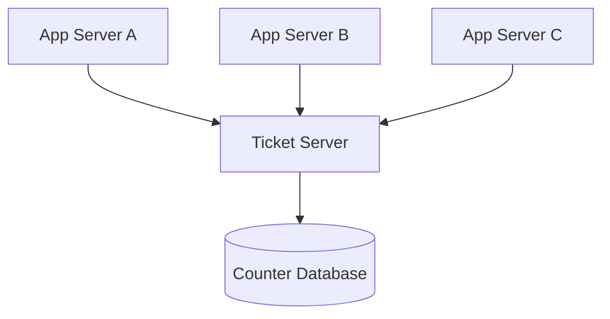
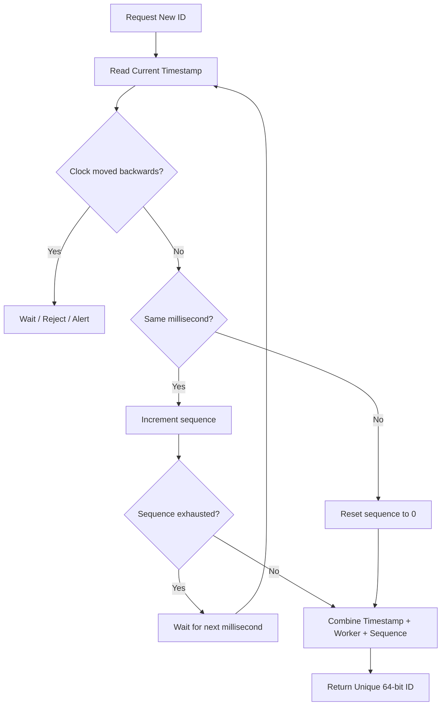
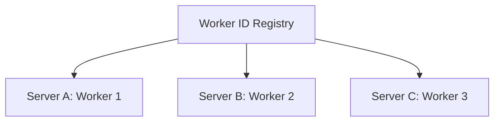
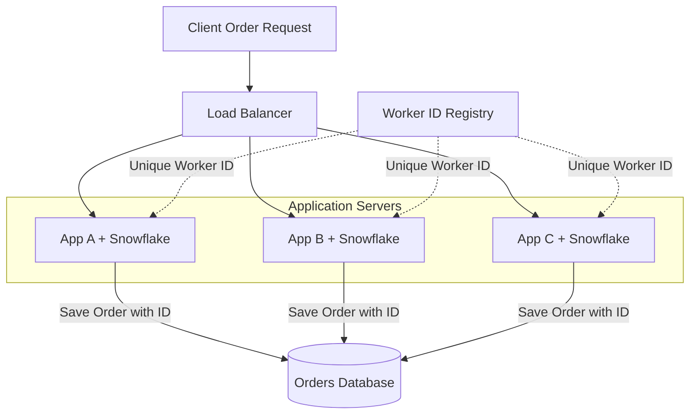
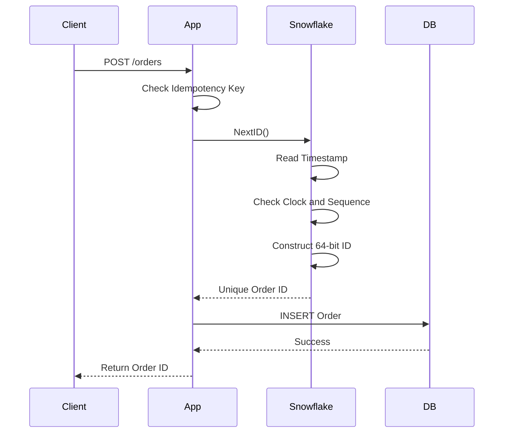

# Design a Distributed Unique ID Generator
> **Goal:** Generate globally unique, numeric, 64-bit IDs across multiple servers with low latency, high throughput, and no single point of failure.

**Practical Example:** Shopee Order ID Generator

Imagine Shopee has hundreds of application servers processing orders simultaneously. Each order needs a unique ID:
```text
Order A → 1001
Order B → 1002
Order C → 1003
```
If every database independently generates sequential IDs starting from 1, duplicate IDs may occur. We need a distributed solution that guarantees uniqueness without requiring every server to coordinate on every request.

---
# 1. Requirement Gathering

## 1.1 Problem
In a distributed application, multiple servers may create records simultaneously. We need a reliable way to generate unique IDs across all servers and data centers.

**Important:** UUIDv4 already makes collisions astronomically unlikely when generated correctly. Our main reason for exploring another solution is the additional requirement for **64-bit, numeric, approximately time-ordered IDs**.

## 1.2 Functional Requirements
| Requirement | Explanation |
|---|---|
| Uniqueness | Two different objects must not receive the same ID |
| Numeric | IDs contain only numbers |
| 64-bit | Each ID fits into a signed 64-bit integer |
| Time-sortable | Newer IDs should generally be larger |

**Clarification:** Time-sortable doesn't mean consecutive IDs.
```text
100001
100005
100009
```
Gaps are acceptable as long as uniqueness is maintained.

---
# 2. Non-Functional Requirements

## 2.1 High Throughput — 10,000 IDs/Second
We need to estimate how many IDs our system must generate.

### Traffic Estimation
Assumptions:
- 1 million Daily Active Users (DAU).
- Each active user generates 5 IDs per day on average.
- Peak traffic during events like 11.11 is 100 times normal average traffic.

Calculation:
```text
1,000,000 DAU × 5 IDs/day
= 5,000,000 IDs/day

5,000,000 / 86,400 seconds
≈ 58 IDs/second (average)

Peak traffic = 58 × 100
≈ 5,800 IDs/second

Target capacity = 10,000 IDs/second
```
**Why 10,000?** It provides headroom above our estimated peak.

**Important:** DAU alone doesn't determine QPS. We must estimate how many ID-generating operations each user performs. The 100× peak factor is an assumption that should be validated against real traffic.

## 2.2 Low Latency
ID generation should add minimal latency to our services.

**Why?** Every order creation may require an ID before it can be stored.

Ideally, generating an ID should happen locally without a network round trip.

## 2.3 High Availability
If one ID generator crashes, other generators should continue working.

We should avoid making a single centralized server necessary for every ID request.

---
# 3. Scalability

Our system should support:
- Multiple application services.
- Multiple generator instances.
- Multiple data centers.
- Horizontal scaling.
- No duplicate IDs when adding or removing servers.

**Example:**
```text
Malaysia:
  Generator 1
  Generator 2

Singapore:
  Generator 3
  Generator 4
```
All four generators must produce unique IDs without coordinating for every request.

**Key Question:** How do we guarantee uniqueness when different servers generate IDs at exactly the same time?

---
# 4. High-Level Design

We have four common approaches:

1. Multi-Master Auto-Increment
2. UUID
3. Ticket Server
4. Twitter Snowflake

## 4.1 Multi-Master Auto-Increment
### How It Works
Instead of every database generating the same sequence, assign different offsets and increments.

Example with two databases:
```text
Database A:
1, 3, 5, 7, 9

Database B:
2, 4, 6, 8, 10
```
Each database increments by 2.
```text
nextID = previousID + increment
```
With three databases:
```text
DB A: 1, 4, 7, 10
DB B: 2, 5, 8, 11
DB C: 3, 6, 9, 12
```
### Advantages
- Simple to implement.
- Numeric IDs.
- No collision if offsets and increments are managed correctly.

### Disadvantages
- Adding or removing database generators requires careful reconfiguration.
- IDs are not guaranteed to reflect global creation-time order.
- Managing offsets across many servers becomes complicated.

**Important Correction:** Clock synchronization isn't what prevents collisions here. Uniqueness comes from assigning non-overlapping sequences.

**When to use:** Small or moderately distributed database deployments where generator membership changes infrequently.

## 4.2 UUIDv4
### How It Works
Each server generates a random 128-bit UUID locally.
```text
550e8400-e29b-41d4-a716-446655440000
```

### Advantages
- No centralized ID service.
- Easy horizontal scaling.
- No network communication per ID.
- Extremely low collision probability with proper randomness.

### Disadvantages
- 128 bits instead of 64 bits.
- UUIDv4 doesn't preserve creation-time order.
- Random values may cause less efficient B-tree index locality.

### Improvement: UUIDv7
UUIDv7 includes a timestamp component.

Benefits:
- Approximately time-ordered.
- Better index locality than random UUIDv4 in many databases.
- Still decentralized.

**Trade-off:** UUIDv7 is still 128 bits, so it doesn't meet our strict 64-bit requirement.

## 4.3 Ticket Server
### How It Works
Create a centralized service responsible for issuing sequential IDs.

Example:
```text
Server A requests ID → 1001
Server B requests ID → 1002
Server C requests ID → 1003
```
### Advantages
- Simple concept.
- Sequential numeric IDs.
- Centralized uniqueness control.

### Disadvantages
1. A single ticket server could become a single point of failure.
2. Every ID request adds network latency.
3. The counter service may become a bottleneck.

### Improvement: Batch / Range Allocation
Instead of requesting one ID at a time, each application can reserve a range.
```text
Server A reserves 1000–1999
Server B reserves 2000–2999
Server C reserves 3000–3999
```
Each server generates IDs locally from its allocated range.

**Why is this better?** We reduce network requests and can scale the allocation service using appropriate coordination.

**Trade-off:** Unused IDs may create gaps. The allocator must ensure ranges never overlap, including during failover.

## 4.4 Twitter Snowflake
### How It Works
Construct an ID from three main pieces:
```text
Timestamp + Machine Identity + Sequence Number
```
Example:
```text
Timestamp = 1000
Machine ID = 3
Sequence = 0

Timestamp = 1000
Machine ID = 3
Sequence = 1

Timestamp = 1000
Machine ID = 4
Sequence = 0
```
All three IDs are unique because their combined fields differ.

### Why Snowflake?
- 64-bit numeric IDs.
- No centralized service required per ID.
- Approximately time-ordered.
- High throughput.
- Easy to scale by adding uniquely identified workers.

## 4.5 Comparison
| Approach | Distributed | 64-bit | Time-Ordered | Main Trade-off |
|---|---|---|---|---|
| Multi-master increment | Yes | Yes | No | Difficult reconfiguration |
| UUIDv4 | Yes | No | No | Random, 128-bit |
| Ticket server | Central allocation | Yes | Allocation order | Network dependency |
| Snowflake | Yes | Yes | Approximately | Clock and worker ID management |
| UUIDv7 | Yes | No | Approximately | 128-bit |

**Decision:** Choose Snowflake because it meets our 64-bit, high-throughput, approximately time-ordered requirements.

---
# 5. API + Database Design

## 5.1 API Design
With Snowflake, we don't necessarily need a separate ID-generation HTTP service.

Each application instance can use a local generator library:
```go
orderID, err := snowflake.NextID()
```
Then create the order:
```go
order := Order{
    ID:     orderID,
    UserID: 101,
}
```
### Why Local Generation?
It eliminates the network round trip needed to request each ID from a centralized service.

### Alternative: Dedicated ID Service
If multiple languages or services need centralized control, we can expose:
```text
POST /ids/next

Response:
{
  "id": "193485670201"
}
```
**Trade-off:** Easier central management, but adds network latency and service dependencies.

## 5.2 Database Design
Example:
```sql
CREATE TABLE orders (
    order_id BIGINT PRIMARY KEY,
    user_id BIGINT NOT NULL,
    created_at TIMESTAMP NOT NULL
);
```
**Why BIGINT?** Snowflake IDs fit into signed 64-bit integers when the sign bit is kept at zero.

<mark style="background:#ff4d4f">### Important: JavaScript Precision</mark>
JavaScript's regular Number type can only represent integers exactly up to:
```text
2^53 - 1
```
Snowflake IDs may exceed that limit.

Therefore, when sending IDs to JavaScript clients, represent them as decimal strings:
```json
{
  "order_id": "1934856702012345678"
}
```
The database can still store the ID as BIGINT.

### What About Duplicate Order Requests?
A unique ID generator doesn't prevent the same business request from creating two orders.

Example:
```text
Client creates order → ID 1001
Response times out
Client retries → ID 1002
```
Now the same intended order might exist twice.

**Solution:** Use an idempotency key at the business API layer.

Snowflake ensures unique IDs; idempotency ensures the same logical operation isn't performed twice.

---
# 6. Deep Dive + Failure Handling

## 6.1 How Snowflake Works

### 64-Bit Snowflake Structure
```text
| Sign | Timestamp | DC ID | Machine ID | Sequence |
|  1   |    41     |   5   |     5      |    12    |

Total = 64 bits
```
| Component | Bits | Purpose |
|---|---:|---|
| Sign | 1 | Always 0, keeps ID positive |
| Timestamp | 41 | Milliseconds since custom epoch |
| Datacenter ID | 5 | Distinguishes data centers |
| Machine ID | 5 | Distinguishes workers within a DC |
| Sequence | 12 | Distinguishes IDs within the same millisecond |

### Timestamp — 41 Bits
```text
timestamp = currentTimeMillis - customEpochMillis
```
Using a custom epoch allows us to store elapsed milliseconds rather than the full Unix timestamp.

Capacity:
```text
2^41 milliseconds ≈ 69.7 years
```
**Why timestamp?** It makes IDs approximately sortable by creation time.

### Datacenter ID — 5 Bits
```text
2^5 = 32 datacenter IDs
```
Example:
```text
DC 1 → Malaysia
DC 2 → Singapore
```
These are logical identifiers and don't necessarily need to correspond one-to-one with actual countries.

### Machine ID — 5 Bits
```text
2^5 = 32 machines per DC
```
Total unique worker identities:
```text
32 × 32 = 1,024
```
**Why machine ID?** Two generators can produce IDs in the same millisecond without collisions.

### Sequence — 12 Bits
```text
2^12 = 4,096 sequences
```
A worker can generate up to 4,096 IDs in the same millisecond.

Theoretical throughput:
```text
4,096 × 1,000
= 4,096,000 IDs/second per worker
```
**Important:** This is a theoretical sequence capacity, not guaranteed real-world throughput.

### ID Construction
```go
id := (timestamp << 22) |
      (datacenterID << 17) |
      (machineID << 12) |
      sequence
```
Why shift timestamp by 22?
```text
5 DC bits + 5 Machine bits + 12 Sequence bits = 22 bits
```
We place the timestamp above those lower bits.

### Generation Example
```text
Same Worker, Same Millisecond:

Timestamp 1000, Worker 1, Seq 0 → Unique ID A
Timestamp 1000, Worker 1, Seq 1 → Unique ID B

Different Worker, Same Millisecond:

Timestamp 1000, Worker 2, Seq 0 → Unique ID C
```
All IDs differ.

## 6.2 Snowflake Generation Flow


## 6.3 Failure 1 — Clock Moves Backwards

### Problem
Imagine Worker A generates:
```text
Timestamp = 1000
Worker = 5
Sequence = 0
```
Then the system clock moves backwards and eventually returns to timestamp 1000.

If the sequence resets or generator state is lost, the worker could generate the same ID again.

### Detection
```go
if now < lastTimestamp {
    return errors.New("clock moved backwards")
}
```
### Fallback Solutions
1. **Small clock rollback:** Wait until the clock catches up.
2. **Large clock rollback:** Temporarily reject ID generation and alert operators.
3. **Monitoring:** Synchronize clocks using NTP and monitor clock drift.
4. **Restart safety:** Persist or safely recover the last-used timestamp, or use a safe worker identity lifecycle.

**Important:** Checking `lastTimestamp` in memory is insufficient if the process restarts and loses its previous state.

**Trade-off:** Waiting preserves uniqueness but temporarily increases latency or reduces availability.

## 6.4 Failure 2 — Two Machines Receive the Same Worker ID

### Problem
```text
Server A:
DC = 1
Machine = 5

Server B:
DC = 1
Machine = 5
```
If both generate:
```text
Timestamp = 1000
Sequence = 0
```
The generated IDs will be identical.

### Solution: Unique Worker Assignment
Use a coordination system such as:
- ZooKeeper
- etcd
- A reliable worker ID registry


At startup:
1. Worker requests an available ID.
2. Registry assigns a unique identity.
3. Worker begins generating Snowflake IDs locally.
4. Worker maintains its ownership of that identity.

### Important: Leases and Fencing
A worker ID should never be used by two active generators simultaneously.

If worker IDs are allocated through expiring leases, an isolated old worker must stop generating IDs when it can no longer safely retain its lease.

Otherwise, the registry might reassign its ID while the old worker is still running.

**Trade-off:** Coordination is needed for safe worker assignment, but not for every generated ID.

## 6.5 Failure 3 — More Than 4,096 IDs in One Millisecond

### Problem
The sequence field has 12 bits:
```text
0 ... 4095
```
What happens when request 4,097 arrives in the same millisecond?

### Solution A: Wait
Wait until the next millisecond, then reset the sequence to zero.

```text
At timestamp 1000:
Sequence 0 ... 4095

At timestamp 1001:
Sequence resets to 0
```
### Solution B: Scale Horizontally
Add more generators with different worker IDs.

### Solution C: Adjust Bit Allocation
For example:
```text
Timestamp: 41 bits
Worker ID: 8 bits
Sequence: 14 bits
Sign:      1 bit
```
This provides more sequence capacity but fewer distinct worker identities.

**Trade-off:** Increasing sequence bits reduces the bits available for other fields because the total must remain 64.

## 6.6 Failure 4 — Different Servers Have Different Timestamps

### Problem
Imagine:
```text
Server A clock: 10:00:00.010
Server B clock: 10:00:00.008
```
Server A generates an ID first.

Server B generates another ID afterward, but its clock is 2ms behind.

### Will this cause duplicate IDs?
**Not necessarily.**

If A and B have different worker identities, their IDs remain unique even when their timestamps match or differ.

### What Is the Actual Problem?
**Global ordering may be incorrect.**

Example:
```text
Real Event Order:
1. Server A creates Order A.
2. Server B creates Order B.

Snowflake Numeric Order:
Order B ID < Order A ID
```
This can happen because B's clock is behind A's.

### Fallback Solutions
1. **NTP:** Keep server clocks synchronized.
2. **Clock Monitoring:** Alert when clock drift exceeds a threshold.
3. **Local Monotonicity:** Prevent a worker from using timestamps lower than those it already issued.
4. **Strict Global Ordering:** Use a centralized or consensus-backed sequencer when true global ordering is mandatory.

### Trade-off
| Solution | Benefit | Cost |
|---|---|---|
| NTP | Reduces clock differences | Doesn't eliminate all drift |
| Local timestamp guard | Prevents local backward movement | May block or delay generation |
| Logical timestamp techniques | Can help maintain local order | More implementation complexity |
| Central sequencer | Can provide strict allocation order | Network latency and coordination bottleneck |

**Important Interview Point:** Snowflake provides approximate chronological order, not strict global order.

## 6.7 Failure 5 — ID Generator Crashes

### Problem
What happens if one generator crashes while processing an order?

### Solution
Other generators continue producing IDs because they have distinct worker identities.

```text
Generator A → Down
Generator B → Healthy
Generator C → Healthy
```
The load balancer or application routing can send subsequent work to B or C.

### Recovery Considerations
- A restarted generator must not accidentally reuse unsafe timestamp/sequence combinations.
- Worker identity reuse must be coordinated.
- The business operation must handle retries safely.

**Trade-off:** Snowflake removes per-request coordination, but safe worker lifecycle management is still important.

## 6.8 Failure 6 — Worker ID Registry Is Down

### Problem
ZooKeeper or etcd becomes unavailable.

Can existing generators continue?

### Fallback
Existing generators may continue generating IDs **if their worker identity ownership remains valid and safe**.

New generators may be unable to obtain IDs until the registry recovers.

If identity leases cannot be renewed, generators may need to stop rather than risk duplicate worker assignment.

### Improvement
- Run the registry as a highly available cluster.
- Monitor lease renewal failures.
- Use fencing and safe shutdown behavior.
- Avoid consulting the registry on every ID request.

---
# 7. Final Architecture

## 7.1 Distributed Snowflake Architecture

### How It Works
1. App server starts and safely obtains a unique worker identity.
2. Client sends an order request.
3. Load balancer forwards the request to an application instance.
4. Application generates a Snowflake ID locally.
5. Application inserts the order into the database using that ID.
6. Application returns the order result.

**Why this architecture?**
- No network request for every generated ID.
- Horizontal scalability.
- Multiple servers can generate IDs simultaneously.
- Failure of one application instance doesn't stop others.
- Worker identity coordination happens separately from ID generation.

## 7.2 Complete Order Creation Flow

This is a simplified successful request flow. In production, idempotency checking and order creation need appropriate atomic database handling so concurrent retries cannot create duplicate logical orders.

---
# 8. Trade-offs + Improvements

## 8.1 Important Trade-offs
| Decision | Advantage | Trade-off |
|---|---|---|
| Snowflake | Fast local generation | Depends on clocks and unique workers |
| UUIDv4 | Simple and decentralized | 128-bit, random ordering |
| UUIDv7 | Time-ordered, decentralized | 128-bit |
| Ticket server | Simple centralized sequencing | Extra network dependency |
| Batch ID allocation | Fewer network requests | Gaps and range management |
| More sequence bits | More IDs per millisecond | Fewer bits for workers or time |
| More worker bits | More generator identities | Less sequence or timestamp capacity |
| Wait on clock rollback | Protects uniqueness | Temporary latency/unavailability |
| Central worker registry | Prevents identity collisions | Coordination overhead |
| NTP synchronization | Improves time accuracy | Doesn't guarantee global ordering |

## 8.2 Improvement 1 — Use Batch Allocation When Strict Ordering Isn't Required
A centralized allocator can issue blocks of IDs.

Example:
```text
App A → 1000–1999
App B → 2000–2999
```
This reduces network latency compared with requesting every individual ID.

**When useful:** Systems that want numeric IDs but don't require timestamps embedded in them.

## 8.3 Improvement 2 — Monitoring and Alerts
Monitor:
- ID generation throughput.
- p99 generation latency.
- Clock rollback events.
- Clock drift between servers.
- Worker ID assignment conflicts.
- Sequence exhaustion.
- Worker lease renewal failures.
- Remaining timestamp lifetime.

**Why?** Snowflake errors can be rare but serious. Duplicate ID incidents may affect many downstream systems.

## 8.4 Improvement 3 — Concurrency Safety
Multiple goroutines may call `NextID()` on the same worker simultaneously.

Without synchronization:
```text
Goroutine A reads sequence = 5
Goroutine B reads sequence = 5
```
Both could generate the same ID.

### Solution
Use a mutex or correctly implemented atomic sequence management to protect each worker's timestamp and sequence state.

**Important:** Snowflake eliminates coordination between different uniquely identified workers, but each worker still needs safe local concurrency handling.

## 8.5 Improvement 4 — Choose the Right ID Strategy
Not every application needs Snowflake.

| Requirement | Good Option |
|---|---|
| Small application, one database | Auto-increment / DB sequence |
| Distributed, 128-bit acceptable | UUIDv7 |
| Distributed, 64-bit, approximately time-ordered | Snowflake |
| Centralized numeric ID allocation | Ticket server |
| Reduce centralized request overhead | Batch / Range Allocation |
| Strict global allocation order | Centralized or consensus-backed sequencer |

**Key Point:** Choose the simplest design that satisfies the actual requirements.

## 8.6 Improvement 5 — Security and Privacy
Snowflake IDs reveal some structural information:
- Approximate creation time.
- Generator identity bits.
- Some information about ID generation patterns.

They are not random secret tokens.

**Do not use Snowflake IDs as authentication credentials or authorization checks.**

Always verify that the requesting user has permission to access the resource.

## 8.7 Improvement 6 — Database Index Performance
Time-ordered IDs can improve insertion locality in a B-tree index compared with fully random identifiers.

**Why?** Newer IDs tend to be inserted near the end of the index rather than at random positions.

But this depends on database implementation and workload.

Sequential or time-ordered IDs can also create hot insertion ranges under heavy concurrent workloads.

Therefore, time ordering helps some workloads but isn't universally optimal.

---
# Interview Summary

If the interviewer asks **"Design a Distributed Unique ID Generator"**, I would explain:

> First, I would clarify the requirements: globally unique, numeric, 64-bit, approximately time-ordered IDs, supporting at least 10,000 IDs per second with low latency and high availability.
>
> I would compare multi-master auto-increment, UUID, ticket servers, and Snowflake.
>
> I would choose Snowflake because each generator can produce IDs locally without requesting a new value from a central service.
>
> A Snowflake ID contains a 41-bit timestamp, 5-bit datacenter ID, 5-bit machine ID, and 12-bit sequence, plus one sign bit.
>
> The timestamp provides approximate chronological ordering, machine identity prevents collisions across workers, and sequence numbers distinguish IDs generated within the same millisecond.
>
> For failure handling, I would detect clock rollback, safely assign unique worker IDs using a registry, wait when the sequence is exhausted, and ensure thread-safe local generation.
>
> I would also monitor clock drift, protect worker leases, and use idempotency at the business API layer to prevent duplicate logical operations.

---
# Quick Revision Table

| Problem | Solution | Why |
|---|---|---|
| Duplicate IDs across independent counters | Non-overlapping sequences | Prevent collisions |
| UUIDv4 doesn't meet requirements | Snowflake / UUIDv7 | Meet ordering or size needs |
| Central ID service bottleneck | Local Snowflake generation | Remove per-ID network calls |
| Same millisecond across servers | Unique Worker ID | Distinguish generators |
| Same millisecond on one worker | Sequence Number | Distinguish local IDs |
| Clock moves backwards | Detect, wait, reject | Avoid timestamp reuse |
| Duplicate Worker IDs | Registry + Fencing | Ensure exclusive identity |
| More than 4096 IDs/ms | Wait or scale workers | Prevent sequence overflow |
| Different server clocks | NTP + Monitoring | Reduce ordering errors |
| Strict global order required | Central/Consensus Sequencer | Coordinate global ordering |
| Multiple goroutines generate IDs | Mutex / Atomic State | Prevent local races |
| Generator crashes | Other healthy workers | Maintain availability |
| Registry unavailable | Valid leases / Fail-safe behavior | Avoid unsafe identity reuse |
| Duplicate business requests | Idempotency Key | Prevent duplicate operations |
| JavaScript precision issue | Serialize ID as String | Avoid losing integer precision |

## Final Mental Model
```text
UNIQUENESS
├── Timestamp
├── Worker Identity
└── Sequence Number

SCALABILITY
├── Local ID Generation
├── Multiple Workers
└── No Per-ID Coordination

AVAILABILITY
├── Independent Generators
├── Worker Registry HA
└── Safe Worker Recovery

CORRECTNESS
├── Clock Rollback Detection
├── Unique Worker Assignment
├── Thread-Safe Sequence
└── Sequence Overflow Handling

IMPROVEMENTS
├── NTP Monitoring
├── Worker Leases + Fencing
├── Batch Allocation Alternative
├── Idempotency Keys
└── Database Index Optimization
```

## Most Important Takeaway
**Snowflake generates unique IDs by combining Time + Worker Identity + Sequence Number.**

- **Timestamp:** WHEN was the ID generated?
- **Worker ID:** WHICH generator created the ID?
- **Sequence:** WHICH ID was generated within that millisecond?

This eliminates the need for centralized coordination on every ID request.

**But Snowflake still requires correct clock handling, safe worker identity assignment, and thread-safe local generation.**

> **Interview Tip:** Start with the requirements, explain why simpler approaches don't fully satisfy them, then introduce Snowflake and discuss how it handles failures.